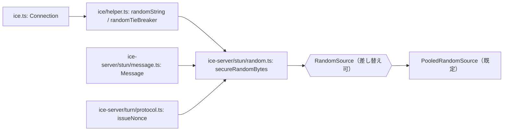

---
ide:
  viewer: review-document
  version: 1
  title: "ICE 初期化経路の同期 randomBytes 排除"
  dock: right
  baseCommit: 446a69fce38a1d73738232819a7f8a261bd1438b
---
# ICE 初期化経路の同期 `randomBytes()` 排除

## 1. 概要

ICE の credentials、tie-breaker、STUN/TURN のトランザクション ID の乱数取得を、差し替え可能な `RandomSource` 1 か所に集約しました。デフォルト実装は非同期補充プールで、プールが足りないときだけ同期フォールバックします。あわせて `Connection` 生成時の credentials 二重生成をなくしました。

堅牢性の改善であり、公開 API・乱数の長さ・形式は変えていません。ufrag は hex 4 文字、password は hex 22 文字、tie-breaker は 64 bit、トランザクション ID は 96 bit のままです。

  

    <strong>Before</strong> 各所が <code>crypto.randomBytes()</code> を直接呼ぶ。 credentials はフィールド初期化子と <code>restart()</code> で 2 回生成。 テストから遅延・失敗を注入できない。
  

  

    <strong>After</strong> すべて <code>secureRandomBytes()</code> 経由。 credentials 生成は 1 回。 <code>setRandomSource()</code> で差し替え可能。 補充済みなら同期 entropy API を呼ばない。
  

## 2. 主要変更

### 乱数ソース（新規）

[packages/ice-server/src/stun/random.ts:1](review-file:packages/ice-server/src/stun/random.ts:1) を追加しました。`ice` は `ice-server` を相対 import しており、依存は `ice` → `ice-server` の一方向です。そのためヘルパーは `ice-server` 側に置いています。

- `RandomSource`: `bytes(length)` だけを持つインターフェースです。
- `PooledRandomSource`: 512 バイトのプールを `crypto.randomFill`（callback 版）で非同期に補充します。残量が 128 バイト未満になると補充を 1 本だけ予約します。足りないときは `randomFillSync` に落ちます。払い出したバイトはプール内でゼロ埋めし、同じバイトを 2 回返しません。補充が失敗した場合は `debug` ログを出してプールを破棄し、同期フォールバックへ戻ります。
- `setRandomSource()` / `getRandomSource()`: `@internal` の差し替え口です。引数なしで既定のプールに戻ります。
- `secureRandomBytes()`: 返却長が要求と違えば `RangeError` を投げます。`randomTransactionId()` は 12 バイトを返します。

変更の核: [packages/ice-server/src/stun/random.ts](review-diff:packages/ice-server/src/stun/random.ts:1)

### ice-server 側の利用箇所

- [packages/ice-server/src/stun/message.ts:151](review-file:packages/ice-server/src/stun/message.ts:151): `Message` の default 引数を `randomTransactionId()` に変更しました。ほぼ全リクエストの ID はここから生成されます。差分は [message.ts](review-diff:packages/ice-server/src/stun/message.ts:151) です。
- [packages/ice-server/src/turn/protocol.ts:1072](review-file:packages/ice-server/src/turn/protocol.ts:1072): `issueNonce()` を `secureRandomBytes(16)` に変更しました。チケットでは任意の項目でしたが、ついでに揃えています。

### ice パッケージ

- [packages/ice/src/helper.ts:1](review-file:packages/ice/src/helper.ts:1): `randomString` を `secureRandomBytes` 経由にし、`randomTieBreaker()` を追加しました。ソース関連のシンボルも re-export します。差分は [helper.ts](review-diff:packages/ice/src/helper.ts:1) です。
- [packages/ice/src/ice.ts:57](review-file:packages/ice/src/ice.ts:57): `localUsername` / `localPassword` の初期化子を `""` に変更しました。これで二重生成がなくなります。`tieBreaker` は `randomTieBreaker()` を使います（[ice.ts:96](review-file:packages/ice/src/ice.ts:96)）。`crypto` の import も消えました。
- [packages/ice/src/ice.ts:236](review-file:packages/ice/src/ice.ts:236): credentials 生成を `generateLocalCredentials()` に切り出しました。`localPasswordPrefix` の置換挙動はそのままです。
- [packages/ice/src/ice.ts:257](review-file:packages/ice/src/ice.ts:257): `restart()` の本体を同期の `restartSync()` に分けました。constructor は [ice.ts:179](review-file:packages/ice/src/ice.ts:179) でこれを直接呼びます。変更の核は [ice.ts](review-diff:packages/ice/src/ice.ts:257) です。

### テスト

- [packages/ice/tests/ice/random.test.ts:14](review-file:packages/ice/tests/ice/random.test.ts:14): 11 件を追加しました。内訳は、各 1 回の取得、形式維持、ID の重複なし、失敗の伝播、`restart()` 失敗時の不変性、空プール・補充遅延・補充失敗のフォールバック、再利用なし、補充済みで同期 API を呼ばないこと、です。
- [packages/ice/tests/utils.ts:1660](review-file:packages/ice/tests/utils.ts:1660): 共通 Arrange（`useRandomSource`、記録用・失敗用ソース、制御可能なプール）を追加しました。

## 3. 判断理由

- **非同期の `Connection` 生成（案 A）は不採用**: `RTCIceGatherer` の constructor と `localParameters` の同期参照が壊れ、`packages/webrtc` の API 全体に波及します。
- **`webcrypto.getRandomValues` だけ（案 B）は不採用**: Node では同じ CSPRNG を同期で使うため、ブロック特性が変わりません。
- **案 C（プール＋同期フォールバック）を採用**: 同期 API を保ったまま、通常時は待たずに済みます。
- **`restartSync()` の分離**: 元の constructor は async の `restart()` を `await` せずに呼んでいました。乱数ソースが失敗すると unhandled rejection になります。そこで constructor からは同期版を呼び、`new Connection()` から例外が出るようにしました。外から見える `restart()` は引き続き async で、失敗は reject になります。
- **credentials は状態変更の前に生成**: 失敗しても世代カウンタや `userHistory` を変えません。

## 4. レビュアーが確認すべき点・リスク

- ufrag 16 bit、password 88 bit という RFC 8445 §5.3 に対する不足は、チケットの指示どおり今回は変えていません。別チケットで扱う前提です。
- 既定プールはモジュールロード時に `randomFill` を 1 回開始します（[random.ts](review-file:packages/ice-server/src/stun/random.ts:79)）。threadpool タスクなので終了はブロックしない想定ですが、open handle 検出への影響は vitest の実行範囲でしか見ていません。
- cold start 直後やプール枯渇時は、従来と同じく同期取得になります。改善は通常時に限られます。
- `setRandomSource()` はモジュールグローバルです。差し替えたテストは必ず元に戻す必要があります（共通ユーティリティの `useRandomSource` で行います）。
- `ice/src/helper.ts` から `PooledRandomSource` などを re-export しています。`@internal` が付いているのは setter / getter のみです。公開エントリポイントに出るかは `npm run doc` の出力で確認していません。
- スコープ外の同期乱数（`common/binary.ts`、SDP、SSRC、DTLS、SCTP）は未変更です。

## 5. 検証結果

このドキュメント作成時に、私が実行したものは次のとおりです。

| コマンド | 結果 |
| --- | --- |
| `cd packages/ice && npm run type` | 成功 |
| `cd packages/ice-server && npm run type` | 成功 |
| `cd packages/ice && npx vitest run tests/ice/random.test.ts` | 11 件成功 |

次は私が実行していないので、結果を保証しません。

- `packages/ice` と `packages/ice-server` の全テスト
- ルートの `npm run type` と `npm run test:small`
- `npm run doc` と format
