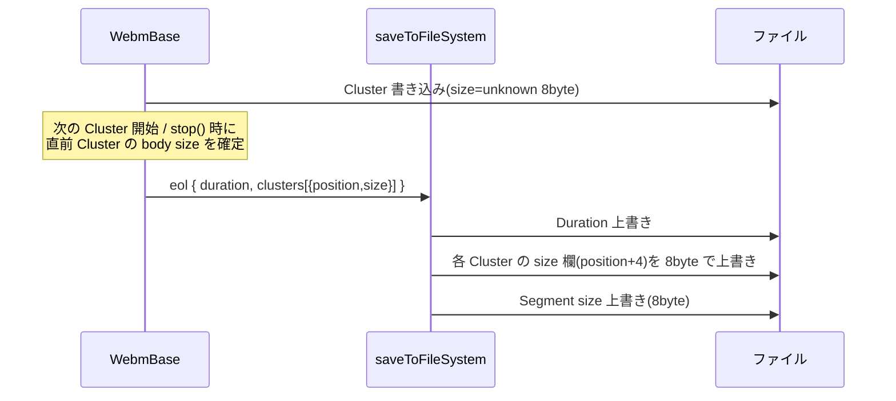

---
ide:
  viewer: review-document
  version: 1
  title: "WebM Cluster サイズ修正 レビューガイド"
  dock: right
  baseCommit: b608bb2d078ab659800ad14ba3fc8ddd20a5628a
---
# WebM 保存時の Unknown-size Cluster 修正 — レビューガイド

## 1. 結論

`saveToFileSystem` で保存した WebM は、すべての Cluster が**実サイズ**で書かれるようになりました。ffprobe の `Unknown-sized element ... inside parent with finite size` 警告は出ません。ストリーミング出力（`WebmStream`）は従来どおり unknown-size のままです。

あわせて、既存の `replaceSegmentSize` に 2 つのバグがあり、同時に直しています（§4）。

## 2. 問題と修正方針

  

    <strong>Before（保存後のファイル）</strong>
    

Segment size = 不正確

Cluster 1 size = ???

Cluster 2 size = ???

Cues

    
Cluster は unknown-size のまま。Segment size は 6byte 大きく、Cue の位置も 6byte ずれる

  

  

    <strong>After</strong>
    

Segment size = 正

Cluster 1 size = N1

Cluster 2 size = N2

Cues

    
終了時に各 size 欄を 8byte のまま上書き。データは動かない

  

### 処理の流れ

ポイントは「**unknown-size と同じ 8 バイト幅**で書き換える」ことです。EBML は最短でない VINT も許容するため、後続データのオフセット（Cues の CueClusterPosition）が動きません。

## 3. 主要変更

| 変更 | 場所 | 内容 |
| --- | --- | --- |
| Cluster 記録 | [packages/rtp/src/extra/processor/webm.ts:255](review-file:packages/rtp/src/extra/processor/webm.ts:255) | Cluster 開始位置を `clusters` に追加 |
| サイズ確定 | [packages/rtp/src/extra/processor/webm.ts:318](review-file:packages/rtp/src/extra/processor/webm.ts:318) | `closeCluster()`。次の Cluster 開始時と、Cues 書き込み直前（`stop()`）に呼ぶ |
| eol に載せる | [packages/rtp/src/extra/processor/webm.ts:356](review-file:packages/rtp/src/extra/processor/webm.ts:356) | `WebmOutput.eol.clusters`（フィールド追加のみ） |
| 固定幅 VINT | [packages/rtp/src/extra/container/webm/ebml/ebml.ts:147](review-file:packages/rtp/src/extra/container/webm/ebml/ebml.ts:147) | `vintEncodeFixed(num, byteLength)` |
| Cluster size 生成 | [packages/rtp/src/extra/processor/webm.ts:453](review-file:packages/rtp/src/extra/processor/webm.ts:453) | `replaceClusterSize()` / `ClusterSizeOffset = 4` |
| 書き換え | [packages/rtp/src/extra/processor/webmCallback.ts:76](review-file:packages/rtp/src/extra/processor/webmCallback.ts:76) | `eol` で各 Cluster の size を in-place 上書き |
| examples | `packages/rtp/examples/node/record/*.ts` ほか | 終了処理のコピーを `saveToFileSystem` に置換 |

差分: [webm.ts](review-diff:packages/rtp/src/extra/processor/webm.ts) / [webmCallback.ts](review-diff:packages/rtp/src/extra/processor/webmCallback.ts) / [ebml.ts](review-diff:packages/rtp/src/extra/container/webm/ebml/ebml.ts)

## 4. 併せて直した既存バグ（要注目）

[packages/rtp/src/extra/processor/webm.ts:439](review-file:packages/rtp/src/extra/processor/webm.ts:439) の `replaceSegmentSize`:

  
<strong>Before</strong><ul style="margin:4px 0;padding-left:18px"><li>size 欄自身の長さを含めて数えており、<b>値が大きすぎる</b></li><li>短い VINT + Void(0xEC) を書くため Segment 本体の開始が 48 → 42 に移動</li><li>CueClusterPosition は <code>-48</code> で計算 → 全 Cue が Cluster の <b>6byte 先</b>を指す</li></ul>

  
<strong>After</strong><ul style="margin:4px 0;padding-left:18px"><li><code>total - 48</code> を 8byte VINT で書く</li><li>Void を廃止、本体開始は 48 のまま</li><li>Cue は Cluster の先頭と一致</li></ul>

チケットの分析は「本体が 48 から始まる」前提で、この食い違いを見落としていました。

## 5. 判断理由

- **in-place 上書き**: ファイル全体の再構築より安全で、Cue の位置も変わらない。
- **`numberToByteArray(n, 8)` は使わない**: 小さい値で 5 byte を返すことを確認したため、新ヘルパー `vintEncodeFixed` が独自にバイト列を作る。
- **ストリーミングは unknown-size を維持**: チケット要件。テストで固定。

## 6. リスク・影響

- `replaceSegmentSize` の出力レイアウトが変わる。独自 writer を持つ利用者は出力バイトが変わる。
- `WebmOutput.eol.clusters` は必須フィールド。`eol` を自前で組み立てるコードは型エラーになる（リポジトリ内には無し。`clusters?:` にする案あり）。
- `saveToFileSystem` は空ファイルから書き始める前提（追記時は以前から Duration/Segment がずれる。Cluster 書き換えも同前提に依存）。
- record examples は元々型チェックが通らない import パスを含む（今回の対象外・別チケット推奨）。

## 7. 検証結果

  
<strong>rtp</strong> 40 files / 369 tests 成功（型チェック含む）

  
<strong>webrtc</strong> type 成功、test 成功

  
<strong>ffprobe</strong> develop: 警告再現 → 変更後: 警告なし

  
<strong>EBML 走査</strong> 11 Cluster をサイズのみで Cues まで到達、Cue 11 件が一致

- 新規テスト [packages/rtp/tests/processor/webm.test.ts](review-file:packages/rtp/tests/processor/webm.test.ts:25): 8byte 幅の確認、Segment→Cluster→Cues の走査、ffprobe 警告なし、ストリーミングが unknown-size のまま。
- 境界: キーフレーム無し 80 秒入力（32.767 秒で Cluster 分割）でも整合。mediabunny が 2 トラックで読めた。

<!-- review-bookmark id="bm_1a18beffc9a-fe92dee4" title="7. 検証結果" -->
**未確認**: mkvalidator（環境に無し）、実ブラウザでの E2E（`npm run e2e`）、examples の実行。なお、この文書作成のために新たなテストは再実行していません（上記は実装・レビュー時の結果です）。
