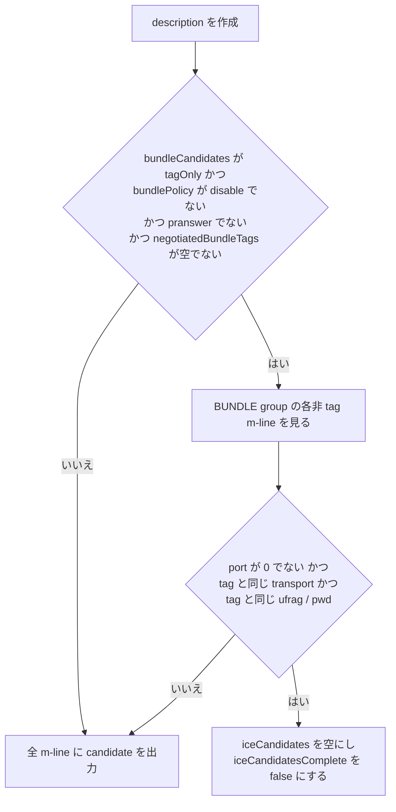

---
ide:
  viewer: review-document
  version: 1
  title: "BUNDLE再交渉で候補を繰り返し広告する問題の改善（#269）"
  dock: right
  baseCommit: e1b615b4b894167d64e09d23d30d4567ebd46b8e
---
# BUNDLE 再交渉で ICE candidate を繰り返し広告する問題の改善（#269）

## 1. 概要

`PeerConfig` に `bundleCandidates: "compatible" | "tagOnly"` を追加しました。`"tagOnly"` では、answer で BUNDLE が確定した後に作る offer / answer のうち、BUNDLE の tag ではない m-line から `a=candidate` と `a=end-of-candidates` を省きます。長く続く BUNDLE 接続で再交渉を重ねても、SDP の candidate 数が「m-line 数 × candidate 数」で増えなくなります。

既定値は `"compatible"` のままで、出力は従来と同じです。アプリや SFU が非 tag m-line の candidate を読んでいる可能性があるためです。チケットの Phase B（tag m-line の candidate も省くモード）は扱っていません。

変更前後の比較（チケット記載の実測値。12 candidate、m-line 7 本）:

<b>compatible（従来・既定）</b> 
tag m-line: candidate 12 + eoc 
非 tag m-line 6 本: それぞれ candidate 12 + eoc 
合計 <b>84</b> 行の <code>a=candidate</code>

<b>tagOnly</b> 
tag m-line: candidate 12 + eoc 
非 tag m-line 6 本: candidate なし（ufrag / pwd / fingerprint / setup / mid は残す） 
合計 <b>12</b> 行の <code>a=candidate</code>

## 2. 主要変更

### 2.1 設定と検証

- [packages/webrtc/src/api/peerConfig.ts:197](review-file:packages/webrtc/src/api/peerConfig.ts:197) に `bundleCandidates` を追加し、既定値は `"compatible"` です。差分は [packages/webrtc/src/api/peerConfig.ts](review-diff:packages/webrtc/src/api/peerConfig.ts) です。
- 不正な値は `TypeError`、構築後の変更は `InvalidModificationError` で拒否します（同じ値の再設定は許可）。`mLineReuse` などの既存オプションと同じ形です。
- [packages/webrtc/src/peerConnection.ts:285](review-file:packages/webrtc/src/peerConnection.ts:285) で `SDPManager` に値を渡します。

### 2.2 candidate を省く処理（変更の核）

変更の核は [packages/webrtc/src/sdpManager.ts](review-diff:packages/webrtc/src/sdpManager.ts) の `applyBundleCandidates()` です。

チケットの案 (a)・(b) どおり、m-line ごとの `addTransportDescription()` には判定を入れず、group が決まった後の後処理にしました。呼び出しは 3 か所です。

| 呼び出し | 役割 |
| --- | --- |
| `buildOfferSdp()` の末尾 | offer の作成時に判定する（`decide: true`） |
| `buildAnswerSdp()` の末尾 | answer の作成時に判定する（`decide: true`） |
| `setLocal()` の再描画 | 候補収集後の書き直し。作成時の判定を再利用する（`decide: !applied`） |

判定は description を作る時点で一度だけ行い、`WeakSet`（`tagOnlyCandidateDescriptions`）に記録します。収集後の再描画ではその記録を使うので、`createOffer()` の戻り値と後の `localDescription` で形が変わりません。

- 「tag と同じ transport か」の判定のため、`addTransportDescription()` が m-line ごとに書いた transport を `describedTransport`（`WeakMap`）に記録します。ICE の認証情報だけでは transport を区別できません（live の transport の隣に作った transport は認証情報を引き継ぐ）。そのためこの記録を使います。
- 基準は確定済み answer の `negotiatedBundleTags` だけで、pending description は見ません。そのため rollback で元に戻す処理は不要です。
- `a=ice-ufrag` / `a=ice-pwd` / `a=ice-options` / `a=fingerprint` / `a=setup` / `a=mid` と BUNDLE group は全 m-line に残します（werift の受信側が m-line ごとの ufrag で同じ generation かを判定しているため）。

省かない（従来どおり全 candidate を出す）場面: 最初の offer / answer、BUNDLE 未確定、local pranswer、`bundlePolicy: "disable"`、port 0 の m-line、tag の変更（新しい tag）、BUNDLE から分離して別 transport になった m-line、ICE restart で新しい generation を持つ m-line。

### 2.3 型・ドキュメント

- `BundleCandidates` 型と `BundleCandidatesModes` を [packages/webrtc/src/sdpManager.ts:1346](review-file:packages/webrtc/src/sdpManager.ts:1346) 付近に定義しました。`enum` は使わず、リポジトリの規約どおりです。
- [packages/webrtc/README.md](review-diff:packages/webrtc/README.md)、[changelog.md](review-diff:changelog.md)、生成物 `doc/` を更新しました（`doc/` は `npm run doc` で再生成されたものです）。

### 2.4 テスト

- negotiation case: [packages/webrtc/tests/negotiation/cases/negotiationTransactionBundleCandidates.test.ts:30](review-file:packages/webrtc/tests/negotiation/cases/negotiationTransactionBundleCandidates.test.ts:30)。9 ケースで、candidate 数が一定であること、`compatible` の維持、最初の offer / answer、ICE restart とトリクル、tag の stop、`bundlePolicy: "disable"`、pranswer、rollback、transport 分離を確認します。
- PBT oracle: [packages/webrtc/tests/pbt/model/oracles.ts](review-diff:packages/webrtc/tests/pbt/model/oracles.ts) に candidates oracle を追加しました。[packages/webrtc/tests/pbt/model/generator.ts](review-diff:packages/webrtc/tests/pbt/model/generator.ts) は seed が偶数のときに `tagOnly` を使い、[packages/webrtc/tests/pbt/model/scenes.ts](review-diff:packages/webrtc/tests/pbt/model/scenes.ts) に固定シーンを 2 件追加しました。
- 設定の単体テスト: [packages/webrtc/tests/integrate/iceOptions.test.ts:99](review-file:packages/webrtc/tests/integrate/iceOptions.test.ts:99)。
- E2E（Chrome）: [e2e/tests/bundle/tagOnlyCandidates.test.ts](review-diff:e2e/tests/bundle/tagOnlyCandidates.test.ts) と [e2e/server/handler/bundle/tagOnlyCandidates.ts](review-diff:e2e/server/handler/bundle/tagOnlyCandidates.ts)。サーバーの登録は [e2e/server/main.ts](review-diff:e2e/server/main.ts) です。

## 3. 判断理由

- **既定値は `"compatible"`**。チケットが挙げる安全側の案です。非 tag m-line の `a=candidate` を前提に SDP を解析するアプリや SFU を壊さないためです。changelog に、既定値を変えない理由を書いています。`"tagOnly"` に切り替えるときは別途 changelog で明示する必要があります。
- **後処理方式**。m-line を作る時点では BUNDLE group がまだ確定していないため、`addTransportDescription()` の中では tag を判定できません。
- **判定を description ごとに記録する**。収集後の再描画のたびに判定し直すと、`negotiatedBundleTags` が変わった後に、すでに適用した description の形が変わってしまいます。
- **採用しなかった案**: tag m-line の candidate まで省く Phase B。RFC 8839 の「実行中は全候補を含める」要求や W3C の `localDescription` の要件との関係がグレーで、チケットも別チケット扱いを許容しているため、扱っていません。

## 4. レビュアーが確認すべき点・リスク

- **公開 API の追加**: `PeerConfig.bundleCandidates` と、`BundleCandidates` / `BundleCandidatesModes` の export。既定値では出力が変わらないことが互換性の前提です。ここは `"compatible"` ケース（#269-2）と、既存テストが通ることで担保しています。
- **`tagOnly` のときの SDP が変わる**: 非 tag m-line の candidate が消えます。werift の受信側はすでに非 tag m-line の candidate を無視する実装（`bundleTopology.ts` の `isBundledNonTag()`）です。ブラウザ（Chrome）との相互接続は E2E に追加しましたが、Firefox と mediasoup の interop は、この文書を作る際には確認できていません。
- [packages/webrtc/src/sdpManager.ts](review-diff:packages/webrtc/src/sdpManager.ts) の `applyBundleCandidates()` の tag 判定: `description.media.find` は `rtp.muxId` で MID を引きます。tag または非 tag の m-line が見つからない、transport が記録されていない場合は何もせず全 candidate を残す（fallback）側に倒れる作りです。この向きで問題ないか確認してください。
- `setLocal()` の `applied` 分岐（max-compat で最初の tag が別の transport に移る場合の認証情報の保持）には手を入れていません。`decide: !applied` で、`applied` のときは判定を再利用するだけです。
- トリクルの経路（`takePreparedCandidateTransports` / `emitStagedIceCandidates`）は変更していません。同じ generation の再交渉で `icecandidate` が再発火しないことは、テストで固定しています。
- WPT の `localDescription` の candidate 要件への影響は、既定が `compatible` のため低い見込みです。

## 5. 検証結果

この文書の作成作業では、テストやビルドを実行していません（読み取りと文書作成のみ）。以下は、コミット `e1b615b4b` の内容から確認できる範囲です。

- 追加されたテスト: negotiation case 9 件、PBT oracle とシーン 2 件、設定の単体テスト 1 件、Chrome E2E 1 件（いずれも差分に含まれることを確認）。
- 実行結果（`npm run type`、`npm test`、`npm run pbt:deep`、`tools/negotiation-diff`、`npm run wpt`、`npm run e2e`）はこの文書では確認していません。チケット完了条件にある項目なので、レビュー時にチケットまたは CI の結果で確認してください。
