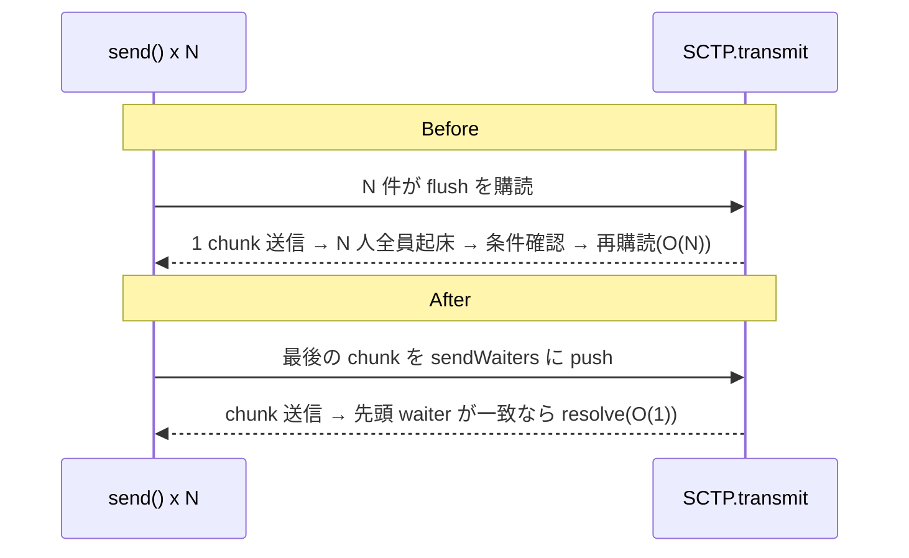

---
ide:
  viewer: review-document
  version: 1
  title: "SCTP キュー O(N²) 解消のレビュー解説"
  dock: right
  baseCommit: 43c4ecb6fa8d5758d932f3a2f4e09e923b193618
---
# SCTP キュー O(N²) 解消のレビュー解説

## 1. 概要

DataChannel で大量のメッセージを一気に `send()` すると、時間が件数の **2乗** で伸び、イベントループが数秒止まって ICE consent を失う問題を直しました。

結論: 主因は `Array.shift()` ではなく **`SCTP.send()` の待ち方**でした。キューの置換だけの試作では N=2000 で 13.7 s（元 12.0 s）とほぼ改善せず、待ち方の変更が効いています。

  

    <strong>Before</strong> N 件の send() が全員 <code>flush</code> イベントを待つ → 1回の transmit で N 人を起こし、各自 O(N) で解除 <strong>合計 O(N²)</strong>
  

  

    <strong>After</strong> 各 send() は「自分の最後のチャンクが送られた時」だけ解決 待ち行列の先頭だけを O(1) で解決 <strong>合計 O(N)</strong>
  

## 1.5 アルゴリズム解説：何がどう改善されたか

遅さには **2つの原因** が重なっていました。効果が大きかったのは ① です。

| | 原因 | 改善前 | 改善後 | 効果 |
|---|---|---|---|---|
| ① | `send()` の完了待ち | 全 `send()` が同じ `flush` イベントを待つ。1回の送信で **N 個全員を起こす**（合計 O(N²)） | 各 `send()` が自分専用の待ち札を持ち、先頭だけ解決（合計 O(N)） | **支配的**。キュー置換だけでは 13.7 s vs 12.0 s と改善せず |
| ② | キューの取り出し | `Array.shift()` は残り全要素を詰め直す（1回 O(n)） | 先頭インデックスを進めるだけ（償却 O(1)） | ①の解消後に線形性を保つ土台 |

### ① 待ち方の改善：N 人全員起こす → 先頭の 1 人だけ解決

スライダーで同時に積んだ `send()` 件数 N を変え、「起床回数」を比べられます（1回の送信で全員が起きる前提、送信 N 回）。

  
同時 send() 件数 N = <b id="wk-n">20</b> <input id="wk-s" type="range" min="2" max="200" value="20">

  
Before（全員起床）

  
After（先頭のみ）

  
<b>1回の transmit で起きる waiter</b>（●=起床）

  
Before

  
After

**ポイント:** Before は N 件が `flush`（＝キューが空になる）を待つので、送信のたびに N 人が起きて条件を確認し、また待ち直していました（待ち直しの購読解除も配列 filter で O(N)）。After は「自分の最後のチャンクが `outboundQueue` から `sentQueue` に移った時」だけ解決するため、送信順＝待ち順で **先頭を見るだけ**で済みます。

実装: [packages/sctp/src/sctp.ts:933](review-file:packages/sctp/src/sctp.ts:933)（登録）、[packages/sctp/src/sctp.ts:947](review-file:packages/sctp/src/sctp.ts:947)（先頭だけ解決）。

### ② キューの改善：`Array.shift()` → 先頭インデックス + 遅延コンパクション

「取り出し」を押して、配列の動きを比べてください。

  <button id="fq-go">取り出し（shift）</button><button id="fq-rs">リセット</button>
  
<b>Array.shift()</b> — 毎回、残り全部を1つ前へコピー：0 要素コピー

  

  
<b>FifoQueue</b> — head を進めるだけ（空きが半分超でまとめて詰める）：0 要素コピー

  

N 要素を全部取り出すと、`Array.shift()` は約 N²/2 回のコピー、`FifoQueue` はコンパクション分を合わせても約 N 回（各要素は高々1回だけ移動）で、**1回あたり償却 O(1)** です。実装: [packages/common/src/queue.ts:31](review-file:packages/common/src/queue.ts:31)（`shift()`）、[packages/common/src/queue.ts:123](review-file:packages/common/src/queue.ts:123)（`compact()`）。

### 効果の裏付け（計測）

N が 5倍（1,000→5,000）になると Before は **1.4 s → 256.7 s（約183倍＝ほぼ N² 以上）**、After は **24 ms → 108 ms（約4.5倍＝ほぼ線形）** でした。イベントループの最大停止も 69.0 s → 19 ms となり、停止が原因だった ICE consent 喪失も起きなくなります。詳細は次節の表を参照してください。

## 2. 計測結果（1 KB メッセージ、in-memory SCTP ペア）

  
N=1,000 Before

1.4 s

  
N=1,000 After

24 ms

  
N=2,000 Before

12.0 s

  
N=5,000 Before

256.7 s

  
N=5,000 After

108 ms

  
N=20,000 After

414 ms

(棒は 256.7 s を 100% とした相対長。After は幅が極小のため最小幅で描画)

| N | Before: 時間 / 最大イベントループ停止 | After: 時間 / 最大停止 |
|---|---|---|
| 1,000 | 1.4 s / 656 ms | 24 ms / 1 ms |
| 2,000 | 12.0 s / 6.8 s | – |
| 5,000 | 256.7 s / 69.0 s | 108 ms / 19 ms |
| 20,000 | – | 414 ms / 15 ms |

Before は revision 07550100 を別 worktree で計測した値です。ベンチ: [packages/sctp/tests/bench/burstTransfer.ts](review-file:packages/sctp/tests/bench/burstTransfer.ts)（vitest 対象外）。

## 3. 主要変更

### 3.1 `FifoQueue`（common）

配列 + 先頭インデックス + 遅延コンパクションで `shift()` を償却 O(1) にしました。走査中に要素が shift されても壊れません。

[packages/common/src/queue.ts:9](review-file:packages/common/src/queue.ts:9) クラス本体、[packages/common/src/queue.ts:31](review-diff:packages/common/src/queue.ts:31) `shift()`、[packages/common/src/queue.ts:123](review-file:packages/common/src/queue.ts:123) `compact()`。`werift-common` から export、`werift-sctp` から再 export しています（[packages/sctp/src/index.ts](review-diff:packages/sctp/src/index.ts)）。

### 3.2 SCTP `send()` の完了待ち（sctp）

  

    <strong>send() の流れ（After）</strong>
    <ol style="margin:6px 0 0 18px;padding:0">
      <li>チャンクを <code>outboundQueue</code> へ push</li>
      <li>最後のチャンクを <code>sendWaiters</code> に登録</li>
      <li><code>transmit()</code> が outbound → sent へ移すたび、先頭 waiter だけ確認して resolve</li>
      <li>association が close したら残り waiter を全部 resolve</li>
    </ol>
  

- 待ち登録: [packages/sctp/src/sctp.ts:933](review-diff:packages/sctp/src/sctp.ts:933)
- O(1) 解決: [packages/sctp/src/sctp.ts:947](review-diff:packages/sctp/src/sctp.ts:947)（送信側は [:1041](review-diff:packages/sctp/src/sctp.ts:1041)）
- close 時の解放: [packages/sctp/src/sctp.ts:954](review-diff:packages/sctp/src/sctp.ts:954)（呼び出しは [:1470](review-file:packages/sctp/src/sctp.ts:1470)）
- `sentQueue` / `outboundQueue` を `FifoQueue` 化: [packages/sctp/src/sctp.ts:174](review-diff:packages/sctp/src/sctp.ts:174)

輻輳制御・再送・abandon のロジックは変更していません。

### 3.3 DataChannel 層（webrtc）

[packages/webrtc/src/transport/sctp.ts:298](review-diff:packages/webrtc/src/transport/sctp.ts:298) `dataChannelFlush()` は、キュー内の全メッセージを **1回の同期ループ**で SCTP に渡します（`send()` ごとに並行ループを起こさない）。`bufferedAmount` はメッセージ単位で減るので、バースト中も `bufferedamountlow` が発火します。

### 3.4 stop() / 再接続の扱い（レビュー指摘への対応）

<button role="tab" aria-selected="true" data-p="a">stop() 時</button>
<button role="tab" aria-selected="false" data-p="b">再接続後の flush</button>

未送信のユーザーメッセージは破棄し <code>bufferedAmount</code> から減算。DATA_CHANNEL_OPEN は<strong>生きているチャネルのものだけ</strong>残す（rollback で残るチャネルを開けるため）。古い ACK は破棄。

キューに残った項目のチャネルが <code>closed</code>/<code>closing</code> なら送らず破棄（ユーザーメッセージ分は <code>bufferedAmount</code> 減算）。閉じたチャネルの OPEN が相手に届いて不要なチャネルが開く事故を防ぐ。

- [packages/webrtc/src/transport/sctp.ts:421](review-diff:packages/webrtc/src/transport/sctp.ts:421) `stop()`、[:433](review-file:packages/webrtc/src/transport/sctp.ts:433) `discardUnsentMessages()`
- [packages/webrtc/src/transport/sctp.ts:320](review-file:packages/webrtc/src/transport/sctp.ts:320) flush 時のガード

## 4. 判断理由

- **待ち方を直した**: 計測で支配項が `flush` waiter の全員起床と判明したため。キュー置換だけでは効果がない（13.7 s vs 12.0 s）。
- **`outboundQueue` は互換層なしの破壊的変更**: 配列互換を残すと O(N) 操作が紛れ込むため。[changelog.md](review-diff:changelog.md) の Unreleased に移行手順を記載。
- **stop() で DataChannel キューを丸ごと消さない**: 全消去すると negotiation の rollback テスト（DataChannel が残る）が壊れるため、OPEN のみ条件付きで残す。

## 5. リスク・注意点

- `SCTP.outboundQueue` の型変更は **breaking**（外部が配列として触っていると壊れる）。
- close 時に未送信分が `bufferedAmount` から引かれる挙動に変わった（従来は `send()` が解決せず残り続けた）。
- 時間比テストは環境差で揺れ得る。[packages/common/tests/queue.test.ts:68](review-file:packages/common/tests/queue.test.ts:68) は 5 回の最小値・16倍サイズ差・閾値 64（線形≈16、二次≈256）に変更済み。SCTP 側の比テストも同系統なので CI で揺れた場合は注意。
- 再接続後に association が確立してからの「別メッセージ送信」までは網羅していない（確立後の OPEN 非送信は検証済み）。

## 6. テスト

| 対象 | 内容 |
|---|---|
| [packages/common/tests/queue.test.ts](review-file:packages/common/tests/queue.test.ts) | 順序、コンパクション後の index、走査中 shift、線形性 |
| [packages/sctp/tests/burst.test.ts:14](review-file:packages/sctp/tests/burst.test.ts:14) | 断片化メッセージの順序保持、N vs 4N 時間比、イベントループ stall、パケットロス（[:66](review-file:packages/sctp/tests/burst.test.ts:66)）、個別解決（[:88](review-file:packages/sctp/tests/burst.test.ts:88)）、stop 時に settle（[:113](review-file:packages/sctp/tests/burst.test.ts:113)） |
| [packages/webrtc/tests/datachannel/burst.test.ts:10](review-file:packages/webrtc/tests/datachannel/burst.test.ts:10) | 20 MB バースト、`bufferedAmount`→0、`bufferedamountlow`、接続維持 |
| [packages/webrtc/tests/transport/sctp.test.ts:19](review-file:packages/webrtc/tests/transport/sctp.test.ts:19) / [:52](review-file:packages/webrtc/tests/transport/sctp.test.ts:52) | stop で破棄・`bufferedAmount` 解放、再接続で closed チャネルを通知しない |

## 7. 検証結果（これまでの報告ベース）

- `npm run type`、`npm run test:small`、WPT（`REGRESSION 0`）は初回実装時に成功。common 33 件、SCTP 59 件成功。
- WebRTC 全体: 793 件成功・3 skip。失敗は変更外の `negotiationTransactionCoverageTransport.test.ts` の空スイート2件のみで、変更前 07550100 でも発生。
- 直近の修正（時間比テスト）後は common/SCTP のみ再実行。WebRTC 全体・WPT・フル E2E・`npm run memleak` は **再実行/実施していません**。
- この文書作成にあたり、コードの再実行は行っていません（文書のみの変更）。
- 補足: 現 HEAD の `git diff 07550100..HEAD` では、上記の空スイート定義（`describeCases(..., () => {})` のループ）は既に削除されています。HEAD 上で失敗が解消しているかは今回確認していません。
