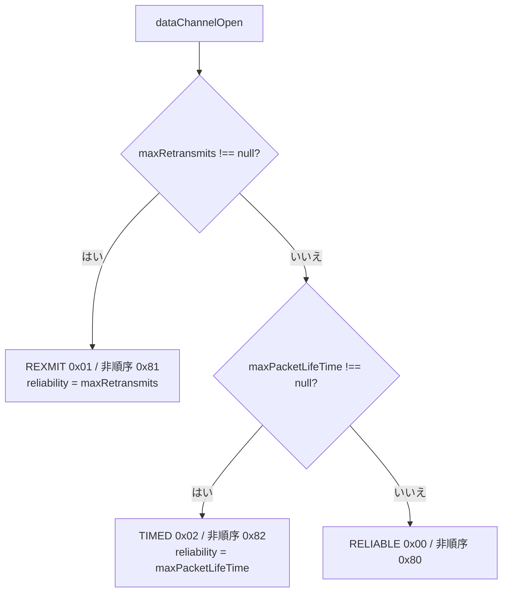

---
ide:
  viewer: review-document
  version: 1
  title: "非順序・部分信頼 DataChannel の DCEP Channel Type 修正のレビュー解説"
  dock: right
  baseCommit: f7908f8ffb8741150f8f779e0c00caefb9d6ca5d
---
# 非順序・部分信頼 DataChannel の DCEP Channel Type 修正 — レビュー解説

## 1. 概要

`ordered: false` かつ `maxRetransmits` / `maxPacketLifeTime` を指定した DataChannel が、DCEP の `DATA_CHANNEL_OPEN` で **順序保証ありの種別（`0x01` / `0x02`）** を送っていました（RFC 8832 §5.1 では `0x81` / `0x82` が正）。そのため相手側は「順序あり」のチャネルとして作成していました。

[packages/webrtc/src/transport/sctp.ts:259](review-file:packages/webrtc/src/transport/sctp.ts:259) の `dataChannelOpen()` を修正し、**信頼性モード** と **非順序ビット（0x80）** を独立に決めるようにしました。修正は変更コミット [packages/webrtc/src/transport/sctp.ts](review-diff:packages/webrtc/src/transport/sctp.ts:commit:3e1e7b5) にあります。

  

    <strong>Before</strong> 
    <code>ordered:false</code> → <code>0x80</code> を設定 
    その後 <code>maxRetransmits</code> があると <code>channelType = 1</code> で<strong>上書き</strong> 
    → 送信値 <code>0x01</code> / <code>0x02</code>（順序あり扱い）
  

  

    <strong>After</strong> 
    モード（reliable / rexmit / timed）を選び、同時に <code>ordered</code> で分岐 
    → 送信値 <code>0x81</code> / <code>0x82</code>（非順序を維持）
  

## 2. 主要変更：Channel Type の決まり方

下の表は修正後の 6 通りです。値は既存の定数（[packages/webrtc/src/const.ts:13](review-file:packages/webrtc/src/const.ts:13)）を使い、生の数値は使わなくなりました。

<table class="dcep-t">
  <tr><th>reliability モード</th><th>ordered: true</th><th>ordered: false（修正後）</th><th>ordered: false（修正前）</th></tr>
  <tr><td>reliable</td><td>0x00</td><td class="ok">0x80</td><td>0x80</td></tr>
  <tr><td>maxRetransmits</td><td>0x01</td><td class="ok">0x81</td><td class="bad">0x01 ✗</td></tr>
  <tr><td>maxPacketLifeTime</td><td>0x02</td><td class="ok">0x82</td><td class="bad">0x02 ✗</td></tr>
</table>

処理の流れ（優先順位は従来どおり）:

分岐の実体は [packages/webrtc/src/transport/sctp.ts:271](review-file:packages/webrtc/src/transport/sctp.ts:271) 〜 [packages/webrtc/src/transport/sctp.ts:287](review-file:packages/webrtc/src/transport/sctp.ts:287) です。

- `maxRetransmits: 0` は `!== null` 判定のため、引き続き「再送 0 回」として扱われます（完全信頼にはなりません）。
- 受信側は `(channelType & 0x80) === 0` で ordered を判定しており（[packages/webrtc/src/transport/sctp.ts:179](review-file:packages/webrtc/src/transport/sctp.ts:179)）、**受信側と公開 API は変更していません**。

## 3. 判断理由

- 受信側は元から 0x80 ビットを正しく解釈していたため、送信側の符号化だけが原因でした。送信側のみ直せば足ります。
- 優先順位（rexmit > timed > reliable）は既存挙動を保つため変えていません。
- 生の数値を `const.ts` の定数に置き換え、同種の上書きミスを起こしにくくしました。

## 4. テスト

6 通りの期待値を 1 つの表 [packages/webrtc/tests/utils.ts:234](review-file:packages/webrtc/tests/utils.ts:234)（`DCEP_CHANNEL_TYPE_CASES`）にまとめ、2 つのテストで共有しています。どちらも Arrange / Act / Assert で、日本語コメントを付けています。

  
<strong>トランスポート層</strong> SCTP 2 台を直結し、実際に送られた OPEN を記録。 Channel Type バイト・reliability 値と、受信側の ordered / maxRetransmits / maxPacketLifeTime を確認

  
<strong>werift 同士の PeerConnection</strong> <code>createDataChannelPair</code> で接続し、送受信両端の設定が一致することを確認

- 送出バイト列の検証: [packages/webrtc/tests/transport/sctp.test.ts:139](review-file:packages/webrtc/tests/transport/sctp.test.ts:139)
- 両端の設定一致の検証: [packages/webrtc/tests/integrate/datachannel.test.ts:149](review-file:packages/webrtc/tests/integrate/datachannel.test.ts:149)
- 変更履歴: [changelog.md:18](review-file:changelog.md:18)（Unreleased の Bug Fixes に追記）

## 5. リスク・未確認事項

  <ul style="margin:4px 0;padding-left:20px">
    <li>ブラウザとの相互接続 e2e（<code>npm run e2e</code>）は未実施。</li>
    <li>修正前のコードで新テストが失敗することの確認は未実施（実装担当の報告による）。</li>
    <li>互換性: 相手がこれまで「順序あり」と解釈していたチャネルが、正しく「非順序」になる挙動変更。仕様どおりだが、順序に依存した利用者には変化が出うる。</li>
  </ul>

スコープ外で別チケット化済み: `maxPacketLifeTime` の単位混在（c49c9ef1）、OPEN の label / protocol 長が UTF-8 バイト長でない問題（8a74aa52）。本修正では触れていません。

## 6. 検証結果

| 項目 | 結果 |
| --- | --- |
| 実装担当: 追加 2 テストファイル | 18 件成功 |
| 実装担当: 全 `npm test`（古い TypeScript 5.7.3 環境） | 884 成功 / 2 失敗（`polyfill.test.ts`、TS5095、環境起因） |
| レビュー: lockfile どおりに依存を復元後の `npm run type` | 成功 |
| レビュー: 復元後の全テスト | 58 ファイル成功、886 成功 / 5 スキップ |

上記はこの文書作成時に再実行したものではなく、会話中の実装・レビューの報告に基づきます。
