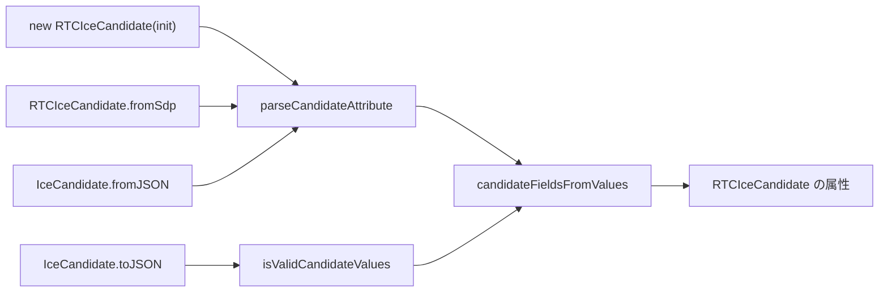

---
ide:
  viewer: review-document
  version: 1
  title: "RTCIceCandidate のパース済み属性の公開"
  dock: right
  baseCommit: f99f095bc30792f47599e54851d05d6f0332fbbe
---
# RTCIceCandidate のパース済み属性の公開

## 1. 概要

`RTCIceCandidate` に W3C の読み取り専用属性（`foundation` / `component` / `priority` / `address` / `protocol` / `port` / `type` / `tcpType` / `relatedAddress` / `relatedPort`）を追加しました。`getSelectedCandidatePair()` などで得た候補を、SDP 文字列を自前で解析せずに `pair.local.type === "relay"` のように判定できます。

属性の検証と変換は新モジュール [packages/webrtc/src/transport/iceCandidateAttribute.ts](review-file:packages/webrtc/src/transport/iceCandidateAttribute.ts) に一本化しました。コンストラクター、`fromSdp`、`IceCandidate.fromJSON`、`IceCandidate.toJSON` の全経路が同じ判定基準を通ります。

**互換性に影響する変更が 1 つあります。** 文法違反の候補を `addIceCandidate()` が `OperationError` で拒否するようになりました。

## 2. 主要変更

  

    <strong>Before</strong> 
    経路ごとに検証が別々。 
    <code>isValidCandidateSdp</code>（文字列）、<code>candidateFromSdp</code>、コンストラクター内の「派生属性が渡されたら信用する」分岐が混在。
  

  

    <strong>After</strong> 
    <code>parseCandidateAttribute</code>（文字列用）と <code>isValidCandidateValues</code>（型付き値用）が同じ要素検証器を使う。 
    W3C 属性への対応付けは <code>candidateFieldsFromValues</code> に集約。
  

### 新規モジュール

[packages/webrtc/src/transport/iceCandidateAttribute.ts:167](review-file:packages/webrtc/src/transport/iceCandidateAttribute.ts:167) の `parseCandidateAttribute` が文字列の入口です。`candidate:` 接頭辞の除去は 1 回だけで、`" "` 分割後に ABNF の要素ごとに検証します。型付き値の検証は [packages/webrtc/src/transport/iceCandidateAttribute.ts:141](review-file:packages/webrtc/src/transport/iceCandidateAttribute.ts:141) の `isValidCandidateValues`、W3C 属性への対応付けは [packages/webrtc/src/transport/iceCandidateAttribute.ts:204](review-file:packages/webrtc/src/transport/iceCandidateAttribute.ts:204) の `candidateFieldsFromValues` です。判定基準の契約は `RTCIceCandidateFields` の JSDoc（[packages/webrtc/src/transport/iceCandidateAttribute.ts:64](review-file:packages/webrtc/src/transport/iceCandidateAttribute.ts:64)）にあります。

### RTCIceCandidate

- コンストラクターは `RTCIceCandidateInit` のメンバーだけを読みます。`init` に含まれる派生属性は無視し、常に `candidate` から解析します（[packages/webrtc/src/transport/ice.ts:1030](review-diff:packages/webrtc/src/transport/ice.ts:1030)）。
- 内部で解析済みの値を渡す経路は、export しない `Symbol`（`parsedFields`）を使うモジュール内ファクトリー `createRTCIceCandidate` に限定しました（[packages/webrtc/src/transport/ice.ts:1007](review-diff:packages/webrtc/src/transport/ice.ts:1007)）。
- `fromSdp(sdp)` は `new RTCIceCandidate({ candidate: sdp })` と同じ解析をします。従来どおり、有効な候補の `ufrag` 拡張属性を `usernameFragment` に設定します（[packages/webrtc/src/transport/ice.ts:1070](review-diff:packages/webrtc/src/transport/ice.ts:1070)）。

### IceCandidate

- `toJSON()` は文字列を再生成・再解析せず、型付き値を検証して属性を作ります（[packages/webrtc/src/transport/ice.ts:1117](review-diff:packages/webrtc/src/transport/ice.ts:1117)）。
- `fromJSON()` は文法違反なら `undefined` を返します。これにより `addIceCandidate` が `OperationError` で拒否します（[packages/webrtc/src/transport/ice.ts:1133](review-diff:packages/webrtc/src/transport/ice.ts:1133)）。

### 判定基準（`null` になる条件）

| 状況 | 結果 |
| --- | --- |
| RFC 8839 §5.1 の文法違反（foundation、component 1〜256、priority 1〜2³¹−1、address、port、`typ`、`raddr` / `rport`、`tcptype`、単一空白区切り） | 全属性 `null`、`fromJSON` は拒否 |
| 文法は有効だが W3C 属性に写せない（component が 1/2 以外、protocol が udp/tcp 以外、type が未知） | 全属性 `null`。ICE 層では従来どおり受理 |
| UDP などで `tcptype` がある | `tcpType` だけ `null` |

### ドキュメント

[changelog.md](review-diff:changelog.md:19) に Features と Behavior change を追記しました。`doc/` 配下の生成ドキュメントは、[doc/classes/RTCIceCandidate.md](review-diff:doc/classes/RTCIceCandidate.md) など 3 ファイルを更新しています。

## 3. 判断理由

- **経路の一本化を採用。** 過去のレビューで入力ごとの個別対応が繰り返し指摘されたため、判定基準を先に契約として定め、全経路を 1 モジュールに通しました。
- **`fromJSON` は寛容にせず拒否を採用。** ブラウザーと同じく `OperationError` にします。Chrome / Firefox が実際に出す形式（mDNS `.local`、`generation`、`ufrag`、`network-id`、`network-cost`、TCP の port 9、大文字 `UDP`、`raddr 0.0.0.0 rport 0`）は受理するようテストで固定しました。
- **採用しなかったもの。**
  - W3C 手順 1 の「`sdpMid` と `sdpMLineIndex` が両方 null なら `TypeError`」は採用していません。AGENTS.md の方針（werift の利便性を既定にし、厳格な挙動は WPT ラッパー側に置く）に従います。
  - `relayProtocol` と `url` は別チケットです。ICE サーバーのメタデータ保持が必要になるためです。
  - リモート description の `a=candidate` 行のパーサーは変更していません。negotiation の変更になるためです。

## 4. レビュアーが確認すべき点・リスク

- **挙動変更（公開 API）。** 文法違反の候補が、以前は寛容なパーサーを通って ICE agent に渡り得ました（`NaN` のポートや `typ` 欠落など）。今後は `addIceCandidate()` が拒否します。実運用の候補を弾かないか、特に判定基準の表（[packages/webrtc/src/transport/iceCandidateAttribute.ts:125](review-file:packages/webrtc/src/transport/iceCandidateAttribute.ts:125)）を確認してください。
- **コンストラクターの型。** 引数が `RTCIceCandidateInit` だけになったため、派生属性を渡していた外部コードは値が無視されます。
- **ICE 層と公開層の差。** component 3 などは ICE 層で受理されますが、公開属性は `null` です。
- 範囲外: リモート description 内の `a=candidate` 行は従来のパーサーのままです。
- 比較対象: ブランチは `main` から大きく離れているため、`main...HEAD` の差分は無関係な変更を多数含みます。本件の差分は、直前のマージ `16fc9090a` から `HEAD` までを見るのが確実です。

## 5. 検証結果

- `packages/webrtc` で `npx vitest run tests/transport/iceCandidate.test.ts` を実行し、**165 件すべて成功**しました（この解説の作成時に実行）。テストは要素 × 4 経路（コンストラクター / `fromSdp` / `fromJSON→toJSON` / `RTCIceTransport` getter）のテーブル駆動です。共通の Arrange は [packages/webrtc/tests/transport/iceCandidateUtils.ts](review-file:packages/webrtc/tests/transport/iceCandidateUtils.ts) にあり、テスト本体は [packages/webrtc/tests/transport/iceCandidate.test.ts:268](review-file:packages/webrtc/tests/transport/iceCandidate.test.ts:268) から始まります。
- `addIceCandidate` の回帰テスト（不正な候補は拒否し、ブラウザー形式は受理）は [packages/webrtc/tests/transport/iceCandidate.test.ts:422](review-file:packages/webrtc/tests/transport/iceCandidate.test.ts:422) にあります。
- `npm run type`、`npm run test:small`、`npm run ci`、E2E、WPT は、この作業では実行していません。
