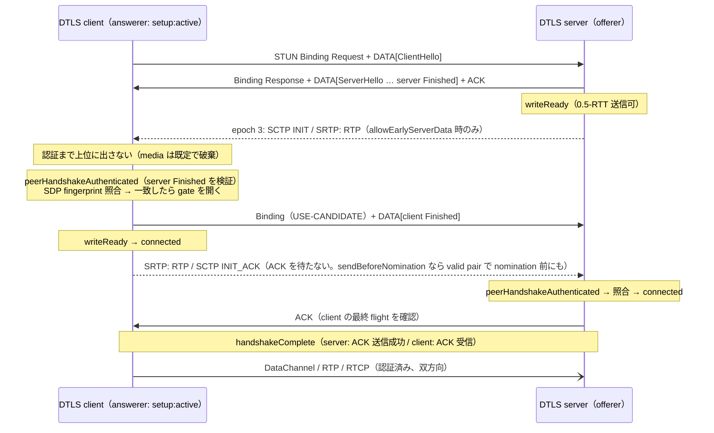
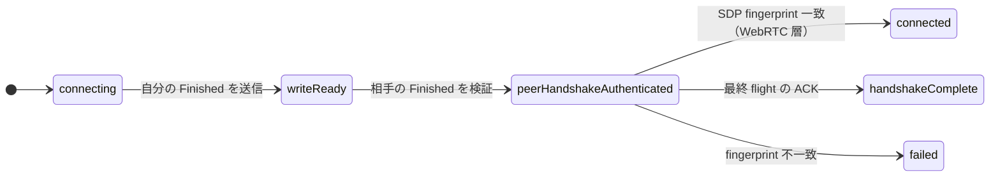
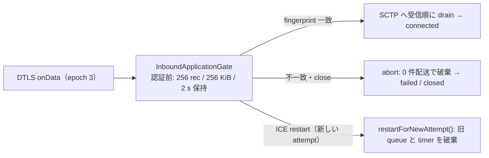
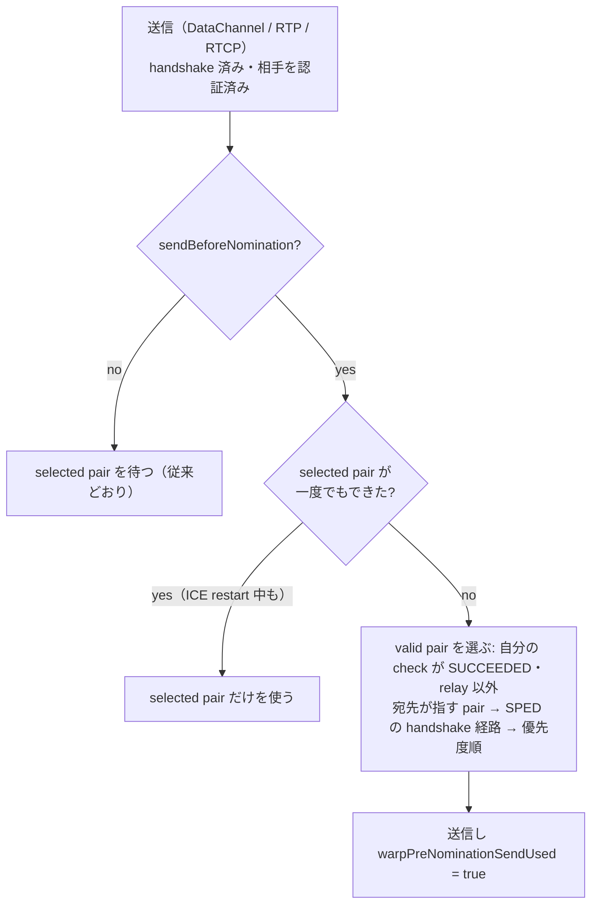
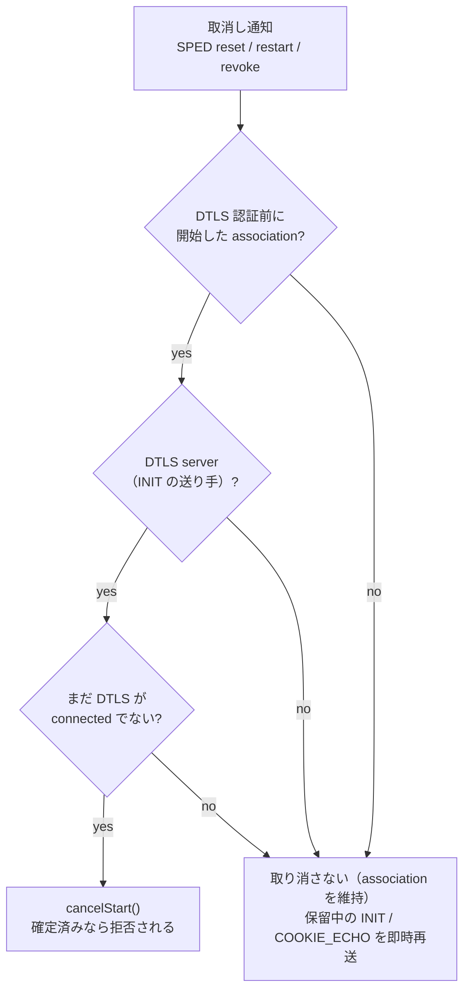

---
ide:
  viewer: review-document
  version: 1
  title: "Epic 4: WARP 対応 WebRTC transport — レビュー解説"
  dock: right
  baseCommit: 2914e50b612b72343e77af924662c28a40384ed1
---
# Epic 4: WARP 対応 WebRTC transport — レビュー解説

## 1. 概要

このブランチ（`epic4-warp-webrtc-detailed`）は、既存の DTLS 1.3 と SPED（ICE の STUN Binding に DTLS の handshake を相乗りさせる仕組み）を `RTCPeerConnection` 層に統合します。`sped: true` の接続では、ICE の接続確認と DTLS 1.3 の handshake が並行して進みます。

**最重要の不変条件**: SDP fingerprint の照合が済むまで、受信した DataChannel のデータ・RTP・RTCP を上位へ一件も渡しません。DTLS の暗号的な認証（相手の Finished の検証）と、WebRTC としての相手の認証（SDP に書かれた証明書であること）は別物です。後者が済んだ時点で初めて配送します。

利用者から見て変わること:

| 設定 | 既定 | 効果 |
| --- | --- | --- |
| `dtls.protocolVersions` | DTLS 1.2 のみ | `[DtlsVersion.V1_3]` または `[V1_3, V1_2]` で DTLS 1.3 を使う |
| `sped` | `false` | `true`（DTLS 1.3 が必要）で ICE と DTLS 1.3 を並行させる。相手が SPED 非対応なら、同じ bytes の direct DTLS に切り替わる |
| `warp.allowEarlyServerData` | `false` | DTLS server が、相手の認証前（0.5-RTT）に DataChannel / RTP / RTCP を送る（`sped: true` と DTLS 1.3 が必要） |
| `warp.earlyMediaPolicy` | `"drop"` | 認証前に届いた暗号化 media を捨てる（`"buffer"` では 256 packet / 256 KiB / 2 秒まで保持し、認証後に復号する） |
| `warp.sendBeforeNomination` | `false` | 自分の handshake が終わり相手を認証したら、ICE の nomination を待たず valid pair で送る（`sped: true` が必要） |
| `RTCTransportStats` | — | `warpSpedState`、`warpCarrier`、`warpHandshakeRttMs`、再送数、early buffer の量と破棄数、`warpEarlyServerSendUsed`、`warpPreNominationSendUsed`、`iceGeneration` を追加 |

不正な組み合わせ（DTLS 1.3 を含まない `sped`、`sped` と `dtls.helloRetryRequest` の併用、`sped` なしの `warp` の opt-in）は、constructor と `setConfiguration()` が同期的に throw し、設定は変わりません。既定の `new RTCPeerConnection()` の挙動（DTLS 1.2、ICE 完了後に DTLS 開始）は変わりません。

**スコープ外**: TURN relay 上の WARP（既存の通常 TURN 経路を回帰させないことだけが要件）。汎用の SDP / BUNDLE 再交渉の問題は [TICKET-webrtc-existing-negotiation-issues.md](review-file:TICKET-webrtc-existing-negotiation-issues.md) に分離しています。

**この文書について**: このチケットのレビュー解説は、以前は 5 本の文書に分かれていました（統合解説、RFC 実装解説、RFC レビュー解説、検証記録、旧 werift 互換性調査）。この 1 本にまとめ、内容を HEAD `2914e50b6`（develop #880 をマージした時点）に合わせて更新しました。本文（§1〜§9）が現在の仕組みの説明です。付録 A は、レビューの指摘ごとの検証記録を時系列のまま収めたものです。付録 B は旧 werift との互換性の調査です。要件と完了条件は [TICKET-epic4-warp-webrtc-detailed.md](review-file:TICKET-epic4-warp-webrtc-detailed.md)、設計の一次資料は [epic4-warp-webrtc-detailed.md](review-file:epic4-warp-webrtc-detailed.md) にあります。

引用した RFC と W3C の文言は、`docs/rfc/` と `docs/w3c/` の原文で節番号を確かめています。W3C は webrtc-pc（2025-03-13 Recommendation）と webrtc-stats（2025-09-25 CRD）の版です。本文の見出しにある **仕様** / **実装** / **werift の判断** / **逸脱** は、それぞれ「仕様の要求」「werift での実現」「仕様に定めがなく werift が決めたこと」「仕様の文言から意図的に外れていること」を表します。

## 2. 全体像

### 2.1 層と認証境界

<div class="w4-layers">
<style>
.w4-layers { font-family: var(--review-font); color: var(--review-fg); }
.w4-layers svg text { fill: var(--review-fg); font-family: var(--review-font); }
.w4-layers .muted { fill: var(--review-muted); }
.w4-layers .box { fill: var(--review-surface); stroke: var(--review-border); }
.w4-layers .gate { fill: var(--review-surface); stroke: var(--review-accent); stroke-width: 2; }
.w4-layers .ok { stroke: var(--review-success); stroke-width: 2; fill: var(--review-surface); }
.w4-layers .arrow { stroke: var(--review-muted); stroke-width: 1.5; }
</style>
<svg viewBox="0 0 760 330" width="100%" role="img" aria-label="ICE/SPED → DTLS 1.3 → 認証境界 → SRTP / SCTP の層構成">
  <defs><marker id="w4l-ah" viewBox="0 0 10 10" refX="9" refY="5" markerWidth="7" markerHeight="7" orient="auto"><path d="M0,0 L10,5 L0,10 z" fill="var(--review-muted)"/></marker></defs>
  <rect class="box" x="20" y="262" width="720" height="54" rx="8"/>
  <text x="40" y="285" font-size="14" font-weight="bold">ICE / STUN（packages/ice）</text>
  <text x="40" y="305" font-size="12" class="muted">connectivity check・nomination・consent・restart（generation）。SPED: DTLS flight を Binding の DATA（0xC070）/ ACK（0xC071）で運ぶ</text>
  <rect class="box" x="20" y="182" width="720" height="58" rx="8"/>
  <text x="40" y="205" font-size="14" font-weight="bold">DTLS 1.3 / 1.2（packages/dtls: DtlsSocket）</text>
  <text x="40" y="226" font-size="12" class="muted">readiness: writeReady → peerHandshakeAuthenticated → handshakeComplete（一度だけ true）。early data buffer 256 rec / 256 KiB / 2 s</text>
  <rect class="gate" x="20" y="100" width="720" height="60" rx="8"/>
  <text x="40" y="124" font-size="14" font-weight="bold">WebRTC 認証境界（RTCDtlsTransport）</text>
  <text x="40" y="146" font-size="12">SDP fingerprint 照合 → 一致するまで InboundApplicationGate / PreAuthMediaQueue が保持。SrtpAccess が送受信を別々に許可</text>
  <rect class="ok" x="20" y="14" width="350" height="64" rx="8"/>
  <text x="40" y="38" font-size="14" font-weight="bold">DTLS-SRTP（RTP / RTCP）</text>
  <text x="40" y="60" font-size="12" class="muted">方向別の鍵、replay window 1024</text>
  <rect class="ok" x="390" y="14" width="350" height="64" rx="8"/>
  <text x="410" y="38" font-size="14" font-weight="bold">SCTP / DataChannel</text>
  <text x="410" y="60" font-size="12" class="muted">INIT は DTLS server、stream id は DTLS role の偶奇</text>
  <line class="arrow" x1="380" y1="262" x2="380" y2="242" marker-end="url(#w4l-ah)"/>
  <line class="arrow" x1="380" y1="182" x2="380" y2="162" marker-end="url(#w4l-ah)"/>
  <line class="arrow" x1="195" y1="100" x2="195" y2="80" marker-end="url(#w4l-ah)"/>
  <line class="arrow" x1="565" y1="100" x2="565" y2="80" marker-end="url(#w4l-ah)"/>
</svg>
</div>

受信データは下から上へ流れ、アクセント色の認証境界を越えるまで SRTP / SCTP の利用者に届きません。

### 2.2 接続までの往復（`sped: false` と `sped: true`）

<div class="w4-rtt">
<style>
.w4-rtt { font-family: var(--review-font); color: var(--review-fg); display: grid; grid-template-columns: repeat(auto-fit, minmax(340px, 1fr)); gap: 12px; }
.w4-rtt .card { border: 1px solid var(--review-border); border-radius: 6px; padding: 6px 10px; }
.w4-rtt .card.before { border-left: 4px solid var(--review-muted); }
.w4-rtt .card.after { border-left: 4px solid var(--review-accent); }
.w4-rtt svg text { fill: var(--review-fg); font-family: var(--review-font); }
.w4-rtt .ice { fill: var(--review-muted); opacity: .55; }
.w4-rtt .dtls { fill: var(--review-accent); opacity: .55; }
.w4-rtt .send { fill: var(--review-success); }
.w4-rtt .opt { fill: var(--review-warning); }
.w4-rtt .axis { stroke: var(--review-border); }
.w4-rtt .legend { font-size: 12px; color: var(--review-muted); grid-column: 1 / -1; }
</style>
<div class="card before"><strong>sped: false（既定）</strong>
<svg viewBox="0 0 340 150" width="100%" role="img" aria-label="sped false: ICE 1 RTT の後に DTLS 1.3 1 RTT、client は 2 RTT、server は 2.5 RTT で送信可能">
  <g font-size="11"><text x="0" y="34">ICE</text><text x="0" y="64">DTLS 1.3</text><text x="0" y="94">client 送信</text><text x="0" y="124">server 送信</text></g>
  <rect class="ice" x="70" y="22" width="100" height="16" rx="3"/>
  <rect class="dtls" x="170" y="52" width="100" height="16" rx="3"/>
  <circle class="send" cx="270" cy="90" r="6"/>
  <circle class="send" cx="320" cy="120" r="6"/>
  <line class="axis" x1="70" y1="138" x2="330" y2="138"/>
  <g font-size="10" fill="var(--review-muted)"><text x="66" y="149">0</text><text x="166" y="149">1</text><text x="266" y="149">2</text><text x="312" y="149">2.5 RTT</text></g>
</svg></div>
<div class="card after"><strong>sped: true（WARP）</strong>
<svg viewBox="0 0 340 150" width="100%" role="img" aria-label="sped true: ICE と DTLS 1.3 が同じ 1 RTT。client は 1 RTT、server は既定 1.5 RTT、allowEarlyServerData で 0.5 RTT">
  <g font-size="11"><text x="0" y="34">ICE</text><text x="0" y="64">DTLS 1.3</text><text x="0" y="94">client 送信</text><text x="0" y="124">server 送信</text></g>
  <rect class="ice" x="70" y="22" width="100" height="16" rx="3"/>
  <rect class="dtls" x="70" y="52" width="100" height="16" rx="3"/>
  <circle class="send" cx="170" cy="90" r="6"/>
  <circle class="send" cx="220" cy="120" r="6"/>
  <circle class="opt" cx="120" cy="120" r="6"/>
  <text x="128" y="114" font-size="10">opt-in</text>
  <line class="axis" x1="70" y1="138" x2="330" y2="138"/>
  <g font-size="10" fill="var(--review-muted)"><text x="66" y="149">0</text><text x="112" y="149">0.5</text><text x="166" y="149">1</text><text x="212" y="149">1.5 RTT</text></g>
</svg></div>
<div class="legend">概念図（損失なし、RTT 単位）。灰: ICE の connectivity check、青: DTLS 1.3 の handshake、緑: 認証済みで送れる時点、黄: <code>warp.allowEarlyServerData</code> の 0.5-RTT 送信。client の送信には <code>warp.sendBeforeNomination</code> を使うと nomination も待たない。</div>
</div>

`sped: true` では、最初の Binding Request に ClientHello が乗るので、ICE の 1 往復で DTLS の最初の往復も済みます。client は自分の Finished を送り、server Finished を検証し、SDP fingerprint を照合した時点で送信を始められます。DTLS の最終 ACK（`handshakeComplete`）は待ちません（SPED draft-00 §3.1.2.2 も ACK を待たずに暗号化データを送れるとしています）。

次は、SPED を有効にし、server が early server data を、client が nomination 前の送信をそれぞれ opt-in した場合の流れです。



client 側に「先に送る」ものが少ないのは、仕様の制約ではなく役割の結果です。SCTP の INIT は DTLS server が送り、client の INIT_ACK は INIT を受け取るまで送れません。TLS の 0-RTT（early_data）は PSK 再開が前提で、接続ごとに新しい証明書を使う WebRTC の初回接続では使えません（werift も未実装）。この文書の「early data」は、接続確定前に届く epoch 3 のデータを指します。

**pion との差異（既知）**: pion の SPED 実装（pion/webrtc #3362、draft 段階）は、DTLS の handshake 完了まで application data を上位へ渡しません。werift の client が早く送っても、相手が保持するか捨てるだけなので相互接続には影響しません。

## 3. 修正前の問題と修正後の仕組み

ベースの `warp` ブランチには、DTLS 1.3 と SPED の部品はそろっていましたが、WebRTC 層への組み込みに次の問題がありました（チケットの「現状調査」）。

<div class="w4-gate">
<style>
.w4-gate { font-family: var(--review-font); color: var(--review-fg); display: grid; grid-template-columns: repeat(auto-fit, minmax(360px, 1fr)); gap: 12px; }
.w4-gate .card { border: 1px solid var(--review-border); border-radius: 6px; padding: 6px 10px; }
.w4-gate .card.before { border-left: 4px solid var(--review-danger); }
.w4-gate .card.after { border-left: 4px solid var(--review-success); }
.w4-gate svg text { fill: var(--review-fg); font-family: var(--review-font); }
.w4-gate .n { fill: var(--review-surface); stroke: var(--review-border); }
.w4-gate .bad { fill: var(--review-surface); stroke: var(--review-danger); stroke-width: 2; }
.w4-gate .good { fill: var(--review-surface); stroke: var(--review-success); stroke-width: 2; }
.w4-gate .acc { fill: var(--review-surface); stroke: var(--review-accent); stroke-width: 2; }
.w4-gate .a { stroke: var(--review-muted); stroke-width: 1.5; fill: none; }
.w4-gate .ab { stroke: var(--review-danger); stroke-width: 2; fill: none; }
.w4-gate .ag { stroke: var(--review-success); stroke-width: 2; fill: none; }
.w4-gate .lbl { font-size: 11px; }
.w4-gate .legend { grid-column: 1 / -1; font-size: 12px; color: var(--review-muted); }
</style>
<div class="card before"><strong>Before（warp）</strong>
<svg viewBox="0 0 360 330" width="100%" role="img" aria-label="Before: markConnected が early data を dataReceiver へ同期 flush した後に fingerprint を照合する。SRTP は送受信と media listener を一括で有効化">
  <defs><marker id="w4g-b" viewBox="0 0 10 10" refX="9" refY="5" markerWidth="7" markerHeight="7" orient="auto"><path d="M0,0 L10,5 L0,10 z" fill="var(--review-danger)"/></marker><marker id="w4g-m" viewBox="0 0 10 10" refX="9" refY="5" markerWidth="7" markerHeight="7" orient="auto"><path d="M0,0 L10,5 L0,10 z" fill="var(--review-muted)"/></marker></defs>
  <rect class="n" x="10" y="10" width="340" height="40" rx="6"/><text x="20" y="35" font-size="12">DTLS 1.3 engine: epoch 3 の record を受信</text>
  <rect class="bad" x="10" y="80" width="340" height="40" rx="6"/><text x="20" y="98" font-size="12">markConnected() → onConnect</text><text x="20" y="113" class="lbl">early data を同期で flush</text>
  <rect class="bad" x="10" y="150" width="160" height="44" rx="6"/><text x="18" y="168" font-size="12">dataReceiver（SCTP）</text><text x="18" y="184" class="lbl">照合前に配送 ✗</text>
  <rect class="n" x="190" y="150" width="160" height="44" rx="6"/><text x="198" y="168" font-size="12">completeHandshake()</text><text x="198" y="184" class="lbl">fingerprint 照合（後）</text>
  <rect class="bad" x="10" y="230" width="340" height="44" rx="6"/><text x="20" y="248" font-size="12">updateSrtpSession() / startSrtp()</text><text x="20" y="264" class="lbl">送受信の鍵と media listener を一括で有効化 ✗</text>
  <path class="a" d="M180,50 V78" marker-end="url(#w4g-m)"/>
  <path class="ab" d="M90,120 V148" marker-end="url(#w4g-b)"/>
  <path class="a" d="M270,120 V148" marker-end="url(#w4g-m)"/>
  <path class="a" d="M180,194 V228" marker-end="url(#w4g-m)"/>
  <text x="10" y="300" class="lbl">接続（connected）が「書ける」「相手 Finished 検証」「照合」を兼ねる</text>
  <text x="10" y="318" class="lbl">ICE restart の世代を受信処理まで運ばない</text>
</svg></div>
<div class="card after"><strong>After（このブランチ）</strong>
<svg viewBox="0 0 360 330" width="100%" role="img" aria-label="After: 受信データは InboundApplicationGate が保持し、fingerprint 照合が一致してから配送する。SrtpAccess が送受信を別々に許可">
  <defs><marker id="w4g-g" viewBox="0 0 10 10" refX="9" refY="5" markerWidth="7" markerHeight="7" orient="auto"><path d="M0,0 L10,5 L0,10 z" fill="var(--review-success)"/></marker><marker id="w4g-m2" viewBox="0 0 10 10" refX="9" refY="5" markerWidth="7" markerHeight="7" orient="auto"><path d="M0,0 L10,5 L0,10 z" fill="var(--review-muted)"/></marker><marker id="w4g-r2" viewBox="0 0 10 10" refX="9" refY="5" markerWidth="7" markerHeight="7" orient="auto"><path d="M0,0 L10,5 L0,10 z" fill="var(--review-danger)"/></marker></defs>
  <rect class="n" x="10" y="10" width="340" height="40" rx="6"/><text x="20" y="35" font-size="12">DTLS 1.3 engine: epoch 3 の record を受信</text>
  <rect class="acc" x="10" y="80" width="340" height="40" rx="6"/><text x="20" y="98" font-size="12">InboundApplicationGate（保持）</text><text x="20" y="113" class="lbl">peerHandshakeAuthenticated → fingerprint 照合</text>
  <rect class="good" x="10" y="150" width="160" height="44" rx="6"/><text x="18" y="168" font-size="12">一致: authenticate()</text><text x="18" y="184" class="lbl">受信順に SCTP へ配送 ✓</text>
  <rect class="bad" x="190" y="150" width="160" height="44" rx="6"/><text x="198" y="168" font-size="12">不一致: abort()</text><text x="198" y="184" class="lbl">0 件配送・failed</text>
  <rect class="good" x="10" y="230" width="340" height="44" rx="6"/><text x="20" y="248" font-size="12">SrtpAccess.update() + PreAuthMediaQueue</text><text x="20" y="264" class="lbl">受信=鍵∧認証、送信=鍵∧(認証∨early server 許可) ✓</text>
  <path class="a" d="M180,50 V78" marker-end="url(#w4g-m2)"/>
  <path class="ag" d="M90,120 V148" marker-end="url(#w4g-g)"/>
  <path class="ab" d="M270,120 V148" marker-end="url(#w4g-r2)"/>
  <path class="a" d="M180,194 V228" marker-end="url(#w4g-m2)"/>
  <text x="10" y="300" class="lbl">readiness を 3 段階に分け、connected は照合の後だけ</text>
  <text x="10" y="318" class="lbl">受信 datagram に rxGeneration を付け、restart 後の旧世代を破棄</text>
</svg></div>
<div class="legend">同じ入力（認証前に届いた epoch 3 の DataChannel データと SRTP）から描いています。赤: 照合より前に上位へ出ていた経路、緑: 照合の後だけ開く経路、青: 新しく入れた保持点。</div>
</div>

- 認証前の受信データは [packages/webrtc/src/transport/dtls-application-gate.ts:4](review-file:packages/webrtc/src/transport/dtls-application-gate.ts:4) の `InboundApplicationGate` が保持します。照合は [packages/webrtc/src/transport/dtls-fingerprint.ts:46](review-file:packages/webrtc/src/transport/dtls-fingerprint.ts:46) です。
- media は [packages/webrtc/src/transport/dtls-media-queue.ts:15](review-file:packages/webrtc/src/transport/dtls-media-queue.ts:15) の `PreAuthMediaQueue` が暗号化のまま保持し、送受信の許可は [packages/webrtc/src/transport/dtls-srtp.ts:45](review-file:packages/webrtc/src/transport/dtls-srtp.ts:45) の `SrtpAccess` がまとめて計算します。
- 他のギャップ（SPED から DTLS 1.2 への fallback、SCTP の開始側と stream id の偶奇、失敗した接続の再試行、診断値）は §4 で層ごとに説明します。

## 4. 主要変更

### 4.1 DTLS 1.3 コア（packages/dtls）

#### 4.1.1 3 段階の readiness

**仕様**: RFC 9147 §5.8.1 — 相手の Finished を受け取るまで、epoch 3 以上の application data は破棄するかバッファしなければなりません（"Implementations MUST either discard or buffer all application data records for epoch 3 and above until they have received the Finished message from the peer."）。同節の状態機械では、最終 flight の ACK で FINISHED に遷移し、FINISHED の server も再送された最終 flight には ACK を再送しなければなりません。

**実装**: DTLS の進行を、一度だけ true になる 3 つのフラグで表します（[packages/dtls/src/engine/v1_3/connection-base.ts:96](review-file:packages/dtls/src/engine/v1_3/connection-base.ts:96)）。

| マイルストーン | 意味 | server | client |
| --- | --- | --- | --- |
| `writeReady` | epoch 3 で送信できる | 自分の Finished 送信後 | 自分の Finished 送信後 |
| `peerHandshakeAuthenticated` | 相手の Finished を検証した（暗号的な認証） | client Finished の検証後 | server Finished の検証後 |
| `handshakeComplete` | 最終 flight の ACK まで済んだ | client の最終 flight の全 record を含む ACK の送信に成功した時点 | 自分の最終 flight が ACK された時点 |



`RTCDtlsTransport` の `connected` は `handshakeComplete` を待ちません。early server 送信中も公開 state は `connecting` のままです。

server の完了判定は [packages/dtls/src/engine/v1_3/record-rx.ts:363](review-file:packages/dtls/src/engine/v1_3/record-rx.ts:363) の `completeServerHandshakeIfAcked()` です。受理した最終 flight の record を未 ACK の集合に記録し、その record を含む ACK の送信が成功したときだけ消します。完了するのは「client の Finished を受信済み、ACK queue が空、未 ACK の集合が空」のときです。以前は「ACK queue が空」だけを見ていたので、相互認証で Certificate の再 ACK だけが成功したときに、Finished の ACK を一度も送れないまま完了を通知していました（付録 A.10.4、A.15）。

**latch 契約**（[packages/dtls/src/socket.ts:187](review-file:packages/dtls/src/socket.ts:187)）:

- 各マイルストーンは association で一度だけ true になり、close・失敗でも false に戻りません。終了は `onClose` / `onError` で通知します。
- DTLS 1.2 には段階がないので、最初の `connected` で 3 つ同時に latch します。
- DTLS 1.3 の engine を close・失敗で破棄するときは、到達していたマイルストーンを個別に保存します（[packages/dtls/src/socket.ts:1516](review-file:packages/dtls/src/socket.ts:1516) の `retireSelectedEngine13()`）。handshake の途中で終わっても、未到達のものを到達済みに見せません（付録 A.21）。
- 到達済みのマイルストーンの waiter は close 後でも resolve し、未到達のものは reject します。

テストは [packages/dtls/tests/e2e/self_readiness_latch.test.ts](review-file:packages/dtls/tests/e2e/self_readiness_latch.test.ts) と [packages/dtls/tests/e2e/self13_final_ack_retry.test.ts](review-file:packages/dtls/tests/e2e/self13_final_ack_retry.test.ts) です。

**werift の判断**: readiness の 3 段階は werift の設計で、仕様にこの概念はありません。`peerHandshakeAuthenticated` は DTLS の暗号的な検証だけを表し、SDP の照合は含みません。

#### 4.1.2 server の 0.5-RTT と early data の受信バッファ

**仕様**: RFC 8446 §4.4.4 — server は最初の flight の後にデータを送ってかまいません（MAY）。ただし相手の身元も生存も保証されていません。RFC 9147 §4.2.1 — 受信側はそれをバッファしても破棄してもよく（MAY）、SCTP のような信頼性のある上位ならバッファすべきです（SHOULD）。

**実装**: server は Finished の送信後に epoch 3 の鍵を設定して `writeReady` を立てます。実際に 0.5-RTT で送ってよいかは WebRTC 層が判断します（§4.2.3）。接続確定前に届いた epoch 3 の record は、受信順を保つ上限付きキュー（[packages/dtls/src/engine/v1_3/early-data-buffer.ts:9](review-file:packages/dtls/src/engine/v1_3/early-data-buffer.ts:9)）に保持します。上限 256 record / 256 KiB / 2 秒は [packages/dtls/src/engine/v1_3/types.ts:90](review-file:packages/dtls/src/engine/v1_3/types.ts:90) の `EARLY_DATA_LIMITS` に一元化し、DTLS engine・WebRTC の受信 gate・early media のキューが同じ値を使います。

- 上限を超えたら、新しく届いた record を捨てます（順序の途中を欠かさないため）。
- 先頭の record が期限切れになったら、キュー全体を捨てます（欠けた先頭の後ろだけを上位に見せないため）。
- 期限はタイマーだけでなく、読み出し・追加・取り出しのたびに評価します。Node のタイマーは `Date.now()` より約 1 ms 早く発火することがあるため、そのときは再武装します（付録 A.4）。
- overflow や期限切れは handshake を失敗させず、drop として統計に計上します。`EARLY_APP_DATA_UNLIMITED`（[packages/dtls/src/engine/v1_3/types.ts:108](review-file:packages/dtls/src/engine/v1_3/types.ts:108)）が外すのは件数と byte の上限だけで、2 秒の retention は残ります。

#### 4.1.3 受信世代（rxGeneration）による ICE restart の隔離

**実装**: datagram を受け取った時点の ICE generation を DTLS の受信キューまで運び、処理時に世代が変わっていたら捨てます（[packages/dtls/src/engine/v1_3/host.ts:15](review-file:packages/dtls/src/engine/v1_3/host.ts:15)）。restart 後に旧世代の SPED inject が新しい attempt を動かさないためです。このフィルタを設定するのは SPED transport だけです。SPED でない経路では、restart をまたいでも同じ DTLS association の datagram なので遮断しません。

**werift の判断**: werift 独自の仕組みです。近い根拠は RFC 9147 §4.5.2（無効な record は黙って捨てる）と draft §9.1（埋め込まれた DTLS は ICE の認証で保護される）です。

#### 4.1.4 DTLS 1.3 → 1.2 の fallback と downgrade 防止

**仕様**: RFC 8446 §4.1.3 — 1.3 に対応した server が 1.2 を選ぶとき、ServerHello.random の末尾に `DOWNGRD\x01` を入れ、1.3 を提示した client はそれを見たら中止します（RFC 9147 §5.3 で DTLS にも適用）。

**実装**: `[1.3, 1.2]` を提示する client の最初の ClientHello は、DTLS 1.2 の拡張（`extended_master_secret`、`renegotiation_info`）も持ちます（[packages/dtls/src/engine/v1_3/flight/client/flight1.ts:138](review-file:packages/dtls/src/engine/v1_3/flight/client/flight1.ts:138)）。werift 0.26 以前の DTLS 1.2 server は、この最初の ClientHello だけで EMS の提示を判断しながら、HelloVerifyRequest 後に EMS を返すため、以前は両端の master secret が食い違って handshake が終わりませんでした（付録 B.3.1）。1.2 に決まったら同じ association のまま 1.2 に確定し、DOWNGRD の判定は [packages/dtls/src/client.ts:1320](review-file:packages/dtls/src/client.ts:1320) です。

#### 4.1.5 SRTP 鍵の exporter

**仕様**: RFC 5764 §4.2 — label `"EXTRACTOR-dtls_srtp"`、空の context で導出し、client_write_key / server_write_key / client_write_salt / server_write_salt の順に切り出します。

**実装**: `waitForWriteReady` の時点で SRTP profile を反映するので、server は 0.5-RTT の段階で鍵を導出できます。鍵を使ってよいかは WebRTC 層が判断します（§4.2.2）。

### 4.2 WebRTC の認証境界（packages/webrtc）

#### 4.2.1 SDP fingerprint の照合を認証の境界にする

**仕様**: RFC 8122 §5.1 — 相手が提示した中で最も優先するハッシュ関数の fingerprint 群を選び、証明書がそのどれかと一致しなければ TLS 接続を確立してはなりません（MUST NOT）。RFC 5763 §5 — 一致しなければ、ただちに media session を終了しなければなりません。W3C webrtc-pc §5.5.1 — `connected` は "DTLS has completed negotiation of a secure connection and verified the remote fingerprint."。

**実装**: DTLS の `peerHandshakeAuthenticated` を待ってから照合します（未対応のアルゴリズムは捨て、残りで最も強いものだけを比較）。

- **一致**: `peerAuthenticated` を立て、SRTP 鍵を設定して保持していた media を復号し、受信 gate を開いて保持していたデータを受信順に配送し、最後に `connected` にします。gate は 1 件配送するたびに attempt と state を確かめ直します。
- **不一致**: 認証を取り消して `failed` にし、gate とキューを破棄し、SPED を中止し、DTLS engine を close します。接続後に新しい SDP で fingerprint が変わったときも、確立済み association の証明書で照合し直して同じ処理をします（[packages/webrtc/src/transport/dtls.ts:461](review-file:packages/webrtc/src/transport/dtls.ts:461) の `failAuthenticatedTransport()`）。
- **送信側の境界**: 認証前の `sendData` は、early server の送信許可がない限り `SCTPSendPermissionRevokedError` を投げます（[packages/webrtc/src/transport/dtls.ts:1249](review-file:packages/webrtc/src/transport/dtls.ts:1249)）。



テストは [packages/webrtc/tests/integrate/sped.test.ts:1715](review-file:packages/webrtc/tests/integrate/sped.test.ts:1715)（実 PeerConnection で、認証前に送られた DataChannel / RTP / RTCP が 0 件、SPED 中止、engine close、`failed`）と [packages/webrtc/tests/integrate/warpEarlyMedia.test.ts](review-file:packages/webrtc/tests/integrate/warpEarlyMedia.test.ts) です。

#### 4.2.2 方向別の SRTP と replay 対策

**仕様**: RFC 5764 §5.1 — "Within each RTP session, SRTP processing MUST NOT take place before the DTLS handshake completes."。RFC 3711 §3.3.2 — 受信側の replay 対策は RECOMMENDED で、window は 64 以上（MUST）。

**実装**:

| 方向 | 許可する条件 |
| --- | --- |
| 受信（復号して上位へ） | 鍵がある かつ `peerAuthenticated` |
| 送信 | 鍵がある かつ（`peerAuthenticated` または early server の送信許可） |

許可は [packages/webrtc/src/transport/dtls-srtp.ts:71](review-file:packages/webrtc/src/transport/dtls-srtp.ts:71) の `update()` で一度に計算し直します。SRTP / SRTCP の受信 context には replay window（libwebrtc と同じ 1024）を追加しました（[packages/rtp/src/srtp/replay.ts:14](review-file:packages/rtp/src/srtp/replay.ts:14)）。window の照合は復号前、記録は認証成功後だけで、未知の SSRC の偽造 packet では受信側の状態が増えません。この replay 対策は WARP と独立なので develop にもバックポート済みです（v0.27.0）。

**逸脱**: 受信の復号は、final ACK ではなく「相手を認証できた時点」で始めます（§5.1 の「handshake completes」を相手の認証完了と解釈）。opt-in した server だけは、相手の認証前に SRTP を送ります（既定では無効）。

#### 4.2.3 early server data と nomination 前の送信（opt-in）

**early server data**: 0.5-RTT で送ってよいかの判定は [packages/webrtc/src/transport/dtls.ts:558](review-file:packages/webrtc/src/transport/dtls.ts:558) の `isEarlyServerOutboundReady()` だけです。SPED transport、DTLS role が server、`warp.allowEarlyServerData`、fallback していない、`writeReady`、DTLS 1.3、現在の attempt をすべて満たすときに限ります。無効のときに DTLS server が `writeReady` から照合まで SCTP / DataChannel を一件も送らないことは [packages/webrtc/tests/integrate/earlyOutboundBoundary.test.ts](review-file:packages/webrtc/tests/integrate/earlyOutboundBoundary.test.ts) で確認しています。

**nomination 前の送信**（`warp.sendBeforeNomination`）:

**仕様**: RFC 8445 §12.1 — "An ICE agent MAY send data on any valid pair before selected pairs have been produced for the data stream."。SPED draft-00 §3.1.2.2 — client は server の最終 flight を処理した後、暗号化データを送ってかまいません。

**実装**: [packages/webrtc/src/transport/sped.ts:751](review-file:packages/webrtc/src/transport/sped.ts:751) の `resolvePreNominationPair()` が、handshake 後・selected pair が無い間の送信先を選びます。



相手の request を受けただけの pair（自分の check がまだ成功していない）は使いません。自分の check の成功は、その pair の初回 consent（RFC 7675）でもあるためです。テストは [packages/webrtc/tests/integrate/warpSendBeforeNomination.test.ts](review-file:packages/webrtc/tests/integrate/warpSendBeforeNomination.test.ts) です。nomination を保留したまま、werift 同士・Chromium（SPED なし、DTLS 1.3）・`werift@0.26.0`・Pion ICE v4.4.1 でデータの到達を確認しています（付録 A.25）。

#### 4.2.4 transport の状態の持ち方

`RTCDtlsTransport` の状態は、一緒に変わるものごとにモジュールへ分けています。状態遷移は、複数のフィールドを直接書き換えずに、名前の付いた操作で行います。

| モジュール | 持つ状態 |
| --- | --- |
| [packages/webrtc/src/transport/dtls-attempt.ts:14](review-file:packages/webrtc/src/transport/dtls-attempt.ts:14) | どの handshake / 認証の attempt が継続処理を所有するか（ICE restart で新しい attempt） |
| [packages/webrtc/src/transport/dtls-readiness.ts:26](review-file:packages/webrtc/src/transport/dtls-readiness.ts:26) | WebRTC 層の readiness と handshake の時刻 |
| [packages/webrtc/src/transport/dtls-srtp.ts:45](review-file:packages/webrtc/src/transport/dtls-srtp.ts:45) | SRTP 鍵と送受信の許可 |
| [packages/webrtc/src/transport/dtls-application-gate.ts:4](review-file:packages/webrtc/src/transport/dtls-application-gate.ts:4) / [packages/webrtc/src/transport/dtls-media-queue.ts:15](review-file:packages/webrtc/src/transport/dtls-media-queue.ts:15) | 認証まで保持する application data / media |
| [packages/webrtc/src/transport/dtls-sped-handshake.ts](review-file:packages/webrtc/src/transport/dtls-sped-handshake.ts) | SPED の carrier と runtime の制御 |
| [packages/webrtc/src/transport/dtls-ice-transport.ts:17](review-file:packages/webrtc/src/transport/dtls-ice-transport.ts:17) | SPED でない DTLS から見た ICE（切り離すだけで ICE は止めない。§4.5） |
| [packages/webrtc/src/transport/dtls-certificate.ts:13](review-file:packages/webrtc/src/transport/dtls-certificate.ts:13) / [packages/webrtc/src/transport/dtls-stats.ts](review-file:packages/webrtc/src/transport/dtls-stats.ts) | 証明書（`node:crypto`）と stats の組み立て |

**停止された `start()` の契約**: 進行中の `start()` は、`stop()` / `pc.close()` で戻るとき reject せずに resolve し、呼び出し側は `state` で接続しなかったことを知ります（develop の契約。[packages/webrtc/src/negotiation/transportActivation.ts:376](review-file:packages/webrtc/src/negotiation/transportActivation.ts:376) のコメントと `dtlsAlert` のテストが前提にしている）。`connecting` のリスナーから同期的に `stop()` されたら、socket を作らずに戻ります（[packages/webrtc/src/transport/dtls.ts:510](review-file:packages/webrtc/src/transport/dtls.ts:510)）。

### 4.3 ICE / SPED（packages/ice）

#### 4.3.1 SPED の STUN 属性と相手の対応判定

**仕様**: draft-hancke-webrtc-sped-00 §3.3.2.1 — DTLS-IN-STUN-DATA は DTLS の handshake packet を 1 つ運ぶか、空の値で SPED 対応を示します。§4.3 step 1 — "If this is the first authenticated STUN message received from the peer, and the DTLS-IN-STUN-DATA attribute is not present, conclude that the peer does not support SPED, and conclude SPED processing."

**実装**: コードポイントは draft で TBD のため `0xC070` / `0xC071` を使います。DTLS の flight（L1）から 1 packet を round-robin で DATA に入れ、受け取った DATA の CRC-32 を ACK（L2）で返します。判定は世代ごとに 1 回です。DTLS を開始する前に届いた認証済みの Binding には空の DATA だけを返し、相手が「非対応」と誤判定しないようにします。外部に見せる状態（`disabled` / `probing` / `active` / `fallback`）と carrier（`sped` / `direct`）は [packages/ice/src/sped/runtime.ts:185](review-file:packages/ice/src/sped/runtime.ts:185) の `diagnosticsSnapshot()` で、stats の `warpSpedState` / `warpCarrier` になります。

**逸脱**: SPED は DTLS 1.3 に限ります（draft §3.2 は 1.2 以上が目標）。relay の pair と古い世代の ufrag への応答には DATA を付けません（§3.3.2.1 の「active の間はすべての Binding に DATA」からの逸脱）。

#### 4.3.2 SPED 非対応の相手への fallback

<div class="w4-fb">
<style>
.w4-fb { font-family: var(--review-font); color: var(--review-fg); display: grid; grid-template-columns: repeat(auto-fit, minmax(360px, 1fr)); gap: 12px; }
.w4-fb .card { border: 1px solid var(--review-border); border-radius: 6px; padding: 6px 10px; }
.w4-fb .card.before { border-left: 4px solid var(--review-warning); }
.w4-fb .card.after { border-left: 4px solid var(--review-accent); }
.w4-fb svg text { fill: var(--review-fg); font-family: var(--review-font); }
.w4-fb .n { fill: var(--review-surface); stroke: var(--review-border); }
.w4-fb .w { fill: var(--review-surface); stroke: var(--review-warning); stroke-width: 2; }
.w4-fb .g { fill: var(--review-surface); stroke: var(--review-accent); stroke-width: 2; }
.w4-fb .a { stroke: var(--review-muted); stroke-width: 1.5; fill: none; }
.w4-fb .lbl { font-size: 11px; }
.w4-fb .legend { grid-column: 1 / -1; font-size: 12px; color: var(--review-muted); }
</style>
<div class="card before"><strong>warp の実装（78fc9ceaf、採らなかった）</strong>
<svg viewBox="0 0 360 260" width="100%" role="img" aria-label="warp: SPED socket を捨てて標準 DTLS の socket を作り直し、新しい ClientHello を送る">
  <defs><marker id="w4f-m" viewBox="0 0 10 10" refX="9" refY="5" markerWidth="7" markerHeight="7" orient="auto"><path d="M0,0 L10,5 L0,10 z" fill="var(--review-muted)"/></marker></defs>
  <rect class="n" x="10" y="10" width="340" height="40" rx="6"/><text x="20" y="35" font-size="12">最初の認証済み Binding に DATA が無い（非対応）</text>
  <rect class="w" x="10" y="80" width="340" height="44" rx="6"/><text x="20" y="98" font-size="12">switchToStandardDtls()</text><text x="20" y="114" class="lbl">SPED の DtlsSocket・runtime・受信登録を破棄</text>
  <rect class="w" x="10" y="154" width="340" height="44" rx="6"/><text x="20" y="172" font-size="12">新しい DtlsSocket で標準 handshake</text><text x="20" y="188" class="lbl">新しい ClientHello（最初の flight とは別の bytes）</text>
  <rect class="n" x="10" y="216" width="340" height="34" rx="6"/><text x="20" y="238" font-size="12">DTLS 1.2 / 1.3 で接続</text>
  <path class="a" d="M180,50 V78" marker-end="url(#w4f-m)"/><path class="a" d="M180,124 V152" marker-end="url(#w4f-m)"/><path class="a" d="M180,198 V214" marker-end="url(#w4f-m)"/>
</svg></div>
<div class="card after"><strong>このブランチ（チケット §2.7）</strong>
<svg viewBox="0 0 360 260" width="100%" role="img" aria-label="このブランチ: runtime が fallback に入り、L1 の最初の dual ClientHello の bytes をそのまま direct で送り、同じ socket で DTLS 1.2 に確定する">
  <defs><marker id="w4f-m2" viewBox="0 0 10 10" refX="9" refY="5" markerWidth="7" markerHeight="7" orient="auto"><path d="M0,0 L10,5 L0,10 z" fill="var(--review-muted)"/></marker></defs>
  <rect class="n" x="10" y="10" width="340" height="40" rx="6"/><text x="20" y="35" font-size="12">最初の認証済み Binding に DATA が無い（非対応）</text>
  <rect class="g" x="10" y="80" width="340" height="44" rx="6"/><text x="20" y="98" font-size="12">runtime.beginFallback() → carrier = direct</text><text x="20" y="114" class="lbl">warpSpedState = fallback、socket はそのまま</text>
  <rect class="g" x="10" y="154" width="340" height="44" rx="6"/><text x="20" y="172" font-size="12">L1 の最初の ClientHello を同じ bytes で direct 送信</text><text x="20" y="188" class="lbl">[1.3, 1.2] なら EMS など 1.2 の拡張付き（再シリアライズしない）</text>
  <rect class="n" x="10" y="216" width="340" height="34" rx="6"/><text x="20" y="238" font-size="12">相手が選んだ版（1.2-only なら 1.2）で同じ association が接続</text>
  <path class="a" d="M180,50 V78" marker-end="url(#w4f-m2)"/><path class="a" d="M180,124 V152" marker-end="url(#w4f-m2)"/><path class="a" d="M180,198 V214" marker-end="url(#w4f-m2)"/>
</svg></div>
<div class="legend">同じ入力（<code>sped: true</code>・<code>[1.3, 1.2]</code> の側と、SPED 非対応・DTLS 1.2 のみの相手）から描いています。黄: warp が別チケットで入れた方式、青: チケット §2.7「最初に生成した ClientHello flight の同じ Buffer を re-serialize せず direct transport へ送る」に従う方式。</div>
</div>

warp と develop には、warp 側の方式とそのテスト（`spedStandardDtlsFallback.test.ts`）が入っていました。マージ（`99becb6f7`）ではチケットの方式を残しましたが、テストは warp の内部（SPED runtime が消えること、旧 socket が回収されること）を検査したままで、10 件失敗していました。テストを「direct carrier へ fallback し、最初の socket のまま DTLS 1.2 が完了する」に合わせて直しています（[packages/webrtc/tests/integrate/spedStandardDtlsFallback.test.ts:49](review-file:packages/webrtc/tests/integrate/spedStandardDtlsFallback.test.ts:49)、16/16）。relay・ICE-TCP・fallback 後の handshake 中の ICE restart・最初の送信の損失・close 後の資源解放を確かめるケースは、そのまま残しています。

#### 4.3.3 direct carrier と再送モード

**仕様**: draft §4.4 — 有効な pair ができたら DTLS を直接送ってかまいません（MAY）。§6 — SPED の間は DTLS 内部のタイムアウトを止め、最初の Binding Response で再開することを推奨します。

**実装**: SPED の handshake を始めた時点で、DTLS の再送を ICE 側に任せる external モードにします。送信元が対称な認証済み Response を受けたら internal に戻し、直接送信を許します。direct に切り替えても SPED 対応の相手なら状態は `active` のままで、`carrier` が `direct` になります。

#### 4.3.4 ICE restart と、以前に選択されていた pair

**仕様**: RFC 8445 §9 — restart では ufrag とパスワードを両方変えなければなりません（MUST）。RFC 8842 §6 — ICE restart は新しい DTLS association を必要としません。

**実装**: restart で generation を進め、ufrag とパスワードを作り直し、SPED をリセットします。以前に選択されていた pair は退避し、相手が新しい pair に移るまでは、そこから届いた datagram に `fromPreviousSelectedPair` の印を付けます（[packages/ice/src/ice.ts:1276](review-file:packages/ice/src/ice.ts:1276)）。media と SPED でない DTLS はこの経路も受け付け、SPED の carrier は現在の世代だけを受け付けます。この印付けと pair の解決は、内部の datagram event に購読者がいるときだけ行います（[packages/ice/src/ice.ts:1254](review-file:packages/ice/src/ice.ts:1254)。購読者がいなければ RTP / SRTP の datagram ごとの pair 検索を省く develop の最適化）。

**handshake 後の送信先**（付録 A.22・A.23、レビュー指摘 ⑨・⑩）: DTLS が保持する宛先は、経路ではなく association の相手を指します。ICE restart で別の 5-tuple へ移っても更新されません。

<div class="w4-ku">
<style>
.w4-ku { font-family: var(--review-font); color: var(--review-fg); display: grid; grid-template-columns: repeat(auto-fit, minmax(360px, 1fr)); gap: 12px; }
.w4-ku .card { border: 1px solid var(--review-border); border-radius: 6px; padding: 6px 10px; }
.w4-ku .card.before { border-left: 4px solid var(--review-danger); }
.w4-ku .card.after { border-left: 4px solid var(--review-success); }
.w4-ku svg text { fill: var(--review-fg); font-family: var(--review-font); }
.w4-ku .n { fill: var(--review-surface); stroke: var(--review-border); }
.w4-ku .bad { fill: var(--review-surface); stroke: var(--review-danger); stroke-width: 2; }
.w4-ku .good { fill: var(--review-surface); stroke: var(--review-success); stroke-width: 2; }
.w4-ku .a { stroke: var(--review-muted); stroke-width: 1.5; fill: none; }
.w4-ku .lbl { font-size: 11px; }
.w4-ku .legend { grid-column: 1 / -1; font-size: 12px; color: var(--review-muted); }
</style>
<div class="card before"><strong>Before</strong>
<svg viewBox="0 0 360 250" width="100%" role="img" aria-label="Before: 旧 IPv4 宛先に一致する認証済み pair が無く、ACK が 2 秒キューに残って失効し DTLS が失敗">
  <defs><marker id="w4k-m" viewBox="0 0 10 10" refX="9" refY="5" markerWidth="7" markerHeight="7" orient="auto"><path d="M0,0 L10,5 L0,10 z" fill="var(--review-muted)"/></marker></defs>
  <rect class="n" x="10" y="10" width="340" height="40" rx="6"/><text x="20" y="28" font-size="12">IPv4 で接続 → IPv6 だけで ICE restart</text><text x="20" y="43" class="lbl">nomination が遅れている間に KeyUpdate を受信</text>
  <rect class="n" x="10" y="74" width="340" height="40" rx="6"/><text x="20" y="92" font-size="12">ACK を送る: 宛先 = DTLS が保持する旧 IPv4</text><text x="20" y="107" class="lbl">resolveAuthenticatedSendPair(addr)</text>
  <rect class="bad" x="10" y="138" width="340" height="40" rx="6"/><text x="20" y="156" font-size="12">一致する現世代の認証済み pair が無い</text><text x="20" y="171" class="lbl">旧候補が未認証で一覧に残ると、それを指して維持（⑩）</text>
  <rect class="bad" x="10" y="202" width="340" height="40" rx="6"/><text x="20" y="226" font-size="12">queue に 2 秒 → 失効 → DTLS fatal → failed</text>
  <path class="a" d="M180,50 V72" marker-end="url(#w4k-m)"/><path class="a" d="M180,114 V136" marker-end="url(#w4k-m)"/><path class="a" d="M180,178 V200" marker-end="url(#w4k-m)"/>
</svg></div>
<div class="card after"><strong>After</strong>
<svg viewBox="0 0 360 250" width="100%" role="img" aria-label="After: handshake 後は宛先を優先候補として扱い、現世代の認証済み pair へ送る">
  <defs><marker id="w4k-m2" viewBox="0 0 10 10" refX="9" refY="5" markerWidth="7" markerHeight="7" orient="auto"><path d="M0,0 L10,5 L0,10 z" fill="var(--review-muted)"/></marker></defs>
  <rect class="n" x="10" y="10" width="340" height="40" rx="6"/><text x="20" y="28" font-size="12">IPv4 で接続 → IPv6 だけで ICE restart</text><text x="20" y="43" class="lbl">nomination が遅れている間に KeyUpdate を受信</text>
  <rect class="n" x="10" y="74" width="340" height="40" rx="6"/><text x="20" y="92" font-size="12">ACK を送る: 宛先 = DTLS が保持する旧 IPv4</text><text x="20" y="107" class="lbl">applicationReady → resolveEstablishedSendPair()</text>
  <rect class="good" x="10" y="138" width="340" height="40" rx="6"/><text x="20" y="156" font-size="12">宛先が指す pair → nominated → SPED 経路 → 一覧</text><text x="20" y="171" class="lbl">いずれも「現世代の認証済み」のものだけ</text>
  <rect class="good" x="10" y="202" width="340" height="40" rx="6"/><text x="20" y="226" font-size="12">IPv6 の認証済み pair へ送信 → 接続を維持</text>
  <path class="a" d="M180,50 V72" marker-end="url(#w4k-m2)"/><path class="a" d="M180,114 V136" marker-end="url(#w4k-m2)"/><path class="a" d="M180,178 V200" marker-end="url(#w4k-m2)"/>
</svg></div>
<div class="legend">handshake 中の規則（明示的な宛先が認証済み pair の外なら送らない）は変えていません。変えたのは handshake 後（applicationReady）だけです。</div>
</div>

handshake 後の分岐は [packages/webrtc/src/transport/sped.ts:677](review-file:packages/webrtc/src/transport/sped.ts:677)、選択は [packages/webrtc/src/transport/sped.ts:723](review-file:packages/webrtc/src/transport/sped.ts:723) の `resolveEstablishedSendPair()` です。テストは [packages/webrtc/tests/integrate/spedMigratedKeyUpdate.test.ts](review-file:packages/webrtc/tests/integrate/spedMigratedKeyUpdate.test.ts)（旧候補が一覧から消える場合と残る場合）です。pair の選択前は DTLS client の宛先が placeholder（port 0）なので、これも「宛先なし」として扱います（付録 A.20、⑦）。

#### 4.3.5 STUN の認証と consent

- **STUN の認証**（RFC 8445 §7.3、RFC 8489）: 受信した Request は世代ごとのパスワードで検証し、SPED の処理は検証の後でだけ行います。同じ transaction の Request の再送には、最初に返した Response と同じ bytes を返します。SPED の PeerConnection の ICE agent だけが、MESSAGE-INTEGRITY の無い Request を破棄します。**逸脱**: 認証失敗の Request に 400 / 401 を返さず黙って捨てます（RFC 8489 §9.1.3、既存の挙動）。
- **consent freshness**（RFC 7675）: 送信の可否は `canSendApplicationData()`（[packages/ice/src/ice.ts:2053](review-file:packages/ice/src/ice.ts:2053)）です。相手から nominate されただけでは consent とみなしません。consent の確認は [packages/ice/src/consent.ts](review-file:packages/ice/src/consent.ts) にあり、develop の #880（高 RTT・損失下で遅れて届いた有効な応答を受け付ける）を取り込んでいます。consent の Binding にも SPED の属性を付けます。

### 4.4 SCTP / DataChannel

#### 4.4.1 SCTP の役割と stream id の偶奇

**仕様**: RFC 8831 §6.5 / RFC 8832 §6 — stream id の偶奇は DTLS role で決めます（client は偶数、server は奇数）。どちらが INIT を送るかは、どの RFC も定めていません。

**実装**: DTLS server が INIT を送り、DTLS client が応答します（[packages/webrtc/src/transport/sctp.ts:465](review-file:packages/webrtc/src/transport/sctp.ts:465) の `isServer`）。develop の v0.28.0（#815）で、stream id の偶奇は既に DTLS role になっています。このブランチで変えたのは INIT の送り手です（develop は DTLS 開始時の ICE role だった）。early server の INIT が届いたときに偶奇が未確定にならないよう、DTLS client は相手の認証前に passive 側を待受け状態にします。

旧 werift（0.27 以前）は、INIT の送り手と stream id の偶奇を ICE role で決めます。ICE role と DTLS role の対応がずれる構成（ICE-lite の旧 offerer、`a=setup` を逆転させた answer など）でも接続できるよう、次を入れています。

<div class="w4-sctp">
<style>
.w4-sctp { font-family: var(--review-font); color: var(--review-fg); display: grid; grid-template-columns: repeat(auto-fit, minmax(360px, 1fr)); gap: 12px; }
.w4-sctp .card { border: 1px solid var(--review-border); border-radius: 6px; padding: 6px 10px; }
.w4-sctp .card.before { border-left: 4px solid var(--review-danger); }
.w4-sctp .card.after { border-left: 4px solid var(--review-success); }
.w4-sctp svg text { fill: var(--review-fg); font-family: var(--review-font); }
.w4-sctp .life { stroke: var(--review-border); stroke-dasharray: 4 3; }
.w4-sctp .m { stroke: var(--review-muted); stroke-width: 1.5; }
.w4-sctp .bad { stroke: var(--review-danger); stroke-width: 2; }
.w4-sctp .good { stroke: var(--review-success); stroke-width: 2; }
.w4-sctp .hd { fill: var(--review-surface); stroke: var(--review-border); }
.w4-sctp .lbl { font-size: 11px; }
.w4-sctp .legend { grid-column: 1 / -1; font-size: 12px; color: var(--review-muted); }
</style>
<div class="card before"><strong>Before（f0611a775 のマージ後の HEAD）</strong>
<svg viewBox="0 0 360 300" width="100%" role="img" aria-label="Before: INIT は衝突処理で確立するが、旧 werift が ICE role の偶奇で開いた OPEN を現行が reset し DataChannel が開かない">
  <defs><marker id="w4s-m" viewBox="0 0 10 10" refX="9" refY="5" markerWidth="7" markerHeight="7" orient="auto"><path d="M0,0 L10,5 L0,10 z" fill="var(--review-muted)"/></marker><marker id="w4s-r" viewBox="0 0 10 10" refX="9" refY="5" markerWidth="7" markerHeight="7" orient="auto"><path d="M0,0 L10,5 L0,10 z" fill="var(--review-danger)"/></marker></defs>
  <rect class="hd" x="10" y="8" width="150" height="38" rx="6"/><text x="18" y="24" font-size="11">旧 werift 0.26</text><text x="18" y="39" class="lbl">ICE controlling・DTLS client</text>
  <rect class="hd" x="200" y="8" width="150" height="38" rx="6"/><text x="208" y="24" font-size="11">現行 werift</text><text x="208" y="39" class="lbl">ICE controlled・DTLS server</text>
  <line class="life" x1="85" y1="46" x2="85" y2="290"/><line class="life" x1="275" y1="46" x2="275" y2="290"/>
  <line class="m" x1="85" y1="70" x2="273" y2="80" marker-end="url(#w4s-m)"/><text x="100" y="66" class="lbl">INIT（ICE role で送る）</text>
  <line class="m" x1="275" y1="92" x2="87" y2="102" marker-end="url(#w4s-m)"/><text x="150" y="88" class="lbl">INIT（DTLS server）</text>
  <text x="95" y="128" class="lbl">… INIT 衝突（§5.2.1）で確立</text>
  <line class="bad" x1="85" y1="160" x2="273" y2="170" marker-end="url(#w4s-r)"/><text x="92" y="156" class="lbl">DCEP OPEN stream 1（ICE role の奇数）</text>
  <text x="182" y="196" class="lbl">自分の偶奇の未使用 stream</text><text x="182" y="210" class="lbl">→ #815 の規則で reset</text>
  <line class="bad" x1="275" y1="222" x2="87" y2="232" marker-end="url(#w4s-r)"/><text x="130" y="218" class="lbl">RE-CONFIG（reset）</text>
  <text x="20" y="270" class="lbl">→ 旧 werift の DataChannel が開かない（15 秒で失敗）</text>
</svg></div>
<div class="card after"><strong>After</strong>
<svg viewBox="0 0 360 300" width="100%" role="img" aria-label="After: 役割がずれる構成では旧 werift の OPEN を受け入れて ACK を返し DataChannel が開く">
  <defs><marker id="w4s-m2" viewBox="0 0 10 10" refX="9" refY="5" markerWidth="7" markerHeight="7" orient="auto"><path d="M0,0 L10,5 L0,10 z" fill="var(--review-muted)"/></marker><marker id="w4s-g" viewBox="0 0 10 10" refX="9" refY="5" markerWidth="7" markerHeight="7" orient="auto"><path d="M0,0 L10,5 L0,10 z" fill="var(--review-success)"/></marker></defs>
  <rect class="hd" x="10" y="8" width="150" height="38" rx="6"/><text x="18" y="24" font-size="11">旧 werift 0.26</text><text x="18" y="39" class="lbl">ICE controlling・DTLS client</text>
  <rect class="hd" x="200" y="8" width="150" height="38" rx="6"/><text x="208" y="24" font-size="11">現行 werift</text><text x="208" y="39" class="lbl">ICE controlled・DTLS server</text>
  <line class="life" x1="85" y1="46" x2="85" y2="290"/><line class="life" x1="275" y1="46" x2="275" y2="290"/>
  <line class="m" x1="85" y1="70" x2="273" y2="80" marker-end="url(#w4s-m2)"/><text x="100" y="66" class="lbl">INIT（ICE role で送る）</text>
  <line class="m" x1="275" y1="92" x2="87" y2="102" marker-end="url(#w4s-m2)"/><text x="150" y="88" class="lbl">INIT（DTLS server）</text>
  <text x="95" y="128" class="lbl">… INIT 衝突（§5.2.1）で確立</text>
  <line class="good" x1="85" y1="160" x2="273" y2="170" marker-end="url(#w4s-g)"/><text x="92" y="156" class="lbl">DCEP OPEN stream 1（ICE role の奇数）</text>
  <text x="182" y="196" class="lbl">役割がずれる構成</text><text x="182" y="210" class="lbl">→ peerMayUseIceRoleParity で受理</text>
  <line class="good" x1="275" y1="222" x2="87" y2="232" marker-end="url(#w4s-g)"/><text x="150" y="218" class="lbl">DCEP ACK</text>
  <text x="20" y="270" class="lbl">→ DataChannel が開き、現行側の次の ID は 1 を避ける</text>
</svg></div>
<div class="legend">同じ構成（旧 offerer が ICE controlling、現行 answerer が <code>a=setup:passive</code> で DTLS server）から描いています。赤: 拒否されて開かない経路、緑: 修正後に開く経路。</div>
</div>

- **INIT の衝突**: 自分の INIT を待つ間（COOKIE-WAIT / COOKIE-ECHOED）に相手の INIT が届いたら、INIT_ACK で答えます（RFC 9260 §5.2.1、[packages/sctp/src/sctp.ts:482](review-file:packages/sctp/src/sctp.ts:482)）。
- **INIT が来ない場合**: 応答側（DTLS client）は、DTLS 認証の 1 秒後（`PASSIVE_INIT_FALLBACK_MS`、[packages/webrtc/src/transport/sctp.ts:43](review-file:packages/webrtc/src/transport/sctp.ts:43)）までに INIT が届かなければ自分から送ります（[packages/sctp/src/sctp.ts:2018](review-file:packages/sctp/src/sctp.ts:2018) の `startPassiveFallbackInit()`）。
- **verification tag**: 自分の INIT は常に tag 0 で送り、旧 werift が送る「自分の tag 付きの INIT」も受け付けます（develop にもバックポート済み、v0.27.0）。
- **旧 werift の OPEN**: ICE role と DTLS role がずれる構成に限り、自分の偶奇の未使用 stream に来た OPEN を、#815 の規則で reset せずに受け入れます（[packages/webrtc/src/transport/sctp.ts:481](review-file:packages/webrtc/src/transport/sctp.ts:481) の `peerMayUseIceRoleParity`）。RFC 8832 に従う相手はこの偶奇を使わないので、影響はありません。ID の割り当ては #815 の規則（DTLS role の偶奇で最小の空き番号）のままです。

**既知の制限**: 役割がずれる構成で両側が同時に in-band の DataChannel を開くと、両者が同じ最小の番号を選んで衝突し、現行側はその stream を reset します。以前のチケットの実装は、この構成では ID を上から割り当てて避けていました。しかし develop の #815 は、逆転した構成（passive answer）でも最小の空き番号を使うことをテストで固定しているため、develop の方針を優先しました（§6、付録 B.3.3）。negotiated channel で ID を明示すれば避けられます。

テストは [packages/webrtc/tests/integrate/connectionMatrix.test.ts](review-file:packages/webrtc/tests/integrate/connectionMatrix.test.ts)（setup:active / passive × Full×Full / Full×Lite × SPED × DTLS version の 16 通りで偶奇が DTLS role に一致）、[packages/webrtc/tests/integrate/legacySctpRole.test.ts](review-file:packages/webrtc/tests/integrate/legacySctpRole.test.ts)（旧 werift を模した peer）、[packages/webrtc/tests/integrate/legacyWeriftRelease.test.ts](review-file:packages/webrtc/tests/integrate/legacyWeriftRelease.test.ts)（npm の実リリース、opt-in）です。

#### 4.4.2 開始の確定点と、early start の取消し規則

**仕様**: RFC 9260 §5.1 — INIT → INIT ACK → COOKIE ECHO → COOKIE ACK の 4-way handshake。T1 が満了したら再送し、'Max.Init.Retransmits'（既定 8）を超えたら中止します。「開始の取消し」は werift が定義した境界です。

**実装**: 相手が association の状態を持ちうる時点（開始側は COOKIE ECHO、応答側は COOKIE ACK を送信処理に渡した時点）で開始を確定とし、確定後は取り消しません。SPED の reset・ICE restart・early 送信許可の取消しの通知では、次の 3 条件をすべて満たす「認証前の early attempt そのもの」だけを取り消します（[packages/webrtc/src/transport/sctp.ts:296](review-file:packages/webrtc/src/transport/sctp.ts:296) の `cancelEarlyStart`）。



この規則にたどり着くまでに、認証後の通常の開始まで取り消す、DTLS client の passive association の cookie 鍵を失う、認証後も COOKIE_WAIT が続いた early start を restart で取り消す、という回帰がレビューで見つかり、それぞれ条件 1〜3 で直しました（付録 A.8）。SCTP の送信失敗で開始を取り消すのは `SCTPSendPermissionRevokedError`（[packages/sctp/src/sctp.ts:131](review-file:packages/sctp/src/sctp.ts:131)）の場合だけで、それ以外の失敗は損失として T1 の再送に任せます。

### 4.5 終了と close の順序

`pc.close()` は、W3C の `close()` どおり同期部分で DTLS / SCTP / connectionState を closed にし、その後に SCTP ABORT、DTLS の close_notify、ICE の停止を順に行います。

<div class="w4-close">
<style>
.w4-close { font-family: var(--review-font); color: var(--review-fg); display: grid; grid-template-columns: repeat(auto-fit, minmax(360px, 1fr)); gap: 12px; }
.w4-close .card { border: 1px solid var(--review-border); border-radius: 6px; padding: 6px 10px; }
.w4-close .card.before { border-left: 4px solid var(--review-danger); }
.w4-close .card.after { border-left: 4px solid var(--review-success); }
.w4-close svg text { fill: var(--review-fg); font-family: var(--review-font); }
.w4-close .n { fill: var(--review-surface); stroke: var(--review-border); }
.w4-close .bad { fill: var(--review-surface); stroke: var(--review-danger); stroke-width: 2; }
.w4-close .good { fill: var(--review-surface); stroke: var(--review-success); stroke-width: 2; }
.w4-close .a { stroke: var(--review-muted); stroke-width: 1.5; fill: none; }
.w4-close .lbl { font-size: 11px; }
.w4-close .legend { grid-column: 1 / -1; font-size: 12px; color: var(--review-muted); }
</style>
<div class="card before"><strong>Before（マージで guard が消えた HEAD）</strong>
<svg viewBox="0 0 360 270" width="100%" role="img" aria-label="Before: markClosed の closed で SCTP association が CLOSED になり ABORT が送られない。DTLS の close が共有 ICE も止める">
  <defs><marker id="w4c-m" viewBox="0 0 10 10" refX="9" refY="5" markerWidth="7" markerHeight="7" orient="auto"><path d="M0,0 L10,5 L0,10 z" fill="var(--review-muted)"/></marker></defs>
  <rect class="n" x="10" y="10" width="340" height="36" rx="6"/><text x="20" y="33" font-size="12">pc.close() → markClosed(): DTLS = closed（同期）</text>
  <rect class="bad" x="10" y="66" width="340" height="44" rx="6"/><text x="20" y="84" font-size="12">RTCSctpTransport の DTLS state listener</text><text x="20" y="100" class="lbl">association を CLOSED にする（stopped を見ない）</text>
  <rect class="bad" x="10" y="130" width="340" height="40" rx="6"/><text x="20" y="148" font-size="12">sctp.stop(): CLOSED なので abort() を飛ばす</text><text x="20" y="163" class="lbl">相手に ABORT が届かない（#681）</text>
  <rect class="bad" x="10" y="190" width="340" height="40" rx="6"/><text x="20" y="208" font-size="12">DtlsSocket が transport を close</text><text x="20" y="223" class="lbl">IceTransport.close() が ICE agent まで止める</text>
  <text x="10" y="256" class="lbl">観測される順序: [alert, ice-close]</text>
  <path class="a" d="M180,46 V64" marker-end="url(#w4c-m)"/><path class="a" d="M180,110 V128" marker-end="url(#w4c-m)"/><path class="a" d="M180,170 V188" marker-end="url(#w4c-m)"/>
</svg></div>
<div class="card after"><strong>After</strong>
<svg viewBox="0 0 360 270" width="100%" role="img" aria-label="After: stopped の transport は listener が何もせず、stop が ABORT を送り、DTLS は ICE から切り離すだけで ICE は RTCIceTransport.stop で止まる">
  <defs><marker id="w4c-m2" viewBox="0 0 10 10" refX="9" refY="5" markerWidth="7" markerHeight="7" orient="auto"><path d="M0,0 L10,5 L0,10 z" fill="var(--review-muted)"/></marker></defs>
  <rect class="n" x="10" y="10" width="340" height="36" rx="6"/><text x="20" y="33" font-size="12">pc.close() → markClosed(): DTLS = closed（同期）</text>
  <rect class="good" x="10" y="66" width="340" height="44" rx="6"/><text x="20" y="84" font-size="12">RTCSctpTransport の DTLS state listener</text><text x="20" y="100" class="lbl">if (this.stopped) return（stop() に任せる）</text>
  <rect class="good" x="10" y="130" width="340" height="40" rx="6"/><text x="20" y="148" font-size="12">sctp.stop(): ABORT を送る</text><text x="20" y="163" class="lbl">closed listener が channel を閉じる（#815）</text>
  <rect class="good" x="10" y="190" width="340" height="40" rx="6"/><text x="20" y="208" font-size="12">DtlsSocket: IceTransport から切り離すだけ</text><text x="20" y="223" class="lbl">ICE は RTCDtlsTransport.stop() → iceTransport.stop()</text>
  <text x="10" y="256" class="lbl">観測される順序: [sctp-abort, alert, ice-close]</text>
  <path class="a" d="M180,46 V64" marker-end="url(#w4c-m2)"/><path class="a" d="M180,110 V128" marker-end="url(#w4c-m2)"/><path class="a" d="M180,170 V188" marker-end="url(#w4c-m2)"/>
</svg></div>
<div class="legend">develop の挙動（#681 / #811 の ABORT 順序、7ea05eed1 の「DTLS は ICE を止めない」）が、過去のマージ（96baa93c8・e2efcf477）で失われていました。2026-11-22 のマージ見直しで戻しています（付録 A.26）。</div>
</div>

guard は [packages/webrtc/src/transport/sctp.ts:334](review-diff:packages/webrtc/src/transport/sctp.ts:commit:028fb0c29:334)、ICE を止めない close は [packages/webrtc/src/transport/dtls-ice-transport.ts:88](review-diff:packages/webrtc/src/transport/dtls-ice-transport.ts:commit:028fb0c29:88) です。相手の close_notify や致命的 alert で DTLS が終わっても、共有の ICE は `stop()` まで動き続けます。テストは `tests/transport/dtlsAlert.test.ts`（33/33）と `tests/issue/681.test.ts` です。

### 4.6 Stats

| field | 内容 |
| --- | --- |
| `warpSpedState` / `warpCarrier` | SPED runtime の外部状態（`disabled` / `probing` / `active` / `fallback`）と carrier（`sped` / `direct`） |
| `warpHandshakeRttMs` | handshake 開始から相手の認証までの時間（RTT そのものではない） |
| `warpDtlsRetransmissions` / `warpSpedRetransmissions` | DTLS 1.3 engine と SPED runtime の累計再送数（DTLS 1.2 では前者は常に 0） |
| `warpEarlyBuffered*` / `warpEarlyDropped*` | 認証前の保持量と破棄量（DTLS engine・gate・media の合計） |
| `warpEarlyServerSendUsed` / `warpPreNominationSendUsed` | 各 opt-in を実際に使ったか |
| `iceGeneration` | transport の ICE restart の世代 |

組み立ては [packages/webrtc/src/transport/dtls-stats.ts](review-file:packages/webrtc/src/transport/dtls-stats.ts) です。`getStats()` は内部状態を変えない read-only な snapshot です。

## 5. 不変条件と担保している箇所

| 不変条件 | 担保している箇所 | 主なテスト |
| --- | --- | --- |
| `peerAuthenticated` が false の間は DataChannel / RTP / RTCP を配送しない | `InboundApplicationGate`、`PreAuthMediaQueue`、`SrtpAccess` の受信許可 | `sped.test.ts` › WARP fingerprint mismatch / early server traffic is held |
| early server data を送れるのは opt-in した server だけ。その間も公開 state は `connecting` | `isEarlyServerOutboundReady()` | `earlyOutboundBoundary.test.ts` |
| client は SDP の照合前に送信しない | `sendData` の `SCTPSendPermissionRevokedError`、`SrtpAccess` の送信許可 | `sped.test.ts`、`dtls.test.ts` |
| generation N のパケットが N+1 に影響しない | DTLS の `isStaleRxGeneration()`、`TransportAttempts`、ICE の generation 判定 | `self13_rx_generation.test.ts`、`transportFaultMatrix.test.ts` |
| DTLS 1.2 に WARP の early semantics を持ち込まない | 1.2 に確定したら direct に固定し、early 許可は DTLS 1.3 のときだけ | `sped.test.ts` › SPED [1.3,1.2] … DTLS 1.2-only peer |
| `sped: false` の既定の挙動を変えない | ICE 完了後に DTLS を開始する直列の経路。SPED 用の中断処理は SPED transport でだけ有効 | `transportFaultMatrix.test.ts`（sped:false の 44 件）、付録 A.7 |

## 6. 判断理由

| 判断 | 理由 |
| --- | --- |
| readiness を 3 段階に分ける（§4.1.1） | 0.5-RTT 送信の可否、DTLS の暗号的な認証、最終 ACK の到達は別の時点に起き、それぞれを待つ利用者が違うため |
| `connected` は final ACK を待たない（§4.1.1） | W3C の定義（fingerprint の照合が済んだら connected）に合わせ、ACK の喪失で接続の公開が遅れないようにするため |
| early data のキューは 2 秒で、先頭が期限切れならキュー全体を捨てる（§4.1.2） | 認証が来ない相手へのメモリ保持に上限を付けつつ、欠けた先頭の後ろだけを上位に見せないため |
| 受信世代で restart 前の DTLS を捨てるのは SPED だけ（§4.1.3） | 非 SPED は restart をまたいでも同じ association の datagram で、遮断すると handshake が止まるため |
| SPED 非対応の相手には、最初の ClientHello の bytes をそのまま送る（§4.3.2） | チケット §2.7 の要件。warp が入れた「socket を作り直す」方式より、最初の flight の再送・世代・資源の扱いが単純になる |
| DTLS server を SCTP の INIT の送り手にする（§4.4.1） | early server data を JSEP の setup のどの組み合わせでも成り立たせるため。stream id の偶奇（RFC 8832）と同じく DTLS role に揃える |
| 応答側は認証 1 秒後に自分から INIT を送り、INIT の衝突に答える（§4.4.1） | INIT の送り手を ICE role で決める旧 werift と、両端が待つ・両端が送る組み合わせでも接続できるようにするため。1 秒は SCTP の初期 RTO（3 秒）より十分短い |
| 役割がずれる構成だけ、旧 werift の OPEN を受け入れる。ID は上から割り当てない（§4.4.1） | 受け入れは RFC 8832 に従う相手に影響しない。上から割り当てる方式は、develop の #815 が固定した「最小の空き番号」と食い違うため取りやめた |
| early start の取消しを「認証前・DTLS server・未接続」の 3 条件に限る（§4.4.2） | それ以外を取り消すと、通常の開始や passive の cookie 鍵まで失われる回帰がレビューで見つかったため |
| 停止された `start()` は resolve する（§4.2.4） | develop の契約。reject にすると、`start()` の promise を後で await する呼び出し側（upstream のテストを含む）で未処理の rejection になる |
| handshake 後は DTLS の宛先を優先候補としてだけ扱う（§4.3.4） | DTLS の宛先は経路ではなく相手を指し、経路は ICE が決めるため（warp の `ice.send()` と同じ）。handshake 中の規則は誤送信防止のため変えない |
| SRTP の replay window を 1024 にする（§4.2.2） | RFC の下限 64 では、ストリームが進んだ後に届く NACK 再送を捨ててしまうため（libwebrtc と同じ値） |

## 7. リスクと確認してほしい点

### 7.1 仕様からの意図的な逸脱

- **0.5-RTT の SRTP / SCTP 送信**（RFC 5764 §5.1）: opt-in した server だけ。送信側は相手の身元をまだ確認していない（RFC 8446 §4.4.4）。受信側はどの場合も fingerprint の照合まで配送しない。
- **SRTP の受信を相手の認証完了で始める**: final ACK は待たない。
- **SPED を DTLS 1.3 だけに限る**（draft §3.2 は 1.2 以上）。relay 上の SPED を除外し、association path を 1 本だけ使う（チケットのスコープ境界と一致）。
- **SPED が active の間でも、一部の Binding に DATA を付けない**（draft §3.3.2.1）。古い世代の AEAD 認証済み DTLS 1.3 record（Alert を含む）を適用しない（SPED transport のみ）。
- **STUN の認証失敗に 400 / 401 を返さない**（RFC 8489 §9.1.3、既存の挙動）。
- **SCTP の既存の逸脱**（RFC 9260）: T1-init の満了で RTO を倍にしない。応答側は INIT を受けた時点で状態を持つ。自分の verification tag 付きの INIT を受け付ける（旧 werift との互換のため）。
- **tls-id（RFC 8842）を実装していない**: fingerprint が変わっても新しい association を作らず、確立済みの証明書で照合し直して不一致なら失敗させる。
- **stats**: `dtlsRole` は未確定時に undefined（webrtc-stats は `"unknown"`）。`warpHandshakeRttMs` は RTT ではない。

### 7.2 互換性

- 公開済みの `werift@0.26.0` とは、DataChannel・media・ICE restart・ICE-TCP・ICE-lite・再交渉・close で接続できます（`test:legacy-werift` 22/22、付録 B）。役割がずれる構成で両側から同時に開いた DataChannel の衝突は既知の制限です（§4.4.1）。
- 現行を DTLS 1.3 のみにした構成は、1.2 しか話せない旧 werift とはつながりません（設定どおり）。0.24.4 以前には 0.26.0 でも起きる既存の非互換があります（付録 B.4.2）。
- **INIT の送り手の変更は破壊的変更**として `changelog.md` の Unreleased に記載しています。

### 7.3 レビュアーに確認してほしい点

- `RTCDtlsTransport` の分割（`dtls-*.ts`）が `sped: false` の経路を回帰させていないか（develop との差分で）。
- [packages/webrtc/src/transport/sped.ts:723](review-file:packages/webrtc/src/transport/sped.ts:723) は、宛先が指す pair が使えないとき他の認証済み pair へ送ります。これが handshake 後だけであること。
- [packages/webrtc/src/transport/sctp.ts:481](review-file:packages/webrtc/src/transport/sctp.ts:481) の受け入れ条件が、役割の揃った構成で #815 の拒否を弱めていないこと（`tests/issue/815.test.ts` の該当ケースで確認済み）。
- 公開 API（`PeerConfig.warp`、`RTCTransportStats` の追加項目、`PASSIVE_INIT_FALLBACK_MS`、`DatagramRxMeta`）と `doc/`・README・`changelog.md` が一致していること。

### 7.4 未確認・既知の不安定さ

- Pion 同士の full SPED（controlling / controlled、Full / Lite、SPED 上の restart）と、相手も SPED を有効にした組み合わせ（Chromium の `goog-sped-v1`、Pion SPED）は、upstream の対応が前提のため未確認です。
- BoringSSL の harness が確認するのは handshake と双方向データだけで、exporter・KeyUpdate・negative cases の外部実装との組み合わせは未確認です。
- `sped.test.ts` › "WARP fingerprint mismatch …" は負荷が高いと失敗することがあります。単独では成功し、未変更の HEAD（`b8a010b41`）でも同じ負荷で失敗するので、マージ見直しの前からあるタイミング依存です。
- 並列探索中に 1 件失敗した scenario seed 123（`negotiationScenarioProperty.test.ts`）は、原因を特定していません（単独 5 回と seed 100〜149 では再現せず）。
- memleak の 2 シナリオ（DataChannel / メディア）は、処理数 0 のまま時間切れになります（ローカルのみの `npm run memleak`）。

## 8. レビュー対応とマージ見直しの経緯

レビューの指摘への対応は付録 A に時系列で残しています。主なものは次のとおりです。

| 指摘・見直し | 起きていたこと | 対応（付録） |
| --- | --- | --- |
| `sped:false` の非回帰（レビュー 10） | SPED / early 用の中断処理が既定経路にも作用していた。点検で別の 3 か所も見つかった | 到達点検表と障害注入マトリクス（A.7） |
| SPED restart による SCTP 開始の取消し（レビュー 11） | 認証後の開始・passive の cookie 鍵まで取り消していた | 取消しの 3 条件（A.8） |
| 最終 ACK と readiness | 再 ACK の成功だけで完了、close 後の waiter の reject、Finished の ACK 未送信での完了 | ACK の集合で判定（A.10、A.15） |
| early RTP / RTCP の送信許可 | DataChannel のない接続で開かなかった | A.13 |
| heap の増加 | BUNDLE split と ICE restart の反復で増えた | A.14 |
| transport 停止と ICE の購読・二重 close | 購読が残る。マージで guard が消えた | A.16、A.17 |
| 旧 werift と SCTP の INIT 送信側 | 役割がずれると DataChannel が開かない | INIT 衝突と fallback INIT（A.18、B.3） |
| 遅れた nomination / 途中の close / KeyUpdate の宛先 | 最終 ACK・KeyUpdate の ACK が失効、readiness の書き換え | A.20〜A.23（§4.3.4） |
| `warp.sendBeforeNomination`（追加要件） | Finished の直後に同じ経路で送りたい | opt-in として実装（A.25、§4.2.3） |
| 過去のマージの見直し（2026-11-22） | develop / warp の変更の取りこぼし、方針からの逸脱 | 下の表（A.26） |
| develop #880 のマージ（2026-11-22） | #880 の consent のテストの harness が、nominated pair を `SUCCEEDED` にしていなかった | §9.1 |

**2026-11-22 のマージ見直し**: `git diff <develop> HEAD` で develop 側から消えた行を `git blame` で元の commit ごとに分け、コンフリクト解決のたびに `git show --remerge-diff` で確かめ、develop / warp から来たテストを HEAD で実行しました。見つかった主なものです。

| 取りこぼし・逸脱（原因） | 対応 |
| --- | --- |
| `dtls-certificate.ts` への分割で、develop の `@fidm/x509` → `node:crypto` への移行が消えた（依存は package.json に無く、古い node_modules で動いていただけ） | develop の実装に戻した（[packages/webrtc/src/transport/dtls-certificate.ts](review-diff:packages/webrtc/src/transport/dtls-certificate.ts:commit:028fb0c29)） |
| `erasableSyntaxOnly`（Node.js の型除去だけで動く構文）違反と、マージ起因の型エラー | 明示的なフィールドに変え、到達しない分岐を削除。`npm run type` が 18 件から 0 件に |
| DTLS の終了で共有の ICE を止める、`pc.close()` で SCTP ABORT を送らない、close コールバック内の channel が残る | develop の挙動に戻した（§4.5） |
| 停止された `start()` の reject | develop の契約（resolve）に揃えた（§4.2.4） |
| warp の SPED fallback テストが別方式の内部を検査 | テストをチケットの方式に合わせた（§4.3.2） |
| ICE: `onDataReceived` の型を緩めた差し戻し、datagram ゲートの無効化、gatherer の分割に追随していないテスト | develop の型・ゲートに戻し、テストを直した |
| 旧 werift の DataChannel が #815 の規則で reset される。模擬 peer は消えた内部 API を上書きしていて何も模擬していなかった | `peerMayUseIceRoleParity` と模擬 peer の修正（§4.4.1） |
| changelog のチケット項目がリリース済みの v0.27.0 節に入り、Unreleased と重複 | Unreleased へ移して重複を除いた |
| root `AGENTS.md` を develop の整理前の版に戻した。`packages/webrtc/doc` と古い `packages/ice/doc` が commit されていた。mediasoup interop の submodule を古い commit に戻していた | develop の版に戻し、docs を `npm run doc` で作り直した |

## 9. 検証結果

### 9.1 最新の確認（HEAD `2914e50b6`、2026-11-22）

| 対象 | 検証 | 結果 |
| --- | --- | --- |
| 型 | `npm run type` | 0 errors |
| ICE | `packages/ice` の `npx vitest run --retry=0` | 2150 passed / 10 skipped（下の harness の修正後） |
| webrtc の unit / integration | `packages/webrtc` の `npx vitest run ./tests` | 2599 passed / 190 skipped / 0 failed |
| DTLS / SCTP | `packages/dtls`、`packages/sctp` の vitest（`028fb0c29`。#880 は両パッケージを変えていない） | 571 passed・1 skipped / 651 passed |
| 旧 werift 実リリース | `WERIFT_LEGACY_RELEASE_AUTO_INSTALL=1 npm run test:legacy-werift`（`028fb0c29`） | 22/22（マージ見直し前の HEAD では 7 件失敗） |
| 生成 docs | `npm run doc`（`028fb0c29`） | 成功。develop との差分はチケットの公開 API だけ |

**develop #880 のマージ後に見つけた問題**: #880 が追加した [packages/ice/tests/ice/consent-network.test.ts](review-file:packages/ice/tests/ice/consent-network.test.ts) が HEAD で 10 件失敗していました（develop では 26/26）。harness が nominated pair の状態を設定していなかったためです。このブランチの ICE は、nominated pair が `SUCCEEDED` のときだけ application data を送ります。RFC 8445 §8.1.1 では、nominate されるのは valid pair（check に成功した pair）だけです。そこで harness の Arrange で状態を `SUCCEEDED` にしました（[packages/ice/tests/utils.ts](review-diff:packages/ice/tests/utils.ts)）。修正後は 26/26 です。

### 9.2 障害注入マトリクス

SPED / early 用に入れた中断処理（cancel・revoke・discard・attempt の付け替え）が、対象外の経路に効いてしまう回帰が、深いレビューのたびに見つかりました。そこで、SCTP の開始中に障害を注入し ICE restart を重ねるマトリクスを常設テストにしています（4 構成 × DTLS role 2 通り × 11 シナリオ = 88 件、ほかに restart 後の経路切替 2 件）。

| 軸 | 値 |
| --- | --- |
| 構成 | sped:false（DTLS 既定）、sped:false（DTLS 1.3）、SPED early=off、SPED early=on |
| restart のタイミング | なし、DTLS 接続中、SCTP COOKIE_WAIT 中、SCTP COOKIE_ECHOED 中 |
| 障害 | なし、INIT_ACK / COOKIE_ACK の喪失、INIT / INIT_ACK / COOKIE_ECHO の送信失敗 |
| 合格条件 | 一度も `failed` にならず、DataChannel が双方向に届き、両側が最終的に `connected` |

<div class="w4-matrix">
<style>
.w4-matrix { font-family: var(--review-font); color: var(--review-fg); font-size: 13px; }
.w4-matrix h4 { margin: 10px 0 4px; font-size: 13px; }
.w4-matrix .row { display: grid; grid-template-columns: 72px 1fr 52px; align-items: center; gap: 8px; margin: 3px 0; }
.w4-matrix .track { background: var(--review-surface); border: 1px solid var(--review-border); border-radius: 4px; height: 16px; overflow: hidden; }
.w4-matrix .bar { height: 100%; }
.w4-matrix .warp { background: var(--review-muted); }
.w4-matrix .before { background: var(--review-danger); }
.w4-matrix .after { background: var(--review-success); }
.w4-matrix .note { color: var(--review-muted); margin-top: 6px; }
</style>
<div role="img" aria-label="障害注入マトリクスの成功数。sped:false は warp 40、修正前 20、修正後 44（各 44 件中）。SPED は warp 16、修正前 30、修正後 44。">
  <h4>sped:false（DTLS 既定 / 1.3）— 44 件中の成功数</h4>
  <div class="row"><span>warp</span><div class="track"><div class="bar warp" style="width: 90.9%"></div></div><span>40</span></div>
  <div class="row"><span>修正前</span><div class="track"><div class="bar before" style="width: 45.5%"></div></div><span>20</span></div>
  <div class="row"><span>修正後</span><div class="track"><div class="bar after" style="width: 100%"></div></div><span>44</span></div>
  <h4>SPED（early off / on）— 44 件中の成功数</h4>
  <div class="row"><span>warp</span><div class="track"><div class="bar warp" style="width: 36.4%"></div></div><span>16</span></div>
  <div class="row"><span>修正前</span><div class="track"><div class="bar before" style="width: 68.2%"></div></div><span>30</span></div>
  <div class="row"><span>修正後</span><div class="track"><div class="bar after" style="width: 100%"></div></div><span>44</span></div>
  <div class="note">sped:false の修正前は 2fd3ce19、SPED の修正前は 6b2e88a5。warp の sped:false で失敗する 4 件は INIT の送信失敗（既存の弱点）で、あわせて解消。</div>
</div>
</div>

テスト本体は [packages/webrtc/tests/integrate/transportFaultMatrix.test.ts](review-file:packages/webrtc/tests/integrate/transportFaultMatrix.test.ts) です。`packages/webrtc/src/transport/sctp.ts` だけを修正前に戻すと 90 件中 13 件が失敗することを確認しています（付録 A.9）。

### 9.3 外部実装との相互接続（記録時点の結果）

| 相手 | 検証 | 結果（付録） |
| --- | --- | --- |
| BoringSSL（DTLS 1.3） | `cd packages/dtls && npm run test:boringssl:docker` | 5/5（A.2） |
| Pion SPED codec / Pion ICE agent | `test:pion-sped` / `test:pion-ice-agent` | 5/5、1/1。`sendBeforeNomination` は Pion ICE v4.4.1 で確認（A.2、A.25） |
| 通常 TURN の非回帰 | `test:pion-turn`、`examples/turn-loopback` の Chromium E2E | 3/3、3/3（A.2） |
| OpenSSL DTLS 1.2 | `packages/dtls` の `client_dual_openssl` ほか | 成功（A.1） |
| Chromium | `npm run e2e`（一般 E2E と DTLS 1.2 / 1.3 モード） | 66 + 19 passed（A.25 の時点） |
| mediasoup（参考） | `integration/werift-mediasoup-interop` | 7 + 16、browser 8（A.2） |
| WPT | `npm run wpt --workspace packages/webrtc` | 後退なし（A.15） |

これらは記録した時点の結果で、マージ見直し以降は再実行していません。要件ごとのテスト対応（fingerprint の security tests、early buffer、stats）は付録 A.3〜A.5 にあります。

**未実施**: マージ見直し以降の E2E（Chromium / Firefox）・WPT・`npm run examples:e2e`。`npm run doc:check` は、未コミットの変更がある状態では仕組み上差分ありになるため、`npm run doc` の再生成で代えています。

## 付録 A. 検証記録（時系列）

レビューの指摘ごとの原因・修正・検証を、記録した時点の内容のまま収めています（旧 `reviews/epic4-warp-verification.md`）。見出しの番号は旧文書の節番号に `A.` を付けたものです。この付録の中の「§n」は、旧文書の節（A.n）を指すものと、設計書 [epic4-warp-webrtc-detailed.md](review-file:epic4-warp-webrtc-detailed.md) の節を指すもの（見出しの括弧内の §40〜§53 など）があります。記録時点の「未実施」「既知の問題」には、その後の対応で解消したものがあります（たとえば A.25 の生成 docs、A.11 以前の `erasableSyntaxOnly` の型エラーは A.26 で解消）。現在の状態は本文（§1〜§9）を見てください。

設計書 [epic4-warp-webrtc-detailed.md](review-file:epic4-warp-webrtc-detailed.md:1) の §29–32（stats）、§40–50（テスト・相互接続）、§53（完了条件）について、実行した検証と、要件ごとのテストの対応をまとめます。対象は `f296d38e` に、server の完了判定を「Finished を含む全 record の ACK 送信成功」に改めた修正（§10.4）を加えた作業ツリーです。

### A.0 実行環境（2026-10-10）

| 項目 | 値 |
|---|---|
| OS | Linux 7.0.0-34-generic |
| Node.js | v24.18.0 |
| OpenSSL | 3.5.5（27 Jan 2026） |
| Docker | 29.2.1 |
| Go | ホストには無し。Pion harness は `golang:1.24` コンテナでビルド |
| Chromium | Playwright 同梱 chromium-1193（Chrome 140） |
| BoringSSL | `packages/dtls/tests/e2e/boringssl/Dockerfile` の pin revision |

### A.1 `client_dual_openssl` 失敗の原因と修正（§49）

**結論: OpenSSL 3.5 の挙動でも、werift の DTLS 1.2 互換性の問題でもありません。テストが固定 UDP ポートを使っていたことが原因です。**

- 失敗していたのは `werift 1.2 client EXTRACTOR-dtls_srtp still works with openssl` です。このテストは `openssl s_server` を `127.0.0.1:55562` の固定ポートで起動していました。
- 調査時、`55562/udp` は別 worktree（`0ad06d37…`）の node プロセスが `*:55562` で使用中でした。そのため OpenSSL は bind に失敗し、テストは handshake のタイムアウトとしてしか失敗を表に出していませんでした。
- 55561 / 55562 / 55555 / 55559 はいずれも Linux の ephemeral port 範囲（`32768–60999`）の中です。無関係なプロセスにランダムに割り当てられ得るので、`warp` でも同じ条件で失敗します。
- 同じ引数（`-dtls1_2 -use_srtp SRTP_AES128_CM_SHA1_80`）で空きポートを使うと、OpenSSL 3.5.5 との handshake は成功しました。OpenSSL 側にも `SRTP Extension negotiated, profile=SRTP_AES128_CM_SHA1_80` と表示され、exporter は 60 byte を返しています。

**修正**

- `packages/dtls/tests/fixture.ts` に共通の Arrange `spawnOpensslDtls12Server()` を追加しました。
  - OS に空きポートを割り当てさせます。
  - 固定 sleep の代わりに OpenSSL の `ACCEPT` 出力を待ちます。
  - 起動に失敗したら、OpenSSL の stderr を含むエラーで失敗させます（最大 3 回まで再試行）。
- 固定ポートを使っていた OpenSSL のテスト 3 ファイル（`client_dual_openssl` / `client` / `certificate_request/client`）をこの helper に移しました。
- `55562` を別プロセスが使用中のまま、3 ファイル・5 テストが 3 回連続で成功しました。

### A.2 外部相互接続と E2E の実行結果（§42–50, §53）

| §53 の項目 | 実行したコマンド | 結果 |
|---|---|---|
| BoringSSL interop（§48） | `cd packages/dtls && npm run test:boringssl:docker` | 5/5 成功（werift client ↔ BoringSSL server と BoringSSL client ↔ werift server の双方向データ、harness・pin の確認） |
| Pion SPED（§47） | `WERIFT_PION_SPED=<built> npm run test:pion-sped`（packages/ice） | 5/5 成功 |
| Pion ICE agent fallback（§47） | `WERIFT_PION_ICE_AGENT=<built> npm run test:pion-ice-agent`（packages/webrtc） | 1/1 成功（非 SPED の Pion に対して同じ flight で direct fallback） |
| 通常 TURN の非回帰（§46） | `npm run test:pion-turn`（packages/ice、Docker の Pion TURN） | relay 系 3/3 成功（UDP relay の ICE、ChannelData の UDP/TCP） |
| 通常 TURN（Chromium） | `examples/turn-loopback`: `npm run chrome-e2e` | 2 files / 3 tests 成功 |
| Chromium regression（§50） | `npm run install:browsers` → `npm run e2e` | 一般 E2E 19 files / 46 tests、DTLS 1.2 モード 12、DTLS 1.3 モード 12 がすべて成功 |
| OpenSSL 1.2 compatibility（§49） | `packages/dtls` の `npm test` | 上記の修正後、`client_dual_openssl` を含めて成功 |
| mediasoup interop（参考） | `integration/werift-mediasoup-interop`: `npm test` / `npm run test:browser` | 7 + 16 / 8 成功 |

- 一般 E2E の 19 files の内訳は bundle 3、combination 1、datachannel 5（close / datachannel / iceLite / iceTcp / turnRelay）、ice 2（restart / trickle）、mediachannel 8 です。
- DTLS 1.2 / 1.3 モードはそれぞれ `tests/dtls/{datachannel,fingerprint,media}.test.ts` を実行しています。
- SRTP の replay 対策（§4）を入れた後に、`npm run e2e` と mediasoup interop を再実行し、同じ結果を確認しました。

**未実施・範囲外**

- Pion 同士の full SPED orchestration（controlling/controlled、Full/Lite、SPED 上の restart）。設計書 §47 とチケットに従い、upstream の agent inject 対応が前提です。現状の Pion で確認できるのは、上記の非 SPED fallback までです。
- BoringSSL の exporter・KeyUpdate・negative cases（§48）。既存の BoringSSL harness は handshake と双方向データしか確認しません。ローカルでは KeyUpdate / exporter の self テストが成功しています。
- `npm run examples:e2e`（root `examples/` のデモ）は今回実行していません。

### A.3 §40 fingerprint security tests

| 要件 | テスト | 補足 |
|---|---|---|
| early DataChannel → mismatch → 上位へ 0 件 | `packages/webrtc/tests/integrate/sped.test.ts` › `WARP fingerprint mismatch releases no real PeerConnection SCTP, RTP, or RTCP` | 実 PeerConnection で `ondatachannel` が 0 件 |
| early RTP → 0 件 | 同上 | `sendRtp(...) > 0`（wire へ送出済み）かつ受信 0 件 |
| early RTCP → 0 件 | 同上 | **今回** `sendRtcp(...) > 0` の確認を追加 |
| mismatch で SPED abort / DTLS close / `failed` | 同上 | **今回追加**。SPED の diagnostics が `disabled`、DTLS 1.3 engine が `closed`、stats が `dtlsState: "failed"` |
| mismatch 時の DTLS 状態 | `packages/webrtc/tests/transport/dtls.test.ts` › `dtls_start_fails_for_mismatched_fingerprint`, `dtls_start_fails_for_mismatched_fingerprint_dtls13`／`packages/webrtc/tests/integrate/dtls13.test.ts` › `DTLS 1.3 fingerprint mismatch は接続を失敗させる` | |
| 認証後の fingerprint 差し替え | `dtls.test.ts` › `接続後の fingerprint 不一致差し替えは旧認証を残さず失敗させる`／`peerConnection.test.ts` › `post-connect fingerprint failure propagates to PeerConnection, SCTP, and DataChannel` | |
| 認証境界で early traffic を保持 | `sped.test.ts` › `WARP early server traffic is held by the real PeerConnection authentication boundary` | 認証前は DataChannel・RTP・RTCP とも 0 件、認証後に配送 |
| `start()` は final ACK を待たない | `dtls.test.ts` › `DTLS 1.3 final ACK 後の restart は上位 handshakeComplete waiter を引き継ぐ` | |

**修正したバグ:** `RTCDtlsTransport.sendRtcp()` は、成功時に `undefined`、失敗時に `0` を返していました（`warp` から存在する不整合）。`sendRtp()` に合わせて、成功時は送信 byte 数を返すようにしました。

### A.4 §41 early buffer tests

#### application data（DTLS engine / WebRTC gate）

| 要件 | テスト |
|---|---|
| records limit | `packages/dtls/tests/e2e/self13_early_server_appdata.test.ts` › `maxEarlyAppDataRecords option drops overflow before markConnected`／`early_data_buffer.test.ts` › `preserves order and drops the newest packet on overflow` |
| byte limit | **今回追加:** `self13_early_server_appdata.test.ts` › `maxEarlyAppDataBytes option drops the newest record over the byte cap`、`early_data_buffer.test.ts` › `drops the newest packet when the byte cap would be exceeded` |
| retention timeout | `early_data_buffer.test.ts` › `drops the complete ordered queue when its head expires`、`expires the queue even when the retention timer fires before the wall clock reaches the deadline`、`snapshot reports expiry without waiting for the retention timer`／`dtls.test.ts` › `DTLS internal early data is included in WARP stats until expiry` |
| exact ordering | `early_data_buffer.test.ts` › `preserves order and drops the newest packet on overflow`／`self13_early_server_appdata.test.ts`（全ケースで受信順を `toEqual` で確認） |
| overflow で handshake を失敗させない | `self13_early_server_appdata.test.ts` › `maxEarlyAppDataRecords option drops overflow before markConnected`（`errors` が空） |
| timeout で handshake を失敗させない | **今回追加:** `self13_early_server_appdata.test.ts` › `2 s retention expiry discards early data without failing the handshake` |
| authentication failure cleanup | `early_data_buffer.test.ts` › `abort cleanup prevents the retention timer from mutating state`／`sped.test.ts` › `WARP fingerprint mismatch releases …` |
| close cleanup | `dtls.test.ts` › `stop は DTLS engine を close し early queue と carrier を破棄する`、`application gate は deliver 中の close で残りを破棄する` |
| ICE restart cleanup | `dtls.test.ts` › `application gate restart は旧 queue と retention timer を即時破棄する`、`drain 中の restart は terminal abort せず新 attempt 用に gate を開き直す` |

#### media（`earlyMediaPolicy`）

| 要件 | テスト |
|---|---|
| drop / buffer policy、packet limit | `dtls.test.ts` › `pre-auth early media policy=%s enforces bounds and abort cleanup` |
| byte limit、timeout | **今回追加:** `dtls.test.ts` › `pre-auth early media buffer は byte 上限と 2 秒 retention を適用する` |
| authentication failure | `sped.test.ts` › `WARP fingerprint mismatch releases …`／`dtls.test.ts` › `未認証・旧世代の pre-auth media は buffer せず破棄する` |
| close / restart | `dtls.test.ts` › `media drain 中の close は残りを配送せず closed のままにする`、`start 前の media buffer は ICE restart で queue と timer を破棄する`、`media drain 中の ICE restart は残りを drop 統計へ計上する` |

**修正したバグ（retention timer）:** Node の timer は monotonic clock で動くため、`Date.now()` が期限に届く約 1ms 前に発火することがあります。旧実装はこのとき何も破棄せず、timer も再武装しなかったので、期限切れの early data が次の `push` / `drain` まで残っていました（全件実行時に retention テストが断続的に失敗した原因）。timer が早く発火した場合は再武装し、`snapshot()` / `packets` でも読み出し時に期限を評価するようにしました。

- 修正は commit `beb5606e` に入っています。`EarlyDataBuffer` は `snapshot()` と `packets` で `expire(Date.now())` を評価し、timer callback は期限前に発火した場合に `armTimer()` で再武装します（`packages/dtls/src/engine/v1_3/early-data-buffer.ts`）。
- E2E テスト（`2 s retention expiry …`）は固定の `setTimeout(1500)` を使わず、保持を観測した時刻から 2 秒以上経った後に stats を読みます。stats は読み出し時に期限を評価するので、timer の発火時刻には依存しません。
- timer 経路の単体テスト（`early_data_buffer.test.ts`）: 早期発火時の再武装、timer 未発火でも `snapshot()` が期限切れを反映すること、`takeOne` 後に新しい先頭の期限で timer が再武装されること。
- 確認: `packages/dtls` の全件を 4 本同時（retry なし）で各 443/443 成功、`npm run test:small` を 3 回連続で成功。

上限値（256 records / 256 KiB / 2 s）は `EARLY_DATA_LIMITS`（`packages/dtls/src/engine/v1_3/types.ts`）に一元化しています。application gate・media buffer・DTLS engine は、いずれもこの定数から上限を取ります。

### A.5 §29–32 stats / diagnostics

実装は `packages/webrtc/src/transport/dtls-stats.ts`（`buildDtlsTransportStats`）です。型 `RTCTransportStats`（`packages/webrtc/src/media/stats.ts`）には、§29 の全 field があります。

| field / 要件 | テスト |
|---|---|
| `warpSpedState`（active / fallback / disabled / probing） | `sped.test.ts` › `WARP early server opt-in でも DataChannel と diagnostics が成立する`（active）、`non-SPED peer へ fallback して handshake が完了する`（fallback）、`WARP fingerprint mismatch releases …`（disabled、**今回追加**）／`packages/ice/tests/sped/direct-handshake.test.ts` › `handshake 中の ICE restart は direct-ready を破棄して external に戻す`（probing、**今回追加**） |
| `warpCarrier`（direct / sped） | 同上。`sped` は direct-ready 前の probing として **今回追加** |
| `warpHandshakeRttMs` = `peerAuthenticatedAt − handshakeStartedAt`（§31） | **今回追加:** `sped.test.ts` › `WARP diagnostics は認証時刻差・累計再送・ICE generation を read-only に公開する` |
| `warpDtlsRetransmissions` = DTLS の `totalRetransmitCount`（§30） | 同上（**今回追加**）。engine 側の累計は `self13_rx_generation.test.ts` |
| `warpSpedRetransmissions` = SPED runtime の累計（§30, §32） | 同上（**今回追加**） |
| `warpEarlyBuffered*` / `warpEarlyDropped*` | `dtls.test.ts` › `DTLS internal early data is included in WARP stats until expiry` ほか |
| `warpEarlyServerSendUsed` | **今回追加:** `WARP fingerprint mismatch releases …`。認証前に送った server 側は `true`、client 側は `false` |
| `iceGeneration` | **今回追加:** `WARP diagnostics は …`。restart 後に `+1` され、ICE の generation と一致する |
| stats は read-only snapshot | **今回追加:** 同テストで `getStats()` を 2 回呼んでも値が変わらず、内部状態（state / readiness / SPED snapshot / generation）も変化しない |

既知の制限: DTLS 1.2 の association では、`warpDtlsRetransmissions` は常に `0` です。累計カウンタ `totalRetransmitCount` は DTLS 1.3 engine だけが持っていて、§30 も DTLS 1.3 の flight を対象としています。

### A.6 §42–45 の補足

- **§42 row 7/8 と §43 の parity:**
  - **今回追加:** `sped.test.ts` › `SPED [1.3,1.2] answerer=%s は DTLS 1.2-only peer へ fallback し、DataChannel が DTLS role の parity で双方向に通る`（`client` / `server` の 2 ケース）。
  - 両方の role で、次を確認します。
    - DTLS 1.2 への fallback。
    - text / binary を複数件、双方向に送り、送信順のまま届くこと。
    - stream ID の parity（DTLS client = 偶数、server = 奇数）。
- **§44 replay rejection:**
  - **今回実装:** RFC 3711 §3.3.2 の受信側 replay window（64）を SRTP / SRTCP の receive context に追加しました（`packages/rtp/src/srtp/replay.ts`）。
  - replay は `SrtpReplayError`（`SrtpAuthenticationError` のサブクラス）として扱い、WebRTC の既存の破棄経路で捨てます。
  - window に記録するのは認証が通った packet だけです。改ざん packet では window は進みません。
  - 新しい SSRC の window も、認証が通った後にだけ作ります。未知の SSRC を持つ偽造 packet を大量に送られても、受信側の状態（replay window / ROC 状態）は増えません（`未知 SSRC の認証失敗 packet を大量に受けても受信側の状態は増えない`、AES-CM / AES-GCM の SRTP と SRTCP）。
  - window の数は、相手が認証済みで送った SSRC の数で決まり、上限はありません。既存の SSRC ごとの ROC 状態（`srtpSSRCStates`）と同じ寿命・同じ増え方なので、replay 対策によって新たに無制限になった状態はありません。上限の導入は今回のスコープ外とします。
  - テストは `packages/rtp/tests/srtp/replay.test.ts` です。AES-CM と AES-GCM の両方で、replay・ROC をまたぐ rollover・改ざん・SRTCP を確認しています。
- **§44 auth tag failure / ROC:** rtp package の unit テストで確認しています（`Rejects tampered SRTP auth tag without advancing rollover state`、`TestRolloverCount` など）。E2E 相当の確認は、上記の replay テストの rollover ケースです。
- **§45 ICE restart:** `sped.test.ts` › `handshake 開始後の ICE restart でも datachannel が開く`、`ICE restart 後も datachannel が使える`、`dtls13.test.ts` › `ICE restart 後も DTLS 1.3 の DataChannel / RTP / RTCP が使える`、上記の `iceGeneration` テスト、Chromium E2E の `tests/ice/restart.test.ts`。

**未カバーとして残るもの**（§19 で対応済み）

- ~~§42 row 1/2 の「SPED on・Full×Full」を DTLS role ごとに確認する専用テスト~~ → `connectionMatrix.test.ts`（§19）。
- ~~§43 の「early disabled 時に writeReady から peerAuthenticated まで送信を保留する」を DataChannel レベルで確認するテスト~~ → `earlyOutboundBoundary.test.ts`（§19）。
- ~~§45 の「restart 後に新しい selected pair へ切り替わったこと」を直接確認するテスト~~ → `transportFaultMatrix.test.ts` › `$name: 認証後の ICE restart` › `新しい selected pair (別の 5-tuple) へ移り、同じ SCTP association を維持する`（§8.4 の恒久テストの項）。

### A.7 `sped:false` 非回帰の証跡

チケットの追加要件（`TICKET-epic4-warp-webrtc-detailed.md` §6）への対応です。レビュー 10 の指摘どおり、SPED/early 用に入れた中断処理が `sped:false` の既定経路にも作用していました。点検で、指摘 4 件のほかに 3 か所の回帰を見つけて修正しました。

#### A.7.1 SPED/early 用の処理が既定経路から届くかの点検（`warp...HEAD`）

| # | 仕組み | 箇所 | 修正前に `sped:false` から届いたか | 対応 |
|---|---|---|---|---|
| 1 | restart 時の `onEarlyApplicationAttemptCancelled` 発火 | `packages/webrtc/src/transport/dtls.ts` `syncAttemptToIceGeneration` | **届いていた**（この関数は SPED transport では早期 return するため、非 SPED 専用） | 発火を削除（指摘 1） |
| 2 | 同イベントの発火（session abort / fallback flight / generation 変更） | `dtls.ts` `startWithSped` の SPED hook | 届かない（SPED 専用） | 変更なし |
| 3 | `onEarlyApplicationSendRevoked`（early 送信許可の取消し） | `dtls.ts` `updateWarpConfig` | **届き得た**（`sped:false` でも `allowEarlyServerData` を true→false に変更できた） | 設定検証で到達不能にし、`isDtlsTransportSped` でも限定 |
| 4 | 送信失敗による SCTP `cancelStart`（INIT_ACK 送信、T1 再送、`retransmitStartNow`） | `packages/sctp/src/sctp.ts` | **届いていた**（任意の送信失敗で association を閉じた） | `SCTPSendPermissionRevokedError` のときだけ取消し（指摘 2） |
| 5 | INIT 送信失敗で CLOSED + reject | `sctp.ts` `start` | **届いていた** | 取消しのときだけ CLOSED。それ以外は損失として T1 が再送（`warp` でも未到達だった既存の弱点も解消） |
| 6 | 古い attempt の `connect()` 失敗を捨てる | `dtls.ts` `startSerial` / `startWithSped` | **届いていた**（`start()` が終わらない） | attempt に関係なく現在の失敗として `failed` / reject（指摘 3） |
| 7 | DTLS 受信を現 generation の認証済み pair に限定 | `dtls-ice-transport.ts` | **届いていた**（handshake 中の restart で相手の最終 flight を捨て、DTLS が完了しない） | 非 SPED では前 generation の選択 pair（RFC 8445 §9）からの DTLS も受理 |
| 8 | DTLS 1.3 engine の受信世代フィルタ | `dtls.ts` `bindDtlsSocketEvents` | **届いていた**（非 SPED の DTLS 1.3） | SPED transport だけに設定 |
| 9 | SPED/WARP 設定の検証 | `peerConnection.ts` | `connect()` 内だけで、呼び出し側にエラーが返らない | constructor / `setConfiguration` で同期的に throw（指摘 4） |
| 10 | fingerprint gate（`InboundApplicationGate`） | `dtls.ts` | 届く（全経路の security invariant として意図どおり） | 変更なし。非 SPED は認証後にしか受信しないため挙動差なし |
| 11 | media 受信の generation / 認証判定 | `dtls.ts` `onIceDatagram` | 届く | 前 generation の選択 pair を許可済み（既存対応）。マトリクスで確認 |
| 12 | DTLS `connected` 時の `retransmitStartNow` | `packages/webrtc/src/transport/sctp.ts` | 届く | 非 SPED は SCTP 開始が DTLS `connected` 後なので、再送の前倒しだけ。マトリクスで確認 |

#### A.7.2 障害注入マトリクス（`warp` / 修正前 / 修正後）

- テスト: `packages/webrtc/tests/integrate/transportFaultMatrix.test.ts`。Arrange は `tests/integrate/warpArrange.ts` の `runSctpFaultScenario`。
- 構成: 既定設定（`sped:false`）の 2 つの PeerConnection と negotiated DataChannel。DTLS は既定（1.2）と 1.3 の 2 通り、answerer の DTLS role は client / server の 2 通りで、各シナリオ 4 回。
- 判定: 一度も `failed` にならず、DataChannel が双方向に届き、最終状態が両側 `connected` であること。
- 比較: 同じ helper を `warp`（`3404daf8`）と修正前 HEAD（`2fd3ce19`）の一時 worktree にコピーして実行し、`connectionState` の遷移を記録しました。

| restart | 障害 | `warp` | 修正前 HEAD (`2fd3ce19`) | 修正後 |
|---|---|---|---|---|
| DTLS 接続中 | なし | 4/4 | 4/4 | 4/4 |
| SCTP COOKIE_WAIT 中（INIT 送信時） | なし | 4/4 | 0/4（failed 3、未到達 2） | 4/4 |
| SCTP COOKIE_WAIT 中（INIT 送信時） | `INIT_ACK` を喪失 | 4/4 | 0/4（failed 3、未到達 2） | 4/4 |
| SCTP COOKIE_ECHOED 中（COOKIE_ECHO 送信時） | なし | 4/4 | 2/4（failed 2、未到達 2） | 4/4 |
| SCTP COOKIE_ECHOED 中（COOKIE_ECHO 送信時） | `COOKIE_ACK` を喪失 | 4/4 | 2/4（failed 2、未到達 2） | 4/4 |
| なし | `INIT_ACK` を喪失 | 4/4 | 4/4 | 4/4 |
| なし | `COOKIE_ACK` を喪失 | 4/4 | 4/4 | 4/4 |
| なし | `INIT` の送信失敗 | 0/4（未到達 4） | 0/4（failed 4、未到達 4） | 4/4 |
| なし | `INIT_ACK` の送信失敗 | 4/4 | 0/4（failed 4、未到達 4） | 4/4 |
| なし | `COOKIE_ECHO` の送信失敗 | 4/4 | 4/4 | 4/4 |
| SCTP COOKIE_WAIT 中（INIT 送信時） | `INIT_ACK` の送信失敗 | 4/4 | 0/4（failed 3、未到達 4） | 4/4 |

- 合計: `warp` 40/44、修正前 24 件が回帰（`failed` 21、未到達 3）、修正後 44/44。
- 修正前の典型的な遷移は、offerer `connecting → failed → connecting`、answerer `connecting` のまま（DataChannel 未到達）でした。
- `warp` で失敗する `INIT` 送信失敗の 4 件は既存の弱点です（INIT を 1 回送れないと T1 が始まらない）。今回の SCTP 側の整理（#5）で解消しました。

#### A.7.3 修正と回帰テスト

| 指摘 | 修正 | 回帰テスト |
|---|---|---|
| 1. restart で一時的に `failed` | #1、#7、#8 | マトリクスの restart 系。修正前は失敗、修正後は成功 |
| 2. 送信失敗で association を閉じる | #4、#5。`SCTPSendPermissionRevokedError` を SCTP に追加し、SPED early 送信キューと DTLS の未認証送信拒否だけがこの型を投げる | `packages/sctp/tests/sctp.test.ts` › `T1 再送の送信失敗は確定前かつ送信許可の取消しのときだけ start を取り消す`、`INIT 送信失敗 (%s) は送信許可の取消しのときだけ association を閉じる`。マトリクスの送信失敗系 |
| 3. restart 後の `connect()` 失敗で `start()` が終わらない | #6 | `packages/webrtc/tests/transport/dtls.test.ts` › `handshake 中の ICE restart 後に connect が失敗したら start は failed で reject する`（修正前は timeout） |
| 4. 設定検証が `connect()` の中だけ | #9 | `packages/webrtc/tests/integrate/sped.test.ts` › `不正な WARP 設定 ($name) は constructor で同期的に throw する`、`setConfiguration の不正な WARP 設定は throw し、設定を変更しない`。「`connect()` で失敗する」ことを前提にした旧テスト 4 件は削除 |

**検証:** `npm run type`、`lint:imports`、`npm run test:small` が成功しました（webrtc 637、SCTP 65、ICE 302、DTLS 444、rtp 125 ほか）。WebRTC・SCTP・ICE・DTLS・rtp の各パッケージは retry なしでも成功しています。`npm run e2e`（一般 E2E 46、DTLS 1.2 / 1.3 モード各 12）と `npm run wpt --workspace packages/webrtc`（後退なし）も成功しました。

### A.8 SPED restart による SCTP 開始の取消し（レビュー 11 への対応）

#### A.8.1 原因

- **指摘（再現済み）:** `sped:true`、DTLS 1.3、early outbound 無効で、DTLS 接続済み・SCTP の COOKIE_WAIT 中に offerer が restart すると、`connecting → failed → connecting → connected` になる。
  - SPED の reset（`dtls.ts` の `onSessionReset`）は `onEarlyApplicationAttemptCancelled` を無条件に発火し、WebRTC 側の SCTP transport はそれを受けると開始の種類に関係なく `cancelStart()` していた。認証後に始めた通常の SCTP 開始まで取り消されていた。
- **点検で見つけた追加の不具合（未報告）:** 同じ条件で restart を COOKIE_ECHOED 中に行うと、early outbound の有効・無効に関係なく接続が完了しない（`connecting` のまま）。
  - DTLS client 側（SCTP では passive 側）は association を DTLS 接続前に待受け状態にしておく。reset でこの passive association が取り消され、新しい association に置き換わると、すでに送った INIT_ACK の cookie 鍵が失われる。相手の COOKIE_ECHO の再送は検証できず、黙って捨てられる。
  - `warp` でもこのシナリオは完了しない（後述の表）。回帰ではないが、§5 の「認証完了後の ICE restart で既存 DTLS/SCTP が利用可能なまま」に該当するので修正した。

#### A.8.2 修正

- `packages/webrtc/src/transport/sctp.ts`: early の取消し（`onEarlyApplicationAttemptCancelled` と `onEarlyApplicationSendRevoked` の両方）を、次の両方を満たす association だけに限定した。
  1. DTLS が `connected`（= fingerprint 認証済み）になる前に開始した association（`preAuthenticationStarts`）。
  2. DTLS server 側（INIT を送る active 側）の association。early の送信許可で SCTP を送るのは DTLS server だけで、DTLS client の passive association は待受けにすぎない。
  3. 取消しの時点で DTLS がまだ `connected`（認証済み）でないこと。認証前に始めた early start も、認証後まで COOKIE_WAIT が続けば、その後の再送は通常の認証済み送信なので取り消さない（レビュー 11 の確認レビューで残った指摘）。
- 取り消さない場合は、reset で落ちた可能性のある応答を待たずに、保留中の INIT / COOKIE_ECHO をすぐ再送する（`retransmitStartNow`。保留がなければ何もしない）。
- 回帰テスト: `packages/webrtc/tests/transport/sctp.test.ts` › `認証前に始めた early start は認証前だけ取り消され、認証後の SPED reset では維持される (authenticated=$authenticatedBeforeCancel)`。DTLS server が `connecting` で SCTP を開始した後、取消し通知の前に `connected` になった場合は association を維持し、なっていない場合は取り消すことを確認する（修正前は `authenticated=true` が失敗）。end-to-end では認証直後まで COOKIE_WAIT を保つタイミングを安定して作れないため、条件そのものを単体で固定した。
- §7.1 の表の #2・#3・#12 に関わる経路で、SPED でも認証後の SCTP 開始が取り消されなくなる。

#### A.8.3 障害注入マトリクス（SPED、DTLS 1.3）

- `transportFaultMatrix.test.ts` に SPED（early outbound 無効 / 有効）を追加し、§7.2 の `sped:false`（既定 / 1.3）と合わせて 4 構成 × role 2 通り × 11 シナリオ = 88 件を常設した。シナリオは並行実行で約 50 秒。
- 比較は §7.2 と同じ方法（`warp` は一時 worktree に helper をコピー）。各シナリオは early 無効 / 有効 × role 2 通りの 4 回。

| restart | 障害 | `warp` | 修正前 (`6b2e88a5`) | 修正後 |
|---|---|---|---|---|
| DTLS 接続中 | なし | 4/4 | 4/4 | 4/4 |
| SCTP COOKIE_WAIT 中（INIT 送信時） | なし | 4/4 | 2/4（failed 2） | 4/4 |
| SCTP COOKIE_WAIT 中（INIT 送信時） | `INIT_ACK` を喪失 | 4/4 | 2/4（failed 2） | 4/4 |
| SCTP COOKIE_ECHOED 中（COOKIE_ECHO 送信時） | なし | 0/4（未到達 4） | 0/4（未到達 4） | 4/4 |
| SCTP COOKIE_ECHOED 中（COOKIE_ECHO 送信時） | `COOKIE_ACK` を喪失 | 0/4（未到達 4） | 0/4（未到達 4） | 4/4 |
| なし | `INIT_ACK` を喪失 | 0/4（未到達 4） | 4/4 | 4/4 |
| なし | `COOKIE_ACK` を喪失 | 0/4（未到達 4） | 4/4 | 4/4 |
| なし | `INIT` の送信失敗 | 0/4（未到達 4） | 4/4 | 4/4 |
| なし | `INIT_ACK` の送信失敗 | 0/4（未到達 4） | 4/4 | 4/4 |
| なし | `COOKIE_ECHO` の送信失敗 | 0/4（未到達 4） | 4/4 | 4/4 |
| SCTP COOKIE_WAIT 中（INIT 送信時） | `INIT_ACK` の送信失敗 | 4/4 | 2/4（failed 2） | 4/4 |

- 合計: `warp` 16/44、修正前 30/44、修正後 44/44。修正前の `failed` 6 件はいずれも early outbound 無効（指摘のケース）で、両 DTLS role で発生していた。
- `warp` の SPED 経路は、restart なしの障害でも完了しないものが多い（`warp` 単体でも `packages/webrtc/tests/integrate/sped.test.ts` の 10 件が失敗する）。

#### A.8.4 その他の対応

- **認証後の ICE restart で selected pair が実際に変わることの恒久テスト:** `transportFaultMatrix.test.ts` › `$name: 認証後の ICE restart` › `新しい selected pair (別の 5-tuple) へ移り、同じ SCTP association を維持する`（`sped:false` と SPED）。ICE restart は既存 socket を再利用するため、Arrange（`warpArrange.ts` の `connectDualFamilyDataChannelPeers`）で 127.0.0.1 / ::1 の 2 socket を持たせ、restart 時は旧選択経路の family の候補（trickle・SDP）を渡さないことで、新しい 5-tuple を確実に作る。restart 後に、両側の generation が +1 になること、nominated pair のオブジェクトと 5-tuple（ローカル host:port・リモート host:port）が変わること、SCTP association が同一のまま ESTABLISHED で双方向に通信できること、一度も `failed` にならないことを確認する。
- **DTLS 1.2 readiness のライフサイクル:** `packages/dtls/src/socket.ts` の 1.2 readiness は `connected` から毎回導出していたため、close や renegotiation で false に戻っていた。1.3 engine と同じく、最初の接続で 3 つの milestone を一度だけ true にし、以後は戻さない latch にした（終了は `onClose` / `onError` で通知）。テスト: `packages/dtls/tests/e2e/self12_readiness_latch.test.ts`（修正前は失敗）。
- **`EARLY_APP_DATA_UNLIMITED` の説明:** 「上限なしで onConnect まで保持」としていたが、実装には 2 秒の retention がある。外れるのは record / byte の上限だけで、retention は適用されると書き直した（`types.ts`、`socket.ts` の `Options`）。

**検証:** `npm run type`、`lint:imports`、`npm run test:small`（webrtc 685、DTLS 445、SCTP 65、ICE 302、rtp 125 ほか）、`npm run doc`、`npm run e2e`（一般 46、DTLS 1.2 / 1.3 モード各 12）、`npm run wpt --workspace packages/webrtc`（後退なし）が成功。

### A.9 レビュアー向け証跡（`aa1f76ba` 時点）

レビューごとに担当が変わっても、同じ根拠をリポジトリの中から再確認できるように、P1 の検出性・再現コマンド・取りこぼしの点検・最終検証をまとめます。`/tmp` のスクリプトは使いません。

#### A.9.1 P1 とテストの対応

| P1 の内容（レビュー 11） | 対応するテスト | `aa1f76ba` | 修正を外した場合 |
|---|---|---|---|
| `sped:true`・DTLS 1.3・early outbound 無効、DTLS 接続済み・SCTP COOKIE_WAIT 中に INIT_ACK を 1 回落として offerer が restart → `connecting → failed → connecting → connected` | `packages/webrtc/tests/integrate/transportFaultMatrix.test.ts` › `'SPED early=off' は SCTP 障害注入と ICE restart で failed にならない` › `answerer DTLS=client` / `answerer DTLS=server` › `restart=cookie-wait drop=INIT_ACK` | 成功 | 失敗（`expected [ 'connecting', 'failed', … ] to not include 'failed'`） |
| 認証前に始めた early start が、認証後も COOKIE_WAIT のまま restart で取り消される | `packages/webrtc/tests/transport/sctp.test.ts` › `認証前に始めた early start は認証前だけ取り消され、認証後の SPED reset では維持される (authenticated=true)` | 成功 | 失敗 |

- **マトリクスが P1 を検出できることの確認:** `packages/webrtc/src/transport/sctp.ts` だけを修正前（`6b2e88a5`）に一時的に戻すと、マトリクス 90 件のうち **13 件が失敗**した。HEAD では 0 件。
  - 失敗した 13 件: `SPED early=off` × 両 role の `restart=cookie-wait`、`restart=cookie-wait drop=INIT_ACK`、`restart=cookie-wait failSend=INIT_ACK`、`restart=cookie-echoed`、`restart=cookie-echoed drop=COOKIE_ACK`（10 件）と、`SPED early=on` の `restart=cookie-echoed` 系 3 件。
  - P1 と同じシナリオ（`SPED early=off` × `restart=cookie-wait drop=INIT_ACK`）は「`failed` を含まない」の検証で失敗する。マトリクスの restart は INIT 送信時（DTLS 認証後・SCTP COOKIE_WAIT）に起きるので、P1 と同じタイミングになる。
- **そのまま実行できるコマンド:**

```bash
# HEAD: 90/90 成功（--retry=0、約 50 秒）
cd packages/webrtc
npx vitest run tests/integrate/transportFaultMatrix.test.ts --retry=0

# 修正を外した場合: 13 件失敗（確認後に元へ戻す）
git show 6b2e88a5:packages/webrtc/src/transport/sctp.ts > src/transport/sctp.ts
npx vitest run tests/integrate/transportFaultMatrix.test.ts --retry=0
git checkout -- src/transport/sctp.ts
```

#### A.9.2 同じ種類の取りこぼしの点検

SCTP 側で認証状態を見ずに `cancelStart` へ進む経路は、`SCTPSendPermissionRevokedError`（送信権限の取消し）による送信失敗だけである。このエラーが認証後の association に届くかを点検した。

- このエラーを投げるのは、`packages/webrtc/src/transport/sped.ts` の early 送信経路（`applicationWriteReady` だけが立っている間の early application 送信と、early 送信キュー）と、`packages/webrtc/src/transport/dtls.ts` の `sendData` の未認証拒否（`readiness.peerAuthenticated` が false の場合だけ）である。
- 認証後の SPED 送信は `sped.ts` の `send` / `sendApplication` から `sendInternal` の `applicationReady` 分岐を通る。経路がまだ使えない場合はキューに入れるだけで（`waitForWire=false`）、失敗はログに出すだけで SCTP には伝わらない。
- `applicationReady` は `markApplicationReady()` で立つ。これは DTLS の `onConnect` / handshake 完了の hook から呼ばれ、WebRTC の認証（fingerprint 検証は `waitForPeerHandshakeAuthenticated` の後に行う）より遅くならない。
- 以上から、認証後の association がこのエラーで取り消される経路は見つからなかった。認証後に届く cancel / revoke イベントは、`packages/webrtc/src/transport/sctp.ts` の `cancelEarlyStart` が DTLS `connected` を確認して無視する（§8.2）。

#### A.9.3 最終検証（`aa1f76ba` + JSDoc 修正の作業ツリー）

| コマンド | 結果 |
|---|---|
| `npm run type` | 成功 |
| `npm run lint:imports` | 成功 |
| `npm run test:small` | 成功（webrtc 685 / 4 skipped、DTLS 445 / 1 skipped、ICE 302 / 8 skipped、rtp 125、SCTP 65、ice-server 45 ほか） |
| `npx vitest run tests/integrate/transportFaultMatrix.test.ts --retry=0`（packages/webrtc） | 90/90 成功（約 46 秒） |
| `npm run doc:check` | 成功 |
| `npm run e2e` | 成功（一般 E2E 46、DTLS 1.2 / 1.3 モード各 12） |
| `npm run wpt --workspace packages/webrtc` | 成功（後退なし） |

### A.10 DTLS 1.3 の最終 ACK 再送と readiness waiter（承認後レビューの指摘への対応）

#### A.10.1 最終 ACK の再送で server の完了待機が解決しない

- **原因:** server の `handshakeComplete` は `packages/dtls/src/engine/v1_3/record-rx.ts` の `finishHandshakeRecordAck` の中でだけ確定していた。client Finished の処理中に carrier の世代が変わり、最初の ACK 送信が reject すると、その失敗は旧世代のものとして捨てられる。client は Finished を再送し、server は replay / 重複 handshake の経路で再 ACK する。しかしこの経路は ACK を送るだけで完了を確定しなかったため、client は完了しても server は `handshakeComplete=false` のまま待機が解決しなかった。
- **修正:** 完了判定（server・client Finished 受信済み・未 ACK の record なし）を `completeServerHandshakeIfAcked` にまとめ、`finishHandshakeRecordAck` と、replay / 重複 handshake への再 ACK が成功した後の両方から呼ぶ。
- **回帰テスト:** `packages/dtls/tests/e2e/self13_final_ack_retry.test.ts` › `e2e/self13 最初の最終 ACK が失敗しても、再送 Finished への ACK 成功で server が handshakeComplete になる`。server の受信 datagram に carrier 世代を付け、client Finished 処理中に世代を進めて最初の ACK 送信を reject させる。修正前は server の `waitForHandshakeComplete` が timeout、修正後は両側が完了しエラーもない。

#### A.10.2 到達済み readiness の waiter が close 後に reject する

- **原因:** `packages/dtls/src/socket.ts` の `waitForSelectedReadiness`（設定に DTLS 1.3 を含む場合に使う）は、到達済みの milestone より先に association の終了を判定していた。接続・完了後に close すると、readiness は全項目 true なのに 3 つの waiter が reject した。1.2-only の経路（`waitForLegacyReadiness`）は到達済みなら即時 resolve するので、両者が食い違っていた。
- **修正:** 要求された milestone が到達済みなら、終了状態より先に即時 resolve する（readiness は latch という §8.4 の契約どおり）。
- **回帰テスト:** `packages/dtls/tests/e2e/self_readiness_latch.test.ts`（旧 `self12_readiness_latch.test.ts` を拡張）› `e2e/self readiness latch ($name)`。`DTLS 1.3`、`dual client → 1.2 server`、`DTLS 1.2` のそれぞれで、handshake 完了 → 両側 close の後に readiness が true のままで、3 つの waiter がすべて resolve することを確認する。修正前は `DTLS 1.3` と `dual client → 1.2 server` が失敗し、`DTLS 1.2` だけが成功していた。

#### A.10.3 検証

| コマンド | 結果 |
|---|---|
| `npm run type`、`npm run lint:imports` | 成功 |
| `npm run test:small` | 成功（DTLS 448 / 1 skipped、webrtc 685 / 4 skipped、ICE 302、rtp 125、SCTP 65 ほか） |
| `packages/dtls` 全件 `--retry=0` | 448 passed / 1 skipped |
| `cd packages/dtls && npm run test:boringssl:docker` | 5/5 成功 |
| `npm run doc`（差分なし）、`npm run e2e`（一般 46、DTLS 1.2 / 1.3 モード各 12）、`npm run wpt --workspace packages/webrtc`（後退なし） | 成功 |

#### A.10.4 Finished の ACK が未送信のまま server が完了する（承認後レビューの再指摘）

- **原因:** `sendAck()` は送信前に ACK 対象を queue から取り出す。`sendWithBudget` が throw すると対象は queue に戻らず、送信中・失敗した ACK の record は queue にも ACK 済みにも残らなかった。§10.1 の完了判定は「queue が空」だけを見ていたため、相互認証で最終 flight が Certificate・CertificateVerify・Finished に分かれ、世代変更と初回 ACK の送信失敗が重なると、先行 record の再 ACK が成功しただけで、Finished の ACK が一度も送れていないのに server が `handshakeComplete=true` を通知していた（client は `false`、最終 flight は保留のまま）。
- **修正:**
  - `unackedHandshakeRecords`（`connection-base.ts`）: 受理した handshake record を記録し、その record を含む ACK の送信が成功したときだけ消す（`flight-tx.ts` の `sendAck`）。送信中・失敗した ACK の record は残る。
  - `sendAck` は送信が throw した場合も ACK 対象を queue に戻す（後続の ACK、たとえば相手の再送への ACK で必ず送り直す）。
  - server の完了判定（`record-rx.ts` の `completeServerHandshakeIfAcked`）に「`unackedHandshakeRecords` が空」を加え、Finished を含む全 record の ACK 送信成功を条件にした。
- **回帰テスト:** `packages/dtls/tests/e2e/self13_final_ack_retry.test.ts` › `e2e/self13 相互認証で Finished の ACK が送れていない間は server を handshakeComplete にしない`。
  - 相互認証で最終 flight を 3 record に分ける。
  - Finished を含む ACK だけを、`sendAck` が対象を queue から取り出した後の `sendWithBudget` で 2 回失敗させる（初回は世代変更と重ねる）。
  - 先行 record だけの ACK は成功させる。
  - `onHandshakeComplete` の時点で Finished の ACK 送信が成功済みであること、その後に両側が完了することを確認する。
  - 修正前は「Finished の ACK 未送信のまま完了」で失敗した（先行 record の ACK は成功していた）。
- **検証:** `packages/dtls` 全件 `--retry=0`（449 passed / 1 skipped）、`npm run type`、`lint:imports`、`npm run test:small`（DTLS 449、webrtc 685、ICE 302 ほか）、`npm run test:boringssl:docker`（5/5）、`npm run e2e`（46、DTLS 1.2 / 1.3 モード各 12）、`npm run wpt --workspace packages/webrtc`（後退なし）、`npm run doc`（差分なし）が成功。

### A.11 レビュー範囲と承認基準の固定（チケット §8 への対応）

対象は `142abf10` に、installer 関連を `warp` に戻した変更（§11.1）とチケット文書の更新を加えた作業ツリーです。比較元の `warp` は `de84c1b9` です。

#### A.11.1 installer 関連を `warp` に戻した（A-1）

レビュー #8 の指摘（`e2e/ensure-browser.js` の install から `env: playwrightInstallEnv()` が消え、import だけが残った）は、develop merge の conflict 解消で生じたものです。installer は WARP の要件と無関係なので、直さずにこのチケットから外しました。

| ファイル | 対応 |
|---|---|
| `e2e/ensure-browser.js`、`e2e/vitest.config.mts`、`e2e/vitest.dtls.config.mts`、`scripts/install-playwright-browsers.js` | `warp` の内容に戻した |
| `e2e/playwright-browsers.js`（develop の `e2e/browsers-path.js` と重複）、`scripts/playwright-host-platform.js` | 削除した（`warp` に存在しない） |

再導入は `TICKET-playwright-host-platform-installer.md` で扱います。戻した後も、Ubuntu 26.04 では `npm run install:browsers` と `npm run e2e`（63 + 18 件）が成功しました。e2e の Playwright 1.64.1 は `ubuntu26.04-x64` を定義しているためです。

#### A.11.2 merge 残骸の点検（C）

```bash
git diff --stat warp -- e2e scripts integration        # 出力なし
git diff warp --submodule=short -- integration third_party   # 出力なし
npm run lint:imports                                    # all imports are at the file header
```

`e2e/`・`scripts/`・submodule にチケット外の差分は残っていません。差分全体は 156 ファイル（+83,454 / −1,694）で、そのうち 11 ファイル・+63,347 行が `docs/rfc`・`docs/w3c` の参考資料（チケット §8 でレビュー対象外）です。残るチケット外の差分は、`package.json`・`import-test/package.json` の非 auditing install（`4393d889`）と `AGENTS.md`（develop merge 由来）です。merge のたびにこの 3 コマンドを実行し、結果をこの節に追記します。

#### A.11.3 leak probe の計測方針と `warp` との比較

leak property（P2）が報告した `ice.remoteCandidates` / `ice.checkList` の +1 は 2 つの原因の重なりでした。

1. **実際の漏れ（修正済み）:** `restartRemote()` の後、相手の旧 generation の遅れた check（USERNAME の送信側が旧 remote ufrag）が現行 generation として扱われ、新しい checklist に prflx candidate と pair を作っていました。`packages/ice/src/ice.ts` で退役した remote ufrag を最大 4 個覚え、その check には成功応答だけを返して candidate と pair を作らないようにしました（旧経路の consent は RFC 8445 §9 のとおり維持）。`packages/ice/tests/ice/restart-generation.test.ts` が、`restart()` / `restartRemote()` の両方で旧 generation の prflx と pair が残らないことを固定します（修正を外すと失敗）。
2. **環境依存の揺らぎ（漏れではない）:** この環境は複数 NIC（Tailscale の 100.124.146.41 を含む）を持ち、host candidate のソケットが wildcard に bind されています。192.168.0.100 のソケットから相手の Tailscale アドレスへ送った check は、送信元が 100.124.146.41 になり、相手はそれを prflx として学習します。学習するかは、その低優先度の pair が ICE 完了前に check されるかで変わり、次の restart で破棄されます。そこで leak probe では、シグナリングされた candidate と pair を厳密に数え（`ice.remoteCandidates`、`ice.checkList`）、prflx は上限付きで数えます（`ice.prflxCandidates` は相手の host IP 数 × host port 数、`ice.prflxPairs` はさらに × local socket 数）。

あわせて、前回追加した固定 cycle 専用の template に `fixedOnly` を付け、seed の抽選から外しました。追加前と同じく、各 seed は `warp` と同じ cycle を引きます。

**seed ごとの失敗率（各 10 回、`--retry 0`、cycle seed のみ）**

| seed | `warp` | 修正前（`27a2717e`） | ICE 修正 + `fixedOnly` | さらに計測方針 |
|---|---|---|---|---|
| 10 | 2/10 | 1/10 | 0/10 | 0/10 |
| 107 | 0/10 | 6/10 | 0/10 | 0/10 |
| 179 | 0/10 | 0/10 | 4/10 | 0/10 |
| 175 | 0/10 | 2/10 | 6/10 | 0/10 |

修正前の列は、追加した template のせいで `warp` と異なる cycle を引いていました（seed 107 の失敗 cycle に「BUNDLE split offer rolled back on both sides」が含まれていた）。`fixedOnly` を付けた後の 2 列は `warp` と同じ cycle です。`warp` の seed 10 の失敗も同じ「+1 prflx」で、`warp` でも再現する揺らぎです。

#### A.11.4 固定の検証コマンドの結果

| コマンド | 結果 |
|---|---|
| `npm run type` | 成功 |
| `npm run lint:imports` | 成功 |
| `npm run test:small` | 成功（DTLS 462、ICE 402、RTP 405、SCTP 71、WebRTC 1,128 など。失敗 0） |
| `npm run doc:check` | 成功 |
| `npm run e2e` | 成功（63 + 18） |
| `npm run wpt --workspace packages/webrtc` | 成功（PASS 442 / FAIL 534 / TIMEOUT 39、REGRESSION 0。baseline に対する非回帰であり、upstream WPT 全件の成功ではない） |
| leak property（seed 1〜200、`--retry 0`） | 成功（450 passed、200 skipped は opt-in の heap 検査 P3。約 945 秒） |

未実施: Pion SPED の opt-in 相互接続は、自動ビルドが「local pion-sped is missing or incompatible」で起動しなかったため、今回は確認できていません（このセッションの前半では 5/5 成功）。


#### A.11.5 remote だけの ICE restart で旧経路の RTP が破棄される（レビューの再指摘への対応）

**原因:** `packages/ice/src/ice.ts` の `restartRemote()`（相手だけが資格情報を変えた description を適用したときの経路）は、`restart()` と違って旧選択 pair を `previousSelectedPairs` に残さず、`nominated` と checklist を消していました。そのため `RTCDtlsTransport` の受信ゲートは、相手がまだ送り続けている旧経路の RTP を「未認証 pair・旧選択 pair でもない」として破棄し、新 pair が認証されるまで音声と映像が途切れていました。

**修正:** 旧選択 pair を残す処理を `retainSelectedPairs()` にまとめ、`restart()` と `restartRemote()` の両方で呼びます。残した pair は、従来どおり media の受信にだけ使い（DTLS の認証経路には使わない）、新しい generation の認証済み datagram が届いた時点で解放されます（RFC 8445 §9）。

**回帰テスト（修正を外すと両方失敗）:**

| テスト | 内容 |
|---|---|
| `packages/ice/tests/ice/restart-previous-pair.test.ts`「remote だけの restart でも…」 | `restartRemote()` と新しい remote 資格情報の適用後、新候補が届く前の旧経路の datagram が `fromPreviousSelectedPair` として識別される |
| `packages/webrtc/tests/integrate/iceRestartContinuity.test.ts` | 公開 API で、相手だけが資格情報を変えて候補を省いた answer を `setRemoteDescription()` で適用した後の 250 ms 間も RTP を受け取り続ける（修正前は 0 パケット） |

**固定の検証コマンド（§8 の一式、`9bce67d6` + 本修正の作業ツリー）:** `type`・`lint:imports`・`doc:check` 成功、`test:small` 成功（ICE 403、WebRTC 1,129 ほか失敗 0）、`e2e` 63 + 18 成功、`wpt` REGRESSION 0（PASS 442）、leak property seed 1〜200 は 450 passed。

#### A.11.6 両端の選択経路が異なると SPED の DTLS が破棄される（レビューの再指摘への対応）

**原因:** `packages/webrtc/src/transport/sped.ts` の `IceSpedTransport` は、DTLS 接続後に受け取る record を「自分の選択経路」（`ice.nominated`、nominated / remoteNominated な pair、handshake で固定した `lastPath`）に限っていました。送信経路は相手が選ぶため、複数インターフェースで両端が別の pair（IPv4 / IPv6 など）を選ぶと、相手が使う現世代・認証済みの経路の record まで破棄され、SCTP が進まず DataChannel が開きませんでした。`transportFaultMatrix.test.ts` を `--retry 0` で実行すると、HEAD では `restart=cookie-echoed` 系の 2 件が 20 秒で失敗しました（この環境では Tailscale を含む複数インターフェースで選択が分かれる）。

**修正:** その制限（`isSelectedApplicationPath`）を削除し、受信条件を `allowsAuthenticatedDtlsDelivery` の検証（現世代・認証済み pair・protocol と送信元 5-tuple の一致）だけにしました。どの valid pair で届いたデータも受け取る、という RFC 8445 §12.1 のとおりです。旧世代・未認証 pair・送信元不一致の record は従来どおり破棄します。送信側（`Connection.send()` が consent の取れた選択 pair だけを使う）は変えていません。

**回帰テスト:**

| テスト | 内容 | 修正前 | 修正後 |
|---|---|---|---|
| `packages/webrtc/tests/integrate/spedPathSelection.test.ts` | 127.0.0.1 と ::1 だけを候補にした実 SPED 接続で、受信側と送信側に別 family を選ばせ（送信側の経路は受信側の選択 pair でも handshake 経路でもない）、DataChannel のメッセージが届く | 3/3 失敗 | 3/3 成功 |
| `packages/webrtc/tests/transport/sped.test.ts`「両端の選択経路が IPv4 / IPv6 に分かれても…」 | 自分は IPv6、相手は IPv4 を選ぶ。相手の認証済み pair の record は届き、旧世代・未認証 pair・送信元不一致は届かない | 失敗 | 成功 |
| `packages/webrtc/tests/integrate/transportFaultMatrix.test.ts`（`--retry 0`） | 障害注入マトリクス 90 件 | 88/90 | 90/90 |

自分の選択 pair 以外を破棄することを確かめていた単体テスト 2 件（restart 中の未 nomination の pair、TCP の別 pair）は、この誤った制限を固定していたため、受け取ることを確かめる内容に改めました。

**固定の検証コマンド（§8 の一式、`89e8bdad` + 本修正の作業ツリー）:** `type`・`lint:imports`・`doc:check` 成功、`test:small` 成功（WebRTC 1,130、ICE 403 ほか失敗 0）、`e2e` 63 + 18 成功、`wpt` REGRESSION 0（PASS 442）、leak property seed 1〜200 は 450 passed。

### A.12 同じ型の漏れの洗い出し（チケット §9 への対応）

レビュー #3・#5・#7 の非承認は、どれも「このチケットが transport ごとに追加した状態が、代表的な 1 経路にしか適用されていない」型でした（#3: `restart()` には入れたが `restartRemote()` に未適用、#5: 自分の選択経路だけを前提にした受信制限、#7: WARP 設定の更新が使用中の transport だけに届く）。同じ型の残りを、次の 2 つの表で洗い出しました。各マスは、反映されることを示すコードの位置かテスト、または反映されない理由です。`✓` は反映される、`—` はその集合・操作に当てはまらないことを表します。

#### A.12.1 どの transport に反映されるか

transport の集合は次のとおりです。

- **live:** `SecureTransportManager.dtlsTransports`。現在の m-line と SCTP が使う transport。
- **prepared:** 適用前の description のために作られた transport。BUNDLE 分割や新しい m-line の answer・offer で作られ、`negotiation.resources.prepared` に入る。
- **pendingOnly / speculative:** pranswer の暫定接続だけが使う transport。`resources.pendingOnly` と `owners`。
- **baseline:** rollback で戻る先の transport。開いたまま保持されている。
- **停止済み:** `stop()` で `closed` になった transport。

作成済みで閉じていない transport は、すべて `SecureTransportManager.openDtlsTransports`（`secureTransportManager.ts:88`）に入ります（`dtlsStateDisposers` のキー）。

| このチケットが追加した状態 | live | prepared | pendingOnly / speculative | baseline | 停止済み |
|---|---|---|---|---|---|
| WARP 設定（`allowEarlyServerData`・`earlyMediaPolicy`） | ✓ 作成時に複製（`secureTransportManager.ts:227`、`dtls.ts` の constructor）。変更は `openDtlsTransports` 全体へ（`peerConnection.ts:514`） | ✓ 同左。**#7 で漏れていた**。`tests/integrate/warpConfiguration.test.ts`、model の固定 scene とすべての操作後の invariant（§12.3） | ✓ 同左（`openDtlsTransports` に含まれる） | ✓ 同左 | — `closed` で集合から外れる。再び使われない |
| `sped`・`dtls.protocolVersions`・`helloRetryRequest` | ✓ 作成時に設定 | ✓ 同左 | ✓ 同左 | ✓ 同左 | — |
| （上の行の続き） | 最初の transport ができた後は変更不可（`peerConfig.ts:551` ほか）なので、作成後の更新漏れは起きない | | | | |
| SPED の対応表明（`prepareConnectionSped`） | ✓ `sped: true` の全 transport の作成時（`secureTransportManager.ts:238`） | ✓ 同左 | ✓ 同左 | ✓ 同左 | — |
| DTLS の `failed` → `connectionState` の橋渡しと購読 | ✓ 作成時に登録（`secureTransportManager.ts:250`） | ✓ 同左 | ✓ 同左。暫定接続の DTLS 失敗も `failed` にする（W3C の集約は開いている transport の失敗を含む） | ✓ 同左 | ✓ `closed` で購読と表から外す（`secureTransportManager.ts:254`、leak の固定 cycle「a remote offer rolled back releases…」） |
| ICE restart の DTLS への通知（`handleIceRestart`） | ✓ ICE を restart する集合と同じ live 集合（`secureTransportManager.ts:507`） | — ICE をまだ開始していない。restart は開始後の generation に対する操作 | — 暫定世代は live 世代を変えない（`transport/ice.ts:111`） | ✓ live と同じ | — |
| （上の行の続き） | 通知のない経路（answerer の restart、staged restart の commit、remote だけの restart）は、datagram の受信時と handshake の待機中に `syncAttemptToIceGeneration`（`dtls.ts:397`）が generation のずれを検出して同じ処理をする | | | | |
| early データ・media の buffer、readiness | ✓ attempt 単位。generation の変化で作り直す（SPED は `onSessionReset`（`dtls.ts:758`）、非 SPED は `syncAttemptToIceGeneration`） | ✓ 開始前の到着も現世代だけ buffer する | ✓ 同左 | ✓ 同左 | ✓ `stop()`（`dtls.ts:1349`）が gate を中止し、buffer を破棄する |
| SRTP の replay window | ✓ DTLS association ごとの `SrtpSession`（`dtls-srtp.ts:17`）。ICE restart では同じ鍵を使い続けるので window も保つ | ✓ 同左（新しい association は新しい window） | ✓ 同左 | ✓ 同左 | — |
| SCTP の stream ID の偶奇・開始側 | ✓ DTLS role で決める（`sctp.ts:219` の `firstLocalStreamId` を `start()` と、相手の INIT が先に来た場合の両方で使う） | ✓ SCTP transport が移っても同じ規則 | ✓ 同左 | ✓ 同左 | — |
| SCTP の停止と DataChannel | ✓ `stop()` は登録済みの channel だけを閉じ、未告知の channel を残す（`sctp.ts:116`） | ✓ 同左 | ✓ 同左 | ✓ rollback で残った channel は次の association で告知する | ✓ PeerConnection の close はすべての channel を閉じる（`sctpManager.ts:356`）。DTLS の `failed`／`closed` も全 channel を閉じる |
| `connect()` の結果の集約 | ✓ 待機中に失敗した transport を `connected` と報告しない（`transportActivation.ts:323`） | — 接続判定は live 集合が対象（W3C の `connectionState`） | — 同左 | — 同左 | — `closed` は終端（`secureTransportManager.ts:718`） |

#### A.12.2 対になる操作の両方を通るか

| 対になる操作 | 一方 | もう一方 | 根拠 |
|---|---|---|---|
| local の restart と remote だけの restart | ✓ `restart()` が旧選択 pair を保持し（`ice.ts:325`）、旧 remote ufrag を退役させる（`ice.ts:350`） | ✓ `restartRemote()` も同じ処理を呼ぶ（`ice.ts:500`、`ice.ts:502`）。**#3 で漏れていた** | `tests/ice/restart-previous-pair.test.ts`（両方）、`tests/ice/restart-generation.test.ts`（`restart` / `restartRemote` の each）、`tests/integrate/iceRestartContinuity.test.ts` |
| （上の行の続き） | | `setRemoteParams()` で remote ufrag が変わったときも退役させる（`ice.ts:971`） | |
| 自分の選択経路と相手の選択経路 | ✓ | ✓ 受信は「現世代・認証済み pair・送信元一致」だけで判定する。SPED の DTLS（`sped.ts:92`）、media（`dtls.ts:1128`、旧選択 pair は media だけ）。**#5 で漏れていた** | `tests/integrate/spedPathSelection.test.ts`（IPv4 / IPv6）、`tests/transport/sped.test.ts` |
| （上の行の続き） | | 同じ 5-tuple に重複した pair があるときは、認証済みの pair で判定する（`ice.ts:2565`） | `tests/sped/datagram.test.ts` |
| DTLS client と DTLS server | ✓ SCTP の stream ID は偶数（`sctp.ts:219`） | ✓ 奇数。INIT を送るのは server で、client は受け身で待つ | `tests/datachannel/streamId.test.ts`、`transportFaultMatrix.test.ts`（answerer の DTLS role を 2 通り） |
| SPED の Binding Request と Response | ✓ runtime がない間も、relay 以外の pair では空の DATA を付ける（`sped-bind.ts:25`） | ✓ 同左 | `tests/sped/prestart.test.ts` |
| pranswer と最終の answer | ✓ pranswer の暫定世代は、live の選択 pair と送信先を変えない（`transport/ice.ts:111`）。暫定 pair では送らないので、受信制限の対象にもならない | ✓ 最終の answer は `restart()` で live 世代を作り直し、上の restart の規則が適用される | `negotiationTransaction*.test.ts`（[2.7-T4b] ほか） |
| rollback | ✓ WARP 設定は description の状態ではないので、rollback で戻さない。開いている transport はすべて現在の設定を保つ（§12.1） | ✓ rollback で閉じた transport は、表と購読から外れる | model の固定 scene（§12.3）、leak の固定 cycle「a remote offer rolled back releases the transports it created」 |
| offer と answer（設定変更の時期） | ✓ offer の作成後・適用前の変更も反映される（作成済みの transport はすべて `openDtlsTransports` に入る） | ✓ answer の作成後・適用前の変更も反映される（#7 の手順） | `tests/integrate/warpConfiguration.test.ts`、model の操作 `warpPolicy` |

**同じ型だが、このチケットでは直さないもの:** `setConfiguration({ iceServers })` が準備中の transport に届かない問題（`updateIceServers()`）は、`warp` と同じコードの既存の不具合です。`TICKET-webrtc-existing-negotiation-issues.md` §6 に記録し、チケット §8 の対象外一覧に加えました。

#### A.12.3 model property への組み込み（C）

`packages/webrtc/tests/pbt/model` に次を追加しました。

- **操作 `warpPolicy`**（`generator.ts`）: どの signaling state でも、`setConfiguration({ warp: { earlyMediaPolicy } })` で `"drop"` / `"buffer"` を切り替える。model の peer は SPED を使わないため、`allowEarlyServerData` は切り替えない（SPED と DTLS 1.3 が必要）。
- **invariant**（`oracles.ts` の `warpConfigReachesOpenTransports`）: description の操作のたびに、開いているすべての transport の `config.warp` が `getConfiguration().warp` と一致することを検査する。
- **固定 scene**（`scenes.ts`）「a WARP policy set while a BUNDLE split transport is prepared reaches that transport」: #7 と同じ順序（分割 offer → `createAnswer` → 設定変更 → `setLocalDescription`）。修正を外すと invariant が `setLocal(answer)` で失敗し、修正後は成功する。

#### A.12.4 依頼前の確認（D、`468aef83` + §9 の修正の作業ツリー）

**`--retry 0` で全体のテスト:**

| パッケージ | 結果 |
|---|---|
| common | 57 passed |
| dtls | 462 passed |
| ice | 403 passed |
| rtp | 405 passed |
| sctp | 1 回目は 70 passed / 1 failed、再実行 3 回はすべて 71 passed |
| webrtc | 1,133 passed |
| ice-server | 45 passed、Chrome E2E 4 passed |

sctp の 1 件は `tests/burst.test.ts`「transfer time grows close to linearly…」です。時間の比（10.2 倍、上限 8 倍）で判定する負荷依存のテストで、単独実行では branch・`warp` とも 5/5 成功しました。パッケージ全体の `--retry 0` 再実行も、branch（71 件）と `warp`（59 件）でそれぞれ 3/3 成功しました。このブランチはこのテストを変更していません。

**`transportFaultMatrix.test.ts` を `--retry 0`:** 90/90 成功。

**#7 のシナリオの `warp` との比較:** `warp` には `PeerConfig.warp`（`allowEarlyServerData`・`earlyMediaPolicy`）も、実行中の設定変更（`updateWarpConfig`）もありません。#7 は退行ではなく、このチケットが追加した機能が準備中の transport に届いていなかったもので、`warp` では同じ手順を再現できません。

**model property（C の追加後）:** 既定の 4 seed で 56 passed。seed 1〜100（12 操作）で 152 passed。

**固定の検証コマンド（§8）:**

- `type`・`lint:imports`・`doc:check`: 成功
- `e2e`: 63 + 18 件成功
- `wpt`: REGRESSION 0（PASS 442）
- leak property（seed 1〜200）: 449 passed / 1 failed

leak property の 1 件は seed 96 で、操作を 1 つも適用する前の初期接続が 5 秒の待機内に完了しなかった（`Duplex session did not connect`）ものです。単独の再実行では、branch・`warp` とも 5/5 成功しました。

**E:** 調査用のスクリプトとログはすべて `/tmp/spedfix` に置き、比較用の `warp` worktree は `/tmp` に作って確認後に削除しました。worktree に残った調査用ファイルはありません（`git status` には本修正のファイルだけが出る）。

### A.13 DataChannel のない接続で early RTP / RTCP の送信許可が開かない（レビューの指摘への対応）

**原因:** `RTCDtlsTransport` が DTLS コアの write-ready（DTLS 1.3 server が自分の Finished を送り終えた時点）を上位の `readiness.writeReady` に反映する経路は、2 つしかありませんでした。

- peer 認証の待機後（`completeHandshake()`）
- 内部 API `waitForWriteReady()` の呼び出し（`startEarlySctp()` だけが呼ぶ）

SCTP がない media-only の接続では後者が呼ばれず、`allowEarlyServerData: true` でも、client の Finished を処理するまで送信許可（`isEarlyServerWriteAllowed()`）が閉じたままでした。RTP の送信は 0 byte でした。§12.1 の表で言えば「SCTP あり / なし」という対の片方だけに early 送信の許可が届いていた、同じ型の漏れです。

**修正:** DTLS socket を作った直後（`bindDtlsSocketEvents()`、serial と SPED の両方の経路で通る）に、コアの write-ready を待って上位へ反映する処理を transport 層で始めます（`dtls.ts`、`waitForWriteReady()` を再利用し、attempt の検証もそのまま使う）。送信を許可するかどうかは、従来どおり `updateSrtpPermissions()` が決めます。peer 認証済みか、early server の条件（SPED・DTLS 1.3・server・`allowEarlyServerData`）を満たす場合だけです。early 送信が無効の接続では、許可は peer 認証まで閉じたままです。

**回帰テスト:** `packages/webrtc/tests/integrate/warpEarlyMedia.test.ts` を追加しました。DataChannel のない media-only の SPED 接続で、DTLS server が client の Finished を処理するのを保留します（Arrange は `warpArrange.ts` の `holdPeerAuthentication`）。内部 API を呼ばずに track へ書いた RTP が、server が `connecting` のまま wire に出る（transport stats の `bytesSent > 0`）ことを確かめます。修正を外すと 3/3 失敗し（0 byte）、修正後は 3/3 成功しました。

**あわせて直したもの:** §11.6 の `spedPathSelection.test.ts` は、両 family の pair が成功するのを固定の 500 ms で待っていたため、全体実行の負荷で 1 回失敗しました。成功を待つ helper（`waitForBothFamilySucceeded`）に置き換え、単独で 3/3 成功しました。

**依頼前の確認（§9 の D、`074009621` + 本修正の作業ツリー）:**

| 確認 | 結果 |
|---|---|
| `--retry 0`: common / ice / dtls / rtp / sctp | 65 / 404 / 462 / 408 / 71 passed |
| `--retry 0`: webrtc | 1,158 passed（helper の修正後） |
| `--retry 0`: ice-server | 45 passed |
| `transportFaultMatrix.test.ts`（`--retry 0`） | 90/90 |
| `type`・`lint:imports`・`doc:check` | 成功 |
| `e2e` | 63 + 18 |
| `wpt` | REGRESSION 0（PASS 442） |
| leak property（seed 1〜200） | 450 passed |
| leak property の TURN を含むケース（`-t "TURN\|turn"`、`--retry 0`） | 5 回とも 4 件成功 |

指摘にあった TURN リーク検査の `Timeout +1` は、この環境では再現しませんでした。因果関係は未確定のままです。

### A.14 BUNDLE split と ICE restart の反復で heap が増加する（レビューの指摘への対応）

**再現:** leak property の heap seed 4（`BUNDLE split and merge → ICE restart → re-offer`、200 cycle、`--retry 0`）は、修正前に 18.64 KiB/cycle（R²=0.95）で上限の 16 KiB/cycle を超えました。前回追加した write-ready の待機（§13）を外しても 18.4〜18.8 KiB/cycle のままで、これは原因ではありませんでした。

**保持オブジェクトの特定:** cycle 30 と 130 の heap snapshot を比較し、新しく増えたオブジェクトの retainer を辿りました（スナップショットと解析スクリプトは worktree の外の `/tmp` に置き、計測用の一時テストはすぐ削除）。100 cycle で `Candidate` が 600 個（1 cycle あたり 6 個）増えていて、どれも次の経路で保持されていました。

- `{ value: Candidate }` の配列（`Promise.allSettled` の結果）
- それを結果に持つ `Promise`
- その `Promise` を参照する closure
- `closedSignal` に付いた `PromiseReaction`

原因は、`packages/ice/src/ice.ts` の `gatherCandidates()` が gathering のたびに `Promise.race([Promise.allSettled(candidatePromises), this.closedSignal])` を作っていたことです。`closedSignal` は agent を閉じるまで解決しないので、race がそれに付けた反応が、終わった gathering の結果（その世代の候補）を ICE restart のたびに 1 つずつ保持し続けていました。`warp` にも同じコードがある既存の不具合ですが、このブランチではほかの増加と合わせて上限を超えていました。

**修正:** `closedSignal` を廃止し、`untilSettledOrClosed()` で待つようにしました。close の検出には `close()` が abort する既存の `AbortController`（`closing`）を使い、待機が終わったら listener を外します。終わった gathering の結果は、次の restart まで残りません。

**回帰テスト:** `packages/ice/tests/ice/gather-generation.test.ts`「終わった gathering の結果は、その後の ICE restart をまたいで保持されない」を追加しました。gathering ごとに一意の目印を一緒に解決させ、WeakRef で追います。restart を 5 回繰り返して GC した後、目印がすべて解放されることを確かめます。旧来の `Promise.race` に戻すと失敗し（5 個とも残る）、修正後は成功します。GC の helper は `packages/ice/tests/utils.ts` の `collectGarbage` です。

**heap の傾き（200 cycle、修正後の branch / `warp`）:**

| seed | 周期 | branch | `warp` |
|---|---|---|---|
| 1 | re-offer, replacement offer then rollback | 12.36 | 10.24 |
| 2 | BUNDLE split and merge ×2, replacement offer then rollback | 9.19 | 6.48 |
| 3 | re-offer, replacement offer then rollback, re-offer | 3.65 | 1.81 |
| 4 | BUNDLE split and merge, ICE restart, re-offer | **4.98**（修正前 18.64） | 8.16 |
| 5 | remote DataChannel opened and closed, ICE restart, glare | 3.10 | 7.72 |
| 6 | re-offer, glare | 2.75 | 0.97 |

単位は KiB/cycle です。すべて上限の 16 KiB/cycle 未満です。seed 1 の snapshot の差分で残る増加は、主に JIT のコードオブジェクトと `RTCRtpSender.rtpCache` でした。`rtpCache` は 128 件の ring buffer（`RTP_HISTORY_SIZE`）で、traffic とともに埋まって上限で止まります。

**依頼前の確認（§9 の D、`10959a75c` + 本修正の作業ツリー）:**

| 確認 | 結果 |
|---|---|
| `--retry 0`: common / ice / dtls / rtp / sctp / webrtc / ice-server | 65 / 405 / 462 / 408 / 71 / 1,158 / 45 passed |
| `transportFaultMatrix.test.ts`（`--retry 0`） | 90/90 |
| `type`・`lint:imports`・`doc:check` | 成功 |
| `e2e` | 63 + 18 |
| `wpt` | REGRESSION 0（PASS 442） |
| leak property（seed 1〜200、`--retry 0`） | 450 passed |
| heap property（`WERIFT_NEGOTIATION_LEAK_HEAP=1`、seed 1〜8、200 cycle、`--retry 0`） | 8/8 成功 |

### A.15 最終 ACK の実送信前に `handshakeComplete` が成立する（レビューの指摘への対応）

**原因:** DTLS 1.3 server は、client の Finished を受け取ると `onConnect` から `markApplicationReady()` を呼び、その後で最終 ACK を送ります。`IceSpedTransport.sendInternal()`（`packages/webrtc/src/transport/sped.ts`）は、`applicationReady` のあと ICE の application path がまだない（nomination / consent が未完了）とき、record をキューに入れて呼び出し元へ直ちに成功を返していました。DTLS engine の `sendAck()` は、送信が成功した時点で ACK 済みの record を未 ACK 管理から外し、server の完了を判定します。そのため、ACK がキューに残ったまま server だけが完了し、相手は完了しない状態になっていました。

**修正:** handshake の制御 record（最終 ACK・alert。application data ではない record）は、application path がない間も、相手の record が届いた認証済み pair で直ちに送ります（nomination 前の handshake と同じ経路）。認証済み pair もない場合は、キューが実際に送ってから解決します。キューの flush も同じ規則にしました。application record は従来どおり application path を待ち、呼び出し元を止めません。こうして、DTLS が「送信済み」と見なすのは実際に wire に出た record だけになります。nomination の待機中に送信を await すると、ICE の Binding 処理（SPED の inject を await する）と相互に待ち合う恐れがありますが、認証済み pair で送るのでその待ち合いは生じません。

**回帰テスト（修正を外すと両方失敗）:**

| テスト | 内容 | 修正前 | 修正後 |
|---|---|---|---|
| `packages/webrtc/tests/integrate/spedFinalAck.test.ts` | 実 PeerConnection の SPED / DTLS 1.3 接続で、両端の ICE を application path なし（nomination 未完了）に保留する（Arrange は `warpArrange.ts` の `holdApplicationPath`）。server の handshake 完了時点で最終 ACK が送信キューに残っておらず、相手 (client) も完了する | 3/3 失敗（完了時に ACK がキューに 1 件残る） | 3/3 成功 |
| `packages/webrtc/tests/transport/sped.test.ts`「application path がない間の制御 record…」 | 認証済み pair がない間は、制御 record の `send()` が解決しない。pair ができて実際に送られてから解決する | 失敗（直ちに解決） | 成功 |

**依頼前の確認（§9 の D、`fa7cf5c77` + 本修正の作業ツリー）:**

| 確認 | 結果 |
|---|---|
| `--retry 0`: common / ice / dtls / rtp / sctp / webrtc / ice-server | 65 / 405 / 462 / 408 / 71 / 1,160 / 45 passed |
| `transportFaultMatrix.test.ts`（`--retry 0`） | 90/90 |
| `type`・`lint:imports`・`doc:check` | 成功 |
| `e2e` | 63 + 18 |
| `wpt` | REGRESSION 0（PASS 442） |
| leak property（seed 1〜200） | 450 passed |
| heap property（seed 1〜8、200 cycle） | 8/8 成功 |

**未実施:** Pion の相互接続。自動ビルドが「local pion-sped is missing or incompatible」で起動しませんでした。

### A.16 transport 停止で SPED transport の ICE 購読が解放されない（レビューの指摘への対応）

**原因:** `RTCDtlsTransport.stop()` は DTLS を閉じて ICE を停止するだけで、`IceSpedTransport.close()` を呼んでいませんでした。通常は DTLS association の close 経路（engine の close 通知）が transport を閉じますが、`dtls.close()` が失敗すると `connectionDatagramEvent` と ICE 状態イベントの購読が残り、停止済み transport への参照と callback が ICE Connection に保持されます。

**修正:** `packages/webrtc/src/transport/dtls.ts` の `runStop()` の `finally` で、ICE 停止の後に SPED transport を閉じて参照を外すようにしました。close_notify を拒否しないよう、閉じるのは ICE 停止の後です。

| テスト | 確認内容 | 修正前 | 修正後 |
|---|---|---|---|
| `packages/webrtc/tests/integrate/spedTransportStop.test.ts`「通常の停止」 | `stop()` の完了時点で SPED transport が閉じられ、停止後の ICE datagram / state 通知が SPED transport の callback に届かない | 成功（DTLS の close 経路が閉じる） | 成功 |
| 同「DTLS close が失敗する停止」 | 同上 | 失敗（`close` が呼ばれない） | 成功 |

`packages/webrtc` の `npm test`: 1,851 passed / 6 skipped。

### A.17 マージで `IceTransport.close()` の二重 close guard が失われた（レビューの指摘への対応）

**原因:** `warp` の `de807ac8c` が追加した `if (this.closed) return;` と `if (this.ice.state !== "closed")` は、本ブランチで `IceTransport` を `packages/webrtc/src/transport/dtls-ice-transport.ts` へ分割していたため、マージで移されませんでした。DTLS socket は teardown のたびに `transport.close()` を呼ぶため、非 SPED・DTLS 1.3 で `Connection.close()` と `stateChanged("closed")` が重複していました。

**修正:** 2 つの guard を戻しました。

| テスト（`packages/webrtc/tests/integrate/iceCloseOnce.test.ts`） | 修正前 | 修正後 |
|---|---|---|
| DTLS 1.3: ローカルで close → `Connection.close()` / `closed` 通知が各 1 回 | 失敗（3 回） | 成功 |
| DTLS 1.3: 相手の close 後にローカルで close → 各 1 回 | 失敗（2 回） | 成功 |
| DTLS 1.2: 上記 2 件 | 成功 | 成功 |

あわせて、README・`PeerConfig` の JSDoc を「constructor / `setConfiguration()` が同期的に throw する」挙動に合わせ、`changelog.md` に DTLS 1.3 / SPED / WARP の設定と `RTCTransportStats` の追加項目、SCTP role を DTLS role で決める変更の互換性を追記しました。`npm run format` と `npm run doc` を実行しました。

**未検証:** 旧 werift（ICE role で INIT 送信側を決める）との相互接続。ICE role と DTLS role の対応がずれる組み合わせ（旧 werift の ICE-lite offerer が DTLS server になる場合など）では、両側が INIT を待つ可能性があります（changelog に記載）。

### A.18 旧 werift peer と SCTP の INIT 送信側が食い違うと DataChannel が開かない（レビューの指摘への対応）

**原因:** 現行は DTLS server を SCTP の INIT 送信側にしますが、旧 werift は ICE controlling 側を送信側にします。さらに SCTP の initiator は受け取った INIT / COOKIE_ECHO を無視していました（`packages/sctp/src/sctp.ts`）。ICE role と DTLS role の対応がずれると、両端が INIT を送って互いに無視するか、両端が INIT を待つだけになり、association が確立しませんでした。

**修正:**
- `packages/sctp/src/sctp.ts`: COOKIE-WAIT / COOKIE-ECHOED の initiator は相手の INIT に INIT_ACK で答え（RFC 9260 §5.2.1）、続く COOKIE_ECHO を受け入れて T1 を止めます。passive 側に `startPassiveFallbackInit()` を追加しました（相手の INIT を受け取っていない場合だけ自分で INIT を送る）。相手の INIT で確立済みの association では、遅れた `start()` が INIT を送り直しません。
- `packages/webrtc/src/transport/sctp.ts`: DTLS client は DTLS 認証の 1 秒後（`PASSIVE_INIT_FALLBACK_MS`）までに INIT が届かなければ fallback INIT を送ります。認証前には送りません（DTLS client には early 送信の許可がない）。

| テスト | 修正前 | 修正後 |
|---|---|---|
| `packages/sctp/tests/roleMismatch.test.ts`: 両端 initiator で相手が INIT / COOKIE_ECHO を無視 | 失敗（確立しない） | 成功 |
| 同: 両端 initiator の同時開始 | 失敗 | 成功 |
| 同: 両端 passive で fallback INIT | 失敗 | 成功 |
| `packages/webrtc/tests/integrate/legacySctpRole.test.ts`: 旧 werift を模した peer（ICE role で開始側を決め、initiator は INIT / COOKIE_ECHO を無視、fallback なし）と、両端が INIT を送る組み合わせ | 失敗（15 秒で開かない） | 成功（3 秒未満で開き双方向に届く） |
| 同: 両端が INIT を待つ組み合わせ | 失敗 | 成功 |
| 同: role が揃う組み合わせ | 成功 | 成功 |

**未検証:** 実際の旧 werift リリースとの相互接続（上の test は旧実装の開始側規則を模したもの）。role がずれる場合は両端の stream ID parity が同じになり得るため、両端が同時に in-band で DataChannel を開くと ID が衝突し得ます（changelog に記載）。

### A.19 完了条件の検証の補完（レビューの指摘への対応）

**early outbound 無効時の送信保留（DataChannel レベル）:** `packages/webrtc/tests/integrate/earlyOutboundBoundary.test.ts`。SPED / DTLS 1.3 で offerer を DTLS server にし、server の peer 認証を保留して writeReady から fingerprint 認証の間に留めます。server が DTLS に渡した application record を、その時点の readiness と一緒に記録します。

| テスト | 確認内容 | 結果 |
|---|---|---|
| early outbound 無効 | writeReady かつ未認証の間（1 秒）、application record は 0 件で、client に DataChannel は公開されない。認証後は DataChannel が開いて双方向に届き、送った record はすべて認証後のもの | 成功 |
| 比較: early outbound 有効 | 同じ保留中に未認証のまま SCTP の record が送られ、受信側は認証前に DataChannel を公開しない | 成功 |

送信を止めている gate は 2 つあります。transport activation の early SCTP 開始条件と、`RTCDtlsTransport.sendData` の early 送信許可です。両方の設定判定を外す（常に許可にする）と無効側のテストは失敗しました（`expected [ … ] to have a length of +0 but got 1`）。片方だけを外した場合は、もう一方が送信を止めるため成功します。

**接続マトリクス:** `packages/webrtc/tests/integrate/connectionMatrix.test.ts`。2 つの実 `RTCPeerConnection` で、setup:active / setup:passive（answerer の DTLS role）× Full×Full / Full×Lite（answerer が ICE-lite）× SPED on/off × `[1.3]` / `[1.3, 1.2]` の 16 通りを接続します。各組み合わせで次を確認します。

- 両側から開いた in-band DataChannel で、text / binary を交互に 5 件ずつ送り、両方向とも順序と型を保って届く
- DTLS role が setup の指定どおりで、stream ID parity が DTLS client = 偶数 / server = 奇数
- Full×Lite では answerer が lite、offerer が ICE controlling
- `tlsVersion` が `DTLS 1.3`、SPED on なら `warpSpedState` が `disabled` 以外、off なら `disabled`

16/16 成功（`--retry=0` で 4 回）。

**公開済み旧 werift との相互接続:** `packages/webrtc/tests/integrate/legacyWeriftRelease.test.ts`（opt-in。`npm run test:legacy-werift`）。npm の `werift@0.26.0`（SCTP の INIT 送信側を ICE role で決め、initiator は INIT / COOKIE_ECHO を無視する実装であることを公開パッケージのコードで確認）と現行 werift を、plain な SDP / candidate だけで接続します。

| 組み合わせ | §18 の修正前（`1d650aeb0` の SCTP 2 ファイル） | 修正後 |
|---|---|---|
| 旧 offerer（ICE controlling）× 現行 answerer DTLS server（両端が INIT を送る） | 失敗（15 秒で開かない） | 成功 |
| 現行 offerer DTLS client × 旧 answerer（ICE controlled）DTLS server（両端が INIT を待つ） | 失敗（同上） | 成功 |
| 旧 ICE-lite offerer（ICE controlled）DTLS server × 現行 answerer DTLS client（両端が INIT を待つ） | 未確認 | 成功 |
| role が揃う 2 通り | 成功 | 成功 |

修正後はいずれも 3 秒未満で開き、双方向に届きました。`WERIFT_LEGACY_RELEASE_AUTO_INSTALL=1 npm run test:legacy-werift` は一時ディレクトリへ `--ignore-scripts` で install し、終了時に削除します。既定の `npm test` では skip されます。

### A.20 SPED / ICE-TCP で nomination が遅れると DTLS が失敗する（レビューの指摘への対応）

**原因:** DTLS client は `connect()` 時に宛先を固定します。pair 選択前は `IceSpedTransport.remotePeer()` が placeholder の `0.0.0.0:0` を返し、DTLS がそれを `127.0.0.1:0` に正規化して保持します。handshake 後・nomination 前（applicationReady で application path なし）の最終 ACK は、この宛先で認証済み pair を照合するため一致する pair が見つからず、キューに残ったまま 2 秒の保持期限で失効し、DTLS の致命的エラーになっていました。`warp` ではこの経路が宛先を使わず `ice.send()` を呼んでいたため顕在化しませんでした。ICE-TCP は regular nomination（USE-CANDIDATE を別 Request で送る）なので、nomination だけが遅れる状況が起こります。

**修正:** `packages/webrtc/src/transport/sped.ts` の `sendInternal` で、port 0 の宛先（どの 5-tuple も指さない placeholder）を宛先なしとして扱い、現世代の認証済み handshake pair（固定済みの SPED 経路 → nominated → 認証済みの checklist pair）へ送ります。実在の宛先の照合規則は変えていません。

| テスト | 修正前 | 修正後 |
|---|---|---|
| `packages/webrtc/tests/integrate/spedDelayedNomination.test.ts`: TCP loopback・early outbound 無効で nomination Request だけを 2.5 秒遅らせる | 失敗（両端の DTLS が `failed`、DataChannel が閉じる） | 成功（DTLS `connected`、両 DataChannel が open でメッセージが届く） |
| `packages/webrtc/tests/transport/sped.test.ts` › `IceSpedTransport placeholder destination`（認証済み pair が既にある / 後からできる） | 失敗（2 秒で失効） | 成功（認証済み pair の 5-tuple へ送られる） |

レビューの再現スクリプト（`/tmp/werift-review-delayed-nomination-loopback.mjs`）も修正後は exit 0 です。

### A.21 handshake 途中の close / 失敗で readiness の到達状態が書き換わる（レビューの指摘への対応）

**原因:** `DtlsSocket.readiness` は、1.3 engine を破棄した後は DTLS 1.2 用の単一 latch（`legacyReadinessReached`、`connected` の立ち上がりで 3 milestone を同時に true にする）を 3 つすべてに返していました。1.3 では client の接続通知でこの latch が立つため、最終 ACK 未受信の client は close 後に `handshakeComplete` が true になって waiter が resolve し、接続通知前の server は到達済みの `writeReady` が false に戻って waiter が reject していました。

**修正:** `packages/dtls/src/socket.ts` に `retireSelectedEngine13()` を追加し、選択中の 1.3 engine を破棄する経路（`failAssociationFromEngine13`、`onEngine13PeerOrLocalClose`、`packages/dtls/src/client.ts` の `closeAllDtls13Candidates`）で、破棄前に milestone ごとの到達状態を保存します。engine 破棄後の `readiness` と waiter はこの保存値を使います。1.2 と、1.2 を選んだ dual 設定は従来どおり 1.2 latch を使います（dual probe で park した未選択の 1.3 候補は保存しません）。

| テスト（`packages/dtls/tests/e2e/self_readiness_latch.test.ts` › `handshake 途中の終了`） | 修正前 | 修正後 |
|---|---|---|
| server: writeReady 後・client Finished 受理前に close / 致命的失敗 → `writeReady` だけ true、その waiter だけ resolve | 失敗（`writeReady` が false に戻る） | 成功 |
| client: 接続通知後・最終 ACK 未受信で close / 致命的失敗 → `handshakeComplete` は false、その waiter は reject | 失敗（`handshakeComplete` が true になる） | 成功 |

Arrange は `packages/dtls/tests/fixture.ts` の `arrangePartialDtls13Handshake`。レビューの再現スクリプト（`/tmp/werift-review-readiness-partial.mjs`）も修正後は exit 0 です。

### A.22 ICE restart で別の 5-tuple へ移った後、KeyUpdate の ACK を返せず接続が失敗する（レビューの指摘への対応）

**原因:** DTLS が保持する宛先は association の相手を指すもので、ICE restart で別の 5-tuple へ移っても更新されません。`IceSpedTransport.resolveAuthenticatedSendPair` はこの宛先と一致する認証済み pair を要求し、さらに旧世代で固定した SPED 経路（`lastPath`）が「所有境界」として新しい pair への送信を止めていました。nomination 前（application path なし）の KeyUpdate の ACK は一致する pair が見つからずキューに残り、2 秒の保持期限で DTLS の致命的エラーになっていました。`warp` ではこの経路が宛先を使わず `ice.send()` を呼んでいました。

**修正:** `packages/webrtc/src/transport/sped.ts` の `resolveAuthenticatedSendPair`（送信時とキューの flush の両方が使う）で次のように扱います。
- port 0 の placeholder（§20）は全フェーズで宛先なしとして扱う。
- handshake 完了後（applicationReady）は、現在の checklist のどの pair も指さない宛先を宛先なしとして扱い、現世代の認証済み pair へ送る。
- ICE restart で置き換わった世代の `lastPath` は所有境界にしない。
- handshake 中に、認証済み pair の外にある明示的な宛先へは送らない規則（既存テスト `carrier の明示 addr が認証済み pair と一致しないと送らない`）は維持。現世代の pair を指す宛先は従来どおりその pair にだけ送る。

| テスト | 修正前 | 修正後 |
|---|---|---|
| `packages/webrtc/tests/integrate/spedMigratedKeyUpdate.test.ts`: IPv4 で接続後、IPv6 だけを許可して restart。controlling 側の nomination 応答の処理を 2.5 秒遅らせ、その間に DTLS client が KeyUpdate | 失敗（両 peer が `failed`） | 成功（接続を保ち、両 DataChannel が双方向に届き、両側が IPv6 の経路を使う） |
| `packages/webrtc/tests/transport/sped.test.ts` › 旧世代の宛先・旧世代で固定した SPED 経路しかない場合の制御 record | 失敗（2 秒で失効） | 成功（現世代の認証済み pair へ送られる） |
| 同 › 現世代の pair を指す宛先はその pair にだけ送る | 成功 | 成功 |

レビューの再現スクリプト（`/tmp/werift-review-migrated-keyupdate.mjs`）と §20 の再現スクリプトは、修正後どちらも exit 0 です。

**未特定:** レビューで並列探索中に 1 件失敗した scenario seed 123（`tests/pbt/scenario/negotiationScenarioProperty.test.ts`）は、単独で 5 回、seed 100〜149 の 50 件でいずれも成功し、再現できていません。

### A.23 旧宛先の候補が一覧に残る ICE restart で KeyUpdate が接続を切断する（レビューの指摘への対応）

**原因:** §22 の修正は「現世代の一覧のどの pair も指さない宛先」だけを宛先なしとして扱いました。旧経路の候補が restart 後の一覧に残る（ただし経路が失われて未認証のまま）場合は、DTLS が保持する旧宛先がその候補を指すため宛先として維持され、認証済みの新しい経路があっても ACK を送れず、2 秒の保持期限で DTLS が失敗していました。

**修正:** `packages/webrtc/src/transport/sped.ts` で、handshake 完了後（applicationReady）の送信先解決を `resolveEstablishedSendPair` に分けました。確立後は DTLS が保持する宛先を association の相手を指す「優先候補」としてだけ扱い、現世代の認証済み pair を次の順で選びます: 宛先が指す pair → nominated → 固定した SPED 経路 → 一覧の任意の認証済み pair。宛先が指す pair が未認証・旧世代なら他の認証済み pair へ送ります（`warp` の `ice.send()` と同じく経路は ICE が決める）。handshake 中の規則（明示的な宛先が認証済み pair の外なら送らない、固定経路を所有境界にする）は §22 以前の形に戻して維持し、§22 で入れた「一覧に無い宛先」の判定は不要になったため削除しました。

| テスト | 修正前（§22 の状態） | 修正後 |
|---|---|---|
| `packages/webrtc/tests/integrate/spedMigratedKeyUpdate.test.ts` › 旧経路 (IPv4) の候補が一覧に残るが経路は失われている | 失敗 | 成功（接続を保ち、双方向に届き、両側が IPv6 の経路を使う） |
| 同 › 旧経路の候補は一覧から消える（§22） | 成功 | 成功 |
| `packages/webrtc/tests/transport/sped.test.ts` › 旧宛先の候補が現世代の一覧に残っていても未認証なら… | 失敗（2 秒で失効） | 成功 |
| 同 › 旧世代の宛先・旧世代で固定した SPED 経路しかなくても…（§22）、現世代の pair を指す宛先はその pair にだけ送る、carrier の明示 addr が認証済み pair と一致しないと送らない | 成功 | 成功 |

レビューの再現スクリプト（`/tmp/werift-review-retained-candidate-keyupdate.mjs`）と、§20・§22 の再現スクリプトは、修正後いずれも exit 0 です。

### A.24 旧バージョンの werift との互換性の再確認

公開済みの旧リリース（主に 0.26.0、ほかに 0.25.2〜0.19.9）と実際に接続して再確認し、本ブランチが原因の非互換を 3 件修正しました。DTLS `[1.3, 1.2]`（SPED を含む）の client が旧 werift の DTLS 1.2 server とつながらない件、旧 werift の INIT の verification tag で SCTP が確立しない件、role がずれる構成で両側から同時に開いた DataChannel の stream ID が衝突する件です。調査方法・結果・修正しなかったもの・別に見つかった問題は 付録 B にまとめました。

### A.25 追加要件: Finished の直後に同じ経路でアプリケーションデータを送る（`warp.sendBeforeNomination`）

**背景:** DTLS client は自分の Finished を送った直後から DTLS 上は送信できますが、認証後のアプリケーションデータと media は ICE の nomination と consent（`canSendApplicationData()`）がそろうまで SPED transport のキューで待っていました。DTLS client が ICE controlled の通常の役割では、自分の check（Finished を載せた Binding）への応答が返るまで約 1 RTT 余分に待ちます。

**仕様上の根拠:** RFC 8445 §12.1「An ICE agent MAY send data on any valid pair before selected pairs have been produced for the data stream.」、SPED draft-00 §3.1.2.2（client は DTLS server の ACK を待たずに暗号化データを送り始めてよい）、RFC 7675 §5.1（接続確認の成功が最初の consent）。selected pair ができた後（ICE restart 中は以前の selected pair）はそれだけを使う（RFC 8445 §12.1）。

**実装（opt-in）:** `PeerConfig.warp.sendBeforeNomination`（既定 `false`、`sped: true` が必要。不正な組み合わせは constructor / `setConfiguration()` で同期的に throw）。`packages/webrtc/src/transport/sped.ts` の `resolvePreNominationPair` が、handshake 完了後かつ ICE が一度も selected pair を作っていない間だけ、現世代・非 relay で自分の check が成功した pair（valid pair）を選びます（宛先が指す pair → SPED の handshake 経路 → 優先度の最も高い valid pair）。直接の送信とキューの flush の両方に適用し、使ったかどうかを `RTCTransportStats.warpPreNominationSendUsed` に出します。受信側の werift は以前から、認証済み pair から届く DTLS / media を nomination 前でも受け付けます。

| 検証 | 相手 | 結果 |
| --- | --- | --- |
| `packages/webrtc/tests/transport/sped.test.ts` › `warp.sendBeforeNomination`（5 件） | — | valid pair へ送る / 相手の request を受けただけの pair では待ち、自分の check の成功後に送る / opt-in なしでは待つ / selected pair ができた後（restart 相当を含む）は他の pair へ送らない / relay は使わない |
| `packages/webrtc/tests/integrate/warpSendBeforeNomination.test.ts` | werift | client（DTLS client・ICE controlled）の nomination を保留したまま SCTP / DataChannel が開き、双方向の message と client からの RTP が届く。opt-in なしでは開かない。`setConfiguration()` での反映と、`sped` なしの throw |
| `e2e/tests/dtls/datachannel.test.ts` › `WARP sendBeforeNomination: …` | Chromium（Playwright、SPED は field trial で無効、DTLS 1.3） | werift は SPED を広告せず direct DTLS へ fallback し、nomination を保留したまま DataChannel の ping / pong が通る（`iceNominated: false`、`warpPreNominationSendUsed: true`） |
| `packages/webrtc/tests/integrate/legacyWeriftRelease.test.ts`（opt-in） | `werift@0.26.0`（SPED 非対応、DTLS 1.2） | 現行（SPED、`[1.3, 1.2]`）の nomination を保留したまま DataChannel が開き双方向に届く（DTLS 1.2、`warpPreNominationSendUsed: true`） |
| `packages/webrtc/tests/integrate/sped-pion-ice.test.ts`（opt-in、`npm run test:pion-ice-agent`） | released `pion/ice` v4.4.1 agent（controlling、Docker の golang:1.24 でビルド） | werift（controlled）の nomination を保留したまま、DTLS 完了後の application data が Pion ICE 経由で届く |

全体の確認: `packages/webrtc` の `npx vitest run --dir tests --retry=0` は 1920 passed / 29 skipped / 5 failed（失敗 5 件はマージ後の HEAD でも同じく失敗する memleak・polyfill・public types）。Chromium E2E は 66 + 19 passed（`npm run e2e` は事前の `tsc` が既存の型エラーで止まるため、その終了コードを無視して同じ手順を実行）。型エラーは 49 → 47 件（新規 0 件。触れた `sped.ts` と `sped-pion-ice.test.ts` のパラメータプロパティを解消）。

**未実施:** 生成 docs（`npm run doc`）は、typedoc が既存の `erasableSyntaxOnly` の型エラーで止まるため再生成していません。libwebrtc（Chromium）の SPED（`goog-sped-v1`）や pion/webrtc の SPED 実装（draft 段階）とは、相手側の SPED を有効にした組み合わせでは確認していません。

### A.26 過去のマージ・コンフリクト解決の見直しと develop の方針への追随（2026-11-22）

**対象:** HEAD `b8a010b41`（`warp` = develop `2e57c99e8` の tree をマージ済み）。`git diff 2e57c99e8 HEAD` で develop 側の行が消えている箇所を `git blame` で元の commit ごとに分け、各コンフリクト解決 merge の `git show --remerge-diff` と、develop から来たテストの HEAD での結果で確かめた。作業中に develop は #880（ICE consent）で先へ進んだが、未マージのまま比較の基準を `2e57c99e8` に固定した。

| 見つかった問題（原因の merge / commit） | 対応 |
| --- | --- |
| `dtls-certificate.ts` への分割で、develop の `@fidm/x509` → `node:crypto`（`X509Certificate` / `normalizePem`）への移行と parameter property の除去が消えた（依存は package.json にない） | develop の実装に戻した |
| `erasableSyntaxOnly` 違反（`dtls-ice-transport.ts`、`dtls-application-gate.ts`、`early-data-buffer.ts`）と、merge 起因の型エラー（`sctpManager.ts` に到達しない分岐（`9d349b101`）、`rtpReceiverTestUtils.ts` の mock、`self_readiness_latch.test.ts`） | 明示的なフィールドに変え、到達しない分岐を削除。`npm run type` が 18 件から 0 件に |
| DTLS の終了で共有の ICE まで止めていた（`7ea05eed1` の「DTLS は ICE から切り離すだけ」が `e2efcf477` で消えた）。`start()` が `connecting` リスナーからの同期 `stop()` 後に socket を作っていた（`1c326909f`） | develop の挙動に戻した（`dtlsAlert.test.ts` 33/33） |
| `pc.close()` が SCTP ABORT を送らない（`96baa93c8` で `if (this.stopped) return` が消えた）。close コールバック内で作った channel が残る（`f0611a775`、#815） | guard を戻し、`stop()` の channel close を closed listener に任せた（`issue/681`、`815.notification` が成功） |
| 停止された `start()` が reject していた（チケット `b7900b411`）。develop の契約（resolve し、呼び出し側は `state` を見る）と食い違い、upstream テストで未処理の rejection になっていた | resolve に揃えた |
| `spedStandardDtlsFallback.test.ts`（warp `78fc9ceaf`）は warp の「SPED socket を捨てて標準 DTLS を作り直す」実装の内部を検査していた。チケット §2.7 は最初の ClientHello の bytes をそのまま送る方式なので、`99becb6f7` でその実装は取らなかった | テストを「direct carrier へ fallback し、同じ socket で DTLS 1.2 が完了する」に合わせた（16/16）。changelog の SPED 項目も同じ説明にした |
| ICE: `Protocol.onDataReceived` の source を省略可能に戻していた（`a6479a648`）。datagram の pair 解決を飛ばすゲートが働かない条件になっていた（`e2efcf477` / `a6479a648`、`6040be95d`）。develop の gatherer 分割に追随していないテスト | develop の型・ゲートに戻し、テストを `gatherer.candidatePromises` に向けた |
| 旧 werift（ICE role の偶奇）との role がずれる構成: #815 の「自分の偶奇の未使用 stream への OPEN は reset」で、旧 werift の DataChannel が開かなくなっていた（`f0611a775` でチケットの上端からの割り当ても消えた）。模擬 peer（`emulateLegacySctpRole`）は消えた内部 API を上書きしていて何も模擬していなかった | role がずれる構成に限り、その OPEN を受け入れる（`peerMayUseIceRoleParity`）。割り当ては #815 の規則（最小の空き番号）のまま。模擬 peer を直した。同時に開いた場合の衝突は既知の制限（付録 B §3.3） |
| changelog: チケットの項目が develop のリリース（v0.27.0）の節に入り、develop の Unreleased と重複していた | Unreleased へ移し、重複（EMS、INIT の tag 0、DTLS 1.3 / SPED の説明）を除いた |
| root `AGENTS.md` を develop の整理前の版に戻していた（`a6479a648`）。`packages/webrtc/doc`（`npm run doc` の途中で残ったもの）と `packages/ice/doc` の古い 6 ファイル（`0fbe321c9`）が commit されていた。mediasoup interop の submodule を古い commit に戻していた（`19b5f8221`） | develop の版にチケットの規則（cache を使う nested install）だけを足した。生成 docs は `npm run doc` で作り直した。submodule を develop の `63bc5d51e` に戻した |

| 検証 | 結果 |
| --- | --- |
| `npm run type` | 0 errors（作業前 18） |
| `packages/dtls` / `packages/sctp` / `packages/ice` の vitest | 571 passed・1 skipped / 651 passed / 2121 passed・10 skipped |
| `packages/webrtc` の `vitest run ./tests` | 2598 passed / 190 skipped / 1 failed（作業前: 26 failed）。残り 1 件の `sped.test.ts` › "WARP fingerprint mismatch …" は負荷によって失敗し、単独では成功する。`tests/integrate` を同じ負荷で 2 回流すと、未変更の HEAD でも 2 回とも失敗する |
| `legacyWeriftRelease.test.ts`（opt-in、`werift@0.26.0`） | 22/22（未変更の HEAD では 7 件失敗） |
| `npm run doc` | 成功。develop との差分はチケットの公開 API だけ |

**未実施:** E2E（Chromium / Firefox）、WPT、`npm run doc:check`（未コミットの変更があると差分ありで失敗するため）、develop の #880 のマージ。

## 付録 B. 旧バージョンの werift との互換性の調査

公開済みの旧リリースとの互換性の調査を収めています（旧 `reviews/legacy-werift-compatibility.md`、調査日 2026-11-07、B.3.3 と B.6 は 2026-11-22 に更新）。この付録の中の「§n」は B.n を指します。

対象: チケット `71cc0e0d`（`epic4-warp-webrtc-detailed`、`develop` と `warp` をマージした後の `076c09787`）。
調査日: 2026-11-07。

### B.0 結論

- npm で公開されている旧バージョンと実際に接続して確認し、本ブランチの変更が原因の非互換を 3 件見つけて修正しました（§3）。
- 修正後、0.26.0（本ブランチの直前のリリース）との 60 ケースのうち、つながらない・届かないものは 4 件だけです。4 件とも、現行側を DTLS 1.3 のみに設定した構成で、旧 werift が DTLS 1.2 にしか対応していないため接続できないのは仕様どおりです（§4.1）。
- 0.24.4 以前のリリースとの間には別の非互換がありますが、すべて公開済みの 0.26.0 でも同じように起きるため、本ブランチによる回帰ではありません（§4.2）。

### B.1 方法

- 公開済みのリリースを `npm install --ignore-scripts` で一時ディレクトリに入れ、現行のソース（`packages/webrtc/src`）と同じプロセスで接続しました。両者の間でやり取りするのは plain な SDP と candidate の JSON だけです。
- 主な対象は 0.26.0 です。0.25.2、0.24.4、0.22.9、0.20.1、0.19.9 も各系列から 1 つずつ確認しました。
- 確認したのは次の 10 領域・60 ケースです。旧 werift が offerer か answerer か、answerer の DTLS role が client（setup:active）か server（setup:passive）かの組み合わせを、各領域で回しました。offerer は ICE controlling なので、answerer が DTLS server になると ICE role と DTLS role の対応がずれます。

| 領域 | 内容 |
|---|---|
| A / A2 | 両側からの in-band DataChannel（同時 / 順番）、stream ID |
| B / B2 | 60 KB・binary・50 件の順序、unordered・maxRetransmits:0、negotiated |
| C | DataChannel の close がもう一方へ伝わるか |
| D | 音声 RTP の双方向 |
| E | 現行側が DTLS `[1.3, 1.2]`、SPED + `[1.3, 1.2]`、1.3 のみ、SPED + 1.3 のみ |
| F | ICE restart（どちらから restart しても） |
| G | ICE-TCP のみ |
| H | ICE-lite（旧 / 現行のどちらが lite でも） |
| I | 接続後の再交渉で音声を追加 |
| J | PeerConnection の close がもう一方へ伝わるか |

- 失敗したケースは、現行側を公開済みの 0.26.0 に置き換えて同じ組み合わせで再実行し、本ブランチで生じたものか、以前からのものかを分けました。

### B.2 0.26.0 との結果（修正前）

60 ケース中 11 件が失敗しました。

| 失敗 | ケース | 原因 |
|---|---|---|
| E: 4 件 | 現行側が DTLS client で `[1.3, 1.2]`（SPED の有無とも）。接続しないまま `connecting` | §3.1 |
| G: 1 件 | ICE-TCP、旧 offerer × 現行 answerer DTLS server。SCTP が確立しない | §3.2 |
| A: 2 件 | role がずれる構成で、両側から同時に DataChannel を開くと stream ID が衝突し、相手側に現れない | §3.3 |
| E: 4 件 | 現行側が DTLS client で 1.3 のみ（SPED の有無とも） | §4.1（仕様どおり） |

それ以外（DataChannel の各種送信、close、RTP、ICE restart、ICE-lite、再交渉）は、すべての組み合わせで成功しました。

### B.3 見つかった問題と修正

#### B.3.1 DTLS `[1.3, 1.2]` の client が旧 werift の DTLS 1.2 server とつながらない

**原因:** 現行の client は、1.3 と 1.2 の両方を提示する最初の ClientHello（CH-A）を DTLS 1.3 engine で組み立てており、extended_master_secret（EMS、RFC 7627）を載せていませんでした。0.26.0 の server は HelloVerifyRequest の前の ClientHello だけで client の EMS 提示を判定し（`flight2`）、cookie 付きの ClientHello への ServerHello では EMS を常に返します。client は ServerHello の EMS を見て EMS で、server は「client は EMS を提示していない」として EMS なしで master secret を導出するため、client の Finished を server が復号できず、handshake が終わりませんでした。旧 werift だけでなく、SPED 非対応の peer へ直接 DTLS 1.2 へ fallback する（チケットの完了条件）経路そのものが、この相手では成立していませんでした。

**修正:** `packages/dtls/src/engine/v1_3/flight/client/flight1.ts` で、DTLS 1.2 も提示し、かつ EMS が有効なときは CH-A にも EMS を載せます（`Dtls13Options.extendedMasterSecret` を追加し、`packages/dtls/src/client.ts` から渡す）。1.3 だけを提示する ClientHello は変わりません。DTLS 1.3 の server は EMS を無視します。

この変更で、既存のテスト `self13_dual_fallback_ch_wire.test.ts` の「CH-A は EMS を載せない」という前提を改めました。この前提は、CH-A を 1.3 engine が作るため 1.2 の拡張を載せていなかったことをそのまま固定したものでした。cookie なしの 1.2 ServerHello（Chrome 相当）を受けた後に CH-A をそのまま再送する、という規則は変えておらず、再送も CH-A と同じ拡張集合のままです。cookie 付きの ClientHello に 1.2 の拡張を足す処理は重複を足さないので、EMS が二重に載ることはありません。

#### B.3.2 旧 werift が自分の INIT に答えた後、旧 werift の INIT を捨てて SCTP が確立しない

**原因:** 0.26.0 の SCTP association は `start()` までは passive（`isServer` の既定値が true）で、相手の INIT に INIT_ACK で答え、相手の verification tag を覚えます。その後 ICE controlling 側として `start()` すると、覚えた tag を付けて自分の INIT を送ります（RFC 9260 では INIT の tag は 0）。さらに initiator になった後は INIT と COOKIE_ECHO を無視します。現行側（DTLS server、INIT を送る側）の INIT が旧 werift の `start()` より先に届くと、現行側は tag が 0 でない旧 werift の INIT を捨て、旧 werift は現行側の COOKIE_ECHO を捨てるため、どちらも進めなくなっていました。ICE-TCP では毎回この順序になりました。現行の SCTP 自身も、`start()` 前に相手の INIT に答えた後の INIT を同じく相手の tag で送っていました。

**修正:** `packages/sctp/src/sctp.ts` で次の 2 点を変えました。
- 自分の verification tag が付いた INIT も受け付ける。その tag を知っているのは自分の INIT を受け取った相手だけで、SCTP は DTLS の中を流れるので、送れるのは認証済みの相手だけです。受け付けた後は、これまでどおり INIT の衝突（RFC 9260 §5.2.1）として INIT_ACK で答えます。
- 自分の INIT は常に tag 0 で送る。

#### B.3.3 role がずれる構成で、両側から同時に開いた DataChannel の stream ID が衝突する

**原因:** 現行は RFC 8832 §6 に従い、DTLS role で stream ID の parity を決めます（client は偶数、server は奇数）。0.26.0 は ICE role で決めます（controlling は奇数）。ICE role と DTLS role の対応がずれる構成（現行が DTLS server かつ ICE controlled、または DTLS client かつ ICE controlling）では、両者が同じ parity を使い、どちらも小さい番号から数えます。両側から同時に開くと同じ ID になり、どちらの側も相手の OPEN を「既に開いている」として ACK だけを返すため、相手のチャネルは現れず、メッセージは別の label の自分のチャネルへ混線していました。

**修正（2026-11-22 に develop の #815 に合わせて変更）:** 当初は、role がずれる構成に限り交渉済みの stream 数の上端から ID を割り当てていました。develop の #815（v0.28.0）は、DataChannel の ID を DTLS role の parity の最小の空き番号で、role が決まった時点で割り当て、自分の parity の未使用 stream に来た OPEN を reset する規則を入れました。マージ（`f0611a775`）で上端からの割り当ては消え、旧 werift が開いた DataChannel はすべて reset されるようになっていました。そこで #815 の割り当て規則（role がずれる構成でも最小の空き番号。#815 のテストが固定）は変えず、`packages/webrtc/src/transport/sctp.ts` の `peerMayUseIceRoleParity` で、ICE role と DTLS role がずれる構成に限り、自分の parity の未使用 stream に来た OPEN を受け入れるようにしました。RFC 8832 に従う peer はこの parity を使わないため、影響はありません。旧 werift が先に開いた ID は使用中として避けるので、片側ずつ開く場合は衝突しません。**既知の制限:** この構成で両側が同時に開くと、両者とも同じ最小の番号を選んで衝突し、現行側は #815 の規則でその stream を reset します（旧 werift 側の挙動は確認していません）。

#### B.3.4 テスト

| テスト | 修正前 | 修正後 |
|---|---|---|
| `packages/webrtc/tests/integrate/legacyWeriftRelease.test.ts`（opt-in、0.26.0 実物、21 ケース）: role の 4 通り × 現行 `[1.3, 1.2]`（SPED の有無）、ICE-TCP、両側から同時の DataChannel を追加 | 7 件失敗（3.1 の 4 件、3.2 の 1 件、3.3 の 2 件） | 21 件成功 |
| `packages/sctp/tests/roleMismatch.test.ts`: `start()` 前に答えた後も INIT は tag 0 / 自分の tag 付きの INIT に INIT_ACK で答える / 無関係な tag の INIT は捨てる | 前の 2 件が失敗 | 3 件成功 |
| `packages/dtls/tests/e2e/self13_dual_fallback_ch_wire.test.ts`: CH-A は EMS を提示する / 再送は CH-A と同じ / 1.3 のみの ClientHello は EMS を載せない | （前提を変更） | 3 件成功 |
| `packages/webrtc/tests/integrate/legacySctpRole.test.ts`: 旧 werift の SCTP を模した peer（ICE role の parity で下から割り当て）と、両側から同時に DataChannel を開く 3 通り | role がずれる 2 件が失敗 | 3 件成功 |

opt-in のテストは `cd packages/webrtc && WERIFT_LEGACY_RELEASE_AUTO_INSTALL=1 npm run test:legacy-werift` で実行できます（`WERIFT_LEGACY_RELEASE_VERSION` で版を変更）。修正前の欄は、HEAD のソースに新しいテストだけを入れた一時 worktree で確認しました。

### B.4 修正しなかったもの

#### B.4.1 現行側を DTLS 1.3 のみにした構成

1.3 だけを提示する現行と、1.2 にしか対応しない旧 werift はつながりません（設定どおり）。現行が DTLS server のときは 10 秒以内に `failed` になります。現行が DTLS client のときは、旧 werift の server が ClientHello を内部で拒否するだけで alert を返さないため、現行側は応答のない相手と区別できず、再送の上限（10 回、指数バックオフ、上限 RTO）に達するまで `connecting` のままです。応答のない相手に対する既存の振る舞いと同じなので、変更していません。旧 werift と接続する可能性がある場合は `[1.3, 1.2]` を使ってください（§3.1 の修正でつながります）。

#### B.4.2 0.24.4 以前との非互換（0.26.0 でも同じ）

修正後の現行で、0.25.2 との失敗は §4.1 の 4 件だけでした。0.24.4 以前では次の失敗が加わりますが、現行側を公開済みの 0.26.0 に置き換えても同じケースが同じように失敗するため、本ブランチによる回帰ではなく、旧リリース側の既存の非互換です。

| 旧リリース | 失敗する領域（0.26.0 でも失敗） |
|---|---|
| 0.24.4 | J: 旧側が PeerConnection を close しても、相手の DataChannel が閉じない |
| 0.22.9 | F: ICE restart で一方が `failed`、G: ICE-TCP で開かない、J: 同上 |
| 0.20.1 / 0.19.9 | D: 旧側が相手の RTP を受け取らない、G: ICE-TCP で開かない、I: 再交渉で追加した音声を旧側が受け取らない（旧側が受信側の 2 通り） |

### B.5 検証

| 確認 | 結果 |
|---|---|
| 調査用の 60 ケース（0.26.0） | 修正前 11 件失敗 → 修正後は §4.1 の 4 件だけ |
| 同（0.25.2 / 0.24.4 / 0.22.9 / 0.20.1 / 0.19.9） | §4.1 の 4 件と §4.2 の既存の非互換だけ |
| `legacyWeriftRelease.test.ts`（0.26.0、`--retry=0`） | 21/21 |
| `packages/sctp` | 80 passed |
| `packages/dtls` | 470 passed / 1 skipped |
| `packages/webrtc`（`tests/` 以下） | 1896 passed / 27 skipped。失敗 5 件は HEAD でも同じく失敗（§6） |
| Chromium E2E（`e2e/run-ci.js` と `run-dtls-ci.js`） | 66 / 18 passed。`npm run e2e` は §6 の型エラーで事前の `tsc` が止まるため、`tsc` の終了コードを無視して同じ手順を実行した |
| 型エラーの数（package ごと） | HEAD と同じ（増えていない） |

### B.6 別に見つかった問題（当時は範囲外。2026-11-22 のマージ見直しで対応）

いずれも当時の HEAD（`develop` と `warp` のマージ後）で、本件の変更の前から起きていました。`erasableSyntaxOnly` の型エラーと `packages/webrtc/doc` は、2026-11-22 のマージ見直しで解消しました（parameter property を明示的なフィールドに変更し、誤って commit された `packages/webrtc/doc` を削除）。

- **`erasableSyntaxOnly` の型エラー:** マージで入った「ソースは消去可能な構文だけ」（Node.js 26 の型除去のみ）の規則に、本チケットで追加したコードが従っていません。parameter property や `enum` のため、package ごとの `tsc` で dtls 40 件、webrtc 49 件（import する dtls・ice のソースを含む）、ice 2 件、rtp 1 件の型エラーがあり、`npm run type`、`npm run e2e` の事前の `tsc`、`tests/nonstandard/polyfill.test.ts`、`tests/types/publicTypes.test.ts` が失敗します。webrtc にはこのほかに `transportActivation.ts` の TS2339 が 1 件あります。Node.js の型除去だけでは本ブランチのソースを実行できません（調査では Node.js 24 の `--experimental-transform-types` で実行した）。
- **`packages/webrtc/doc` が commit されている:** 別チケットの自動 commit（`004fcafc8`）で 873 ファイルが入っています。`npm run doc` が途中で止まった残りと思われます。`npm test`（`vitest run ./tests`）がその下の例のテストまで拾います。
- **memleak の 2 シナリオ（DataChannel / メディア）:** HEAD でも処理数 0 のまま時間切れになります（`npm run memleak`、ローカルのみ）。
