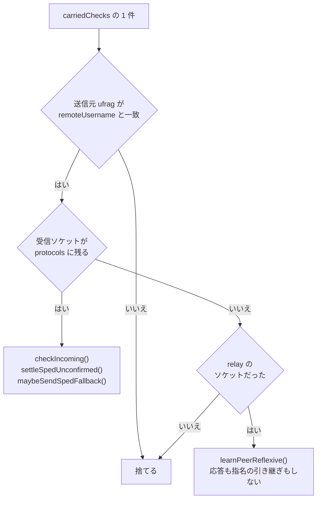

---
ide:
  viewer: review-document
  version: 1
  title: "werift 起点の ICE restart と Firefox: answer 前の check の引き継ぎ"
  dock: right
  baseCommit: 6e6d2d4aee7fdfba931072a2365496d48c1bb195
---
# werift 起点の ICE restart で Firefox への送信が止まる不具合の修正

## 1. 概要

answer の適用前に新しい ufrag 宛てに届いた connectivity check を、restart の commit 後に再生するようにしました。修正前はこの check から学んだ内容が commit で消えていました。Firefox の restart answer には候補がなく、成功した check も再送されないため、werift は新しい generation の pair を作れず、Firefox へ RTP も DataChannel も送れませんでした。

変更は ICE 層の内部に閉じています。`Connection` の公開 API と `iceBase.ts` は変えておらず、SDP の出力も変わらない想定です。比較範囲はベースの `develop`（`b925ad42d`、マージ済み）から HEAD の `6e6d2d4ae` までです。

前回版（`e72cbd57e`）の後、レビューの指摘で次の 2 点を直しました。2 回目の承認はこの修正を含みます。

- 同じ経路に値の大きい NOMINATION が後から届くと、捨てていました（2.2 節）。
- carried check の再生で、early check にある SPED の処理を呼んでいませんでした（3.2 節）。

**現行コードでは、Firefox の実機確認をしていません**（6 節）。

## 2. 修正前と修正後の流れ

### 2.1 restart 全体（develop と HEAD の比較）

<strong>Before: 受けた check が commit で消える</strong>
<svg viewBox="0 0 730 420" width="100%" role="img" aria-label="修正前の restart の流れ" style="font-family:var(--review-mono)">
<text x="100" y="16" fill="var(--review-fg)" font-size="12" text-anchor="middle">Firefox (controlled)</text><text x="542" y="16" fill="var(--review-fg)" font-size="12" text-anchor="middle">werift Connection (controlling)</text>
<g stroke="var(--review-border)"><line x1="100" y1="26" x2="100" y2="412"/><line x1="372" y1="26" x2="372" y2="412"/></g>
<line x1="100" y1="48" x2="372" y2="48" stroke="var(--review-muted)" stroke-width="1.5" /><path d="M372 48 l-8 -4 v8 z" fill="var(--review-muted)"/><text x="236" y="42" fill="var(--review-muted)" font-size="12" text-anchor="middle">① restart offer（新 ufrag）</text>
<rect x="372" y="34" width="340" height="28" rx="6" fill="var(--review-surface)" stroke="var(--review-muted)" stroke-width="1.5"/><text x="542" y="51" fill="var(--review-fg)" font-size="12" text-anchor="middle">stageLocalCredentials()</text>
<line x1="100" y1="94" x2="372" y2="94" stroke="var(--review-muted)" stroke-width="1.5" /><path d="M372 94 l-8 -4 v8 z" fill="var(--review-muted)"/><text x="236" y="88" fill="var(--review-muted)" font-size="12" text-anchor="middle">② check（新 ufrag 宛て）</text>
<line x1="372" y1="118" x2="100" y2="118" stroke="var(--review-muted)" stroke-width="1.5" /><path d="M100 118 l8 -4 v8 z" fill="var(--review-muted)"/><text x="236" y="112" fill="var(--review-muted)" font-size="12" text-anchor="middle">Binding success（再送はもう来ない）</text>
<rect x="372" y="78" width="340" height="62" rx="6" fill="var(--review-surface)" stroke="var(--review-muted)" stroke-width="1.5"/><text x="542" y="95" fill="var(--review-fg)" font-size="12" text-anchor="middle">provisionalChecklist.checkIncoming()</text><text x="542" y="111" fill="var(--review-fg)" font-size="12" text-anchor="middle">prflx と pair を provisional に記録</text><text x="542" y="127" fill="var(--review-fg)" font-size="12" text-anchor="middle">（check 自体は保存しない）</text>
<line x1="100" y1="170" x2="372" y2="170" stroke="var(--review-muted)" stroke-width="1.5" /><path d="M372 170 l-8 -4 v8 z" fill="var(--review-muted)"/><text x="236" y="164" fill="var(--review-muted)" font-size="12" text-anchor="middle">③ answer（候補なし）</text>
<rect x="372" y="154" width="340" height="78" rx="6" fill="var(--review-surface)" stroke="var(--review-danger)" stroke-width="1.5"/><text x="542" y="171" fill="var(--review-fg)" font-size="12" text-anchor="middle">restart() → provisionalChecklist.end()</text><text x="542" y="187" fill="var(--review-fg)" font-size="12" text-anchor="middle">checkList / earlyChecks は空</text><text x="542" y="203" fill="var(--review-fg)" font-size="12" text-anchor="middle">prflx・pair・受けた指名をすべて破棄</text><text x="542" y="219" fill="var(--review-fg)" font-size="12" text-anchor="middle">（引き継ぎ先がない）</text>
<rect x="372" y="242" width="340" height="46" rx="6" fill="var(--review-surface)" stroke="var(--review-muted)" stroke-width="1.5"/><text x="542" y="259" fill="var(--review-fg)" font-size="12" text-anchor="middle">commitLocalCredentials(ufrag)</text><text x="542" y="275" fill="var(--review-fg)" font-size="12" text-anchor="middle">資格情報だけを live にする</text>
<rect x="372" y="298" width="340" height="62" rx="6" fill="var(--review-surface)" stroke="var(--review-danger)" stroke-width="1.5"/><text x="542" y="315" fill="var(--review-fg)" font-size="12" text-anchor="middle">connect()</text><text x="542" y="331" fill="var(--review-fg)" font-size="12" text-anchor="middle">remote 候補なし → checkList が空</text><text x="542" y="347" fill="var(--review-fg)" font-size="12" text-anchor="middle">ICE negotiation failed</text>
<line x1="372" y1="386" x2="100" y2="386" stroke="var(--review-danger)" stroke-width="1.5" stroke-dasharray="6 5"/><path d="M100 386 l8 -4 v8 z" fill="var(--review-danger)"/><text x="236" y="380" fill="var(--review-danger)" font-size="12" text-anchor="middle">④ werift からの送信なし</text><text x="542" y="391" fill="var(--review-danger)" font-size="12" text-anchor="middle">nominated なし → 送れない</text>
<text x="365" y="414" fill="var(--review-muted)" font-size="11" text-anchor="middle">赤 = 問題の箇所 ／ 灰 = 正常な処理</text>
</svg>

<strong>After: 受けた check を commit 後の checklist で再生する</strong>
<svg viewBox="0 0 730 420" width="100%" role="img" aria-label="修正後の restart の流れ" style="font-family:var(--review-mono)">
<text x="100" y="16" fill="var(--review-fg)" font-size="12" text-anchor="middle">Firefox (controlled)</text><text x="542" y="16" fill="var(--review-fg)" font-size="12" text-anchor="middle">werift Connection (controlling)</text>
<g stroke="var(--review-border)"><line x1="100" y1="26" x2="100" y2="412"/><line x1="372" y1="26" x2="372" y2="412"/></g>
<line x1="100" y1="48" x2="372" y2="48" stroke="var(--review-muted)" stroke-width="1.5" /><path d="M372 48 l-8 -4 v8 z" fill="var(--review-muted)"/><text x="236" y="42" fill="var(--review-muted)" font-size="12" text-anchor="middle">① restart offer（新 ufrag）</text>
<rect x="372" y="34" width="340" height="28" rx="6" fill="var(--review-surface)" stroke="var(--review-muted)" stroke-width="1.5"/><text x="542" y="51" fill="var(--review-fg)" font-size="12" text-anchor="middle">stageLocalCredentials()</text>
<line x1="100" y1="94" x2="372" y2="94" stroke="var(--review-muted)" stroke-width="1.5" /><path d="M372 94 l-8 -4 v8 z" fill="var(--review-muted)"/><text x="236" y="88" fill="var(--review-muted)" font-size="12" text-anchor="middle">② check（新 ufrag 宛て）</text>
<line x1="372" y1="118" x2="100" y2="118" stroke="var(--review-muted)" stroke-width="1.5" /><path d="M100 118 l8 -4 v8 z" fill="var(--review-muted)"/><text x="236" y="112" fill="var(--review-muted)" font-size="12" text-anchor="middle">Binding success（再送はもう来ない）</text>
<rect x="372" y="78" width="340" height="62" rx="6" fill="var(--review-surface)" stroke="var(--review-success)" stroke-width="1.5"/><text x="542" y="95" fill="var(--review-fg)" font-size="12" text-anchor="middle">provisionalChecklist.checkIncoming()</text><text x="542" y="111" fill="var(--review-fg)" font-size="12" text-anchor="middle">prflx と pair を provisional に記録</text><text x="542" y="127" fill="var(--review-fg)" font-size="12" text-anchor="middle">＋ receivedChecks に check を保存</text>
<line x1="100" y1="170" x2="372" y2="170" stroke="var(--review-muted)" stroke-width="1.5" /><path d="M372 170 l-8 -4 v8 z" fill="var(--review-muted)"/><text x="236" y="164" fill="var(--review-muted)" font-size="12" text-anchor="middle">③ answer（候補なし）</text>
<rect x="372" y="154" width="340" height="78" rx="6" fill="var(--review-surface)" stroke="var(--review-success)" stroke-width="1.5"/><text x="542" y="171" fill="var(--review-fg)" font-size="12" text-anchor="middle">restart() → provisionalChecklist.end()</text><text x="542" y="187" fill="var(--review-fg)" font-size="12" text-anchor="middle">checkList / earlyChecks は空</text><text x="542" y="203" fill="var(--review-fg)" font-size="12" text-anchor="middle">end() の前に endedStagedChecks へ退避</text><text x="542" y="219" fill="var(--review-fg)" font-size="12" text-anchor="middle"></text>
<rect x="372" y="242" width="340" height="46" rx="6" fill="var(--review-surface)" stroke="var(--review-success)" stroke-width="1.5"/><text x="542" y="259" fill="var(--review-fg)" font-size="12" text-anchor="middle">commitLocalCredentials(ufrag)</text><text x="542" y="275" fill="var(--review-fg)" font-size="12" text-anchor="middle">ufrag 一致なら carriedChecks へ移す</text>
<rect x="372" y="298" width="340" height="62" rx="6" fill="var(--review-surface)" stroke="var(--review-success)" stroke-width="1.5"/><text x="542" y="315" fill="var(--review-fg)" font-size="12" text-anchor="middle">connect()</text><text x="542" y="331" fill="var(--review-fg)" font-size="12" text-anchor="middle">answer の remote ufrag を照合して再生</text><text x="542" y="347" fill="var(--review-fg)" font-size="12" text-anchor="middle">checkIncoming() → prflx pair を作る</text>
<line x1="372" y1="386" x2="100" y2="386" stroke="var(--review-success)" stroke-width="1.5" /><path d="M100 386 l8 -4 v8 z" fill="var(--review-success)"/><text x="236" y="380" fill="var(--review-success)" font-size="12" text-anchor="middle">④ triggered check（USE-CANDIDATE）</text><text x="542" y="391" fill="var(--review-success)" font-size="12" text-anchor="middle">nominated → RTP / DataChannel 再開</text>
<text x="365" y="414" fill="var(--review-muted)" font-size="11" text-anchor="middle">緑 = 修正で変わった箇所 ／ 灰 = 変更なし</text>
</svg>

図の要点は次のとおりです。

- 分かれ目は `restart()` です。修正前は `provisionalChecklist.end()` が、staged generation の受けた内容をすべて捨てていました。
- 修正後は check そのもの（`[Message, Address, Protocol]`）を残し、`connect()` で通常の `checkIncoming()` に渡します。prflx 候補の学習と triggered check は既存の経路が担います。
- werift 側で commit を起こすのは [packages/webrtc/src/transport/ice.ts:621](review-file:packages/webrtc/src/transport/ice.ts:621) の `restart()` と、直後の `commitLocalCredentials()` です。このファイルは変更していません。

チケット 10.1 節の調査では、ログ出力で処理が遅れ、Firefox の check が commit の後に届いた回は成功しました。トリクルでも、Firefox が新しい候補を送るため修正前から成功しています。

### 2.2 再指名の保持（レビューで見つかった、このブランチ内の不具合）

develop にあった不具合ではありません。この変更の途中版（`6c6a8b687`）の保存規則にあった問題です。controlling peer が answer の前に A=1、B=2、A=3 の順で再指名すると、A=3 が捨てられました。controlled 側の werift は `remoteNomination` が最大の経路を選ぶため、peer が選んだ A ではなく B を選ぶおそれがありました。

<strong>Before（6c6a8b687）: 指名済みなら後続を捨てる</strong>
<table style="width:100%;border-collapse:collapse;font-family:var(--review-mono);font-size:12px">
<tr><th align="left">到着</th><th align="left">保存値 A</th><th align="left">保存値 B</th></tr>
<tr><td>A=1</td><td>1</td><td>-</td></tr>
<tr><td>B=2</td><td>1</td><td>2</td></tr>
<tr><td>A=3</td><td style="color:var(--review-danger)"><b>1（3 を破棄）</b></td><td>2</td></tr>
<tr><td>commit 後の選択</td><td></td><td style="color:var(--review-danger)"><b>B（peer と不一致）</b></td></tr>
</table>

<strong>After（HEAD）: 経路ごとに最大値を残す</strong>
<table style="width:100%;border-collapse:collapse;font-family:var(--review-mono);font-size:12px">
<tr><th align="left">到着</th><th align="left">保存値 A</th><th align="left">保存値 B</th></tr>
<tr><td>A=1</td><td>1</td><td>-</td></tr>
<tr><td>B=2</td><td>1</td><td>2</td></tr>
<tr><td>A=3</td><td style="color:var(--review-success)"><b>3（置換）</b></td><td>2</td></tr>
<tr><td>両経路の check 完了後</td><td style="color:var(--review-success)"><b>A を選択</b></td><td></td></tr>
</table>

同じ入力に対する `rememberStagedCheck` の保存値の比較です。赤が問題の箇所、緑が修正後の結果です。

変更は [packages/ice/src/provisional.ts:709](review-diff:packages/ice/src/provisional.ts:commit:6e6d2d4ae:709) の比較です。保存済みの値が新しい値より大きいときだけ、新しい check を捨てます。値が同じなら新しい check に置き換えます。通常の check の値は 0、`USE-CANDIDATE` だけの check の値は 1 です（[packages/ice/src/internal/checkMessages.ts:44](review-file:packages/ice/src/internal/checkMessages.ts:44)）。

commit の直後は、triggered check が先に成功した B が一時的に選ばれることがあります。その後 A の check が成功すると、通常の renomination の規則で A に移ります。テストは両経路の check の完了を待ってから判定します。

## 3. 主要変更

### 3.1 check の記録（`provisional.ts`）

- [packages/ice/src/provisional.ts:578](review-diff:packages/ice/src/provisional.ts:commit:0767eeacb:578): 応答対象の check を `receivedChecks` に記録します。記録位置は `allows()` と remote ufrag の判定より後です。除外されるソケットの check や、既知の remote ufrag と異なる check は残りません。
- [packages/ice/src/provisional.ts:688](review-diff:packages/ice/src/provisional.ts:commit:0767eeacb:688): `rememberStagedCheck` は上限を 32 件（`MAX_CARRIED_CHECKS`）にします。pranswer がない時点では相手の ufrag が分からないため、次の規則で正しい check が押し出されるのを防ぎます。
  - 送信元 ufrag、アドレス、ソケットが同じ check は、新しいもので置き換えます。
  - ただし、保存済みの check の指名の値が新しい check より大きい場合は置き換えません（2.2 節。この条件は `6e6d2d4ae` で変えたため、上のリンクが開く初版の差分とは異なります）。
  - 満杯なら、最も多くの件数を持つ送信元 ufrag の最古の 1 件を捨てます。

### 3.2 引き継ぎの受け渡し（`ice.ts`）

check は `receivedChecks` → `endedStagedChecks` → `carriedChecks` の順に移ります。

- [packages/ice/src/ice.ts:770](review-diff:packages/ice/src/ice.ts:commit:0767eeacb:770): `restart()` は `end()` の前に記録を退避します。pranswer で checks を始めた（`started`）generation は対象外です。
- [packages/ice/src/ice.ts:983](review-diff:packages/ice/src/ice.ts:commit:0767eeacb:983): `commitLocalCredentials()` は、退避した ufrag が commit する ufrag と一致し、`earlyChecksDone` が false のときだけ `carriedChecks` に移します。
- [packages/ice/src/ice.ts:1946](review-diff:packages/ice/src/ice.ts:commit:0767eeacb:1946): `connect()` は通常の `earlyChecks` より先に再生します。送信元が answer の remote ufrag と一致しない check は捨てます。
- 再生した check には、early check と同じく `settleSpedUnconfirmed` と `maybeSendSpedFallback` を適用します（[packages/ice/src/ice.ts:1961](review-diff:packages/ice/src/ice.ts:commit:6e6d2d4ae:1961)）。restart は SPED runtime を reset するため、新しい generation でも SPED が動きます。session が fallback になっていれば、再生で学んだ経路へ handshake の flight を直送します。
- 破棄する経路は、置き換えの offer（[packages/ice/src/ice.ts:942](review-diff:packages/ice/src/ice.ts:commit:0767eeacb:942)）、`restartRemote()`（[packages/ice/src/ice.ts:914](review-diff:packages/ice/src/ice.ts:commit:0767eeacb:914)）、`close()`（[packages/ice/src/ice.ts:2308](review-diff:packages/ice/src/ice.ts:commit:0767eeacb:2308)）です。次の `restart()` も `carriedChecks` を空にします。rollback は staged generation を先に捨てるため、退避する対象がありません。

### 3.3 閉じた TURN allocation の扱い

commit で TURN allocation が差し替わると、その allocation では応答できません。この場合は [packages/ice/src/ice.ts:3743](review-diff:packages/ice/src/ice.ts:commit:0767eeacb:3743) の `learnPeerReflexive` が相手のアドレスだけを prflx 候補にし、現在のソケットから確認します。旧 pair への指名は引き継ぎません。

チケット 10.2 節には「今も使っているソケットに届いたものだけを再生する」とだけあり、この relay の分岐は書かれていません。`checkIncoming()` で再生しないという意味では一致しますが、アドレスは学習される点に注意してください。

### 3.4 テスト、リーク監視、changelog

- [packages/ice/tests/ice/restart-early-checks.test.ts:12](review-diff:packages/ice/tests/ice/restart-early-checks.test.ts:commit:0767eeacb:12): 初版で 7 ケースを追加しました。内容は、主ケース（nominate と双方向のデータ）、置き換えの offer、rollback、別の remote ufrag、別 ufrag の check 64 件による容量超過、指名の保持、閉じた relay です。
- [packages/ice/tests/utils.ts:4547](review-diff:packages/ice/tests/utils.ts:commit:0767eeacb:4547): 共通の Arrange です。`b` は check を終えたあと再送せず指名を待ち、answer は使える候補を持ちません。`incomingCheckTimeout` は 1 秒です。
- [packages/ice/tests/ice/restart-early-checks.test.ts:184](review-diff:packages/ice/tests/ice/restart-early-checks.test.ts:commit:6e6d2d4ae:184): 再指名の 3 ケースを追加し、合計 10 ケースになりました。大きい値での置換、小さい値や通常の check で消えないこと、commit 後に A が選ばれることを確かめます。共通の準備は [packages/ice/tests/utils.ts:4664](review-file:packages/ice/tests/utils.ts:4664) の `createRenominatedBeforeAnswer` です。
- [packages/ice/tests/sped/restart.test.ts:391](review-diff:packages/ice/tests/sped/restart.test.ts:commit:6e6d2d4ae:391): 再生した check の経路へ fallback の flight を直送するテストを追加しました。テストは fallback への移行を直接起こし、mock の `Protocol` で送信を記録します。実際の DTLS と組み合わせた restart ではありません。
- [packages/webrtc/tests/pbt/leak/leakProbe.ts:491](review-diff:packages/webrtc/tests/pbt/leak/leakProbe.ts:commit:0767eeacb:491): leak probe に `ice.carriedChecks` を追加しました。`endedStagedChecks` の件数も合算します。
- [changelog.md:72](review-diff:changelog.md:commit:6e6d2d4ae:72): `## Unreleased` の Bug Fixes に記載しました。初回レビューで公開済みの `v0.28.0` 節にあると指摘され、`e72cbd57e` で移しました。`6e6d2d4ae` で、指名の最大値と SPED の扱いを追記しています。

ICE の行番号付き diff リンクは、コミットを固定しています。`0767eeacb` が初版の差分、`6e6d2d4ae` がレビュー指摘への追加差分で、行番号は各コミット時点のものです。HEAD の ICE ソースには、このほかに途中の develop マージ（`6c6a8b687`）が入っています。

## 4. 判断理由

- **check を再生する方式（チケットの案 1）**: 初回接続の early check と同じ `checkIncoming()` を通るため、prflx の学習、triggered check、指名の反映を作り直さずに済みます。
- **provisional の prflx 候補を live に移す方式（案 2）は不採用**: answer が届くまで remote ufrag が分からず、live の pair が持つ ufrag 照合の条件と整合させる処理が必要になります。
- **タイマーでの再送や Firefox だけの分岐は不採用**: チケットが対症療法として除外しています。原因は werift が受信内容を捨てることにあります。
- **`started` の generation を除外**: pranswer の経路は `nominationHint` で経路を引き継ぎます。この既存の挙動を変えないためです。
- **webrtc の negotiation case は追加しない**: werift 同士の answer には候補が入るため再現しません。他実装の SDP の形を `tests/negotiation/cases` で作ることも禁止されています（チケット 10.2 節）。

詳しい調査記録は [docs/tickets/TICKET-ticket-bfc84a9e-9ca3-4900-8210-00854f576265.md:107](review-file:docs/tickets/TICKET-ticket-bfc84a9e-9ca3-4900-8210-00854f576265.md:107) 以降にあります。

## 5. レビュアーが確認すべき点とリスク

1. **Firefox の確認は現行コードより前の結果**: チケットの目的は Firefox との相互接続ですが、直結確認の後に `ice.ts` と `provisional.ts` を変えています。最終レビューは 18/18 を「同一コード」の結果と書いています。実際の対象は `0767eeacb` で、HEAD のコードとは異なります。チケット 9 章はすべてチェック済みですが、一部は移植前の結果に基づきます（10.4 節）。
2. **再指名の途中経過**: commit 直後に B が一時的に選ばれ、その後 A に移ることがあります。確認はテスト内の ICE agent 同士で、実際の controlling peer との再指名は試していません。
3. **32 件の上限が守る範囲**: 1 つの誤った ufrag からの大量の check は、別の ufrag の check を押し出しにくい作りです。一方、全送信元が 1 件ずつで満杯の場合は、先に登録された送信元の check から落ちます。テストが確かめているのは、1 つの別 ufrag から 64 件届く場合です。
4. **挙動の変化**: answer の前に check を受けた restart では、commit 後の checklist に prflx の pair が加わります。answer に候補がある相手でも同じです。再生時には SPED の fallback flight を直送することもあります。commit 時に `nominated` を捨て、再指名まで送信しない仕様は変えていません。
5. **relay の分岐のテスト**: テストは `carriedChecks` に偽の relay `Protocol` を直接入れています。実際の TURN サーバーで allocation が差し替わる流れは通していません。
6. **別件の DTLS 不具合**: werift が初回の offer を出し、Firefox が DTLS client になる構成では、HelloVerifyRequest に Firefox が `decode_error` を返します。ベース `7ca1d86aa` でも再現すると報告されています（現行の `b925ad42d` での再確認は記録にありません）。この差分は dtls に触れていません。別チケットでの調査が推奨されています。

## 6. 検証結果

対象リビジョンごとに分けます。「この文書の作成時」以外は、レビュー記録、チケット、CI 履歴からの転記で、再実行していません。

### HEAD（`6e6d2d4ae`）

| 実行者 | 項目 | 結果 |
| --- | --- | --- |
| この文書の作成時 | `packages/ice` で `npx vitest run`（`tests/ice/restart-early-checks.test.ts`、`tests/ice/provisional.test.ts`、`tests/sped/restart.test.ts`） | 3 ファイル、33 件がすべて成功 |
| 2 回目の最終承認レビュー | `restart-early-checks.test.ts` | 10 件が成功 |
| 同上 | `packages/ice` の全テスト | 2,415 件が成功、10 件は skip |
| 同上 | ICE deep property search | 30,800 件が成功 |
| 同上 | `packages/ice` の型検査、`git diff --check` | 成功 |

### 指摘への対応時（チケット 10.6 節。`6c6a8b687` に未コミットの修正を加えた作業ツリー）

- `packages/ice` 2,415 件、`packages/webrtc` 3,322 件が成功し、`npm run type` も成功しました。
- negotiation-diff は `b925ad42d` と比較し、seeds 11–40（各 12 steps）で regressions / divergences / hangs / transceiver state differences がすべて 0 でした。seeds 1–10 の 0 件は以前のレビューの結果で、この修正より前のものです。seeds 41–80 は実行していません。
- チケットは、追加したテストが修正前のコードで失敗することも記録しています（再指名は 3 件中 2 件、SPED は直送されない）。この文書の作成時には再現していません。

### 追加修正より前のリビジョン（参考。HEAD の結果ではない）

| 対象 | 項目 | 結果 |
| --- | --- | --- |
| `e72cbd57e` | 自動 CI の `npm run ci`（チケットの CI 履歴にある記録はこの 1 件） | 成功 |
| `e72cbd57e` | 1 回目の最終承認レビュー: Chrome / DTLS E2E | 108 件が成功 |
| `e72cbd57e` | 同上: WebRTC deep search | fuzz / model / scenario と leak の構造検査は成功。heap slope の seed 2 / 4 は失敗し、develop でも同じ seed が失敗 |
| `0767eeacb` | 初回レビュー: Firefox 157 の直結確認 | ベースは 2/18、修正後は 18/18 が成功 |
| `0767eeacb` | 同上: Chrome の E2E | restart は `--retry=0` の 5 回で 10/10 が成功。全体は 71 件成功、6 件失敗（失敗した relay 関連はベースでも失敗） |

- Firefox の 18/18 の条件は、3 ポリシー × `legacy` / `compatible` × 3 回で、Firefox が初回の offer を出し（werift が DTLS client）、各側が gathering の完了後に SDP を渡す方式です。トリクルと、werift が初回の offer を出す構成は含みません。
- heap slope の seed 2 / 4 は、初回レビューの単独再実行ではベースと変更後の両方で成功しました。後のレビューやチケット 10.4 節（develop でも失敗）と異なるため、結果が安定しない検査として扱ってください。
- 移植前の別ブランチ（基準 `dc95a5a49`）では、Firefox の直結確認が 36/36、80 seeds の negotiation-diff が差分 0 でした（チケット 10.3 節）。

### HEAD で結果の記録を確認できなかったもの

Firefox の直結確認、Chrome の E2E、WebRTC の deep property search、80 seeds 全体の negotiation-diff です。Firefox の一時 harness はチケットが指す場所になく、再実行できなかったと 10.6 節に記録されています。
