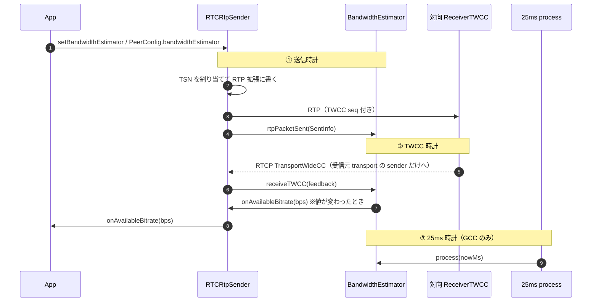
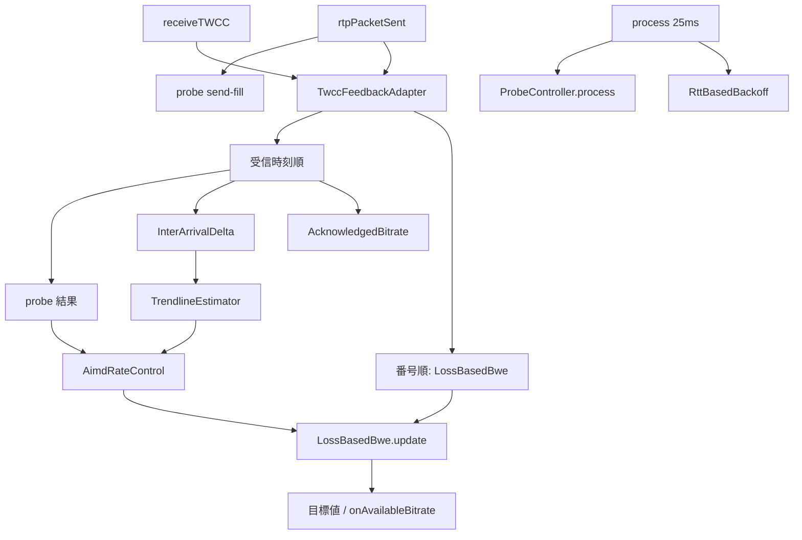
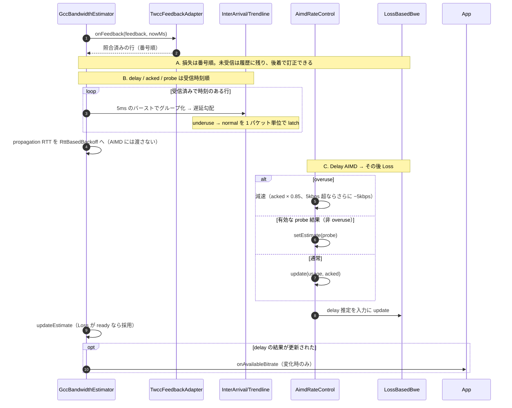

---
ide:
  viewer: review-document
  version: 1
  title: "TWCC と GCC の仕組み — 実装の呼び出し順で読む"
  dock: right
  baseCommit: a94ad03ea357bfb4d2b738b75fce3a7b2b364e78
---
# TWCC と GCC の仕組み — 実装の呼び出し順で読む

この文書は、werift の **TWCC（観測を返す仕組み）** と **帯域推定（legacy / GCC）** を、現行コードの呼び出し順に沿って説明します。仕様ドラフトの要約ではなく、「どのファイルが何を担当し、パケットと feedback がどこを通るか」を追います。

legacy と GCC が同じ観測から別の値を出す様子は、数値つきの図解 [reviews/c724daf9-gcc-vs-legacy.html](review-file:reviews/c724daf9-gcc-vs-legacy.html) にあります。テストの構成は [reviews/c724daf9-twcc-tests.md](review-file:reviews/c724daf9-twcc-tests.md) です。

## 1. 概要

### 1.1 役割の分担

| 層 | 役割 | 置き場 |
| --- | --- | --- |
| TWCC | 送信パケットに番号を付け、到達 / 未到達と受信時刻を **観測して返す**（[draft-holmer-rmcat-transport-wide-cc-extensions-01](https://datatracker.ietf.org/doc/html/draft-holmer-rmcat-transport-wide-cc-extensions-01)） | RTP 拡張、RTCP FB、`ReceiverTWCC` |
| 照合 | feedback の 16-bit 番号を送信履歴に対応づける（legacy / GCC 共通） | `TwccFeedbackAdapter` |
| 帯域推定 | 観測から **推奨送信ビットレート（bps）** を出す。既定は legacy、選択で GCC | `BandwidthEstimator` の実装 |
| アプリ | 推定値に追従する | `RTCRtpSender.onAvailableBitrate` |

TWCC はアルゴリズムを規定しません。werift ではこの分担を共通 interface [bandwidthEstimator.ts:76](review-file:packages/webrtc/src/media/sender/bandwidthEstimator.ts:76) に落としています。必須は入力 `rtpPacketSent` / `receiveTWCC` と出力 `availableBitrate` / `onAvailableBitrate` で、probe・RTT・process 周期は legacy / disabled では何もしないフックです。

アプリが購読するのは estimator 本体ではなく sender のブリッジ [rtpSender.ts:170](review-file:packages/webrtc/src/media/rtpSender.ts:170) です。単位は **bps**、値が変わったときだけ発火し（[bandwidthEstimator.ts:341](review-file:packages/webrtc/src/media/sender/bandwidthEstimator.ts:341)）、`setBandwidthEstimator` で差し替えても購読は残ります。

```ts
sender.onAvailableBitrate.subscribe((bps) => {
  // encoder / simulcast を bps に合わせる
});
sender.setBandwidthEstimator(new GccBandwidthEstimator());
// または new RTCPeerConnection({ bandwidthEstimator: "gcc" })
```

### 1.2 直感 — 道路のたとえ

ボトルネックを料金所にたとえると、GCC が読む観測は 3 種類です。

| 観測 | たとえ | GCC の反応 |
| --- | --- | --- |
| 遅延の傾き | 料金所の手前で車が並び始める | 右肩上がり（overuse）なら減速 |
| ロス | 並びきれずに車が落ちる | 消えた量が続けば天井を下げる。後から届いた報告で取り消せる |
| probe（試し打ち） | わざと少し速く走ってみる | 返事がよければ推奨値を上げる |

GCC は荷物（パケット）を作りません。「今この道に秒間どれだけ流してよいか」を提案するだけで、画質を落とすのはアプリです。

### 1.3 時計は 3 本

GCC は 1 本の巨大なループではありません。時刻の流れが 3 つあり、混ぜないことで推定が暴れないようにしています。

| 時計 | 誰が叩く | 何をする | 何をしない |
| --- | --- | --- | --- |
| 送信 | 各 RTP | 送信履歴に残す、probe を埋める | 推定値を更新しない |
| TWCC | 受信側からの RTCP | 照合し、delay / loss / probe 結果を更新 | 25ms 周期の処理は呼ばない |
| 25ms | sender のタイマ（GCC のときだけ） | 履歴の掃除、RTT backoff、probe の進行、目標の公開 | 新しい遅延サンプルは作らない |



## 2. プロトコル経路（TWCC）

### 2.1 送信側: transport-wide sequence の付与

TSN のカウンタは **DTLS transport 共有**、推定器は **sender ごと** です。

- TSN は送信の直前に同期で割り当てます: [rtpSender.ts:1102](review-file:packages/webrtc/src/media/rtpSender.ts:1102) → [dtls.ts:492](review-file:packages/webrtc/src/transport/dtls.ts:492) の `allocateTransportWideSequence()`。ワイヤーには下位 16 bit、`SentInfo.wideSeq` には拡張値（周回しても単調）を使います。await の後に transport の現在値を読むと、BUNDLE で他 sender の TSN を拾うためです。
- 2 バイトの拡張は [headerExtension.ts:123](review-file:packages/rtp/src/rtp/headerExtension.ts:123) の `serializeTransportWideCC` が書きます。
- TWCC / abs-send-time は hop-by-hop です。転送元パケットの古い値で上書きしないよう、[sendHeaderExtensions.ts:64](review-file:packages/rtp/src/rtp/sendHeaderExtensions.ts:64)（`werift-rtp`） で merge 対象から外しています。
- 送信完了後、TWCC が交渉済みなら `SentInfo`（[bandwidthEstimator.ts:8](review-file:packages/webrtc/src/media/sender/bandwidthEstimator.ts:8)）を estimator に渡します（[rtpSender.ts:1163](review-file:packages/webrtc/src/media/rtpSender.ts:1163)）。`size` は SRTP 後の実バイト、`sendingAtMs` は ICE に渡す直前、`sentAtMs` は送信完了の時刻です。TWCC 未交渉なら BWE も probe padding も動きません。
- estimator の差し替えや transport 切替の前に始まった送信は、推定器の世代番号（`EstimatorBinding.generation`、[estimatorBinding.ts:62](review-file:packages/webrtc/src/media/sender/estimatorBinding.ts:62)）が一致しないので estimator に報告しません。
- NACK の再送も同じ送信経路を通り、**新しい TSN** が付きます。

送信経路は estimator で分かれます。legacy / disabled（`processIntervalMs = 0` かつ padding 0）は develop と同じく DTLS へ直接書きます。GCC は上限付きの送信 FIFO と pacer を通ります（[rtpSender.ts:801](review-file:packages/webrtc/src/media/rtpSender.ts:801) の `needsPacedSendPath`）。

### 2.2 受信側: feedback 生成

[rtpReceiver.ts:751](review-file:packages/webrtc/src/media/rtpReceiver.ts:751) は TWCC 拡張を持つパケットだけを [receiverTwcc.ts:108](review-file:packages/webrtc/src/media/receiver/receiverTwcc.ts:108) の `ReceiverTWCC` に入れます。`ReceiverTWCC` は DTLS transport ごとに 1 つで、BUNDLE の audio / video が共有します（[receiverTwcc.ts:53](review-file:packages/webrtc/src/media/receiver/receiverTwcc.ts:53)）。

- 周期 **100ms**、またはバッファ **> 10 パケット** で RTCP Transport-cc（PT=205, FMT=15）を送ります。
- 受信 TSN は、これまでに受信した最大の拡張 TSN を基準に展開します（[receiverTwcc.ts:316](review-file:packages/webrtc/src/media/receiver/receiverTwcc.ts:316)）。前方へ半周（32768）までの飛びは前方、それより後ろは遅着です。
- 報告は前回の続き（`nextReportTsn`）から始め、ギャップは `PacketNotReceived` にします。1 回の報告は最大 32767 件で、保留分はその長さの窓に分けて送ります（[receiverTwcc.ts:174](review-file:packages/webrtc/src/media/receiver/receiverTwcc.ts:174)）。欠落だけで窓が埋まるときは、開始番号を次の受信パケットまで進めます。
- **dumb receiver** です。報告済みの番号に遅れて届いたパケットは再報告しません（corrective feedback はしない）。
- `reference_time` は 64ms 量子化で、最初の recv delta はその切り捨て基準からの差分です。

### 2.3 送信側: feedback の配送と復元

- [router.ts:510](review-file:packages/webrtc/src/media/router.ts:510) が TWCC を、**受信元 transport に今いる全 sender** に配ります。`media_ssrc` は最後の RTP の SSRC にすぎず、TSN の持ち主を表さないためです。受信元 transport が分かるときは、SSRC で別 transport の sender を選びません。
- [twcc.ts:238](review-file:packages/rtp/src/rtcp/rtpfb/twcc.ts:238) の `packetResults` は RunLength / StatusVector を単一の番号 cursor で展開し、受信済みだけに delta を積んで受信時刻を復元します。
- sender は [rtpSender.ts:1252](review-file:packages/webrtc/src/media/rtpSender.ts:1252) で現在の estimator の `receiveTWCC` に渡します。

### 2.4 照合: `TwccFeedbackAdapter`（legacy / GCC 共通）

[twccFeedbackAdapter.ts:64](review-file:packages/webrtc/src/media/sender/estimators/twccFeedbackAdapter.ts:64) は、どの estimator より先に feedback を正規化します（libwebrtc `TransportFeedbackAdapter` 相当）。

- 送信履歴は拡張 TSN をキーに持ちます。feedback の 16-bit 番号は、直前の feedback を基準に最も近い拡張番号へ戻します（初回は最新の送信番号が基準）。
- 履歴の番号 span は 32768 未満（[twccFeedbackAdapter.ts:17](review-file:packages/webrtc/src/media/sender/estimators/twccFeedbackAdapter.ts:17)）なので、同じ 16-bit 番号の候補は常に 1 つです。
- 受信と確定した番号は履歴から消すので、重複・重なり合う feedback が来ても **受信として数えるのは高々 1 回** です。未受信と報告された番号は履歴に残り、後の feedback で受信に訂正できます。
- 他の BUNDLE sender の番号は履歴にないので捨てます。

時刻の取り決め（[twccFeedbackAdapter.ts:47](review-file:packages/webrtc/src/media/sender/estimators/twccFeedbackAdapter.ts:47)）:

| 時刻 | 意味 |
| --- | --- |
| `SentInfo.sendingAtMs` | ICE に渡す直前 |
| `SentInfo.sentAtMs` | 送信完了（`onSent()` はこの時刻以降に呼ばれる） |
| `onFeedback(feedback, nowMs)` / `prune(nowMs)` の `nowMs` | feedback の到着 / 呼び出し側の tick |

adapter はこれらの最大値を単調な時計として持ち、パケットの age を `clock − sendingAtMs` とします。`onFeedback()` は照合した各エントリを **その場で** 範囲判定（age ≤ 時間窓、かつ最新番号から span 32768 未満）し、範囲外は返しません。掃除はメモリを抑えるだけで、正しさは照合時に保証します。時間窓は legacy 10 秒、GCC 60 秒です。

## 3. legacy（既定）

[legacyCumulativeBwe.ts:32](review-file:packages/webrtc/src/media/sender/estimators/legacyCumulativeBwe.ts:32) の `SenderBandwidthEstimator` です（mediasoup 由来）。

1. `rtpPacketSent` は adapter に送信履歴を記録するだけです。
2. `receiveTWCC`（[legacyCumulativeBwe.ts:95](review-file:packages/webrtc/src/media/sender/estimators/legacyCumulativeBwe.ts:95)）は adapter が返した行のうち、受信済みで時刻を持つ行を `CumulativeResult` に積みます。照合が 0 件の feedback（他 sender 宛て）は無視します。
3. 経過 ≥ 100ms かつ ≥ 20 パケットで `min(sendBitrate, receiveBitrate)` を推定値にします。
4. 1 秒を超えて更新できないと congestion counter / score を悪化させます（legacy 固有。共通 interface には載せない）。

probe・pacing・25ms process はありません。

## 4. GCC

### 4.1 構成

[gccBwe.ts:102](review-file:packages/webrtc/src/media/sender/estimators/gcc/gccBwe.ts:102) の `GccBandwidthEstimator` は libwebrtc goog_cc の send-side を参考にした実装です。初期目標は **300 kbps**、下限は **5 kbps** です（[constants.ts:19](review-file:packages/webrtc/src/media/sender/estimators/gcc/constants.ts:19)、[constants.ts:40](review-file:packages/webrtc/src/media/sender/estimators/gcc/constants.ts:40)）。



### 4.2 送信時計 — `rtpPacketSent` は履歴だけ

[gccBwe.ts:552](review-file:packages/webrtc/src/media/sender/estimators/gcc/gccBwe.ts:552) では推定を更新しません（libwebrtc の `OnSentPacket` と同じ）。ALR のバイト計上、adapter への記録、最初のパケットでの propagation RTT の初期化、予約済み `probeClusterId` への send-fill だけです。

probe 中の送信は、送信の **前** に cluster id を予約します（[rtpSender.ts:988](review-file:packages/webrtc/src/media/rtpSender.ts:988) → [probeController.ts:302](review-file:packages/webrtc/src/media/sender/estimators/gcc/probeController.ts:302)）。非同期の送信完了時に「その時点の cluster」へ誤って計上しないためです。

### 4.3 TWCC 時計 — GCC の本流

入口は [gccBwe.ts:590](review-file:packages/webrtc/src/media/sender/estimators/gcc/gccBwe.ts:590) です。順番は **delay（必要なら probe を AIMD に載せる）→ loss → 最終目標** です。probe を loss の後に載せると、同じ feedback のロス制約をすり抜けてしまいます。



**遅延経路** — [interArrivalDelta.ts:67](review-file:packages/webrtc/src/media/sender/estimators/gcc/interArrivalDelta.ts:67) が送信時刻 5ms 以内のパケットを群にまとめ、群間の send / recv の差を出します（並べ替えは無視、3 回続くとやり直し）。[trendlineEstimator.ts:42](review-file:packages/webrtc/src/media/sender/estimators/gcc/trendlineEstimator.ts:42) が直近 20 群で遅延勾配の回帰を取り、適応閾値で **overuse / underuse / normal** を出します。2 秒サンプルがなければ遅延経路をやり直します（[gccBwe.ts:694](review-file:packages/webrtc/src/media/sender/estimators/gcc/gccBwe.ts:694)）。

| 判定 | 意味 | 反応 |
| --- | --- | --- |
| overuse | 列が伸びている | 減速。probe の上昇は採用しない |
| underuse | 列が解けている最中 | 新しい probe を出さない |
| normal | 勾配が落ち着いている | underuse から戻った瞬間だけ recovery probe を検討（[gccBwe.ts:710](review-file:packages/webrtc/src/media/sender/estimators/gcc/gccBwe.ts:710)） |

[aimdRateControl.ts:34](review-file:packages/webrtc/src/media/sender/estimators/gcc/aimdRateControl.ts:34) の AIMD は、減少 `acked × 0.85`、増加上限 `1.5 × acked + 10 kbps`、乗法増加 `1.08^Δt`、RTT に応じた加法増加です。AIMD の RTT は RTCP RR の生の値だけを使います（§4.6）。到達スループットは [acknowledgedBitrateEstimator.ts:51](review-file:packages/webrtc/src/media/sender/estimators/gcc/acknowledgedBitrateEstimator.ts:51) が TWCC の相対受信時刻から求め、壁時計に依存しません。

**ロス経路** — Delay のあと、同じ feedback の観測を [lossBasedBwe.ts:125](review-file:packages/webrtc/src/media/sender/estimators/gcc/lossBasedBwe.ts:125) に渡します（[gccBwe.ts:862](review-file:packages/webrtc/src/media/sender/estimators/gcc/gccBwe.ts:862)）。byte ベースの観測を貯め、既定では送信時刻幅 250ms 以上の観測が最低 3 個そろうまで（`IsReady()`）目標に採用しません。状態は `increasing` / `increase_using_padding` / `decreasing` / `delay_based` です。後から届いた受信報告で取り消せるのは未確定の観測のロスだけで、確定済みの観測は書き換えません。

**最終目標** — [gccBwe.ts:1194](review-file:packages/webrtc/src/media/sender/estimators/gcc/gccBwe.ts:1194) の `updateEstimate` は、高 RTT なら ×0.8 の backoff を優先し、Loss が ready ならその結果、それまでは delay 上限まで、という順で決め、アプリ指定の min / max で clamp します。通常経路では `min(遅延側の上限, ロス側の提案)` です。

### 4.4 25ms 時計 — `process(nowMs)`

[gccBwe.ts:362](review-file:packages/webrtc/src/media/sender/estimators/gcc/gccBwe.ts:362) の順は次のとおりです。sender は GCC のときだけ 25ms タイマを回します（[estimatorBinding.ts:112](review-file:packages/webrtc/src/media/sender/estimatorBinding.ts:112)）。

1. adapter の送信履歴を掃除（メディアが止まっても履歴が残らない）
2. loss padding の積算
3. 初回の probe 設定（`ensureProbing`。network available の後）
4. 目標の更新（高 RTT なら ×0.8）
5. ALR の同期
6. `ProbeController.process`（新しい cluster の起動）
7. 目標の公開（`propagateTarget`）

新しい遅延サンプルはここでは作りません。初期の 3x / 6x probe は DTLS が connected になってから始まります（[gccBwe.ts:521](review-file:packages/webrtc/src/media/sender/estimators/gcc/gccBwe.ts:521) の `setNetworkAvailable`）。

### 4.5 probe と pacing

[probeController.ts:135](review-file:packages/webrtc/src/media/sender/estimators/gcc/probeController.ts:135) は `init` → `waiting_for_result` → `complete` です。初期は推定の 3 倍と 6 倍を FIFO で並べ、further は ×2 です。

- 次の送信時刻は `started_at + sent_bytes / send_bitrate` です。最初の間隔は 20ms、その後 2ms。予定より 10ms 以上遅れた active cluster は捨てます。5 秒の期限切れは、まだ送っていない queued cluster だけです。
- pacing の完了は「minBytes **かつ** minPackets を送った」ときです。ACK が 80% 来ただけでは切りません。
- メディアだけで cluster が埋まらないときは padding-only RTP を足します（[rtpSender.ts:866](review-file:packages/webrtc/src/media/rtpSender.ts:866)）。padding は **RTX の SSRC・PT・seq** で送るので、media の seq はずれません（[rtpSender.ts:1012](review-file:packages/webrtc/src/media/rtpSender.ts:1012)）。RTX が交渉されていない sender は padding を送りません（`GCC_KNOWN_DIFFERENCES`）。
- メディアの pacing レートは [gccBwe.ts:286](review-file:packages/webrtc/src/media/sender/estimators/gcc/gccBwe.ts:286) の `getPacingBitrateBps` です。初回 TWCC 前は 2.5 倍、以降は 1.1 倍、probe 中は probe 目標との大きい方です。

新しい probe を出してよいかは [bandwidthLimitedCause.ts:42](review-file:packages/webrtc/src/media/sender/estimators/gcc/bandwidthLimitedCause.ts:42) の `getBandwidthLimitedCause` で決めます。

| いまの状態 | cause | 新規 probe |
| --- | --- | --- |
| delay が overuse / underuse | `delay_based_limited_delay_increased` | 出さない |
| CorrectedRtt > 3s | `rtt_based_back_off_high_rtt` | 出さない |
| loss decreasing / increase_using_padding | `loss_limited_bwe` | 出さない |
| loss increasing | `loss_limited_bwe_increasing` | 出す（上限は推定の 1.5 倍） |
| delay_based | `delay_based_limited` | 出す |

### 4.6 RTT は 2 系統 — 混ぜない

| 経路 | 入力 | 用途 |
| --- | --- | --- |
| TWCC propagation | `feedback_rtt − pending_time` の最小値 | [rttBasedBackoff.ts:22](review-file:packages/webrtc/src/media/sender/estimators/gcc/rttBasedBackoff.ts:22)。`CorrectedRtt = 返事が途絶えた時間 + propagation` が 3 秒を超えたら、1 秒ごとに目標を ×0.8（床 5 kbps） |
| RTCP RR の生の値 | `now − lastSR − DLSR` | AIMD の `setRoundTripTime` だけ（[rtpSender.ts:1240](review-file:packages/webrtc/src/media/rtpSender.ts:1240) → [gccBwe.ts:469](review-file:packages/webrtc/src/media/sender/estimators/gcc/gccBwe.ts:469)）。stats 用に平滑化した値は渡さない |

### 4.7 アプリ指定の制約

[gccBwe.ts:429](review-file:packages/webrtc/src/media/sender/estimators/gcc/gccBwe.ts:429) の `setBitrates(min, start, max)` は制約を **置き換え** ます（前回値とは合成しない）。max を指定すると目標値と probe の上限の両方に効きます。

## 5. 差し替えと transport 切替

| 操作 | sender の処理 | estimator の状態 |
| --- | --- | --- |
| `setBandwidthEstimator(impl)`（[rtpSender.ts:366](review-file:packages/webrtc/src/media/rtpSender.ts:366)） | 世代番号を進め、旧インスタンスを dispose / reset、新インスタンスも reset、ブリッジを付け替える | すべて初期化（暗黙の引き継ぎなし） |
| 別の DTLS transport へ移る（[rtpSender.ts:318](review-file:packages/webrtc/src/media/rtpSender.ts:318) → [rtpSender.ts:384](review-file:packages/webrtc/src/media/rtpSender.ts:384)） | 世代番号を進め、`resetNetworkRoute()` があれば呼び、なければ `reset()` | 経路に依存する状態（送信履歴、TSN 基準、推定、probe）だけを初期化。GCC は `setBitrates` の min / start / max を保つ（[gccBwe.ts:943](review-file:packages/webrtc/src/media/sender/estimators/gcc/gccBwe.ts:943)） |

transport 切替は、`bundlePolicy: "balanced"` の初回交渉で BUNDLE が受理され、video sender が audio の transport に統合されるときにも起きます。新しい transport は別の TSN 空間なので、旧 transport の番号基準や遅れて届く旧 transport の feedback（§2.3）を持ち込まないようにしています。

## 6. 判断理由

1. **共通 interface を薄く保つ** — アプリは `onAvailableBitrate(bps)` だけ追えば足ります。overuse や congestion score はアルゴリズム固有なので、具象インスタンス側に置きます。
2. **照合を 1 か所にまとめる** — 16-bit 番号の世代解決と重複排除を estimator ごとに書くと、レビューで反例が続きました。`TwccFeedbackAdapter` に集約し、正しさを照合時の範囲判定で保証しています（チケット §2.11）。
3. **3 時計に分ける** — 送信ホットパスで AIMD を回すと、パケットレートで推定が暴れます。
4. **delay のあとに loss** — 同じ feedback に高い probe 結果とロス観測があるとき、probe を載せてからロスで天井を掛けます。
5. **GCC の完成度基準** — 「GCC として正しく機能すること」で判定し、libwebrtc との 1:1 一致は求めません（チケット §2.12）。意図的な差は [constants.ts:435](review-file:packages/webrtc/src/media/sender/estimators/gcc/constants.ts:435) の `GCC_KNOWN_DIFFERENCES` にあります。
6. **既定は legacy** — 既存アプリの挙動を変えないためです。legacy の送信経路は develop と同じ直接送信です。

## 7. リスク / 既知差分

- 本家 `PacedSender` ではなく、メディアは token-bucket、probe は `next_probe_time` の軽量 pacer です。ボトルネック sim では輻輳期だけ `mediaPacingEnabled = false`（[rtpSender.ts:187](review-file:packages/webrtc/src/media/rtpSender.ts:187)）にします。
- REMB は未配線（TWCC のみ）、ALR の周期 probe は既定でオフ、RR 由来の loss（`updatePacketsLost`）は未配線です。
- RTX を交渉しない GCC sender は padding を送らないので、立ち上がりが libwebrtc より遅くなることがあります。
- adapter の時計は壁時計（`Date.now`）の最大値で進みます。OS の時計が大きく進んでから戻ると、戻った幅の時間だけ照合されません。
- 32767 件以上続く欠落は未受信として報告しません（受信側の窓分割）。
- 外部の自作 estimator が `resetNetworkRoute` を持たない場合、transport 切替で `reset()` が呼ばれ、その estimator 固有の設定は失われます。

## 8. 検証結果

この文書は解説で、コード変更はありません。数値の再現は [reviews/c724daf9-gcc-vs-legacy.trace.ts](review-file:reviews/c724daf9-gcc-vs-legacy.trace.ts) で確かめられます（この文書の作成時に実行し、HTML 内のデータと現在の実装の出力が一致しました）。テストと実行方法は [reviews/c724daf9-twcc-tests.md](review-file:reviews/c724daf9-twcc-tests.md) にあります。
