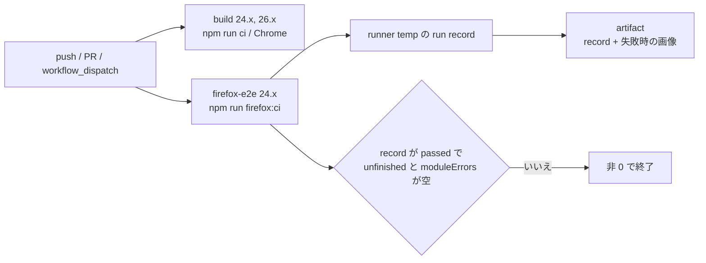

---
ide:
  viewer: review-document
  version: 1
  title: "Firefox E2E の失敗修正と CI 追加：レビュー解説"
  dock: right
  baseCommit: 5c55224f990f64a747dc6c2cd5dd5ed9df621cc5
---
# Firefox E2E の失敗修正と CI 追加：レビュー解説

対象は `73e59216d..5c55224f9` です。

## 概要

Firefox E2E のメディア系の失敗は、テストではなく werift の回帰が原因でした。DTLS 1.2 の HelloVerifyRequest (HVR) の cookie が 104 バイトになり、32 バイトを超える cookie を拒否する Firefox (NSS) がハンドシェイクを打ち切っていました。cookie を 32 バイトに戻し、調査中に見つかった TURN の NONCE の不具合も直したうえで、Firefox E2E を CI の独立ジョブにしています。

残っていた ICE の失敗は、チケット §2.3 で Firefox の非対応と結論されています。`packages/ice` は変えず、E2E 側で対象を絞って検証を外しています。headCommit の CI は 5 ジョブすべて成功し、Firefox は 68 passed / 0 failed / 9 skipped でした。

## 修正前 → 修正後

  

    <strong>Before</strong>
    
Firefox → werift (DTLS server): ClientHello

↓

    
✕ flight2: HVR cookie <b>104 バイト</b> <code>mintAddressCookie()</code>（1.3 HRR と共用）

↓

    
✕ NSS: fatal <code>decode_error</code>

↓

    
✕ <code>dtls failed</code> → メディア・データが流れずテストがタイムアウト

  

  

    <strong>After</strong>
    
Firefox → werift (DTLS server): ClientHello

↓

    
✓ flight2: HVR cookie <b>32 バイト</b> <code>mintDtls12HelloVerifyCookie()</code> + 長さの assert

↓

    
✓ Firefox: cookie 付き ClientHello を送る

↓

    
✓ <code>verifyDtls12HelloVerifyCookie()</code> が CH から hash を再計算して照合 → 続行

  

凡例: 赤 ✕ = 失敗する経路、緑 ✓ = 変更した経路。起こるのは werift が DTLS サーバーになる向きだけです。

| cookie の中身 | Before（104 B） | After（32 B） |
| --- | --- | --- |
| version | 1 | 1（値は `0x12`） |
| CH の hash | cookie に格納 | **格納しない**（検証時に再計算し、MAC の入力にする） |
| 発行時刻（有効期限） | あり | 4（`issuedAt`） |
| MAC | HMAC-SHA256 | HMAC-SHA256 の先頭 **27** バイト |
| 送信元アドレス・CH パラメータへの束縛 | あり | あり（MAC の入力） |

## 主要変更

### 1. DTLS 1.2 HVR cookie（本題）

- 専用形式の定数、発行、長さの検査、検証を追加しています。 [packages/dtls/src/handshake/extensions/cookie.ts:175](review-diff:packages/dtls/src/handshake/extensions/cookie.ts:commit:e411e9e10:175) / [発行 packages/dtls/src/handshake/extensions/cookie.ts:221](review-file:packages/dtls/src/handshake/extensions/cookie.ts:221)
- 送信前にも 32 バイト超を例外にします。 [packages/dtls/src/flight/server/flight2.ts:55](review-diff:packages/dtls/src/flight/server/flight2.ts:commit:e411e9e10:55)
- 検証の呼び出し元は変更していません。 [packages/dtls/src/server.ts:368](review-file:packages/dtls/src/server.ts:368)
- 長さ、束縛、期限、改ざんと、32 バイト超を拒否する NSS 風クライアントとの接続をテストしています。 [packages/dtls/tests/e2e/self12_hvr_cookie_length.test.ts:136](review-diff:packages/dtls/tests/e2e/self12_hvr_cookie_length.test.ts:commit:e411e9e10:136)

### 2. TURN サーバーの NONCE

生の乱数 16 バイトを、16 進テキスト 32 文字にしました。NUL を含む NONCE は nICEr が解析できません。TCP では Allocate が再送されないため、relay 候補を取れませんでした。

- [packages/ice-server/src/turn/protocol.ts:1075](review-diff:packages/ice-server/src/turn/protocol.ts:commit:7d27abf82:1075)
- 再現テスト: [packages/ice-server/tests/turn.test.ts:317](review-diff:packages/ice-server/tests/turn.test.ts:commit:7d27abf82:317)

### 3. ICE の E2E

| ケース | Firefox での扱い | 理由（`firefoxUnsupported`） |
| --- | --- | --- |
| nomination, renomination: false（2 件） | 実行。relay の指名、相手アドレス、往復、候補追加後の接続維持を確認。host 経路への移行は確認しない | `lateTrickleAfterCompleted` |
| nomination, renomination: true（2 件） | スキップ | `renomination` |
| failover, renomination: false | 実行。werift の relay 退避と、ICE restart がないことを確認。ブラウザの追従と relay での往復は確認しない | `lowerPriorityNomination` |
| failover, renomination: true | スキップ | `renomination` |

- スキップ理由の定義: [e2e/tests/fixture.ts:28](review-file:e2e/tests/fixture.ts:28)
- 候補の型の確認は Chrome に限り、全ブラウザで相手のアドレスとポートを照合します。 [e2e/tests/ice/nomination.test.ts:170](review-diff:e2e/tests/ice/nomination.test.ts:commit:e411e9e10:170)
- Firefox 向けの分岐: [nomination e2e/tests/ice/nomination.test.ts:185](review-file:e2e/tests/ice/nomination.test.ts:185) / [failover e2e/tests/ice/failover.test.ts:122](review-file:e2e/tests/ice/failover.test.ts:122)
- 照合に使う `localAddress` / `localPort` を stats に追加しています。werift の挙動は補正していません。 [e2e/server/handler/ice/nomination.ts:126](review-file:e2e/server/handler/ice/nomination.ts:126)

### 4. Firefox E2E の CI 化

- ジョブ定義（30 分で打ち切り）: [.github/workflows/nodejs.yml:64](review-diff:.github/workflows/nodejs.yml:commit:e411e9e10:64)
  - `runner.temp` をジョブ単位の `env` に書けない問題は 後続コミット（[.github/workflows/nodejs.yml:97](review-diff:.github/workflows/nodejs.yml:commit:dc0eeddd4:97)）で直しています。
- CI モード（記録は repo の外、prune なし、既定の上限 20 分）: [e2e/firefox-run-record.js:186](review-diff:e2e/firefox-run-record.js:commit:e411e9e10:186)
- 終了コード: [e2e/firefox-run-record.js:217](review-file:e2e/firefox-run-record.js:217)
- ハーネスのテスト: [e2e/tools/tests/firefoxRunRecord.test.js](review-diff:e2e/tools/tests/firefoxRunRecord.test.js:commit:e411e9e10)
- 運用方針も更新しています。 [e2e/AGENTS.md](review-file:e2e/AGENTS.md) / [e2e/firefox-runs/README.md](review-file:e2e/firefox-runs/README.md)

差分の行数の多くは `e2e/firefox-runs/` の run record です。新しい記録 3 件が増え、古い 10 件が消えています（git の表示は削除 7 件と rename 3 件）。残る記録は 20 件で、runner の既定の保持数と一致します。

## 判断理由

- **ランダム cookie に戻さない**: 以前の 20 バイトの乱数ではなく、ステートレスな HMAC 方式を保ったまま短くしています。DTLS 1.2 では cookie 付きの ClientHello が元のパラメータを繰り返すので、hash は再計算できます。
- **1.3 の cookie は変えない**: NSS の 32 バイト制限にかかるのは DTLS 1.2 の HVR です。1.3 の HRR cookie 拡張は 104 バイトのままです。
- **ICE は実装を変えない**: チケット §2.3 によると、Firefox は指名後に trickle された候補を捨てます。また、優先度の低いペアの指名に追従せず、renomination も実装していません。failover では werift 側が relay に退避することを確認しています。
- **CI は独立ジョブ**: `npm run ci` と `npm run e2e` に Firefox を入れず、ローカルの既定の検証時間を延ばしていません。

## レビュアーが確認すべき点・リスク

1. **MAC の切り詰め**: MAC は 27 バイト（216 bit）です。入力の `label || version || issuedAt || peerKey || 0x00 || CH hash` と、MAC を照合してから期限を調べる順序を確認してください。`random` と cookie は、変更前と同じく束縛の対象外です（README の記述: [packages/dtls/README.md:112](review-file:packages/dtls/README.md:112)）。
2. **cookie の互換性**: wire 上の形式と長さが変わります。差分では、公開エントリ（`packages/dtls/src/index.ts`、`packages/webrtc/src/index.ts`）に新しい export を足していません。
3. **Firefox で確認していない動作**: 指名後の host 経路への移行、failover 後のブラウザの追従と relay での往復、renomination は、Firefox では保証されません。
4. **非対応と判断した根拠**: 根拠の MOZ_LOG はチケットと理由文に要約されています。ログ本体は、確認した差分に含まれていません。今回の解説作成では再現していません。特に `lowerPriorityNomination` の説明が妥当かを確認してください。
5. **終了コードはローカルにも影響**: `firefox:record` も、記録が `passed` で `unfinished` と `moduleErrors` が空のときだけ 0 を返します。
6. **ハーネスのテストは CI の対象外**: `e2e` は workspace ではなく、`ci:silent` も `test:tools` を呼びません。CI モードのロジックを変えるときは、手元での実行が必要です。
7. **マージ時の changelog**: 解説の作成時点で、worktree では別のマージが進行中で、`changelog.md` が未解決でした。解決後に [changelog.md](review-file:changelog.md) の Unreleased 節に両方の項目が残っているか確認してください。この解説と以下の検証結果は、マージ後の内容を対象にしていません。

## 検証結果

### headCommit の CI

GitHub Actions の [run 46106618596](https://github.com/shinyoshiaki/werift-webrtc/actions/runs/46106618596)（`workflow_dispatch`、`5c55224f9`）を、今回 `gh` で確認しました。

| ジョブ | 結果 | 内容 |
| --- | --- | --- |
| `firefox-e2e` | 成功 | Firefox 157.0。68 passed / 0 failed / 9 skipped / 0 unfinished（27 ファイル） |
| `build` (24.x, 26.x) | 成功 | `npm run ci`（型、doc:check、build、パッケージテスト、Chrome と DTLS の E2E）、examples E2E など |
| `DTLS 1.3 BoringSSL interop (P0)` | 成功 | DTLS の型検査、BoringSSL interop、DTLS 1.3 の self テスト |
| `mediasoup-interop` (24.x) | 成功 | ジョブの結論のみ確認 |

BoringSSL のジョブは DTLS 1.3 が対象なので、今回の 1.2 HVR の変更を直接確かめるものではありません。

### コミットされたローカルの記録

[e2e/firefox-runs/20261128T040955Z-443868c64.json](review-file:e2e/firefox-runs/20261128T040955Z-443868c64.json) は clean な `443868c64` の全件実行です。`passed`、68 passed / 0 failed / 9 skipped / 0 unfinished で、`moduleErrors` は空です。headCommit との差は、この記録を追加したコミットです。

9 件のスキップの内訳は、H.264 が 3 件、RED が 2 件、TURNS の IP リテラルが 1 件、renomination が 3 件です。

### 今回実行したもの

`node --test tools/tests/firefoxRunRecord.test.js`（`e2e/` で実行）は 12 件すべて成功しました。`test:tools` 全体は実行していません。

### 今回実行していないもの

DTLS やパッケージのテスト、ブラウザ E2E はローカルで再実行していません。`packages/ice` の `pbt:deep` も実行していません（この差分は `packages/ice` を変更していません）。
