---
ide:
  viewer: review-document
  version: 1
  title: "SCTP 修正のレビュー解説：修正前後のフローとテストの読み方"
  dock: right
  baseCommit: 70dc204c261f23d8716d0b3b45901cff2b0d093a
---
# SCTP 修正のレビュー解説：修正前後のフローとテストの読み方

このブランチの `packages/sctp` の変更だけを扱う解説です。SRTP と WebRTC 層の変更は [reviews/eb61cc4a-sctp-srtp-review-guide.md](review-file:reviews/eb61cc4a-sctp-srtp-review-guide.md) を見てください。

前半（1〜5 章）は、問題ごとに**修正前と修正後のフロー**をシーケンス図で並べます。後半（6〜8 章）は、**テストコードをどうレビューするか**の手順とチェックポイントです。

## 1. 全体像：どこで何が詰まっていたか

SCTP の 1 本の association の中で、修正対象は次の 4 か所です。いずれも「接続は生きているのに、データが流れない・返らない」形で表に出るので、症状だけを見ると気づきにくい問題でした。

<div style="display:grid;grid-template-columns:repeat(auto-fit,minmax(220px,1fr));gap:10px;font-family:var(--review-font);font-size:13px">
  <div style="padding:8px 12px;border:1px solid var(--review-border);border-top:4px solid var(--review-danger);border-radius:6px"><strong>① 確立（INIT 衝突）</strong><br><span style="color:var(--review-muted)">両端が INIT を送ると、どちらも ESTABLISHED に進めない</span></div>
  <div style="padding:8px 12px;border:1px solid var(--review-border);border-top:4px solid var(--review-danger);border-radius:6px"><strong>② 送信（flightSize）</strong><br><span style="color:var(--review-muted)">T3 の後、送信中バイト数が減らず DATA も HEARTBEAT も止まる（#806）</span></div>
  <div style="padding:8px 12px;border:1px solid var(--review-border);border-top:4px solid var(--review-danger);border-radius:6px"><strong>③ 部分信頼性（寿命）</strong><br><span style="color:var(--review-muted)">寿命切れが判定されず、send() と bufferedAmount が残る</span></div>
  <div style="padding:8px 12px;border:1px solid var(--review-border);border-top:4px solid var(--review-danger);border-radius:6px"><strong>④ stream reset</strong><br><span style="color:var(--review-muted)">reset が再送 DATA を追い越すと最後のメッセージが消える／応答損失で詰まる</span></div>
</div>

変更の本体は [packages/sctp/src/sctp.ts](review-diff:packages/sctp/src/sctp.ts) と [packages/sctp/src/chunk.ts](review-diff:packages/sctp/src/chunk.ts)、reconfig の結果コードは [packages/sctp/src/param.ts](review-diff:packages/sctp/src/param.ts) です。

## 2. ① INIT 衝突（RFC 9260 §5.2.1, §8.5.1）

### 修正前

usrsctp / dcsctp は両端から INIT を送ります。werift の initiator は、自分が COOKIE-WAIT に入った後に届いた相手の INIT と COOKIE_ECHO を無視していました。さらに、`start()` の前に相手の INIT に答えていると、自分の INIT に相手の verification tag を付けて送っていました（INIT の tag は 0 でなければならず、相手は破棄し得る）。

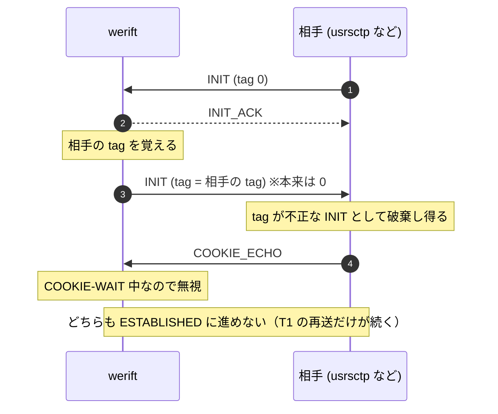

### 修正後

INIT は常に tag 0 で送り、initiator でも相手の INIT に INIT_ACK で答えて、続く COOKIE_ECHO を受け入れます。相手の INIT で先に確立していれば、遅れた `start()` は INIT を送らず `connected` を保ちます。

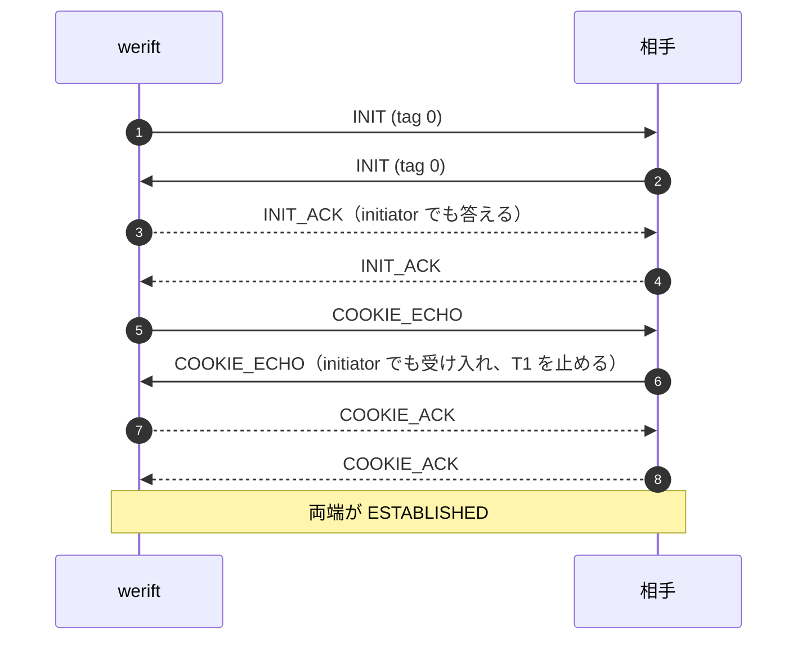

あわせて、状態遷移と T1 の開始を**送信前**に移しました。修正前は INIT の送信完了を待ってから COOKIE-WAIT に入っていたため、その間に届いた INIT_ACK を捨てていました。送信に失敗すると T1 も動かず、INIT は再送されませんでした。

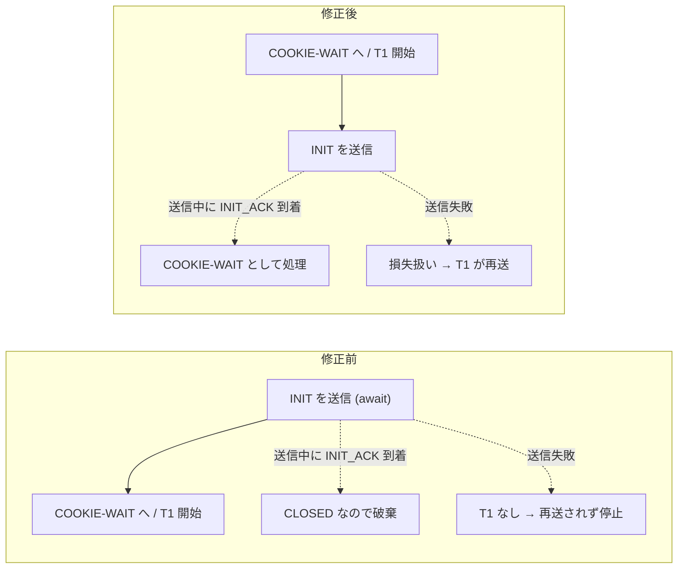

もう 1 点、重複 INIT で受信 TSN を巻き戻さないようにしました。受信 TSN を初期化するのは、ハンドシェイク前（CLOSED / COOKIE-WAIT）か、相手が別の initiate tag で再開始したときだけです。

コード: INIT 受信 [packages/sctp/src/sctp.ts:404](review-file:packages/sctp/src/sctp.ts:404)、TSN を初期化する条件 [packages/sctp/src/sctp.ts:422](review-file:packages/sctp/src/sctp.ts:422)、COOKIE_ECHO 受信 [packages/sctp/src/sctp.ts:547](review-file:packages/sctp/src/sctp.ts:547)、`start()` [packages/sctp/src/sctp.ts:1842](review-file:packages/sctp/src/sctp.ts:1842)、`init()` [packages/sctp/src/sctp.ts:1870](review-file:packages/sctp/src/sctp.ts:1870)、INIT の tag 0 [packages/sctp/src/sctp.ts:1915](review-file:packages/sctp/src/sctp.ts:1915)。

## 3. ② flightSize が残って送信が止まる（#806）

`flightSize` は「送ったがまだ確認されていないバイト数」で、`flightSize >= cwnd` の間は新しい DATA を送りません。

### 修正前

計上を集計値だけで持っていたため、同じチャンクを二重に足したり、引き忘れたりしました。

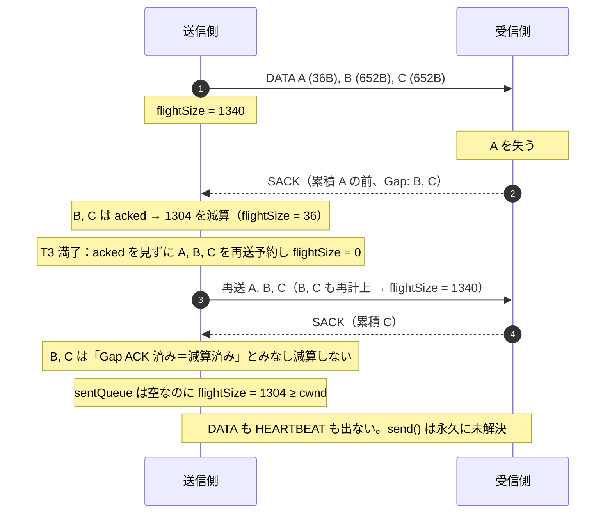

### 修正後

チャンクごとに `inFlight` を持ち、増減はフラグを見て 1 回だけ効かせます。どの経路でも次の不変条件が成り立ちます。

> `flightSize === Σ(sentQueue 内で inFlight なチャンクの bookSize)`

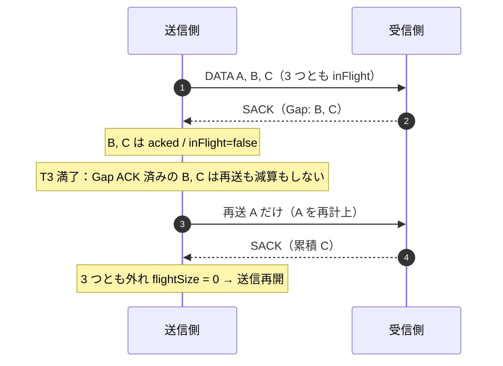

受信側が Gap ACK したデータを捨てる **reneging** にも対応しました。以前 Gap ACK したチャンクが後の SACK から消えたら、未確認に戻して再計上し、SACK ごとにミス指示を数えて 3 回目で Fast Retransmit します。T3 が止まっていれば開始します（RFC 9260 §6.2.1 D-iii）。

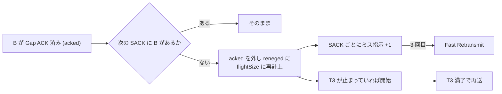

コード: `inFlight` / `reneged` [packages/sctp/src/chunk.ts:200](review-file:packages/sctp/src/chunk.ts:200)、増減ヘルパー [packages/sctp/src/sctp.ts:1428](review-file:packages/sctp/src/sctp.ts:1428)、reneging の検出 [packages/sctp/src/sctp.ts:964](review-file:packages/sctp/src/sctp.ts:964)、T3 満了 [packages/sctp/src/sctp.ts:1526](review-file:packages/sctp/src/sctp.ts:1526)、ミス指示 [packages/sctp/src/sctp.ts:1769](review-file:packages/sctp/src/sctp.ts:1769)。

## 4. ③ PR-SCTP の寿命（maxPacketLifeTime）

### 修正前：寿命破棄が一度も動いていない

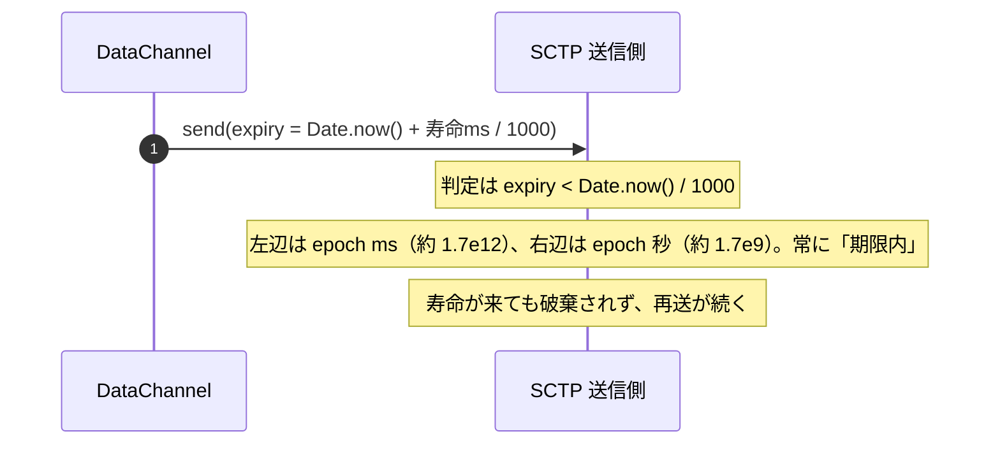

単位を epoch ms に揃えると、破棄の経路が初めて動きます。それに伴って、破棄の対象選び（キュー先頭を捨てていた）、未送信断片の扱い、FORWARD-TSN の損失、受信側の再組み立てでも問題が見つかったので、まとめて直しました。

### 修正後：寿命切れから回復まで

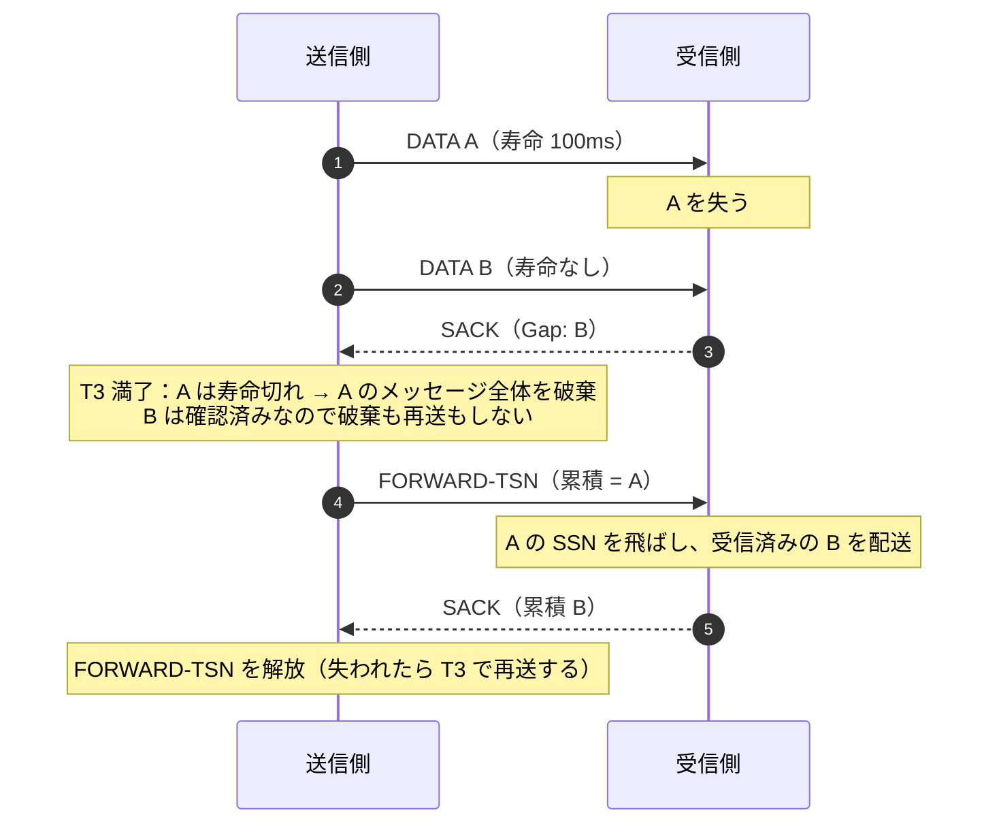

### 修正後：送るまでもなく寿命が切れたとき

相手の受信ウィンドウが 0 で、未確認 DATA もない状態では、`transmit()` を起こすイベント（SACK、ウィンドウ更新、次の `send()`）が来ません。修正前は、期限が切れてもメッセージがキューに残り、`send()` と DataChannel の `bufferedAmount` が減りませんでした。寿命付きメッセージが寿命なしメッセージの後ろにいる場合も同じです。

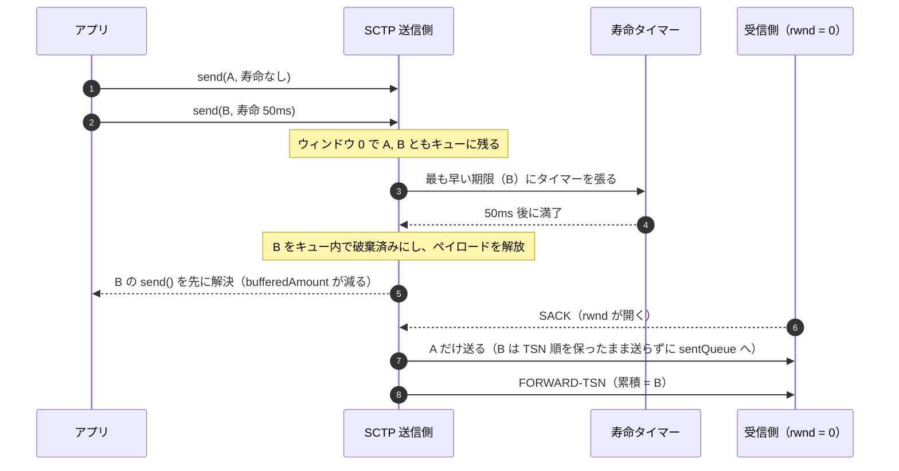

TSN は `send()` の時点で割り当て済みです。B をキューから抜くと TSN に穴が空くので、B は**その場で破棄済みにして残し**、先頭に来たら送らずに `sentQueue` へ移します。タイマーは、キューが空になったとき、`stop()`、相手の ABORT やタイムアウトによる CLOSED 遷移で解除します。

コード: 期限判定 [packages/sctp/src/sctp.ts:1781](review-file:packages/sctp/src/sctp.ts:1781)、送信直前の判定 [packages/sctp/src/sctp.ts:1340](review-file:packages/sctp/src/sctp.ts:1340)、寿命タイマー [packages/sctp/src/sctp.ts:1560](review-file:packages/sctp/src/sctp.ts:1560) と [packages/sctp/src/sctp.ts:1578](review-file:packages/sctp/src/sctp.ts:1578)、ペイロード解放 [packages/sctp/src/sctp.ts:1789](review-file:packages/sctp/src/sctp.ts:1789)、メッセージ単位の破棄 [packages/sctp/src/sctp.ts:1796](review-file:packages/sctp/src/sctp.ts:1796)、FORWARD-TSN の保持 [packages/sctp/src/sctp.ts:1711](review-file:packages/sctp/src/sctp.ts:1711)、受信側の再組み立て [packages/sctp/src/sctp.ts:2090](review-file:packages/sctp/src/sctp.ts:2090)、CLOSED 遷移 [packages/sctp/src/sctp.ts:1921](review-file:packages/sctp/src/sctp.ts:1921)。

## 5. ④ stream reset（RFC 6525）

### 修正前：reset が再送 DATA を追い越すと最後のメッセージが消える

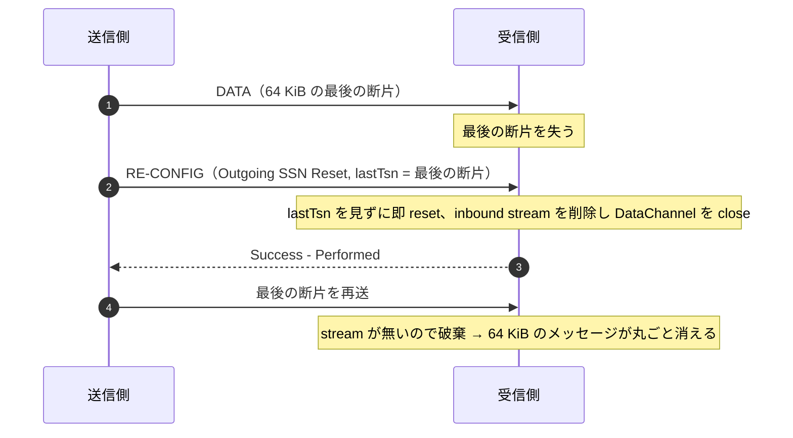

### 修正後：境界まで揃うのを待ってから reset

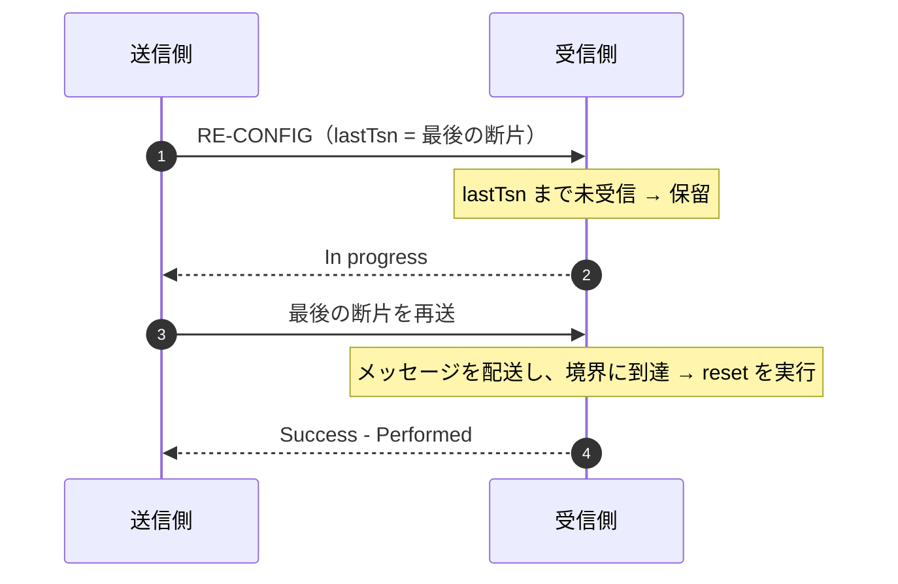

request の sequence number も検証します。再送された request には同じ結果を返し、期待外の番号には `Bad Sequence Number` を返します。

### レビュー反復で直した点：成功応答が失われると詰まる

相手の逆方向 request が `responseSequence` で「自分の request を受け取った」と伝えてきた時点で、修正前はタイマーを止めていました。ところが request そのものは成功応答が届くまで残るので、その応答が失われると誰も再送せず、後続の reset も送れなくなります。

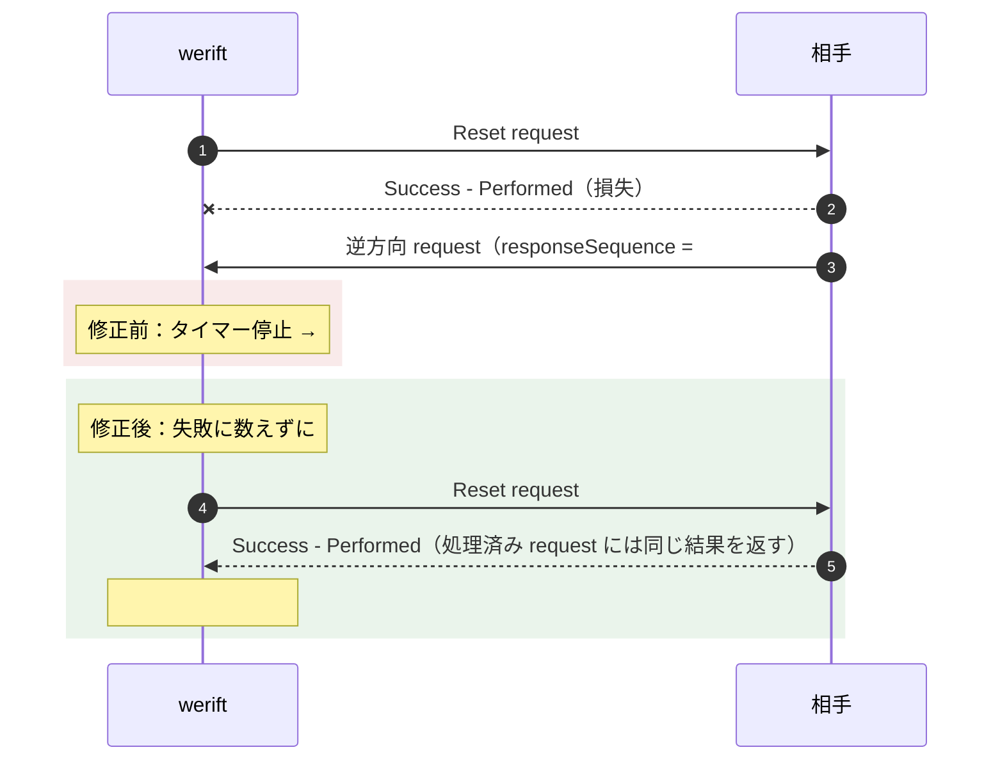

コード: request の受信 [packages/sctp/src/sctp.ts:736](review-file:packages/sctp/src/sctp.ts:736)、確認済みでも再送を続ける部分 [packages/sctp/src/sctp.ts:762](review-file:packages/sctp/src/sctp.ts:762)、保留中 reset の実行 [packages/sctp/src/sctp.ts:797](review-file:packages/sctp/src/sctp.ts:797) と [packages/sctp/src/sctp.ts:818](review-file:packages/sctp/src/sctp.ts:818)。

## 6. テストの全体構成

テストは 3 つの層に分かれています。レビューでは、**どの層のテストか**を先に見ると、何を信頼してよいかが分かります。

<div style="display:grid;grid-template-columns:repeat(auto-fit,minmax(230px,1fr));gap:10px;font-family:var(--review-font);font-size:13px">
  <div style="padding:8px 12px;border:1px solid var(--review-border);border-left:4px solid var(--review-accent);border-radius:6px"><strong>モック（1 端点）</strong><br>送信をスパイし、受信は handleData / receiveChunk で直接注入する。<br><span style="color:var(--review-muted)">状態遷移・計上・送ったチャンクを細かく確認できる。相手の挙動は手で作るので、相手の実装との組み合わせは保証しない。</span></div>
  <div style="padding:8px 12px;border:1px solid var(--review-border);border-left:4px solid var(--review-success);border-radius:6px"><strong>実ペア（2 端点）</strong><br>MemoryTransport で 2 つの SCTP をつなぎ、特定のパケットだけ落とす。<br><span style="color:var(--review-muted)">相手側の応答（再送への同じ結果、FORWARD-TSN の処理など）まで含めて回復することを確認できる。</span></div>
  <div style="padding:8px 12px;border:1px solid var(--review-border);border-left:4px solid var(--review-warning);border-radius:6px"><strong>シード付き乱数損失</strong><br>DATA・SACK・FORWARD-TSN を 20% 落とし、100 シードで実行する。<br><span style="color:var(--review-muted)">想定外の順序で起きる不整合を探す。失敗したシードはそのまま再現できる。</span></div>
</div>

| テストファイル | 主な対象 | 層 |
| --- | --- | --- |
| [packages/sctp/tests/initCollision.test.ts](review-file:packages/sctp/tests/initCollision.test.ts:34) | ① 同時開始、tag 0、確立済みでの start()、重複・再開始 INIT、送信順序と T1 | モック＋実ペア |
| [packages/sctp/tests/sctp.test.ts](review-file:packages/sctp/tests/sctp.test.ts:272) | ② flightSize の計上（#806 の再現、T3、reneging） | モック |
| [packages/sctp/tests/lifetime.test.ts](review-file:packages/sctp/tests/lifetime.test.ts:27) | ③ 寿命破棄、FORWARD-TSN、受信側の再組み立て | 実ペア |
| [packages/sctp/tests/lifetime.test.ts](review-file:packages/sctp/tests/lifetime.test.ts:741) | ③ 受信ウィンドウ 0 の寿命タイマー | モック |
| [packages/sctp/tests/lifetime.test.ts](review-file:packages/sctp/tests/lifetime.test.ts:911) | ③ 乱数損失 | 乱数 |
| [packages/sctp/tests/reconfig.test.ts](review-file:packages/sctp/tests/reconfig.test.ts:15) | ④ 保留、sequence number、In progress、成功応答の損失 | モック＋実ペア |
| [packages/sctp/tests/stream.test.ts](review-file:packages/sctp/tests/stream.test.ts:59) | ③ 受信側の再組み立て（popMessages）の単体 | 単体 |
| [packages/sctp/tests/burst.test.ts](review-file:packages/sctp/tests/burst.test.ts:68) | ② 損失ありの大量送信で完了・順序が保たれる | 実ペア |

共通の Arrange はすべて [packages/sctp/tests/utils.ts](review-diff:packages/sctp/tests/utils.ts) にあります。

| ヘルパー | 役割 |
| --- | --- |
| [createControlledTransport](review-file:packages/sctp/tests/utils.ts:235) / [createSctpEndpointPair](review-file:packages/sctp/tests/utils.ts:360) | 送信を記録・保留できる transport。INIT 衝突の順序を作る |
| [createMockSctp](review-file:packages/sctp/tests/utils.ts:396) / [createZeroWindowMockSctp](review-file:packages/sctp/tests/utils.ts:413) | ESTABLISHED のモック端点。後者は相手の rwnd を 0 にする |
| [buildSack](review-file:packages/sctp/tests/utils.ts:458) / [receiveSack](review-file:packages/sctp/tests/utils.ts:470) | 任意の累積 TSN・Gap・rwnd の SACK を注入する |
| [expectFlightSizeInvariant](review-file:packages/sctp/tests/utils.ts:486) / [findFlightSizeViolation](review-file:packages/sctp/tests/utils.ts:592) | flightSize の不変条件を検査する |
| [createConnectedSctpPair](review-file:packages/sctp/tests/utils.ts:84) / [createLossyPrSctpPair](review-file:packages/sctp/tests/utils.ts:551) | 実ペア。後者は種類ごとにパケットを落とせる |
| [dropDataPacketsAt](review-file:packages/sctp/tests/utils.ts:180) / [dropReconfigSuccessResponses](review-file:packages/sctp/tests/utils.ts:193) | 特定の DATA や成功応答だけを落とす |
| [createSeededRandom](review-file:packages/sctp/tests/utils.ts:576) | 再現可能な乱数 |
| [createEstablishedMockSctp](review-file:packages/sctp/tests/utils.ts:717) / [createResetRequestChunk](review-file:packages/sctp/tests/utils.ts:643) | reconfig のモックと request の組み立て |

## 7. テストのレビュー手順

### 手順 1：テスト名と Assert が「症状」を指しているか

各テストは、修正前に起きていた**利用者から見える症状**を Assert で確かめているかを見ます。内部の値（`flightSize` など）だけでなく、`send()` が解決する、メッセージが届く、reset が完了する、といった外から見える結果も確認しているのが良いテストです。

たとえば成功応答損失のテスト [packages/sctp/tests/reconfig.test.ts:518](review-file:packages/sctp/tests/reconfig.test.ts:518) は、次の流れになっています。

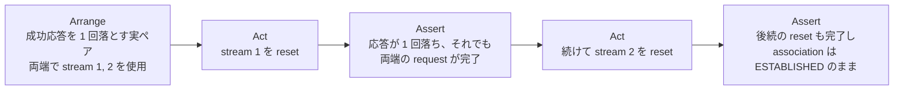

### 手順 2：Arrange がバグの成立条件をすべて満たしているか

バグは条件の組み合わせで起きるので、Arrange が**その組み合わせを本当に作っているか**を確認します。条件が 1 つ欠けると、テストは修正なしでも通ってしまいます。

| 問題 | Arrange で揃っているべき条件 | 確認先 |
| --- | --- | --- |
| ② #806 | 先頭の損失 ＋ 後続の Gap ACK ＋ T3 満了 ＋ 累積 ACK | [packages/sctp/tests/sctp.test.ts:290](review-file:packages/sctp/tests/sctp.test.ts:290) |
| ③ 寿命タイマー | rwnd = 0 ＋ 未確認 DATA なし ＋ ほかのイベントなし | [packages/sctp/tests/lifetime.test.ts:742](review-file:packages/sctp/tests/lifetime.test.ts:742) |
| ③ 後続メッセージ | 寿命なしの先行メッセージ ＋ その後ろの寿命付き | [packages/sctp/tests/lifetime.test.ts:783](review-file:packages/sctp/tests/lifetime.test.ts:783) |
| ③ CLOSED 後 | stop() 以外での CLOSED ＋ その後の stop() | [packages/sctp/tests/lifetime.test.ts:866](review-file:packages/sctp/tests/lifetime.test.ts:866) |
| ④ 応答損失 | 成功応答だけを落とす ＋ 相手にも送信済み stream がある（逆方向 request が出る） | [packages/sctp/tests/reconfig.test.ts:518](review-file:packages/sctp/tests/reconfig.test.ts:518) |
| ① 重複 INIT | DATA 受信・確認済み ＋ 同じ tag の INIT ＋ 次の DATA | [packages/sctp/tests/initCollision.test.ts:184](review-file:packages/sctp/tests/initCollision.test.ts:184) |

途中の Assert（「この時点ではまだキューに残っている」「T3 は動いていない」など）は、Arrange が成立条件に入ったことの確認です。消さずに残してあるかも見てください。

### 手順 3：修正を外すと落ちるか（ミューテーション確認）

レビュー反復で追加した修正は、**該当する修正を一時的に外すと追加テストが失敗し、戻すと通る**ことを確認済みです。レビュアーが自分で確かめるときは、次のように 1 か所ずつ外して対象テストだけ実行します。

| 外す修正 | 失敗すべきテスト |
| --- | --- |
| [packages/sctp/src/sctp.ts:762](review-file:packages/sctp/src/sctp.ts:762) の再送継続（タイマー停止に戻す） | reconfig の「成功応答が失われ…」など 2 件 |
| 寿命タイマー満了時の、キュー内での破棄済みの印付けと `send()` の先行解決（満了時に `transmit()` だけ呼ぶ形に戻す） | lifetime の「behind a message without lifetime」 |
| [packages/sctp/src/sctp.ts:1789](review-file:packages/sctp/src/sctp.ts:1789) のペイロード解放 | lifetime の「releases the payload」 |
| CLOSED 遷移でのタイマー解除 | lifetime の「after the peer's ABORT」など 2 件 |
| 再開始 INIT での保留中 reset の破棄 | initCollision の「再開始 INIT は…stream reset を破棄する」 |

```bash
cd packages/sctp
npx vitest run tests/reconfig.test.ts tests/lifetime.test.ts tests/initCollision.test.ts
```

### 手順 4：テスト同士が干渉しない・時間に依存しすぎないか

- **後始末**: モックは [disposeMockSctp](review-file:packages/sctp/tests/utils.ts:500) を `finally` で呼び、実ペアは `pair.stop()` を `finally` / `afterEach` で呼んでいるか。タイマーが残るとほかのテストに影響し、プロセスも終わりません。
- **時間**: 寿命タイマーのテストは実時間（50ms の寿命を 120ms 待つ）です。待ち時間に余裕があるか、遅い CI で揺れないかを見てください。T3 を待つ実ペアのテストは `vi.waitFor` に最大 20 秒の上限を設けています。
- **乱数**: 乱数損失テストはシード固定です。失敗時はテスト名にシードが出るので、そのシードだけで再現できます。

### 手順 5：private な状態に触る箇所を把握する

一部のテストは、状況を作るために private な状態を直接読み書きしています（`peerAdvertisedRwnd = 0`、`timer3Expired()` の直接呼び出し、受信側の `reassembly` を空にする reneging の模擬など）。実装の内部が変わればテストも直す必要があります。どのテストが該当するかを把握しておき、**外から見える Assert も併せて持っているか**を確認してください。

### 手順 6：規約に沿っているか

- Arrange / Act / Assert の順で書かれ、Act と Assert に日本語のコメントがあるか（一部の既存英語テストは名前が英語のまま）。
- 共通の Arrange が `tests/utils.ts` にまとまり、テストファイルにコピーされていないか。

## 8. 検証結果

| 検証 | 結果 |
| --- | --- |
| `cd packages/sctp && npm test`（型検査を含む） | 11 ファイル・228 件成功 |
| `cd packages/webrtc && npm test` | 77 ファイル・1627 件成功、5 件スキップ |
| `npm run type` | 成功 |
| 追加修正ごとのミューテーション確認 | 修正を外すと該当テストが失敗、戻すと成功 |
| `npm run ci`、E2E（実ブラウザ・usrsctp との相互接続）、WPT | 未実施 |

この文書の作成にあたってコードとテストは変更しておらず、テストも再実行していません。上の結果は、直前の作業で実行したものです。
