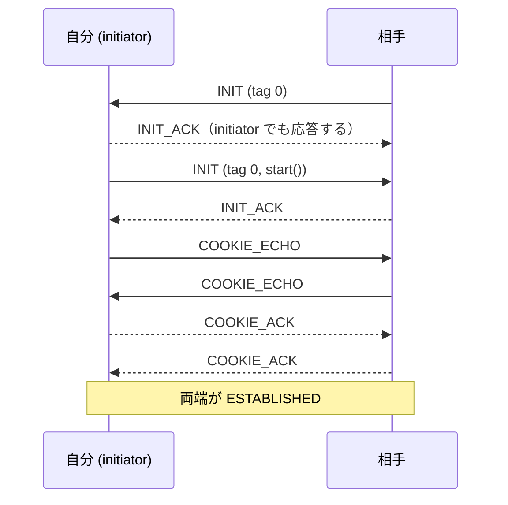

---
ide:
  viewer: review-document
  version: 1
  title: "SCTP INIT 衝突処理と SRTP/SRTCP replay 保護のレビュー解説"
  dock: right
  baseCommit: 090514c847e28ecea3cead019b0d1bb37ddf3013
---
# SCTP INIT 衝突処理と SRTP/SRTCP replay 保護のレビュー解説

## 1. 概要

WARP（DTLS readiness / DTLS role 基準の SCTP 開始）に依存せず、develop にも存在する 2 つの問題を develop 向けに移植しました。(1) SCTP の INIT 衝突と verification tag の扱い、(2) SRTP / SRTCP 受信側の replay 保護です。

さらにこのブランチには、同じ `packages/sctp/src/sctp.ts` を触る SCTP 修正チケット（#806 の flightSize、`maxPacketLifeTime`、stream reset 保留、renegotiation 時の SCTP 開始）を統合してあります。最新の再レビュー反復（HEAD `090514c84`）では、reconfig request の再送継続と、送信待ちメッセージの寿命切れ処理を追加しました。

  

    <strong>Before</strong> start() 前に相手の INIT に答えると、自分の INIT に相手の tag を付けて送る。initiator は相手の INIT / COOKIE_ECHO を無視するので、両端が INIT を送ると確立しない。SRTP は同じパケットを何度でも受理する。
  

  

    <strong>After</strong> INIT は常に tag 0。initiator も相手の INIT に INIT_ACK で答え、COOKIE_ECHO を受け入れる。SRTP / SRTCP は SSRC ごとの 1024 個の replay window で重複と古い index を拒否する。
  

## 2. 主要変更

### 2.1 SCTP の INIT 衝突（RFC 9260 §5.2.1, §8.5.1）

- INIT の送信は常に verification tag 0 にしました。[packages/sctp/src/sctp.ts:1911](review-file:packages/sctp/src/sctp.ts:1911) 、差分は [packages/sctp/src/sctp.ts](review-diff:packages/sctp/src/sctp.ts:1911) です。自分の tag が付いた INIT（旧 werift ≤ 0.26 が送る）も受け付けます（[packages/sctp/src/sctp.ts:308](review-file:packages/sctp/src/sctp.ts:308)）。それ以外の tag の INIT は破棄します。
- INIT 受信ハンドラは、COOKIE-WAIT / COOKIE-ECHOED の initiator でも INIT_ACK で答えます（[packages/sctp/src/sctp.ts:404](review-file:packages/sctp/src/sctp.ts:404)）。続く COOKIE_ECHO も initiator が受け入れ、T1 を止めます（[packages/sctp/src/sctp.ts:547](review-file:packages/sctp/src/sctp.ts:547)）。
- 確立済み・重複 INIT では受信 TSN を巻き戻しません。別の initiate tag（相手の再開始）のときだけ TSN 空間を初期化し、保留中 reset（`deferredReset`）と `lastReconfigResult` も捨てます。
- `start()` は、相手の INIT で既に確立済みなら INIT を送りません（[packages/sctp/src/sctp.ts:1841](review-file:packages/sctp/src/sctp.ts:1841)）。
- `init()` は T1 開始と COOKIE-WAIT 遷移を送信前に行います（[packages/sctp/src/sctp.ts:1868](review-file:packages/sctp/src/sctp.ts:1868)）。送信中に届いた INIT_ACK を落とさず、送信失敗は T1 の再送に任せます。COOKIE_ECHO も同様で、COOKIE_ACK は送信前に ESTABLISHED へ進みます。

### 2.2 SRTP / SRTCP の replay 保護（RFC 3711 §3.3.2）

- 新規 [packages/rtp/src/srtp/replay.ts:14](review-file:packages/rtp/src/srtp/replay.ts:14) の `SrtpReplayWindow` が、`check()`（認証前に重複・古すぎを判定）と `accept()`（認証後に記録）を持ちます。window は 1024（`SRTP_REPLAY_WINDOW_SIZE`）です。
- [packages/rtp/src/srtp/context/srtp.ts:50](review-file:packages/rtp/src/srtp/context/srtp.ts:50) は index = ROC × 65536 + SEQ で判定し、[packages/rtp/src/srtp/context/srtcp.ts:41](review-file:packages/rtp/src/srtp/context/srtcp.ts:41) は SRTCP index で判定します。拒否時は [packages/rtp/src/srtp/error.ts:13](review-file:packages/rtp/src/srtp/error.ts:13) の `SrtpReplayError`（`SrtpAuthenticationError` の subclass）を投げます。
- 新しい SSRC の window は認証成功後にだけ作ります。偽造パケットで受信側の状態が増えません。

### 2.3 統合チケット由来の SCTP 修正（今回の反復で追加した部分）

- reconfig request の `responseSequence` が自分の未完了 request と一致したとき（RFC 6525 §5.2.2 E1）、再構成タイマーを止めず、失敗を数えずに再送を続けます。成功応答が失われても request が残り続けて後続 reset を塞ぐ問題を避けます。[packages/sctp/src/sctp.ts:762](review-file:packages/sctp/src/sctp.ts:762)
- 送信待ち（`outboundQueue`）の寿命切れ: 受信ウィンドウ 0 や寿命なしメッセージの後ろでは、期限後も `send()` と `bufferedAmount` が残っていました。[packages/sctp/src/sctp.ts:1560](review-file:packages/sctp/src/sctp.ts:1560) の `armOutboundExpiry` が最早の `expiry` にタイマーを張り、[packages/sctp/src/sctp.ts:1578](review-file:packages/sctp/src/sctp.ts:1578) の `outboundExpiryExpired` が期限切れをキュー内で破棄済みにして `send()` を先に解決します。TSN 順を保つためチャンクはキューに残し、先頭に来たら送らずに FORWARD-TSN で飛ばします。
- `markAbandoned()` が破棄済みチャンクの `userData` を空にし、メモリ増加を防ぎます。タイマーは queue が空・`stop()`・CLOSED 遷移で解除します。

差分: [packages/sctp/src/sctp.ts](review-diff:packages/sctp/src/sctp.ts:1578)、テスト [packages/sctp/tests/lifetime.test.ts](review-diff:packages/sctp/tests/lifetime.test.ts) 、[packages/sctp/tests/reconfig.test.ts](review-diff:packages/sctp/tests/reconfig.test.ts) 、共通 Arrange [packages/sctp/tests/utils.ts](review-diff:packages/sctp/tests/utils.ts)。`changelog.md` も更新済みです（[changelog.md](review-diff:changelog.md:53)）。

## 3. 判断理由

- replay window を 1024 にしたのは libwebrtc と同じで、RFC 3711 の最小値 64 より広く、遅れた NACK 再送も受理できるためです。
- 寿命切れメッセージをキューから抜かず「その場で破棄済み」にしたのは、TSN が割り当て済みで、抜くと TSN に穴が空き FORWARD-TSN の整合が崩れるためです。
- 対象外（WARP 固有）: `SCTPSendPermissionRevokedError` / `cancelStart()` / `startCommitted` / DTLS role 基準の SCTP 開始と DataChannel stream ID 割り当て。DTLS 1.3 の EMS 提示などは develop に該当問題がないため移していません。

## 4. レビュアーが確認すべき点・リスク

- 互換性: 旧 werift が自分の tag 付きで送る INIT は受け入れますが、無関係な tag の INIT は破棄します。相互接続で旧版と組む場合の挙動を確認してください。
- 公開 API 追加: `SrtpReplayError`、`SrtpReplayWindow`、`SRTP_REPLAY_WINDOW_SIZE`（[packages/rtp/src/index.ts](review-diff:packages/rtp/src/index.ts)）。生成 docs と `changelog.md` の更新が必要で、チケットの完了条件に含まれます。
- SRTP の挙動変更: 同一パケットの再受信は例外になります。上位で `SrtpAuthenticationError` を握りつぶす実装では、通常の認証失敗と同様に扱われます。
- reconfig の再送は失敗を数えないため、相手が応答しないまま request だけが残る場合の終了条件はアソシエーション側のタイムアウトに依存します。
- 寿命タイマーは `setTimeout` の上限（2^31-1 ms）を超える分を再設定で処理しています。
- ブランチ全体の差分（develop 比）は統合チケットを含み大きいため、本解説は本題と今回の反復の差分に絞っています。

## 5. 検証結果

この解説の作成では、テストやビルドを新たに実行していません。コードも変更していません。差分とチケットの記述の読解にもとづきます。

チケットの完了条件に挙がっている検証は次のとおりで、実行結果はこの文書の作成時には確認していません。

- `packages/sctp` / `packages/rtp` / `packages/webrtc` のテストと型検査、`npm run doc:check`
- 回帰テストの所在: [packages/sctp/tests/initCollision.test.ts](review-file:packages/sctp/tests/initCollision.test.ts)（INIT 衝突・tag 0・T1 再送）、[packages/rtp/tests/srtp/replay.test.ts](review-file:packages/rtp/tests/srtp/replay.test.ts)（window、ROC 跨ぎ、改ざん、SRTCP）
