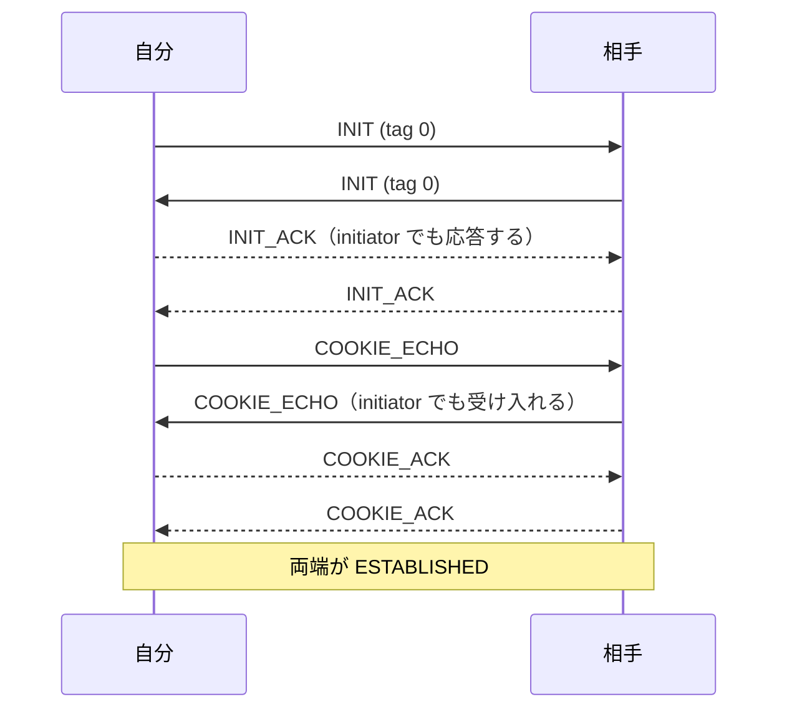

---
ide:
  viewer: review-document
  version: 1
  title: "SCTP / SRTP 修正のレビュー解説（統合版）"
  dock: right
  baseCommit: 5abc1964310e09d820ffd20dc490020096448ec2
---
# SCTP / SRTP 修正のレビュー解説（統合版）

このブランチ（チケット `eb61cc4a`）の変更を 1 つにまとめたレビュー解説です。これまで別々にあった 3 つの解説（本題の INIT 衝突・SRTP replay、#806 の flightSize、PR-SCTP の寿命）を統合し、統合した 4 チケットとレビュー反復で入った修正も含めて、**現在のコード**を基準に書き直しました。

## 1. 全体像

develop にある問題だけを直すブランチです。WARP 固有の変更は含みません。中身は大きく 6 つのテーマに分かれ、3〜6 は同じ `packages/sctp/src/sctp.ts` を触るため 1 本に統合しました。

  
<strong>A. SCTP の INIT 衝突</strong> 本題。両端が INIT を送ると確立しない／INIT の tag が 0 でない

  
<strong>B. SRTP / SRTCP の replay 保護</strong> 本題。同じパケットを何度でも受理していた

  
<strong>C. flightSize が残り送信停止（#806）</strong> 統合元 e639c2a5。Gap ACK 後の T3 で計上が狂う

  
<strong>D. PR-SCTP の寿命（maxPacketLifeTime）</strong> 統合元 c49c9ef1。ms / 秒の混在で寿命破棄が動いていなかった

  
<strong>E. stream reset の保留</strong> 統合元 c7fccdd1。reset が再送 DATA を追い越すと最後のメッセージが消える

  
<strong>F. 再交渉で追加した SCTP の開始</strong> 統合元 27e384b5。DTLS 接続済みだと DataChannel が開かない

変更の中心は次のファイルです。

- SCTP 本体: [packages/sctp/src/sctp.ts](review-diff:packages/sctp/src/sctp.ts)、チャンク状態: [packages/sctp/src/chunk.ts](review-diff:packages/sctp/src/chunk.ts)、reconfig の結果コード: [packages/sctp/src/param.ts](review-diff:packages/sctp/src/param.ts)
- SRTP: [packages/rtp/src/srtp/replay.ts](review-file:packages/rtp/src/srtp/replay.ts:14)（新規）、[packages/rtp/src/srtp/context/srtp.ts](review-diff:packages/rtp/src/srtp/context/srtp.ts)、[packages/rtp/src/srtp/context/srtcp.ts](review-diff:packages/rtp/src/srtp/context/srtcp.ts)
- WebRTC: [packages/webrtc/src/sctpManager.ts](review-diff:packages/webrtc/src/sctpManager.ts)、[packages/webrtc/src/transport/sctp.ts](review-diff:packages/webrtc/src/transport/sctp.ts)、[packages/webrtc/src/negotiation/transportActivation.ts](review-diff:packages/webrtc/src/negotiation/transportActivation.ts)
- 利用者向けの記載: [changelog.md](review-diff:changelog.md)

## 2. A: SCTP の INIT 衝突（RFC 9260 §5.2.1, §8.5.1）

**問題.** `start()` 前に相手の INIT に答えると、その後に自分が送る INIT に相手の verification tag が付いていました（INIT の tag は 0 でなければならない）。また、initiator（COOKIE-WAIT / COOKIE-ECHOED）は相手の INIT と COOKIE_ECHO を無視するため、usrsctp / dcsctp のように両端が INIT を送る相手とは確立できませんでした。

**修正.**

- INIT は常に tag 0 で送ります。[packages/sctp/src/sctp.ts:1915](review-file:packages/sctp/src/sctp.ts:1915)
- initiator も相手の INIT に INIT_ACK で答え（[packages/sctp/src/sctp.ts:404](review-file:packages/sctp/src/sctp.ts:404)）、続く COOKIE_ECHO を受け入れて T1 を止めます（[packages/sctp/src/sctp.ts:547](review-file:packages/sctp/src/sctp.ts:547)）。自分の tag 付きの INIT（werift 0.26 以前が送る）も受け付けます。
- 相手の INIT で確立済みなら、`start()` は INIT を送らず `connected` を保ちます。[packages/sctp/src/sctp.ts:1842](review-file:packages/sctp/src/sctp.ts:1842)
- INIT / COOKIE_ECHO は、送信前に状態遷移と T1 開始を行います。送信中に届いた INIT_ACK を落とさず、送信失敗は T1 の再送に任せます。[packages/sctp/src/sctp.ts:1870](review-file:packages/sctp/src/sctp.ts:1870)
- 受信 TSN の初期化は、ハンドシェイク前（CLOSED / COOKIE-WAIT）か、相手が別の initiate tag で再開始したときだけ行います。遅れて届いた重複 INIT で、受信済み DATA の累積確認が巻き戻らないようにするためです。再開始のときは、旧 TSN 空間の保留中 stream reset も捨てます。[packages/sctp/src/sctp.ts:422](review-file:packages/sctp/src/sctp.ts:422)

**テスト.** [packages/sctp/tests/initCollision.test.ts](review-file:packages/sctp/tests/initCollision.test.ts:34)（同時開始、tag 0、確立済みでの `start()`、重複 INIT、再開始 INIT、送信順序と T1 再送の 15 件）。

## 3. B: SRTP / SRTCP の replay 保護（RFC 3711 §3.3.2）

**問題.** 受信側に replay list がなく、認証に通る同じパケットを何度でも上位へ渡していました。

**修正.**

- SSRC ごとに 1024 パケットの `SrtpReplayWindow` を持ちます。`check()` は認証前に判定し、`accept()` は認証後に記録します。[packages/rtp/src/srtp/replay.ts:14](review-file:packages/rtp/src/srtp/replay.ts:14)
- SRTP は ROC と SEQ から求めた index、SRTCP は SRTCP index で判定します。[packages/rtp/src/srtp/context/srtp.ts:51](review-file:packages/rtp/src/srtp/context/srtp.ts:51)
- 拒否時は `SrtpReplayError` を投げます。`SrtpAuthenticationError` のサブクラスなので、`RTCDtlsTransport` は認証失敗と同じく破棄します。[packages/rtp/src/srtp/error.ts:13](review-file:packages/rtp/src/srtp/error.ts:13)
- 新しい SSRC の window は認証に成功した後にだけ作るので、偽造パケットで受信側の状態は増えません。

**テスト.** [packages/rtp/tests/srtp/replay.test.ts](review-file:packages/rtp/tests/srtp/replay.test.ts:12)（window、ROC をまたぐケース、改ざん、SRTCP）。

## 4. C: flightSize が残り送信が止まる（#806）

**問題.** Gap ACK の後に T3-rtx が発火すると、Gap ACK 済みのチャンクまで再送して計上し直していました。後の累積 ACK では「Gap ACK 済み＝減算済み」とみなして減算しないため、`flightSize` が `cwnd` を超えたまま残ります。そうなると DATA も HEARTBEAT も出なくなり、`send()` も解決しません。接続は健全に見えるので気づけません。

下の図は #806 の最小再現（36 B / 652 B / 652 B を送り、先頭を失い、残りが Gap ACK された状態で T3）での `flightSize` の推移です。

<svg viewBox="0 0 660 250" width="100%" role="img" aria-label="#806 再現手順での flightSize の推移（修正前と修正後）">
  <g font-family="var(--review-font)" font-size="12" fill="var(--review-fg)">
    <line x1="50" y1="190" x2="640" y2="190" stroke="var(--review-border)"/>
    <line x1="50" y1="66.4" x2="640" y2="66.4" stroke="var(--review-warning)" stroke-dasharray="5 4"/>
    <text x="636" y="60" text-anchor="end" fill="var(--review-warning)">cwnd 1236</text>
    <g fill="var(--review-danger)">
      <rect x="80" y="56" width="36" height="134"/>
      <rect x="220" y="186.4" width="36" height="3.6"/>
      <rect x="360" y="59.6" width="36" height="130.4"/>
      <rect x="500" y="59.6" width="36" height="130.4"/>
    </g>
    <g fill="var(--review-success)">
      <rect x="124" y="56" width="36" height="134"/>
      <rect x="264" y="186.4" width="36" height="3.6"/>
      <rect x="404" y="186.4" width="36" height="3.6"/>
      <rect x="544" y="189" width="36" height="1"/>
    </g>
    <g text-anchor="middle" font-size="11">
      <text x="98" y="50">1340</text><text x="142" y="50">1340</text>
      <text x="238" y="180">36</text><text x="282" y="180">36</text>
      <text x="378" y="54">1304</text><text x="422" y="180">36</text>
      <text x="518" y="54" fill="var(--review-danger)">1304 残存</text><text x="562" y="180" fill="var(--review-success)">0</text>
    </g>
    <g text-anchor="middle">
      <text x="120" y="208">① 3 件送信</text>
      <text x="260" y="208">② B,C を Gap ACK</text>
      <text x="400" y="208">③ T3 発火</text>
      <text x="540" y="208">④ 全件を累積 ACK</text>
      <text x="400" y="226" fill="var(--review-muted)" font-size="11">修正前: A,B,C を再送 / 修正後: A だけ再送</text>
    </g>
    <rect x="60" y="234" width="12" height="10" fill="var(--review-danger)"/><text x="78" y="243">修正前</text>
    <rect x="140" y="234" width="12" height="10" fill="var(--review-success)"/><text x="158" y="243">修正後</text>
  </g>
</svg>

**修正.** `flightSize` を集計値の補正ではなく、チャンクごとの状態で管理します。

- `DataChunk.inFlight` を追加し（[packages/sctp/src/chunk.ts:200](review-file:packages/sctp/src/chunk.ts:200)）、増減ヘルパーはフラグを見て 1 回だけ効くようにしました（[packages/sctp/src/sctp.ts:1428](review-file:packages/sctp/src/sctp.ts:1428)）。T3 での `flightSize = 0` の直接代入と `Math.max(0, …)` の丸めは外しています。
- これで、すべての経路で `flightSize === Σ(sentQueue 内で inFlight なチャンクの bookSize)` が成り立ちます。
- T3 は Gap ACK 済み・破棄済みのチャンクを再送も減算もしません。[packages/sctp/src/sctp.ts:1526](review-file:packages/sctp/src/sctp.ts:1526)
- **reneging（Gap ACK の取り消し）:** 以前 Gap ACK したチャンクが後の SACK から消えたら、未確認に戻して `flightSize` に再計上します。さらに SACK ごとにミス指示を数え、3 回目で Fast Retransmit します（RFC 9260 §6.2.1 D-iii）。T3 が止まっていれば開始します。破棄済みのチャンクは対象外です。[packages/sctp/src/sctp.ts:964](review-file:packages/sctp/src/sctp.ts:964)

**テスト.** [packages/sctp/tests/sctp.test.ts:272](review-file:packages/sctp/tests/sctp.test.ts:272) の「flight size accounting」（#806 の再現、T3 の連続発火、reneging など 11 件）。不変条件のチェックは `tests/utils.ts` にまとめています。

## 5. D: PR-SCTP の寿命（maxPacketLifeTime）

**問題.** DataChannel の `maxPacketLifeTime`（ms）を秒に直してから渡し、SCTP 側も秒で比較していたため、寿命による破棄が一度も動いていませんでした。単位を直すと経路が初めて動き出し、送信側・受信側に眠っていたバグが次々に見つかりました。そこで RFC 3758 / RFC 9260 に沿って PR-SCTP 全体を見直しています。

**修正.**

- `expiry` は epoch ms に統一しました（[packages/webrtc/src/transport/sctp.ts:323](review-file:packages/webrtc/src/transport/sctp.ts:323)、判定は [packages/sctp/src/sctp.ts:1781](review-file:packages/sctp/src/sctp.ts:1781)）。werift-sctp を直接使って秒を渡していた利用者には破壊的変更です。
- 破棄は、対象チャンク自身を含むメッセージの断片（FIRST〜LAST）だけを対象にします。まだ送っていない残りの断片も一緒に破棄します。[packages/sctp/src/sctp.ts:1796](review-file:packages/sctp/src/sctp.ts:1796)
- 期限の判定は、初回送信と再送の直前に行います。待たされている間に期限が切れたら、送らずに破棄して FORWARD-TSN で飛ばします。[packages/sctp/src/sctp.ts:1340](review-file:packages/sctp/src/sctp.ts:1340)
- FORWARD-TSN は SACK で確認されるまで保持し、失われたら T3 で再送します。[packages/sctp/src/sctp.ts:1711](review-file:packages/sctp/src/sctp.ts:1711)
- 受信側では、FORWARD-TSN を受けたとき、完全な順序付きメッセージは配送し、不完全なものだけ捨てます。期待 SSN は後退させません。[packages/sctp/src/sctp.ts:2090](review-file:packages/sctp/src/sctp.ts:2090)
- **送信待ちの寿命タイマー（レビュー反復で追加）:** 相手の受信ウィンドウが 0 で未確認 DATA もないときや、寿命なしメッセージの後ろにあるときは、期限後も `send()` と DataChannel の `bufferedAmount` が残っていました。そこで、キュー内で最も早い期限にタイマーを張ります（[packages/sctp/src/sctp.ts:1560](review-file:packages/sctp/src/sctp.ts:1560)）。満了時には、期限切れのメッセージをキュー内で破棄済みにして、その `send()` を先に解決します（[packages/sctp/src/sctp.ts:1578](review-file:packages/sctp/src/sctp.ts:1578)）。TSN の順序を保つためチャンクはキューに残し、先頭に来たら送らずに FORWARD-TSN で飛ばします。
- 破棄済みチャンクはペイロード（`userData`）を手放し、`bookSize` と TSN / stream の情報だけを残します。[packages/sctp/src/sctp.ts:1789](review-file:packages/sctp/src/sctp.ts:1789)
- 寿命タイマーは、キューが空になったとき、`stop()`、相手の ABORT やタイムアウトによる CLOSED 遷移で解除します。[packages/sctp/src/sctp.ts:1921](review-file:packages/sctp/src/sctp.ts:1921)

<!-- review-bookmark id="bm_1a1bfbae85e-77d54cf1" title="5. D: PR-SCTP の寿命（maxPacketLifeTime）" -->
**テスト.** [packages/sctp/tests/lifetime.test.ts:27](review-file:packages/sctp/tests/lifetime.test.ts:27) の決め打ちテスト、[packages/sctp/tests/lifetime.test.ts:741](review-file:packages/sctp/tests/lifetime.test.ts:741) の受信ウィンドウ 0 のテスト（タイマー、順序、ペイロード解放、CLOSED 後の解除）、[packages/sctp/tests/lifetime.test.ts:911](review-file:packages/sctp/tests/lifetime.test.ts:911) のシード付きランダム損失テスト（DATA・SACK・FORWARD-TSN を 20% 落として 100 シード）。

## 6. E: stream reset の保留（RFC 6525）

**問題.** 相手の Outgoing SSN Reset Request を、Sender's Last Assigned TSN までの DATA を待たずにすぐ実行していました。reset が再送 DATA を追い越すと、最後のメッセージが届かずに DataChannel が閉じます。request の sequence number も検証していませんでした。

**修正.**

- 境界の TSN まで受け取っていなければ `In progress` を返して保留し、DATA か FORWARD-TSN で境界に達したら reset を実行して `Success - Performed` を返します。保留中に届いた境界より後の DATA は、reset 後の stream として預かります。[packages/sctp/src/sctp.ts:736](review-file:packages/sctp/src/sctp.ts:736)、[packages/sctp/src/sctp.ts:797](review-file:packages/sctp/src/sctp.ts:797)
- sequence number を検証します。再送された request には同じ結果を返し、不正なものには `Bad Sequence Number` を返します。
- 自分の request に `In progress` が返ったら、失敗扱いにせず再送を続けます。
- **成功応答の損失（レビュー反復で追加）:** 相手の逆方向 request が自分の request を確認済みとして返してきても（RFC 6525 §5.2.2 E1）、タイマーを止めずに再送を続けます。成功応答が失われると、request が残り続けて後続の reset を塞ぐためです。相手は処理済み request の再送に同じ結果を返すので、そこで完了します。[packages/sctp/src/sctp.ts:762](review-file:packages/sctp/src/sctp.ts:762)

**テスト.** [packages/sctp/tests/reconfig.test.ts](review-file:packages/sctp/tests/reconfig.test.ts:15)（保留、TSN の 2^32 またぎ、FORWARD-TSN 経由、sequence number の検証、In progress、成功応答の損失、64 KiB メッセージの最後の断片を落とすケース）。

## 7. F: 再交渉で追加した SCTP の開始

**問題.** `m=application` なしで確立した接続に、後の再交渉で DataChannel を追加しても、ICE / DTLS が接続済みなので SCTP が開始されず、DataChannel が `connecting` のまま止まっていました。

**修正.**

- `TransportActivation.connect()` は層ごとに開始を保証し、DTLS 接続済みでも answer（または pranswer）の適用時に SCTP を開始します。[packages/webrtc/src/negotiation/transportActivation.ts:222](review-file:packages/webrtc/src/negotiation/transportActivation.ts:222)
- SCTP の開始は冪等です。`RTCSctpTransport.ensureStarted()` は、相手が先に確立した association や接続中の association を開始し直しません。2 回目の INIT を送らず、状態も後退させません。[packages/webrtc/src/transport/sctp.ts:477](review-file:packages/webrtc/src/transport/sctp.ts:477)
- `connectSctp()` は、確立済みなら二度と発火しない `connected` を待たずに終わり、閉じた association も待ちません。[packages/webrtc/src/sctpManager.ts:275](review-file:packages/webrtc/src/sctpManager.ts:275)
- pranswer で開始した association は、rollback で破棄します。

**テスト.** [packages/webrtc/tests/integrate/lateSctpNegotiation.test.ts](review-file:packages/webrtc/tests/integrate/lateSctpNegotiation.test.ts:25)（offerer / answerer の両方向、pranswer と rollback、ICE restart、`bundlePolicy: "disable"` など）。

## 8. 統合時に決めたこと

- C と D は reneging をそれぞれ別の方法で実装していたため、D の `reneged` フラグとミス指示の加算に一本化しました。C の不変条件（`flightSize` = `inFlight` チャンクの合計）は保っています。
- C のテストは秒単位の `expiry` を使っていたので、D に合わせて ms に直しました。
- FORWARD-TSN の受信処理は D の再組み立て処理を使い、その後に E の保留中 reset が預かった DATA の破棄を行います。
- A の再開始 INIT で受信 TSN を初期化するときは、E の保留中 reset と前回の応答結果も捨てます。
- `connectSctp()` は、A のレビューで入れた「確立済みなら待たない」修正を包含する F の実装を採用しました。
- 統合元 4 チケットはアーカイブし、チケットファイルの内容はこのチケットのファイルへ取り込みました。

## 9. レビュアーに見てほしい点・リスク

- **互換性（SCTP）:** 自分の tag 付きの INIT は受け入れますが、それ以外の tag（0 以外）の INIT は破棄します。T3 で Gap ACK 済みチャンクを再送しなくなった点を含め、実ブラウザ（usrsctp）との相互接続は E2E で確認していません。
- **破壊的変更（werift-sctp）:** `send({ expiry })` は epoch ms です。秒を渡していた利用者は、すべてのチャンクが即座に破棄されます。
- **挙動変更（SRTP）:** 同じ sequence number の RTP（例: 既定の `new RtpHeader()` のまま `writeRtp()`）は、werift の受信側で落とされるようになります。
- **公開 API の追加:** `SrtpReplayError`、`SrtpReplayWindow`、`SRTP_REPLAY_WINDOW_SIZE`、`DataChunk.inFlight` / `reneged`、`reconfigResult` の結果コード、`RTCSctpTransport.ensureStarted()`。
- **再送の終了条件:** reconfig の確認済み request と `In progress` の再送は失敗回数に数えないため、相手が応答しない場合の終了は association 側のタイムアウトに頼ります。
- **寿命タイマー:** 満了時はキュー全体を走査します（期限のたびに 1 回）。`setTimeout` の上限（2^31-1 ms）を超える期限は張り直しで扱います。
- **テストの作り:** 一部のテストは private な状態を直接書き換えて状況を作っているので、実装を変えるとテストの修正も必要です。

## 10. 検証結果

最新のコード（CLOSED 遷移でタイマーを解除する修正までを含む `090514c84` と同じ内容）で、次を実行しました。

| 検証 | 結果 |
| --- | --- |
| `cd packages/sctp && npm test`（型検査を含む） | 11 ファイル・228 件成功 |
| `cd packages/webrtc && npm test` | 77 ファイル・1627 件成功、5 件スキップ |
| `npm run type` | 成功 |
| `cd packages/rtp && npm test` | 556 件成功（統合マージ時点。以降 rtp は変更なし） |
| ネゴシエーション fuzz（`WERIFT_NEGOTIATION_FUZZ_SEEDS=300 STEPS=20`） | 303 件成功（F の統合時点） |
| `npm run doc` 後の生成 docs の差分 | なし（統合マージ時点） |
| `npm run ci`、E2E、WPT | 未実施 |

レビュー反復で追加した修正（成功応答の損失、送信待ちの寿命タイマー、ペイロード解放、CLOSED での解除）は、それぞれ修正を外すと追加テストが失敗し、戻すと通ることを確認しています。

**レビュー状況:** チケットの `reviewStatus` は `completed`（未承認）で、レビュー回数が上限（6/6）に達しています。最後の修正（CLOSED 遷移での寿命タイマー解除）は確認レビューを受けていません。
