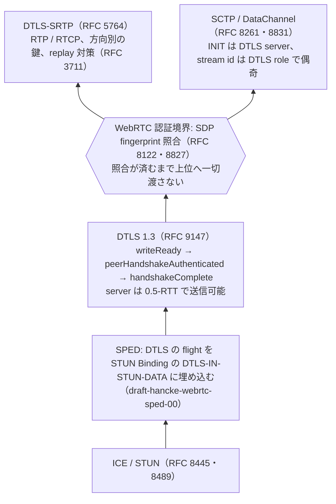
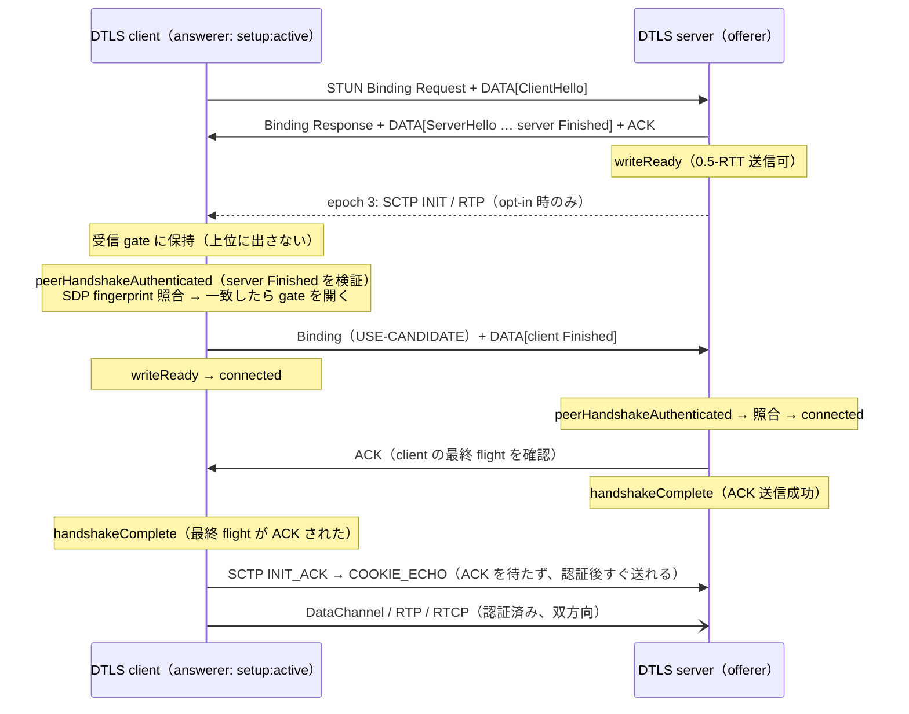
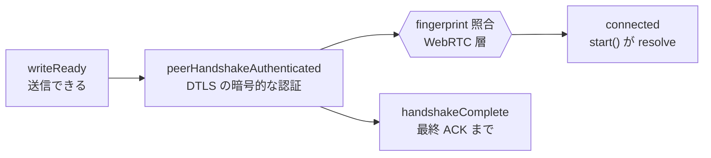
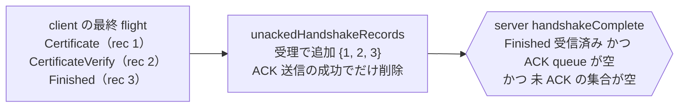
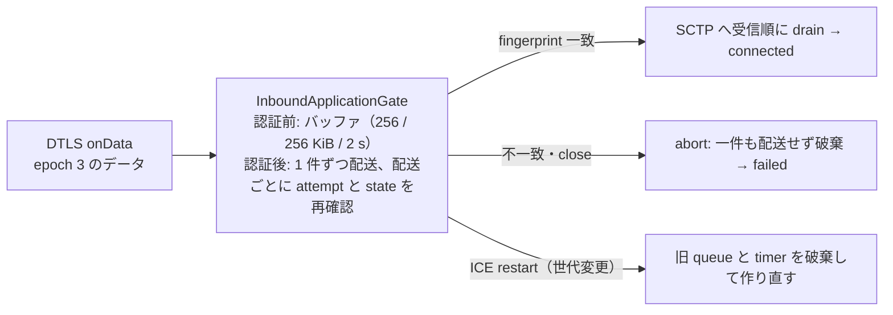
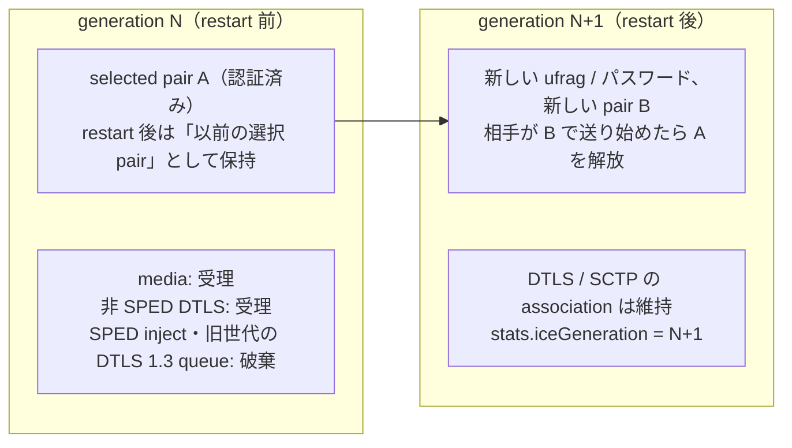
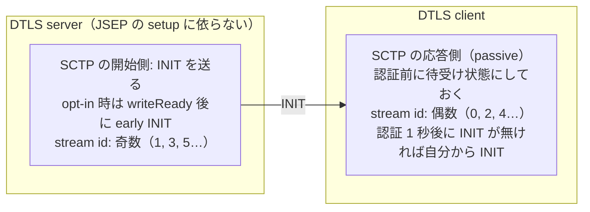
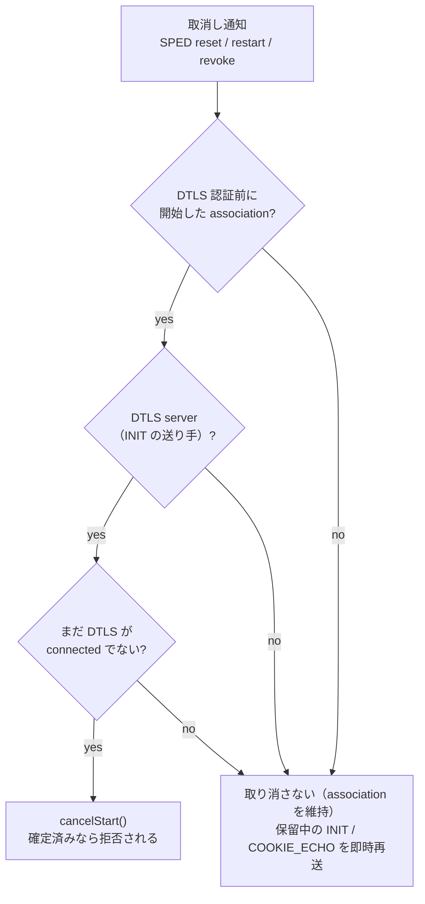

---
ide:
  viewer: review-document
  version: 1
  title: "Epic 4: WARP 対応 WebRTC transport — 仕様に基づくレビュー解説"
  dock: right
  baseCommit: 8cbed47b63bd598d4753d199a3b2ce4638a59bb8
---
# Epic 4: WARP 対応 WebRTC transport — 仕様に基づくレビュー解説

## 概要

このチケットで実装した WARP（SPED + DTLS 1.3 + 0.5-RTT）対応 WebRTC transport を、根拠となる RFC / draft / W3C の条文に対応づけて解説します。対象はブランチ `epic4-warp-webrtc-detailed`（比較元 `warp`）の現在の作業ツリーで、`packages/webrtc/src/transport/dtls.ts` のモジュール分割（`8cbed47b`）までを含みます。コードへのリンクは `パス:行` で、この時点のファイルの行を指します。

各項目は次の見出しで書き分けます。

- **仕様**: RFC / draft / W3C が求めていること。引用は `docs/rfc/`（RFC 3711 / 5763 / 5764 / 7675 / 7983 / 8122 / 8261 / 8445 / 8446 / 8489 / 8827 / 8831 / 8832 / 8842 / 9147 / 9260 / 9443、draft-hancke-webrtc-sped-00）と `docs/w3c/`（webrtc-pc: W3C Recommendation 13 March 2025、webrtc-stats: W3C Candidate Recommendation Draft 25 September 2025）の原文で節番号と文言を確認したものです。
- **実装**: werift のどこで、どう実現しているか。
- **werift の判断**: 仕様に定めがなく、werift が決めたこと（理由は「判断理由」にまとめています）。
- **逸脱**: 仕様の文言から意図的に外れていること（一覧は「リスク」にまとめています）。

設計の一次資料は [epic4-warp-webrtc-detailed.md](review-file:epic4-warp-webrtc-detailed.md)、要件と完了条件は [TICKET-epic4-warp-webrtc-detailed.md](review-file:TICKET-epic4-warp-webrtc-detailed.md)、検証の詳細は [reviews/epic4-warp-verification.md](review-file:reviews/epic4-warp-verification.md)、旧バージョンとの互換性の調査は [reviews/legacy-werift-compatibility.md](review-file:reviews/legacy-werift-compatibility.md) です。TURN relay 上の WARP はスコープ外です。

### 全体像

WARP は、ICE の接続確認（STUN Binding）に DTLS の handshake を相乗りさせ（SPED）、ICE と DTLS 1.3 を同時に進めることで接続までの往復を減らす仕組みです。werift の transport は次の層でできています。データは下から上へ流れ、認証境界を越えるまで上位に届きません。

**最重要の不変条件**: SDP fingerprint の照合が済むまで、DataChannel のデータ・RTP・RTCP を上位へ一件も配送しない。DTLS の暗号的な認証（Finished の検証）と、WebRTC としての相手の認証（SDP に書かれた証明書であること）は別物で、後者が済んで初めて配送します。

典型的な接続（SPED 有効、DTLS server が early server data を opt-in）の流れは次のとおりです。early server data（3 本目の矢印）は既定では無効です。

client が送信を始める条件は「自分の最終 flight（Finished）を送り、server Finished の検証と SDP fingerprint 照合が済んでいること」です。server の ACK（`handshakeComplete`）は待ちません。SPED draft-00 §3.1.2.2 も「server は Finished の受信で DTLS ACK を返すが、client はそれを待たずに暗号化データを送り始めてよい」としています（§5.5 のシーケンスでも `Finished` の直後に application data が続きます）。図で ACK の後に見える順序は時系列の一例で、仕様上の待ち条件ではありません。

client の側に「先に送る」ものが少ないのは、仕様の制約ではなく役割の結果です。SCTP の INIT は DTLS server が送り（RFC 8261）、client が返す INIT_ACK は INIT を受け取るまで送れません。client の 0-RTT（TLS early_data）は PSK 再開が前提で、接続ごとに新しい証明書を使う WebRTC の初回接続では使えません（werift も未実装）。server の 0.5-RTT は、client の Finished が未検証で相手が確定していないため（RFC 8446 §4.4.4）、既定では無効の opt-in です。

**pion との差異（既知）**: pion の SPED 実装（pion/webrtc #3362、draft 段階）は、DTLS の handshake 完了イベント（`DetachedHandshakeDone`）までアプリケーションデータを上位へ渡しません。draft が許す範囲より保守的ですが、werift の client が早く送る分には相手の挙動と矛盾せず、相互接続に影響しません。

## 主要変更

### 1. DTLS 1.3 コア（packages/dtls）

#### 1.1 3 段階の readiness

**仕様**: RFC 9147 §5.8.1 — 相手の Finished を受け取るまで、epoch 3 以上の application data は破棄するかバッファしなければなりません。

> Implementations MUST either discard or buffer all application data records for epoch 3 and above until they have received the Finished message from the peer.

同節の状態機械では、最終 flight の ACK を受け取ると FINISHED に遷移します。server は client の最終 flight を受け取った時点で FINISHED になり、その後も再送された最終 flight には ACK を再送しなければなりません（MUST）。

**実装**: DTLS の進行を、一度だけ true になる 3 つのフラグで表します。

[packages/dtls/src/engine/v1_3/connection-base.ts:96](review-file:packages/dtls/src/engine/v1_3/connection-base.ts:96)

| マイルストーン | 意味 | server | client |
| --- | --- | --- | --- |
| `writeReady` | epoch 3 で送信できる | 自分の Finished 送信後 | 自分の Finished 送信後 |
| `peerHandshakeAuthenticated` | 相手の Finished を検証した（暗号的な認証） | client Finished の検証後 | server Finished の検証後 |
| `handshakeComplete` | 最終 flight の ACK まで済んだ | client の最終 flight の全 record を ACK し終えた時点 | 自分の最終 flight が ACK された時点 |

server の `writeReady` は [packages/dtls/src/engine/v1_3/flight/server/flight4.ts:665](review-file:packages/dtls/src/engine/v1_3/flight/server/flight4.ts:665)、client の `writeReady` は [packages/dtls/src/engine/v1_3/flight/client/flight5.ts:130](review-file:packages/dtls/src/engine/v1_3/flight/client/flight5.ts:130) で立ちます。
`peerHandshakeAuthenticated` は server が [packages/dtls/src/engine/v1_3/flight/server/flight5.ts:48](review-file:packages/dtls/src/engine/v1_3/flight/server/flight5.ts:48)、client が [packages/dtls/src/engine/v1_3/flight/client/flight5.ts:41](review-file:packages/dtls/src/engine/v1_3/flight/client/flight5.ts:41) です。
`handshakeComplete` は server が [packages/dtls/src/engine/v1_3/record-rx.ts:370](review-file:packages/dtls/src/engine/v1_3/record-rx.ts:370)、client が [packages/dtls/src/engine/v1_3/record-rx.ts:786](review-file:packages/dtls/src/engine/v1_3/record-rx.ts:786) です。

`RTCDtlsTransport` の `connected` は `handshakeComplete`（final ACK）を待ちません。early server 送信中も公開 state は `connecting` のままです。

**werift の判断**: readiness を 3 段階に分けるのは werift の設計で、仕様にこの概念はありません。`peerHandshakeAuthenticated` は DTLS の暗号的な検証だけを表し、SDP の照合は含みません（2.1）。

#### 1.2 server の 0.5-RTT application data

**仕様**: RFC 8446 §4.4.4 — server は最初の flight を送った後にデータを送ってかまいません（MAY）。ただし相手の身元も生存も保証されていません。

> Servers MAY send data after sending their first flight, but because the handshake is not yet complete, they have no assurance of either the peer's identity or its liveness (i.e., the ClientHello might have been replayed).

RFC 9147 §4.2.1 — 受信側はそれをバッファしても破棄してもかまいません（MAY）。上位が SCTP のような信頼性のある transport ならバッファすべきです（SHOULD）。

> For instance, the server may send its Finished message and then start transmitting data. Implementations MAY either buffer or discard such records, though when DTLS is used with a reliable transport (e.g., SCTP [RFC4960]), they SHOULD be buffered …

**実装**: server は Finished の送信後に epoch 3 の鍵を設定し、`writeReady` を立てます。0.5-RTT の送信を実際に許すかは WebRTC 層が判断し、明示的に opt-in した server だけに限ります（2.4）。0-RTT（epoch 1）は実装していません。この文書の「early data」は TLS の early_data 拡張ではなく、接続確定前に届く epoch 3 のデータを指します。

#### 1.3 early data の受信バッファ

**実装**: 接続確定前に届いた epoch 3 の record は、受信順を保つ上限付きキューに保持します。上限は 256 record / 256 KiB / 2 秒で、DTLS engine、WebRTC の受信 gate、early media のキューが同じ定数を使います。

[packages/dtls/src/engine/v1_3/early-data-buffer.ts:9](review-file:packages/dtls/src/engine/v1_3/early-data-buffer.ts:9) がキュー、[packages/dtls/src/engine/v1_3/types.ts:90](review-file:packages/dtls/src/engine/v1_3/types.ts:90) が共有の上限です。

- 上限を超えたら、古い record を残して新しく届いた record を捨てます（順序の途中を欠かさないため）。[packages/dtls/src/engine/v1_3/early-data-buffer.ts:32](review-file:packages/dtls/src/engine/v1_3/early-data-buffer.ts:32)
- 先頭の record が期限切れになったら、キュー全体を捨てます。欠けた先頭の後ろだけを上位に見せないためです。[packages/dtls/src/engine/v1_3/early-data-buffer.ts:106](review-file:packages/dtls/src/engine/v1_3/early-data-buffer.ts:106)
- 期限はタイマーだけでなく、読み出しと追加・取り出しのたびに評価します。Node のタイマーは monotonic clock で動き `Date.now()` より約 1 ms 早く発火することがあるため、そのときは再武装します。[packages/dtls/src/engine/v1_3/early-data-buffer.ts:114](review-file:packages/dtls/src/engine/v1_3/early-data-buffer.ts:114)
- `EARLY_APP_DATA_UNLIMITED` が外すのは record / byte の上限だけで、2 秒の retention は残ります。[packages/dtls/src/engine/v1_3/types.ts:108](review-file:packages/dtls/src/engine/v1_3/types.ts:108)

overflow や期限切れは handshake を失敗させず、drop として統計に計上します。

テストは [packages/dtls/tests/handshake/tls13/early_data_buffer.test.ts](review-file:packages/dtls/tests/handshake/tls13/early_data_buffer.test.ts) と [packages/dtls/tests/e2e/self13_early_server_appdata.test.ts](review-file:packages/dtls/tests/e2e/self13_early_server_appdata.test.ts) です。

#### 1.4 最終 flight の ACK と server の完了判定

**仕様**: RFC 9147 §5.8.1 — server は FINISHED 状態でも、再送された client の最終 flight に ACK を再送しなければなりません。§7.1 — 受信した flight の record は ACK で確認します。

> … when in the FINISHED state, the server MUST respond to retransmission of the client's final flight with a retransmit of its ACK.

**実装**: server の `handshakeComplete` は「client の Finished を受け取り、最終 flight（相互認証なら Certificate・CertificateVerify・Finished）の全 record を含む ACK の送信に成功した」時点で立てます。

[packages/dtls/src/engine/v1_3/record-rx.ts:363](review-file:packages/dtls/src/engine/v1_3/record-rx.ts:363)

- 受理した record は [packages/dtls/src/engine/v1_3/connection-base.ts:248](review-file:packages/dtls/src/engine/v1_3/connection-base.ts:248) に記録し、その record を含む ACK の送信が成功したときだけ消します。[packages/dtls/src/engine/v1_3/flight-tx.ts:788](review-file:packages/dtls/src/engine/v1_3/flight-tx.ts:788)
- `sendAck()` は送信前に ACK 対象を queue から取り出すため、送信が throw したら対象を queue に戻します。[packages/dtls/src/engine/v1_3/flight-tx.ts:773](review-file:packages/dtls/src/engine/v1_3/flight-tx.ts:773)
- 完了判定は、通常の ACK の後だけでなく、再送された record への再 ACK が成功した後にも行います。最初の ACK の送信が（Finished の処理中の世代変更などで）失敗しても、再送への ACK で完了できます。

以前は「ACK queue が空」だけを見ていたため、rec 1 の再 ACK が成功しただけで、Finished の ACK を一度も送れていないのに完了を通知することがありました。

テストは [packages/dtls/tests/e2e/self13_final_ack_retry.test.ts:69](review-file:packages/dtls/tests/e2e/self13_final_ack_retry.test.ts:69)（相互認証で Finished の ACK が送れていない間は完了しない）ほかです。

#### 1.5 readiness の latch 契約（DTLS 1.2 / 1.3 共通）

**実装**: 各マイルストーンは association で一度だけ true になり、close・失敗・renegotiation でも false に戻りません。終了は `onClose` / `onError` で通知します。

[packages/dtls/src/socket.ts:152](review-file:packages/dtls/src/socket.ts:152)

- DTLS 1.2 には段階がないため、最初の `connected` で 3 つ同時に latch します。[packages/dtls/src/socket.ts:73](review-file:packages/dtls/src/socket.ts:73)
- DTLS 1.3 の engine を close・失敗で破棄するときは、その時点で到達していたマイルストーンを個別に保存し、破棄後もそれを返します。handshake の途中で終わった場合も、到達済みは true、未到達は false のままです。[packages/dtls/src/socket.ts:1221](review-file:packages/dtls/src/socket.ts:1221)
- 到達済みのマイルストーンを待つ waiter は close 後でも resolve し、未到達のものは reject します。終了状態より先に到達済みかを判定します。[packages/dtls/src/socket.ts:284](review-file:packages/dtls/src/socket.ts:284)

テストは [packages/dtls/tests/e2e/self_readiness_latch.test.ts](review-file:packages/dtls/tests/e2e/self_readiness_latch.test.ts)（DTLS 1.3 / dual client → 1.2 server / DTLS 1.2、handshake 途中の close と致命的失敗）です。

#### 1.6 受信世代（rxGeneration）による ICE restart の隔離

**werift の判断**: 受信世代は werift 独自の仕組みです。近い根拠は RFC 9147 §4.5.2（無効な record は黙って捨てる）と draft §9.1（埋め込まれた DTLS は ICE の認証で保護され、再送の重複は replay として扱う）です。

**実装**: datagram を受け取った時点の ICE generation を DTLS の受信キューまで運び、処理する時点で世代が変わっていたら捨てます。restart 後に旧世代の SPED inject が新しい association を動かさないためです。

[packages/dtls/src/engine/v1_3/host.ts:15](review-file:packages/dtls/src/engine/v1_3/host.ts:15) が判定、[packages/dtls/src/engine/v1_3/record-rx.ts:104](review-file:packages/dtls/src/engine/v1_3/record-rx.ts:104) が受信時の適用です。

このフィルタを設定するのは SPED transport だけです。SPED でない経路では restart をまたいでも同じ DTLS association の datagram なので、`warp` と同じく遮断しません。[packages/webrtc/src/transport/dtls.ts:771](review-file:packages/webrtc/src/transport/dtls.ts:771)

#### 1.7 SRTP 鍵の exporter

**仕様**: RFC 5764 §4.2 — label `"EXTRACTOR-dtls_srtp"`、空の context で鍵素材を導出し、client_write_key / server_write_key / client_write_salt / server_write_salt の順に切り出します。

**実装**: `waitForWriteReady` の時点で SRTP profile を反映するので、server は 0.5-RTT の段階で SRTP 鍵を導出できます。鍵を実際に使ってよいかは WebRTC 層が判断します（2.3）。DTLS client の送信鍵 = server の受信鍵であることは、両方向の RTP / RTCP の E2E で確認しています。

[packages/dtls/src/socket.ts:189](review-file:packages/dtls/src/socket.ts:189) が profile の反映、[packages/webrtc/src/transport/dtls-srtp.ts:17](review-file:packages/webrtc/src/transport/dtls-srtp.ts:17) が鍵の導出です。

### 2. WebRTC の認証境界（packages/webrtc）

#### 2.1 SDP fingerprint の照合を認証の境界にする

**仕様**: RFC 8122 §5 — 提示された証明書が SDP の fingerprint と一致すれば、SDP の作成者が接続の開始者だと確信できます。§5.1 — 相手が提示した中で最も優先するハッシュ関数の fingerprint 群を選び、証明書がそのどれかと一致することを確認します。

> An endpoint MUST select the set of fingerprints that use its most preferred hash function (out of those offered by the peer) and verify that each certificate used matches one fingerprint out of that set. If a certificate does not match any such fingerprint, the endpoint MUST NOT establish the TLS connection.

RFC 5763 §5 — 一致しなければ、ただちに media session を終了しなければなりません（"If the fingerprint does not match the hashed certificate, then the endpoint MUST tear down the media session immediately."）。RFC 8827 §4.1 — SDP は「通信を鍵ペアに束縛する fingerprint 属性」を運びます。§6.5 — すべての media は DTLS-SRTP で鍵を交換した SRTP / SRTCP で、すべての data channel は DTLS で保護しなければなりません。

**実装**: DTLS 層の `peerHandshakeAuthenticated` を待ってから照合します（未対応のアルゴリズムは捨て、残りの中で最も強いものだけを比較）。

[packages/webrtc/src/transport/dtls-fingerprint.ts:46](review-file:packages/webrtc/src/transport/dtls-fingerprint.ts:46)

- **成功**: `peerAuthenticated` を立て、SRTP 鍵を設定して保持していた media を復号し、受信 gate を開いて保持していたデータを配送し、最後に `connected` にします。[packages/webrtc/src/transport/dtls.ts:578](review-file:packages/webrtc/src/transport/dtls.ts:578)
- **不一致**: 認証を取り消して `failed` にし、gate とキューを破棄し、SPED を中止し、DTLS engine を close します。接続後に新しい SDP の fingerprint が来たときも、現在の association の証明書で照合し直して同じ処理をします。[packages/webrtc/src/transport/dtls.ts:330](review-file:packages/webrtc/src/transport/dtls.ts:330)
- **送信側の境界**: 認証前の `sendData` は、early server の送信許可がない限り `SCTPSendPermissionRevokedError` を投げます。[packages/webrtc/src/transport/dtls.ts:1029](review-file:packages/webrtc/src/transport/dtls.ts:1029)

テストは [packages/webrtc/tests/integrate/sped.test.ts:1675](review-file:packages/webrtc/tests/integrate/sped.test.ts:1675)（実 PeerConnection で、early に送られた DataChannel / RTP / RTCP が 0 件、SPED 中止、engine close、`failed`）です。

#### 2.2 受信 gate と公開 state

**実装**: [packages/webrtc/src/transport/dtls-application-gate.ts:4](review-file:packages/webrtc/src/transport/dtls-application-gate.ts:4)。SPED の abort・fallback・同一世代の reset では `discardPending()` で認証前の保留分だけを捨て（[packages/webrtc/src/transport/dtls-application-gate.ts:97](review-file:packages/webrtc/src/transport/dtls-application-gate.ts:97)）、世代の切り替えは `restartForNewAttempt()` で行います（[packages/webrtc/src/transport/dtls-application-gate.ts:78](review-file:packages/webrtc/src/transport/dtls-application-gate.ts:78)）。
media（SRTP）も同じ規則のキューを使います。[packages/webrtc/src/transport/dtls-media-queue.ts:15](review-file:packages/webrtc/src/transport/dtls-media-queue.ts:15)

**仕様**: W3C webrtc-pc §5.5.1 `RTCDtlsTransportState` — `connecting` は "DTLS is in the process of negotiating a secure connection and verifying the remote fingerprint."、`connected` は "DTLS has completed negotiation of a secure connection and verified the remote fingerprint."、`failed` は "… failure to validate the remote fingerprint" を含みます。werift の state はこの定義どおりで、fingerprint の照合が済むまで `connected` にしません。

**werift の判断**: `connected` は final ACK を待たずに出し、early server 送信中も公開 state は `connecting` のままにします。

#### 2.3 方向別の SRTP 有効化と replay 対策

**仕様**: RFC 5764 §4.2 — 鍵は方向ごとに使い分けます。§5.1 — "Within each RTP session, SRTP processing MUST NOT take place before the DTLS handshake completes."

**実装**: 鍵の設定と送受信の許可を分けています。

[packages/webrtc/src/transport/dtls-srtp.ts:45](review-file:packages/webrtc/src/transport/dtls-srtp.ts:45)

| 方向 | 許可する条件 |
| --- | --- |
| 受信（復号して上位へ） | 鍵がある かつ `peerAuthenticated` |
| 送信 | 鍵がある かつ（`peerAuthenticated` または early server の送信許可） |

許可は [packages/webrtc/src/transport/dtls-srtp.ts:71](review-file:packages/webrtc/src/transport/dtls-srtp.ts:71) で一度に計算し直します。認証前に届いた media は暗号化されたまま保持し（`earlyMediaPolicy: "drop"` が既定で容量 0）、認証後に復号します。[packages/webrtc/src/transport/dtls.ts:917](review-file:packages/webrtc/src/transport/dtls.ts:917)

**仕様**: RFC 3711 §3.3.2 — replay 対策は RECOMMENDED です。受信側は replay list（sliding window）を持ち、window の大きさは 64 以上でなければなりません（MUST）。

> Only packets with index ahead of the window, or, inside the window but not already received, SHALL be accepted. After the packet has been authenticated (if necessary the window is first moved ahead), the replay list SHALL be updated with the new index.

§3.4 — SRTCP の replay 対策は、SRTCP index を index として、別の replay list で同じ規則を適用します。

**実装**: werift の SRTP / SRTCP には replay 対策がなかったため、受信 context に追加しました。window の大きさは libwebrtc と同じ 1024 で、遅れて届いた NACK 再送も受け付けます。

[packages/rtp/src/srtp/replay.ts:5](review-file:packages/rtp/src/srtp/replay.ts:5)

- SRTP の index は ROC × 2^16 + SEQ、SRTCP は packet 末尾の 31 bit index です。
- check は復号前、accept（window への記録）は認証成功後だけです。改ざん packet では window は進みません。
- 新しい SSRC の window も認証成功後にだけ作ります。未知の SSRC の偽造 packet を大量に送られても、受信側の状態は増えません。[packages/rtp/src/srtp/context/srtp.ts:51](review-file:packages/rtp/src/srtp/context/srtp.ts:51)
- replay は `SrtpAuthenticationError` のサブクラスとして投げるので、WebRTC の既存の破棄経路でそのまま捨てられます。

テストは [packages/rtp/tests/srtp/replay.test.ts:12](review-file:packages/rtp/tests/srtp/replay.test.ts:12)（AES-CM / AES-GCM、replay・rollover・改ざん・未知 SSRC の偽造・SRTCP）です。

**逸脱**: 受信の復号は final ACK を待たず「相手を認証できた時点」で始めます（§5.1 の「handshake completes」を相手の認証完了と解釈）。opt-in した server だけは相手の認証前に SRTP を送ります。これは §5.1 から外れる実験的な拡張で、既定では無効です。

#### 2.4 early server data の opt-in と設定の検証

**実装**: 0.5-RTT で送ってよいかの判定は 1 か所だけで、次のすべてを満たすときに限ります: SPED transport、DTLS role が server、`warp.allowEarlyServerData` を opt-in、fallback していない、`writeReady`、DTLS 1.3、現在の attempt。

[packages/webrtc/src/transport/dtls.ts:409](review-file:packages/webrtc/src/transport/dtls.ts:409)

不正な組み合わせ（SPED なしの `allowEarlyServerData`、DTLS 1.3 を含まない SPED、SPED と `helloRetryRequest`）は、constructor と `setConfiguration()` で同期的に throw し、設定は変更しません。[packages/webrtc/src/api/peerConfig.ts:633](review-file:packages/webrtc/src/api/peerConfig.ts:633)

early outbound が無効のとき、DTLS server が `writeReady` から fingerprint 認証まで SCTP / DataChannel を一件も送らないことは、DataChannel レベルのテストで確認しています。[packages/webrtc/tests/integrate/earlyOutboundBoundary.test.ts:7](review-file:packages/webrtc/tests/integrate/earlyOutboundBoundary.test.ts:7)

#### 2.5 先頭バイトによる多重分離（RFC 7983 §7 / RFC 9443 §3）

**仕様**: RFC 9443 §3（RFC 7983 §7 を更新）— 先頭バイトが 0–3 は STUN、20–63 は DTLS、64–79 は TURN Channel、128–191 は RTP / RTCP。どれにも当てはまらないものは破棄します。

**実装**: DTLS の判定は [packages/webrtc/src/utils.ts:50](review-file:packages/webrtc/src/utils.ts:50)、RTP / RTCP の判定は [packages/rtp/src/helper.ts:25](review-file:packages/rtp/src/helper.ts:25) です。DTLS を受け取る carrier は、振り分けに加えて「認証済みの pair・現在の世代・送信元 5-tuple の一致」も確認します。[packages/ice/src/internal/datagram.ts:59](review-file:packages/ice/src/internal/datagram.ts:59)

#### 2.6 transport の状態の持ち方

`RTCDtlsTransport` の状態は、一緒に変わるものごとにモジュールへ分けています。どの状態遷移も、複数のフィールドを直接書き換えるのではなく、名前の付いた操作で行います。

| モジュール | 持つ状態 |
| --- | --- |
| [packages/webrtc/src/transport/dtls-attempt.ts:14](review-file:packages/webrtc/src/transport/dtls-attempt.ts:14) | どの handshake / 認証の attempt が継続処理を所有するか（ICE restart で新しい attempt になる） |
| [packages/webrtc/src/transport/dtls-readiness.ts:26](review-file:packages/webrtc/src/transport/dtls-readiness.ts:26) | WebRTC 層の readiness（`writeReady` / `peerAuthenticated` / `handshakeComplete`）と handshake の時刻 |
| [packages/webrtc/src/transport/dtls-srtp.ts:45](review-file:packages/webrtc/src/transport/dtls-srtp.ts:45) | SRTP 鍵と送受信の許可 |
| [packages/webrtc/src/transport/dtls-application-gate.ts:4](review-file:packages/webrtc/src/transport/dtls-application-gate.ts:4) / [packages/webrtc/src/transport/dtls-media-queue.ts:15](review-file:packages/webrtc/src/transport/dtls-media-queue.ts:15) | 認証まで保持する application data / media |
| [packages/webrtc/src/transport/dtls-sped-handshake.ts:56](review-file:packages/webrtc/src/transport/dtls-sped-handshake.ts:56) | SPED の carrier と runtime の制御 |

ICE restart で connecting 中の handshake を新しい attempt に移す処理は [packages/webrtc/src/transport/dtls.ts:475](review-file:packages/webrtc/src/transport/dtls.ts:475)、SPED の世代リセットは [packages/webrtc/src/transport/dtls.ts:493](review-file:packages/webrtc/src/transport/dtls.ts:493)、SPED の abort / fallback で early データを手放す処理は [packages/webrtc/src/transport/dtls.ts:522](review-file:packages/webrtc/src/transport/dtls.ts:522) です。

### 3. ICE / SPED（packages/ice）

#### 3.1 SPED の STUN 属性（DATA / ACK）

**仕様**: draft-hancke-webrtc-sped-00 §3.3.2.1 — DTLS-IN-STUN-DATA は DTLS の handshake packet を 1 つ運ぶか、空の値で SPED 対応を示します。空の値を DTLS 層に渡してはいけません（MUST NOT）。先頭バイトが RFC 9443 §3 の DTLS 範囲外なら黙って捨てるべきです（SHOULD）。§3.3.2.2 — DTLS-IN-STUN-ACK は受け取った DATA の CRC-32 のリストです。

**実装**: 属性のコードポイントは draft で TBD のため `0xC070` / `0xC071` を使っています。DTLS の flight（L1）から 1 packet を round-robin で選んで DATA に入れ、MESSAGE-INTEGRITY より前に挿入します。

[packages/ice/src/sped/draft00/constants.ts:6](review-file:packages/ice/src/sped/draft00/constants.ts:6) がコードポイント、[packages/ice/src/ice.ts:2781](review-file:packages/ice/src/ice.ts:2781) が Binding への付与です。

#### 3.2 相手の SPED 対応の判定と fallback

**仕様**: draft §4.3 step 1:

> If this is the first authenticated STUN message received from the peer, and the DTLS-IN-STUN-DATA attribute is not present, conclude that the peer does not support SPED, and conclude SPED processing.

**実装**: 判定は世代ごとに 1 回です。非対応なら、L1 の最初の bytes をそのまま通常の DTLS として送ります（同じ ClientHello flight で direct fallback）。DTLS を開始する前に届いた認証済みの Binding には空の DATA だけを返し、相手が「非対応」と誤判定しないようにしています。

[packages/ice/src/sped/draft00/session.ts:152](review-file:packages/ice/src/sped/draft00/session.ts:152)

外部に見せる状態（`disabled` / `probing` / `active` / `fallback`）と carrier（`sped` / `direct`）は [packages/ice/src/sped/runtime.ts:177](review-file:packages/ice/src/sped/runtime.ts:177) で、stats の `warpSpedState` / `warpCarrier` になります。[packages/webrtc/src/transport/dtls-stats.ts:120](review-file:packages/webrtc/src/transport/dtls-stats.ts:120)

SPED 非対応かつ DTLS 1.2 だけの相手への fallback は、公開済みの `werift@0.26.0` と実際に接続して確認しています（DTLS `[1.3, 1.2]` を提示する client が、相手が 1.2 server のときに最初の ClientHello で extended_master_secret を提示するよう修正した結果を含みます）。[packages/dtls/src/engine/v1_3/flight/client/flight1.ts](review-file:packages/dtls/src/engine/v1_3/flight/client/flight1.ts)

**逸脱**: SPED は DTLS 1.3 に限っています（draft §3.2 は DTLS 1.2 以上を目標）。dual 構成で 1.2 に決まった場合は direct DTLS に確定し、WARP の early semantics を 1.2 に持ち込みません。relay の pair と古い世代の ufrag への応答には DATA を付けません（§3.3.2.1 の「active の間はすべての Binding に DATA」からの逸脱）。relay 以外の pair では、未確定の prflx を含めて少なくとも空の DATA を付けます。[packages/ice/src/sped/runtime.ts:109](review-file:packages/ice/src/sped/runtime.ts:109)

#### 3.3 direct carrier と再送モード

**仕様**: draft §4.4 — 有効な pair ができたら DTLS を直接送ってもかまいません（MAY）。§6 — SPED の間は DTLS 内部のタイムアウトを止め、最初の Binding Response で再開することを推奨します。

**実装**: SPED の handshake を始めた時点で DTLS の再送を ICE 側に任せる external モードにし、送信元が対称な認証済み Response を受け取ったら internal に戻して直接送信を許します。direct に切り替えても状態は `active` のままで、`carrier` が `direct` になります。

[packages/webrtc/src/transport/dtls-sped-handshake.ts:63](review-file:packages/webrtc/src/transport/dtls-sped-handshake.ts:63) が external への切り替え、[packages/webrtc/src/transport/dtls-sped-handshake.ts:123](review-file:packages/webrtc/src/transport/dtls-sped-handshake.ts:123) が direct への切り替えです。

#### 3.4 ICE restart と、以前に選択されていた pair

**仕様**: RFC 8445 §9 — restart では ufrag とパスワードを両方変えなければなりません（MUST）。restart の間も既存の data session でデータを送り続けてかまいません。

> … data can continue to be sent using existing data sessions, and a new …

RFC 8842 §6 — ICE restart は新しい DTLS association を必要としません。

> However, an ICE restart does not by default require a new DTLS association to be established. Each ICE candidate associated with a component is treated as being part of the same DTLS association.

**実装**: restart で generation を進め、ufrag とパスワードを作り直し、SPED をリセットします。以前に選択されていた pair は退避し、相手が新しい pair に移るまでは、そこから届いた datagram に `fromPreviousSelectedPair` の印を付けます。

[packages/ice/src/ice.ts:314](review-file:packages/ice/src/ice.ts:314) が restart、[packages/ice/src/ice.ts:1211](review-file:packages/ice/src/ice.ts:1211) が印付けです。

- media（RTP / RTCP）はこの経路も受け付けます。
- SPED でない DTLS も、この経路から受け付けます。handshake 中に restart すると、相手の最終 flight は旧 pair で届くためです。[packages/webrtc/src/transport/dtls-ice-transport.ts:30](review-file:packages/webrtc/src/transport/dtls-ice-transport.ts:30)
- SPED の carrier は現在の世代だけを受け付けます。
- SPED の handshake 完了後の送信では、DTLS が保持する宛先を association の相手を指す「優先候補」としてだけ扱い、現在の世代の認証済み pair へ送ります。restart で別の 5-tuple へ移った後や nomination の前でも、KeyUpdate などの ACK が送れずに DTLS が失敗することはありません。[packages/webrtc/src/transport/sped.ts:666](review-file:packages/webrtc/src/transport/sped.ts:666)

テストは [packages/webrtc/tests/integrate/transportFaultMatrix.test.ts:113](review-file:packages/webrtc/tests/integrate/transportFaultMatrix.test.ts:113)（新しい selected pair（別の 5-tuple）へ移り、同じ SCTP association を維持する。sped:false / SPED）と [packages/webrtc/tests/integrate/spedMigratedKeyUpdate.test.ts](review-file:packages/webrtc/tests/integrate/spedMigratedKeyUpdate.test.ts) です。

### 4. SCTP / DataChannel

#### 4.1 SCTP の役割と stream id の偶奇

**仕様**: RFC 8831 §6.1 — SCTP は RFC 8261 の DTLS カプセル化で運びます。§6.5:

> … the streams are picked based on the DTLS role (the client picks even stream identifiers, and the server picks odd stream identifiers).

RFC 8832 §4（DCEP）も同じ規則を MUST で定めています（"the side acting as the DTLS client MUST use streams with even stream identifiers; the side acting as the DTLS server MUST use streams with odd stream identifiers"）。どちらの側が INIT を送るかは、どの RFC も定めていません。

**実装**: DTLS server が INIT を送り、DTLS client が応答します。DTLS client は、early server の INIT が届いたときに偶奇が未確定にならないよう、相手の認証前に passive 側を待受け状態にします。

[packages/webrtc/src/transport/sctp.ts:615](review-file:packages/webrtc/src/transport/sctp.ts:615) が役割の決定、[packages/webrtc/src/negotiation/transportActivation.ts:352](review-file:packages/webrtc/src/negotiation/transportActivation.ts:352) が passive 側の待受けです。

旧 werift（0.26.0 以前）は INIT の送り手と stream id の偶奇を ICE role で決めます。ICE role と DTLS role の対応がずれる構成でも接続できるよう、次の 4 点を入れています（調査の詳細は [reviews/legacy-werift-compatibility.md](review-file:reviews/legacy-werift-compatibility.md)）。

- 自分の INIT を待つ間に相手の INIT が届いたら、INIT_ACK で答えます（RFC 9260 §5.2.1 の INIT 衝突）。[packages/sctp/src/sctp.ts:430](review-file:packages/sctp/src/sctp.ts:430)
- 応答側（DTLS client）は、DTLS 認証の 1 秒後までに INIT が届かなければ自分から INIT を送ります。[packages/webrtc/src/transport/sctp.ts:629](review-file:packages/webrtc/src/transport/sctp.ts:629)
- 自分の INIT は常に verification tag 0 で送り、旧 werift が送る「自分の tag 付きの INIT」も受け付けます。[packages/sctp/src/sctp.ts:334](review-file:packages/sctp/src/sctp.ts:334)
- 役割の対応がずれる構成に限り、in-band DataChannel の id を交渉済みの stream 数の上端から下へ割り当てます（DTLS role の偶奇は守る）。下から数える旧 werift と同時に開いても衝突しません。[packages/webrtc/src/transport/sctp.ts:266](review-file:packages/webrtc/src/transport/sctp.ts:266)

テストは [packages/webrtc/tests/integrate/connectionMatrix.test.ts:18](review-file:packages/webrtc/tests/integrate/connectionMatrix.test.ts:18)（setup:active / passive × Full×Full / Full×Lite × SPED × DTLS version の 16 通りで、stream id の偶奇が DTLS role に一致）と [packages/webrtc/tests/integrate/legacySctpRole.test.ts](review-file:packages/webrtc/tests/integrate/legacySctpRole.test.ts) です。

#### 4.2 開始の確定点と、early start の取消し規則

**仕様**: RFC 9260 §5.1 — INIT → INIT ACK（State Cookie）→ COOKIE ECHO → COOKIE ACK の 4-way handshake。§4 の状態遷移の注記 — T1-init / T1-cookie が満了したら再送し、'Max.Init.Retransmits'（既定 8、§16）回を超えたら初期化を中止して利用者にエラーを返します（werift も上限 8）。RFC が定める association の放棄は ABORT（§9.1）とこの再送上限だけで、「開始の取消し」は werift が定義した境界です。

**実装**:

- **確定点**: 相手が association の状態を持ちうる時点で開始を確定とします。開始側は COOKIE ECHO、応答側は COOKIE ACK を送信処理に渡した時点です。確定後は取り消しません。[packages/sctp/src/sctp.ts:298](review-file:packages/sctp/src/sctp.ts:298)
- **取消し規則**: SPED の reset・ICE restart・early 送信許可の取消しで届く通知に対し、次の判定で取り消すかどうかを決めます。[packages/webrtc/src/transport/sctp.ts:164](review-file:packages/webrtc/src/transport/sctp.ts:164)

3 つの条件をすべて満たす「認証前の early attempt そのもの」だけを取り消します。この規則にたどり着くまでに、レビューで次の回帰が見つかり修正しました。

- 認証後に始めた通常の SCTP 開始まで、SPED の reset で取り消されていた（`connecting → failed → connecting`）。→ 条件 1。
- DTLS client の passive association が取り消され、作り直された association では送信済み INIT_ACK の cookie 鍵が失われ、相手の COOKIE_ECHO を検証できず接続が完了しなかった。→ 条件 2。
- 認証前に始めて、認証後も COOKIE_WAIT が続いた early start が、その後の restart で取り消された。→ 条件 3。

テストは [packages/webrtc/tests/transport/sctp.test.ts:169](review-file:packages/webrtc/tests/transport/sctp.test.ts:169) と [packages/webrtc/tests/integrate/warpLifecycle.test.ts:120](review-file:packages/webrtc/tests/integrate/warpLifecycle.test.ts:120)（確定後は作り直さない）です。

#### 4.3 送信失敗は損失として扱う

**実装**: SCTP の送信失敗（INIT / INIT_ACK の送信、T1 再送、即時再送）で開始を取り消すのは、transport が `SCTPSendPermissionRevokedError` を投げた場合だけです。それ以外の失敗は損失として T1 の再送に任せます（`warp` と同じ）。

[packages/sctp/src/sctp.ts:113](review-file:packages/sctp/src/sctp.ts:113) が error、[packages/sctp/src/sctp.ts:1660](review-file:packages/sctp/src/sctp.ts:1660) が取消しの判定です。

この error を投げるのは、SPED の early 送信経路（許可の取消し・世代の変更・期限切れ）と、DTLS の未認証送信の拒否だけです。認証後の送信は SPED の applicationReady 経路を通り、失敗してもログに出すだけで SCTP には伝わらないため、認証後の association がこの error で取り消される経路はありません。

## 判断理由

仕様が定めておらず、werift が決めたことと、その理由です。

| 判断 | 理由 |
| --- | --- |
| readiness を `writeReady` / `peerHandshakeAuthenticated` / `handshakeComplete` の 3 段階に分ける（1.1） | 0.5-RTT 送信の可否、DTLS の暗号的な認証、最終 ACK の到達は別の時点に起き、それぞれを待つ利用者が違うため |
| early data のキューは 2 秒の retention とし、先頭が期限切れならキュー全体を捨てる（1.3） | 認証が来ない相手へのメモリ保持に上限を付けつつ、欠けた先頭の後ろだけを上位に見せないため |
| `connected` は final ACK を待たない（2.2） | W3C の定義（fingerprint の照合が済んだら connected）に合わせ、ACK の喪失で接続の公開が遅れないようにするため |
| 受信世代で restart 前の DTLS を捨てるのは SPED だけにする（1.6） | SPED は世代ごとに carrier が注入されるが、非 SPED は restart をまたいでも同じ association の datagram で、遮断すると handshake が止まるため |
| DTLS server を SCTP の INIT の送り手にする（4.1） | early server data（server の 0.5-RTT）を JSEP の setup のどの組み合わせでも成り立たせるため。stream id の偶奇（RFC 8832）と同じく DTLS role に揃える |
| 応答側は認証 1 秒後に自分から INIT を送り、INIT 衝突に答える（4.1） | INIT の送り手を ICE role で決める旧 werift と、両端が待つ・両端が送る組み合わせでも接続できるようにするため。1 秒は SCTP の初期 RTO（3 秒）より十分短い |
| 役割がずれる構成だけ DataChannel の id を上から割り当てる（4.1） | 旧 werift は同じ偶奇を下から使うため。RFC 8832 の偶奇は守るので、仕様どおりの相手とも衝突しない。通常の構成の id は変えない |
| early start の取消しを「認証前・DTLS server・未接続」の 3 条件に限る（4.2） | それ以外を取り消すと、通常の開始や passive の cookie 鍵まで失われる回帰がレビューで見つかったため |
| SRTP の replay window を 1024 にする（2.3） | RFC の下限 64 では、ストリームが進んだ後に届く NACK 再送を捨ててしまうため（libwebrtc と同じ値） |

## リスク

### 仕様からの意図的な逸脱

- **0.5-RTT の SRTP / SCTP 送信**（RFC 5764 §5.1）: opt-in した server だけ。既定では無効。RFC 8446 §4.4.4 が認める 0.5-RTT 送信を使うが、送信側は相手の身元をまだ確認していない。RFC 5763 §6.2 の early media（answerer が setup:active で SDP answer 前に DTLS を張る）とは別の仕組みで、いずれの場合も受信側は fingerprint の照合まで配送しない。
- **SRTP の受信を、相手の認証完了の時点で始める**: final ACK は待たない。
- **SPED を DTLS 1.3 だけに限る**（draft §3.2 は 1.2 以上が目標）。
- **relay 上の SPED を除外し、association path を 1 本だけ使う**（チケットのスコープ境界とも一致）。
- **SPED が active の間でも、一部の Binding に DATA を付けない**（draft §3.3.2.1 の MUST から逸脱）。
- **古い世代の、AEAD 認証済みの DTLS 1.3 record（Alert を含む）を適用しない**（SPED transport のみ）。
- **STUN の認証失敗時に 400 / 401 を返さない**（RFC 8489 §9.1.3 は request に 400 / 401 の error response を MUST で求める。既存の挙動）。
- **SCTP の既存の逸脱**（RFC 9260）: T1-init は §6.3 の規則に従うべき（§5.1、SHOULD）だが、満了時に RTO を倍にしない（§6.3.3 rule E2）。[packages/sctp/src/sctp.ts:1241](review-file:packages/sctp/src/sctp.ts:1241) 応答側は INIT を受けた時点で状態を持つ（§5.1 (B) は INIT ACK 送信後に資源や状態を持たないことを MUST で求める）。
- **自分の verification tag 付きの INIT を受け付ける**（RFC 9260 §8.5.1 は INIT の tag を 0 と定める）: 旧 werift との互換のため。その tag を知るのは自分の INIT を受け取った相手だけで、SCTP は DTLS の中を流れる。
- **tls-id（RFC 8842）を実装していない**: RFC 8842 §3.1 は、fingerprint が変わったら offer/answer の後に新しい DTLS association を確立しなければならないとする。werift は新しい association を作らず、確立済みの association の証明書で照合し直して、一致しなければ失敗させる。
- **stats**: `dtlsRole` は未確定時に undefined（webrtc-stats §8.17 は DTLS ネゴシエーション開始前を `"unknown"` と定める）。`warpHandshakeRttMs` は RTT ではなく「handshake 開始から相手の認証まで」の時間。DTLS 1.2 の `warpDtlsRetransmissions` は常に 0。

以前の版にあった「開始側は相手の INIT を無視し、§5.2.1 の INIT 衝突を処理しない」は、旧 werift との互換の修正で解消しています（4.1）。

### 互換性

- 公開済みの `werift@0.26.0` とは、DataChannel・media・ICE restart・ICE-TCP・ICE-lite・再交渉・close のいずれも接続できます。現行を DTLS 1.3 のみにした構成は、1.2 しか話せない旧 werift とはつながりません（設定どおり。DTLS client のときは応答のない相手と同じく再送上限まで `connecting`）。
- 0.24.4 以前のリリースには、0.26.0 でも同じように起きる既存の非互換があります（close の通知、ICE restart、ICE-TCP、片方向の media）。
- 詳細は [reviews/legacy-werift-compatibility.md](review-file:reviews/legacy-werift-compatibility.md) です。

### 未確認の事項

- W3C 仕様は版によって節番号が変わります。この文書は「概要」に記した版に基づきます。
- Pion 同士の full SPED（controlling / controlled、Full / Lite、SPED 上の restart）は、upstream の対応が前提のため未確認です。
- BoringSSL harness が確認するのは handshake と双方向データだけで、exporter・KeyUpdate・negative cases の外部実装との組み合わせは未確認です（ローカルの self テストは成功）。
- `npm run examples:e2e` は実行していません。

### 既知の問題（develop / warp のマージ後、本件の範囲外）

- マージで入った「ソースは消去可能な構文だけ」（`erasableSyntaxOnly`、Node.js の型除去のみ）の規則に、本チケットで追加した DTLS 1.3 / SPED のコードが従っていません。`npm run type`、`npm run e2e` の事前の `tsc`、`typedoc`（`npm run doc` / `doc:check`）が失敗し、Node.js の型除去だけでは本ブランチのソースを実行できません。
- `packages/webrtc/doc` が別チケットの自動 commit で入っており、`npm test` がその下の例のテストまで拾います。
- memleak の 2 シナリオ（DataChannel / メディア）は処理数 0 のまま時間切れになります（`npm run memleak`、ローカルのみ）。

## 検証結果

### 障害注入マトリクス

SPED / early 用に入れた中断処理（cancel・revoke・discard・attempt の付け替え）が、本来対象外の経路に効いてしまう回帰が、深いレビューのたびに見つかりました。そこで、SCTP の開始中に障害を注入し ICE restart を重ねるマトリクスを常設テストにしました（4 構成 × DTLS role 2 通り × 11 シナリオ = 88 件、ほかに restart 後の経路切替 2 件）。

| 軸 | 値 |
| --- | --- |
| 構成 | sped:false（DTLS 既定）、sped:false（DTLS 1.3）、SPED early=off、SPED early=on |
| restart のタイミング | なし、DTLS 接続中、SCTP COOKIE_WAIT 中（INIT 送信時）、SCTP COOKIE_ECHOED 中（COOKIE_ECHO 送信時） |
| 障害 | なし、INIT_ACK / COOKIE_ACK の喪失、INIT / INIT_ACK / COOKIE_ECHO の送信失敗 |
| 合格条件 | 一度も `failed` にならず、DataChannel が双方向に届き、両側が最終的に `connected` |

  <h4>sped:false（DTLS 既定 / 1.3）— 44 件中の成功数</h4>
  
warp

40

  
修正前

20

  
修正後

44

  <h4>SPED（early off / on）— 44 件中の成功数</h4>
  
warp

16

  
修正前

30

  
修正後

44

  
sped:false の修正前は 2fd3ce19、SPED の修正前は 6b2e88a5。warp の sped:false で失敗する 4 件は INIT の送信失敗（既存の弱点）で、あわせて解消。

テスト本体は [packages/webrtc/tests/integrate/transportFaultMatrix.test.ts](review-file:packages/webrtc/tests/integrate/transportFaultMatrix.test.ts) です。`packages/webrtc/src/transport/sctp.ts` だけを修正前に戻すと 90 件中 13 件が失敗することを確認しており、レビュアーが報告した P1 のシナリオもこのマトリクスで検出できます。

### 最新の確認（2026-11-07、この作業ツリー）

| 対象 | 検証 | 結果 |
| --- | --- | --- |
| webrtc の unit / integration | `npx vitest run --dir tests --retry=0`（`packages/webrtc`） | 1906 passed / 27 skipped / 5 failed。失敗 5 件はマージ後の HEAD でも同じく失敗（「既知の問題」） |
| SPED / WARP / 障害注入 | sped・warp・transportFaultMatrix・connectionMatrix ほか 18 ファイル（`--retry=0`） | 275 / 275（2 回） |
| DTLS / SCTP | `packages/dtls`、`packages/sctp` の vitest | 470 passed / 1 skipped、80 passed |
| 旧 werift 実リリース | `WERIFT_LEGACY_RELEASE_AUTO_INSTALL=1 npm run test:legacy-werift` | 21 / 21 |
| Chromium | `e2e/run-ci.js` と `run-dtls-ci.js` | 66 + 18 passed（`npm run e2e` は事前の `tsc` で止まるため、その終了コードを無視して同じ手順を実行） |

### 記録時点の確認（[reviews/epic4-warp-verification.md](review-file:reviews/epic4-warp-verification.md)）

| 対象（設計書の節） | 検証 | 結果 |
| --- | --- | --- |
| BoringSSL interop（§48） | `cd packages/dtls && npm run test:boringssl:docker` | 5/5 |
| Pion SPED codec / ICE agent fallback（§47） | `test:pion-sped` / `test:pion-ice-agent`（golang コンテナでビルドした harness） | 5/5、1/1 |
| 通常 TURN の非回帰（§46） | `test:pion-turn`、`examples/turn-loopback` の Chromium E2E | 3/3、3/3 |
| OpenSSL DTLS 1.2（§49） | `packages/dtls` の `client_dual_openssl` ほか | 成功 |
| mediasoup interop（参考） | `integration/werift-mediasoup-interop` | 7 + 16、browser 8 |
| WPT | `npm run wpt --workspace packages/webrtc` | 後退なし |

これらは記録した時点の結果で、この文書の作成時には再実行していません。要件ごとのテスト対応表（§40 fingerprint、§41 early buffer、§29–32 stats、§42–45 E2E）とコマンドも同じ文書にあります。
